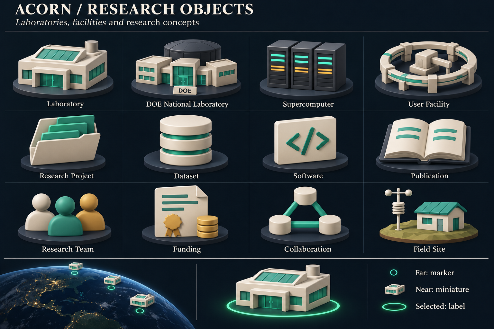

# Outcome

Extend [ABW geospatial 3D work](../acorn-browser-workspace/index.md#abw-37--assess-3d-research-organization-models) with a reproducible, locally owned 3D asset library. The user authorized all remaining assets on November 26, 2026. Risk deliverables belong in `/Users/o9w/dev/risk/assets/models/`, with standalone sources/catalog/build tooling; other models remain in ACORN. Finish **ACORN/research objects → U.S. landmarks → New Seven Wonders plus Giza → Risk pieces**. Do not start the next category before the prior category is accepted.

This plan owns model production and asset-level acceptance. ABW-37 retains live-scene feasibility and production-adoption gates after ABW-18. No asset-production phase changes research schemas, the ROR marker bridge, browser navigation, game rules, release staging, or the live Geospatial page. Game implementation needs a separate plan; creating pieces does not authorize a Risk engine.

# Current evidence

- Verified November 26 at `3eddc62b` plus the existing worktree: `geospatial/src/map.tsx` renders point entities with local basemaps and optional online terrain/buildings; `bridge.ts` restricts marker IDs to ROR URLs. Decorative objects and game pieces need their own runtime identities. Existing concurrent browser changes are outside this write set.
- The accepted user choice is New Seven Wonders plus the Great Pyramid of Giza. Four original design sheets and their exact generation prompts now live under this plan's `_assets/`.
- The first real asset is [supercomputer.glb](../../../crates/acorn-web/assets/models/research/supercomputer.glb), with [editable recipe](../../../crates/acorn-web/assets/models/research/supercomputer.model.json), [catalog](../../../crates/acorn-web/assets/models/catalog.json) and a deterministic [builder](../../../crates/acorn-web/scripts/build-models.py). Its measured artifact size is 189,376 bytes, 2,540 triangles, four nodes and 13 primitives.
- Deterministic regeneration and Khronos validation pass; the [validator report](_assets/supercomputer-validation.json) contains zero errors/warnings. Cesium 1.147.0 loaded the GLB in headless Chromium with no failed responses, page errors or external requests. [Front](_assets/supercomputer-preview.png) and [rear](_assets/supercomputer-preview-rear.png) renders were visually inspected.
- Unresolved: production scene frame time, memory, repeated-instance budgets, terrain clamping, distance switching, mobile rendering and accessibility acceptance. A single model inspection does not satisfy ABW-18 or ABW-37. The model is not yet staged in the browser release or shown on the live page.

# Design assets

| Collection | Reference | Model count |
|---|---|---|
| Research | [Concept sheet](_assets/01-laboratories-and-acorn.png) | 12; supercomputer exists, 11 remain |
| U.S. landmarks | [Concept sheet](_assets/02-us-landmarks.png) | 8 remain |
| World wonders | [Concept sheet](_assets/03-eight-world-wonders.png) | 8 remain |
| Risk | [Concept sheet](_assets/04-risk-globe-pieces.png) | 6 pieces plus 6 reusable faction bases remain |

[Original design brief](_assets/design-brief.txt) and [generation prompts](_assets/generation-prompts.json) preserve the rationale. The original brief's statement that no GLBs exist described the concept-only handoff; the current evidence above supersedes it for the supercomputer. Concept-sheet geography, lighting and game counts are illustrative. The DOE building is a category symbol, not an accurate facility model.

# Managed asset contract

The durable [model asset guide](../../../crates/acorn-web/assets/models/README.md) owns authoring, licensing, rebuilding and validation conventions.

- Canonical runtime artifacts belong in `crates/acorn-web/assets/models/<category>/<name>.glb`, alongside editable `.model.json` sources, with stable IDs in `catalog.json`. This follows crate-owned migrations/prompts rather than storing runtime assets in `output/` or the planning wiki.
- The catalog records revision, source, provenance, license, SHA-256, bytes, bounds, axes, pivot and geometry counts. Regeneration must reproduce committed bytes and metadata. Only catalog-listed runtime assets should enter a future browser/desktop bundle; recipes, previews and design sheets are authoring material.
- Use meters, +Y up, +Z front, a bottom-center pivot, separately addressable pedestal/body, shared materials and self-contained glTF 2.0 GLB. No external-resource dependencies. Distinguish illustrative dimensions from geographic footprints.
- Extend the existing recipe builder with explicit geometry forms as needed within each phase's write set. A model whose silhouette requires more work than the five-hour slice becomes a new bounded phase, retaining the original unfinished ID; do not hide a low-quality placeholder behind the category name.
- Keep each new asset's provenance original and specific. Imported mesh geometry requires a verified license and source before inclusion. Do not infer real organization coordinates from a generic concept.
- Preserve green/amber research status meaning. Object materials, faction identity and selection are separate concerns; labels/counts remain accessible UI content. Risk color and symbol must both be available without depending on seeing under a figure.

# Acceptance and validation

Each phase must deliver recognizable silhouettes matching its sheet, complete editable source and GLB files, deterministic catalog entries, zero Khronos errors/warnings, and inspected front/back/oblique renders in the installed Cesium. Recheck bottom-center pivot, all normals, material contrast, clipping, small-size readability and no external requests. Record triangle, primitive and byte counts; performance limits must come from ABW-18 measurements, not an arbitrary model quota.

Use `python3 crates/acorn-web/scripts/build-models.py --check`, `node crates/acorn-web/scripts/validate-models.mjs /tmp/acorn-model-validation/node_modules/gltf-validator` with the pinned validator installed as documented, and the Cesium smoke harness. Extend the harness to inspect each new asset rather than treating its current supercomputer-only smoke as collection acceptance. The model README is the durable acceptance record; previews/reports are supporting plan artifacts. Run the wiki validator after plan reconciliation.

Risk export phases also own `/Users/o9w/dev/risk/assets/models/catalog.json`, `/Users/o9w/dev/risk/assets/models/README.md`, `/Users/o9w/dev/risk/scripts/build-models.py`, `/Users/o9w/dev/risk/scripts/model-geometry.py`, `/Users/o9w/dev/risk/scripts/model-collection.py`, `/Users/o9w/dev/risk/LICENSE`, and `/Users/o9w/dev/risk/previews/`. Risk recipes may be staged under `/private/tmp/acorn-risk-models/` before verified delivery. Acceptance previews and reports for every phase may be stored under `crates/acorn-web/assets/models/previews/` and `validation.json`; durable collection evidence replaces the completed plan on retirement.

# Dependencies and ownership

Asset creation does not wait for ABW-18, ABW-37 or ABW-72. GEO-02 is ready; subsequent phases are serial in the requested category order. All phases share one primary model-library lock on catalog/generator/validation scripts. ABW runtime phases retain their map-island and loaded-state locks. Do not edit their files during asset production.

The common maintenance write set, included explicitly in each phase below, covers this plan, its ABW entrypoint, affected feature/root indexes, dependency network, lane guide and the focused progress checkpoint. Prune each accepted phase and make its immediate successor ready. Keep completed supercomputer work in current evidence and durable asset documentation.

# Execution phases

## GEO-02 — Research buildings and facility

- Status: in-progress
- Budget: 5 active hours maximum
- Prerequisites: none; accepted supercomputer baseline and asset contract
- Exact write set: `crates/acorn-web/assets/models/research/laboratory.model.json`, `crates/acorn-web/assets/models/research/laboratory.glb`, `.wiki/features/geospatial-objects/_assets/laboratory-preview.png`, `.wiki/features/geospatial-objects/_assets/laboratory-preview-rear.png`, `crates/acorn-web/assets/models/research/doe-national-laboratory.model.json`, `crates/acorn-web/assets/models/research/doe-national-laboratory.glb`, `.wiki/features/geospatial-objects/_assets/doe-national-laboratory-preview.png`, `.wiki/features/geospatial-objects/_assets/doe-national-laboratory-preview-rear.png`, `crates/acorn-web/assets/models/research/user-facility.model.json`, `crates/acorn-web/assets/models/research/user-facility.glb`, `.wiki/features/geospatial-objects/_assets/user-facility-preview.png`, `.wiki/features/geospatial-objects/_assets/user-facility-preview-rear.png`, `crates/acorn-web/assets/models/catalog.json`, `crates/acorn-web/assets/models/README.md`, `crates/acorn-web/scripts/build-models.py`, `crates/acorn-web/scripts/model-geometry.py`, `crates/acorn-web/scripts/model-collection.py`, `crates/acorn-web/scripts/model-collection-smoke.mjs`, `crates/acorn-web/scripts/model-viewer.mjs`, `crates/acorn-web/scripts/model-viewer/viewer.js`, `crates/acorn-web/scripts/model-viewer-smoke.mjs`, `Cargo.toml`, `ARCHITECTURE.md`, `README.md`, `crates/acorn-web/README.md`, `crates/acorn-web/scripts/validate-models.mjs`, `crates/acorn-web/scripts/models-smoke.mjs`, `.wiki/features/geospatial-objects/index.md`, `.wiki/features/acorn-browser-workspace/index.md`, `.wiki/features/index.md`, `.wiki/index.md`, `.wiki/plan-network.md`, `.wiki/parallel-execution.md`, `progress.md`
- Primary integration lock: Geospatial model library catalog and authoring pipeline
- Outcome: Three distinct scientific-building silhouettes; keep the DOE campus generic and the facility ring illustrative.
- Focused validation: Rebuild/check byte equality; pinned Khronos validation and catalog checks; extend/run the Cesium harness for each listed asset, inspect front/rear and oblique/small-size views, check axes/pivot/materials and no external requests; run the wiki validator. Preserve measured artifact counts in the model README.
- Handoff: Remove this accepted phase, preserve its durable asset evidence, and make GEO-03 ready.

## GEO-03 — Research records and outputs

- Status: planned
- Budget: 5 active hours maximum
- Prerequisites: GEO-02
- Exact write set: `crates/acorn-web/assets/models/research/research-project.model.json`, `crates/acorn-web/assets/models/research/research-project.glb`, `.wiki/features/geospatial-objects/_assets/research-project-preview.png`, `.wiki/features/geospatial-objects/_assets/research-project-preview-rear.png`, `crates/acorn-web/assets/models/research/dataset.model.json`, `crates/acorn-web/assets/models/research/dataset.glb`, `.wiki/features/geospatial-objects/_assets/dataset-preview.png`, `.wiki/features/geospatial-objects/_assets/dataset-preview-rear.png`, `crates/acorn-web/assets/models/research/software.model.json`, `crates/acorn-web/assets/models/research/software.glb`, `.wiki/features/geospatial-objects/_assets/software-preview.png`, `.wiki/features/geospatial-objects/_assets/software-preview-rear.png`, `crates/acorn-web/assets/models/research/publication.model.json`, `crates/acorn-web/assets/models/research/publication.glb`, `.wiki/features/geospatial-objects/_assets/publication-preview.png`, `.wiki/features/geospatial-objects/_assets/publication-preview-rear.png`, `crates/acorn-web/assets/models/catalog.json`, `crates/acorn-web/assets/models/README.md`, `crates/acorn-web/scripts/build-models.py`, `crates/acorn-web/scripts/model-geometry.py`, `crates/acorn-web/scripts/model-collection.py`, `crates/acorn-web/scripts/model-collection-smoke.mjs`, `crates/acorn-web/scripts/model-viewer.mjs`, `crates/acorn-web/scripts/model-viewer/viewer.js`, `crates/acorn-web/scripts/model-viewer-smoke.mjs`, `Cargo.toml`, `ARCHITECTURE.md`, `README.md`, `crates/acorn-web/README.md`, `crates/acorn-web/scripts/validate-models.mjs`, `crates/acorn-web/scripts/models-smoke.mjs`, `.wiki/features/geospatial-objects/index.md`, `.wiki/features/acorn-browser-workspace/index.md`, `.wiki/features/index.md`, `.wiki/index.md`, `.wiki/plan-network.md`, `.wiki/parallel-execution.md`, `progress.md`
- Primary integration lock: Geospatial model library catalog and authoring pipeline
- Outcome: Four research record/output models recognizable at small screen sizes.
- Focused validation: Rebuild/check byte equality; pinned Khronos validation and catalog checks; extend/run the Cesium harness for each listed asset, inspect front/rear and oblique/small-size views, check axes/pivot/materials and no external requests; run the wiki validator. Preserve measured artifact counts in the model README.
- Handoff: Remove this accepted phase, preserve its durable asset evidence, and make GEO-04 ready.

## GEO-04 — People, funding and field research

- Status: planned
- Budget: 5 active hours maximum
- Prerequisites: GEO-03
- Exact write set: `crates/acorn-web/assets/models/research/research-team.model.json`, `crates/acorn-web/assets/models/research/research-team.glb`, `.wiki/features/geospatial-objects/_assets/research-team-preview.png`, `.wiki/features/geospatial-objects/_assets/research-team-preview-rear.png`, `crates/acorn-web/assets/models/research/funding.model.json`, `crates/acorn-web/assets/models/research/funding.glb`, `.wiki/features/geospatial-objects/_assets/funding-preview.png`, `.wiki/features/geospatial-objects/_assets/funding-preview-rear.png`, `crates/acorn-web/assets/models/research/collaboration.model.json`, `crates/acorn-web/assets/models/research/collaboration.glb`, `.wiki/features/geospatial-objects/_assets/collaboration-preview.png`, `.wiki/features/geospatial-objects/_assets/collaboration-preview-rear.png`, `crates/acorn-web/assets/models/research/field-site.model.json`, `crates/acorn-web/assets/models/research/field-site.glb`, `.wiki/features/geospatial-objects/_assets/field-site-preview.png`, `.wiki/features/geospatial-objects/_assets/field-site-preview-rear.png`, `crates/acorn-web/assets/models/catalog.json`, `crates/acorn-web/assets/models/README.md`, `crates/acorn-web/scripts/build-models.py`, `crates/acorn-web/scripts/model-geometry.py`, `crates/acorn-web/scripts/model-collection.py`, `crates/acorn-web/scripts/model-collection-smoke.mjs`, `crates/acorn-web/scripts/model-viewer.mjs`, `crates/acorn-web/scripts/model-viewer/viewer.js`, `crates/acorn-web/scripts/model-viewer-smoke.mjs`, `Cargo.toml`, `ARCHITECTURE.md`, `README.md`, `crates/acorn-web/README.md`, `crates/acorn-web/scripts/validate-models.mjs`, `crates/acorn-web/scripts/models-smoke.mjs`, `.wiki/features/geospatial-objects/index.md`, `.wiki/features/acorn-browser-workspace/index.md`, `.wiki/features/index.md`, `.wiki/index.md`, `.wiki/plan-network.md`, `.wiki/parallel-execution.md`, `progress.md`
- Primary integration lock: Geospatial model library catalog and authoring pipeline
- Outcome: Finish the research collection with people, grant, network and field-site models.
- Focused validation: Rebuild/check byte equality; pinned Khronos validation and catalog checks; extend/run the Cesium harness for each listed asset, inspect front/rear and oblique/small-size views, check axes/pivot/materials and no external requests; run the wiki validator. Preserve measured artifact counts in the model README.
- Handoff: Remove this accepted phase, preserve its durable asset evidence, and make GEO-05 ready.

## GEO-05 — Liberty and Golden Gate

- Status: planned
- Budget: 5 active hours maximum
- Prerequisites: GEO-04; all research objects accepted
- Exact write set: `crates/acorn-web/assets/models/landmarks/statue-of-liberty.model.json`, `crates/acorn-web/assets/models/landmarks/statue-of-liberty.glb`, `.wiki/features/geospatial-objects/_assets/statue-of-liberty-preview.png`, `.wiki/features/geospatial-objects/_assets/statue-of-liberty-preview-rear.png`, `crates/acorn-web/assets/models/landmarks/golden-gate-bridge.model.json`, `crates/acorn-web/assets/models/landmarks/golden-gate-bridge.glb`, `.wiki/features/geospatial-objects/_assets/golden-gate-bridge-preview.png`, `.wiki/features/geospatial-objects/_assets/golden-gate-bridge-preview-rear.png`, `crates/acorn-web/assets/models/catalog.json`, `crates/acorn-web/assets/models/README.md`, `crates/acorn-web/scripts/build-models.py`, `crates/acorn-web/scripts/model-geometry.py`, `crates/acorn-web/scripts/model-collection.py`, `crates/acorn-web/scripts/model-collection-smoke.mjs`, `crates/acorn-web/scripts/model-viewer.mjs`, `crates/acorn-web/scripts/model-viewer/viewer.js`, `crates/acorn-web/scripts/model-viewer-smoke.mjs`, `Cargo.toml`, `ARCHITECTURE.md`, `README.md`, `crates/acorn-web/README.md`, `crates/acorn-web/scripts/validate-models.mjs`, `crates/acorn-web/scripts/models-smoke.mjs`, `.wiki/features/geospatial-objects/index.md`, `.wiki/features/acorn-browser-workspace/index.md`, `.wiki/features/index.md`, `.wiki/index.md`, `.wiki/plan-network.md`, `.wiki/parallel-execution.md`, `progress.md`
- Primary integration lock: Geospatial model library catalog and authoring pipeline
- Outcome: Copper statue and vermilion bridge with robust torch, crown and cable silhouettes.
- Focused validation: Rebuild/check byte equality; pinned Khronos validation and catalog checks; extend/run the Cesium harness for each listed asset, inspect front/rear and oblique/small-size views, check axes/pivot/materials and no external requests; run the wiki validator. Preserve measured artifact counts in the model README.
- Handoff: Remove this accepted phase, preserve its durable asset evidence, and make GEO-06 ready.

## GEO-06 — Capitol and Gateway Arch

- Status: planned
- Budget: 5 active hours maximum
- Prerequisites: GEO-05
- Exact write set: `crates/acorn-web/assets/models/landmarks/us-capitol.model.json`, `crates/acorn-web/assets/models/landmarks/us-capitol.glb`, `.wiki/features/geospatial-objects/_assets/us-capitol-preview.png`, `.wiki/features/geospatial-objects/_assets/us-capitol-preview-rear.png`, `crates/acorn-web/assets/models/landmarks/gateway-arch.model.json`, `crates/acorn-web/assets/models/landmarks/gateway-arch.glb`, `.wiki/features/geospatial-objects/_assets/gateway-arch-preview.png`, `.wiki/features/geospatial-objects/_assets/gateway-arch-preview-rear.png`, `crates/acorn-web/assets/models/catalog.json`, `crates/acorn-web/assets/models/README.md`, `crates/acorn-web/scripts/build-models.py`, `crates/acorn-web/scripts/model-geometry.py`, `crates/acorn-web/scripts/model-collection.py`, `crates/acorn-web/scripts/model-collection-smoke.mjs`, `crates/acorn-web/scripts/model-viewer.mjs`, `crates/acorn-web/scripts/model-viewer/viewer.js`, `crates/acorn-web/scripts/model-viewer-smoke.mjs`, `Cargo.toml`, `ARCHITECTURE.md`, `README.md`, `crates/acorn-web/README.md`, `crates/acorn-web/scripts/validate-models.mjs`, `crates/acorn-web/scripts/models-smoke.mjs`, `.wiki/features/geospatial-objects/index.md`, `.wiki/features/acorn-browser-workspace/index.md`, `.wiki/features/index.md`, `.wiki/index.md`, `.wiki/plan-network.md`, `.wiki/parallel-execution.md`, `progress.md`
- Primary integration lock: Geospatial model library catalog and authoring pipeline
- Outcome: Recognizable dome/wings and open arch, with separate pedestals.
- Focused validation: Rebuild/check byte equality; pinned Khronos validation and catalog checks; extend/run the Cesium harness for each listed asset, inspect front/rear and oblique/small-size views, check axes/pivot/materials and no external requests; run the wiki validator. Preserve measured artifact counts in the model README.
- Handoff: Remove this accepted phase, preserve its durable asset evidence, and make GEO-07 ready.

## GEO-07 — Canyon and Yellowstone

- Status: planned
- Budget: 5 active hours maximum
- Prerequisites: GEO-06
- Exact write set: `crates/acorn-web/assets/models/landmarks/grand-canyon.model.json`, `crates/acorn-web/assets/models/landmarks/grand-canyon.glb`, `.wiki/features/geospatial-objects/_assets/grand-canyon-preview.png`, `.wiki/features/geospatial-objects/_assets/grand-canyon-preview-rear.png`, `crates/acorn-web/assets/models/landmarks/yellowstone.model.json`, `crates/acorn-web/assets/models/landmarks/yellowstone.glb`, `.wiki/features/geospatial-objects/_assets/yellowstone-preview.png`, `.wiki/features/geospatial-objects/_assets/yellowstone-preview-rear.png`, `crates/acorn-web/assets/models/catalog.json`, `crates/acorn-web/assets/models/README.md`, `crates/acorn-web/scripts/build-models.py`, `crates/acorn-web/scripts/model-geometry.py`, `crates/acorn-web/scripts/model-collection.py`, `crates/acorn-web/scripts/model-collection-smoke.mjs`, `crates/acorn-web/scripts/model-viewer.mjs`, `crates/acorn-web/scripts/model-viewer/viewer.js`, `crates/acorn-web/scripts/model-viewer-smoke.mjs`, `Cargo.toml`, `ARCHITECTURE.md`, `README.md`, `crates/acorn-web/README.md`, `crates/acorn-web/scripts/validate-models.mjs`, `crates/acorn-web/scripts/models-smoke.mjs`, `.wiki/features/geospatial-objects/index.md`, `.wiki/features/acorn-browser-workspace/index.md`, `.wiki/features/index.md`, `.wiki/index.md`, `.wiki/plan-network.md`, `.wiki/parallel-execution.md`, `progress.md`
- Primary integration lock: Geospatial model library catalog and authoring pipeline
- Outcome: Two terrain miniatures, with distinct canyon/river and mineral-basin/vent geometry; Yellowstone is a composite location symbol.
- Focused validation: Rebuild/check byte equality; pinned Khronos validation and catalog checks; extend/run the Cesium harness for each listed asset, inspect front/rear and oblique/small-size views, check axes/pivot/materials and no external requests; run the wiki validator. Preserve measured artifact counts in the model README.
- Handoff: Remove this accepted phase, preserve its durable asset evidence, and make GEO-08 ready.

## GEO-08 — Space center and Hoover Dam

- Status: planned
- Budget: 5 active hours maximum
- Prerequisites: GEO-07
- Exact write set: `crates/acorn-web/assets/models/landmarks/kennedy-space-center.model.json`, `crates/acorn-web/assets/models/landmarks/kennedy-space-center.glb`, `.wiki/features/geospatial-objects/_assets/kennedy-space-center-preview.png`, `.wiki/features/geospatial-objects/_assets/kennedy-space-center-preview-rear.png`, `crates/acorn-web/assets/models/landmarks/hoover-dam.model.json`, `crates/acorn-web/assets/models/landmarks/hoover-dam.glb`, `.wiki/features/geospatial-objects/_assets/hoover-dam-preview.png`, `.wiki/features/geospatial-objects/_assets/hoover-dam-preview-rear.png`, `crates/acorn-web/assets/models/catalog.json`, `crates/acorn-web/assets/models/README.md`, `crates/acorn-web/scripts/build-models.py`, `crates/acorn-web/scripts/model-geometry.py`, `crates/acorn-web/scripts/model-collection.py`, `crates/acorn-web/scripts/model-collection-smoke.mjs`, `crates/acorn-web/scripts/model-viewer.mjs`, `crates/acorn-web/scripts/model-viewer/viewer.js`, `crates/acorn-web/scripts/model-viewer-smoke.mjs`, `Cargo.toml`, `ARCHITECTURE.md`, `README.md`, `crates/acorn-web/README.md`, `crates/acorn-web/scripts/validate-models.mjs`, `crates/acorn-web/scripts/models-smoke.mjs`, `.wiki/features/geospatial-objects/index.md`, `.wiki/features/acorn-browser-workspace/index.md`, `.wiki/features/index.md`, `.wiki/index.md`, `.wiki/plan-network.md`, `.wiki/parallel-execution.md`, `progress.md`
- Primary integration lock: Geospatial model library catalog and authoring pipeline
- Outcome: Finish U.S. landmarks with a generic rocket/gantry and curved dam/cliff model, without vendor branding.
- Focused validation: Rebuild/check byte equality; pinned Khronos validation and catalog checks; extend/run the Cesium harness for each listed asset, inspect front/rear and oblique/small-size views, check axes/pivot/materials and no external requests; run the wiki validator. Preserve measured artifact counts in the model README.
- Handoff: Remove this accepted phase, preserve its durable asset evidence, and make GEO-09 ready.

## GEO-09 — Great Wall and Petra

- Status: planned
- Budget: 5 active hours maximum
- Prerequisites: GEO-08; all U.S. landmarks accepted
- Exact write set: `crates/acorn-web/assets/models/wonders/great-wall.model.json`, `crates/acorn-web/assets/models/wonders/great-wall.glb`, `.wiki/features/geospatial-objects/_assets/great-wall-preview.png`, `.wiki/features/geospatial-objects/_assets/great-wall-preview-rear.png`, `crates/acorn-web/assets/models/wonders/petra.model.json`, `crates/acorn-web/assets/models/wonders/petra.glb`, `.wiki/features/geospatial-objects/_assets/petra-preview.png`, `.wiki/features/geospatial-objects/_assets/petra-preview-rear.png`, `crates/acorn-web/assets/models/catalog.json`, `crates/acorn-web/assets/models/README.md`, `crates/acorn-web/scripts/build-models.py`, `crates/acorn-web/scripts/model-geometry.py`, `crates/acorn-web/scripts/model-collection.py`, `crates/acorn-web/scripts/model-collection-smoke.mjs`, `crates/acorn-web/scripts/model-viewer.mjs`, `crates/acorn-web/scripts/model-viewer/viewer.js`, `crates/acorn-web/scripts/model-viewer-smoke.mjs`, `Cargo.toml`, `ARCHITECTURE.md`, `README.md`, `crates/acorn-web/README.md`, `crates/acorn-web/scripts/validate-models.mjs`, `crates/acorn-web/scripts/models-smoke.mjs`, `.wiki/features/geospatial-objects/index.md`, `.wiki/features/acorn-browser-workspace/index.md`, `.wiki/features/index.md`, `.wiki/index.md`, `.wiki/plan-network.md`, `.wiki/parallel-execution.md`, `progress.md`
- Primary integration lock: Geospatial model library catalog and authoring pipeline
- Outcome: Wall/watchtower/hill and sandstone-facade miniatures, preserving their defining silhouettes.
- Focused validation: Rebuild/check byte equality; pinned Khronos validation and catalog checks; extend/run the Cesium harness for each listed asset, inspect front/rear and oblique/small-size views, check axes/pivot/materials and no external requests; run the wiki validator. Preserve measured artifact counts in the model README.
- Handoff: Remove this accepted phase, preserve its durable asset evidence, and make GEO-10 ready.

## GEO-10 — Redeemer and Machu Picchu

- Status: planned
- Budget: 5 active hours maximum
- Prerequisites: GEO-09
- Exact write set: `crates/acorn-web/assets/models/wonders/christ-the-redeemer.model.json`, `crates/acorn-web/assets/models/wonders/christ-the-redeemer.glb`, `.wiki/features/geospatial-objects/_assets/christ-the-redeemer-preview.png`, `.wiki/features/geospatial-objects/_assets/christ-the-redeemer-preview-rear.png`, `crates/acorn-web/assets/models/wonders/machu-picchu.model.json`, `crates/acorn-web/assets/models/wonders/machu-picchu.glb`, `.wiki/features/geospatial-objects/_assets/machu-picchu-preview.png`, `.wiki/features/geospatial-objects/_assets/machu-picchu-preview-rear.png`, `crates/acorn-web/assets/models/catalog.json`, `crates/acorn-web/assets/models/README.md`, `crates/acorn-web/scripts/build-models.py`, `crates/acorn-web/scripts/model-geometry.py`, `crates/acorn-web/scripts/model-collection.py`, `crates/acorn-web/scripts/model-collection-smoke.mjs`, `crates/acorn-web/scripts/model-viewer.mjs`, `crates/acorn-web/scripts/model-viewer/viewer.js`, `crates/acorn-web/scripts/model-viewer-smoke.mjs`, `Cargo.toml`, `ARCHITECTURE.md`, `README.md`, `crates/acorn-web/README.md`, `crates/acorn-web/scripts/validate-models.mjs`, `crates/acorn-web/scripts/models-smoke.mjs`, `.wiki/features/geospatial-objects/index.md`, `.wiki/features/acorn-browser-workspace/index.md`, `.wiki/features/index.md`, `.wiki/index.md`, `.wiki/plan-network.md`, `.wiki/parallel-execution.md`, `progress.md`
- Primary integration lock: Geospatial model library catalog and authoring pipeline
- Outcome: Outstretched statue and terraced mountain-city models, readable from oblique views.
- Focused validation: Rebuild/check byte equality; pinned Khronos validation and catalog checks; extend/run the Cesium harness for each listed asset, inspect front/rear and oblique/small-size views, check axes/pivot/materials and no external requests; run the wiki validator. Preserve measured artifact counts in the model README.
- Handoff: Remove this accepted phase, preserve its durable asset evidence, and make GEO-11 ready.

## GEO-11 — Chichen Itza and Colosseum

- Status: planned
- Budget: 5 active hours maximum
- Prerequisites: GEO-10
- Exact write set: `crates/acorn-web/assets/models/wonders/chichen-itza.model.json`, `crates/acorn-web/assets/models/wonders/chichen-itza.glb`, `.wiki/features/geospatial-objects/_assets/chichen-itza-preview.png`, `.wiki/features/geospatial-objects/_assets/chichen-itza-preview-rear.png`, `crates/acorn-web/assets/models/wonders/colosseum.model.json`, `crates/acorn-web/assets/models/wonders/colosseum.glb`, `.wiki/features/geospatial-objects/_assets/colosseum-preview.png`, `.wiki/features/geospatial-objects/_assets/colosseum-preview-rear.png`, `crates/acorn-web/assets/models/catalog.json`, `crates/acorn-web/assets/models/README.md`, `crates/acorn-web/scripts/build-models.py`, `crates/acorn-web/scripts/model-geometry.py`, `crates/acorn-web/scripts/model-collection.py`, `crates/acorn-web/scripts/model-collection-smoke.mjs`, `crates/acorn-web/scripts/model-viewer.mjs`, `crates/acorn-web/scripts/model-viewer/viewer.js`, `crates/acorn-web/scripts/model-viewer-smoke.mjs`, `Cargo.toml`, `ARCHITECTURE.md`, `README.md`, `crates/acorn-web/README.md`, `crates/acorn-web/scripts/validate-models.mjs`, `crates/acorn-web/scripts/models-smoke.mjs`, `.wiki/features/geospatial-objects/index.md`, `.wiki/features/acorn-browser-workspace/index.md`, `.wiki/features/index.md`, `.wiki/index.md`, `.wiki/plan-network.md`, `.wiki/parallel-execution.md`, `progress.md`
- Primary integration lock: Geospatial model library catalog and authoring pipeline
- Outcome: Stepped pyramid and elliptical amphitheater, with simplified stairs/arches and no disappearing thin walls.
- Focused validation: Rebuild/check byte equality; pinned Khronos validation and catalog checks; extend/run the Cesium harness for each listed asset, inspect front/rear and oblique/small-size views, check axes/pivot/materials and no external requests; run the wiki validator. Preserve measured artifact counts in the model README.
- Handoff: Remove this accepted phase, preserve its durable asset evidence, and make GEO-12 ready.

## GEO-12 — Taj Mahal and Giza

- Status: planned
- Budget: 5 active hours maximum
- Prerequisites: GEO-11
- Exact write set: `crates/acorn-web/assets/models/wonders/taj-mahal.model.json`, `crates/acorn-web/assets/models/wonders/taj-mahal.glb`, `.wiki/features/geospatial-objects/_assets/taj-mahal-preview.png`, `.wiki/features/geospatial-objects/_assets/taj-mahal-preview-rear.png`, `crates/acorn-web/assets/models/wonders/great-pyramid-of-giza.model.json`, `crates/acorn-web/assets/models/wonders/great-pyramid-of-giza.glb`, `.wiki/features/geospatial-objects/_assets/great-pyramid-of-giza-preview.png`, `.wiki/features/geospatial-objects/_assets/great-pyramid-of-giza-preview-rear.png`, `crates/acorn-web/assets/models/catalog.json`, `crates/acorn-web/assets/models/README.md`, `crates/acorn-web/scripts/build-models.py`, `crates/acorn-web/scripts/model-geometry.py`, `crates/acorn-web/scripts/model-collection.py`, `crates/acorn-web/scripts/model-collection-smoke.mjs`, `crates/acorn-web/scripts/model-viewer.mjs`, `crates/acorn-web/scripts/model-viewer/viewer.js`, `crates/acorn-web/scripts/model-viewer-smoke.mjs`, `Cargo.toml`, `ARCHITECTURE.md`, `README.md`, `crates/acorn-web/README.md`, `crates/acorn-web/scripts/validate-models.mjs`, `crates/acorn-web/scripts/models-smoke.mjs`, `.wiki/features/geospatial-objects/index.md`, `.wiki/features/acorn-browser-workspace/index.md`, `.wiki/features/index.md`, `.wiki/index.md`, `.wiki/plan-network.md`, `.wiki/parallel-execution.md`, `progress.md`
- Primary integration lock: Geospatial model library catalog and authoring pipeline
- Outcome: Finish the agreed eight wonders with domes/minarets and one dominant pyramid with companions.
- Focused validation: Rebuild/check byte equality; pinned Khronos validation and catalog checks; extend/run the Cesium harness for each listed asset, inspect front/rear and oblique/small-size views, check axes/pivot/materials and no external requests; run the wiki validator. Preserve measured artifact counts in the model README.
- Handoff: Remove this accepted phase, preserve its durable asset evidence, and make GEO-13 ready.

## GEO-13 — Classic Risk pieces

- Status: planned
- Budget: 5 active hours maximum
- Prerequisites: GEO-12; all world wonders accepted
- Exact write set: `/Users/o9w/dev/risk/assets/models/risk/infantry.model.json`, `/Users/o9w/dev/risk/assets/models/risk/infantry.glb`, `.wiki/features/geospatial-objects/_assets/infantry-preview.png`, `.wiki/features/geospatial-objects/_assets/infantry-preview-rear.png`, `/Users/o9w/dev/risk/assets/models/risk/cavalry.model.json`, `/Users/o9w/dev/risk/assets/models/risk/cavalry.glb`, `.wiki/features/geospatial-objects/_assets/cavalry-preview.png`, `.wiki/features/geospatial-objects/_assets/cavalry-preview-rear.png`, `/Users/o9w/dev/risk/assets/models/risk/artillery.model.json`, `/Users/o9w/dev/risk/assets/models/risk/artillery.glb`, `.wiki/features/geospatial-objects/_assets/artillery-preview.png`, `.wiki/features/geospatial-objects/_assets/artillery-preview-rear.png`, `crates/acorn-web/assets/models/catalog.json`, `crates/acorn-web/assets/models/README.md`, `crates/acorn-web/scripts/build-models.py`, `crates/acorn-web/scripts/model-geometry.py`, `crates/acorn-web/scripts/model-collection.py`, `crates/acorn-web/scripts/model-collection-smoke.mjs`, `crates/acorn-web/scripts/model-viewer.mjs`, `crates/acorn-web/scripts/model-viewer/viewer.js`, `crates/acorn-web/scripts/model-viewer-smoke.mjs`, `Cargo.toml`, `ARCHITECTURE.md`, `README.md`, `crates/acorn-web/README.md`, `crates/acorn-web/scripts/validate-models.mjs`, `crates/acorn-web/scripts/models-smoke.mjs`, `.wiki/features/geospatial-objects/index.md`, `.wiki/features/acorn-browser-workspace/index.md`, `.wiki/features/index.md`, `.wiki/index.md`, `.wiki/plan-network.md`, `.wiki/parallel-execution.md`, `progress.md`
- Primary integration lock: Geospatial model library catalog and authoring pipeline
- Outcome: Original classic-style denominations 1/5/10, each with separately addressable pedestal and body, avoiding copies of commercial sculpts.
- Focused validation: Rebuild/check byte equality; pinned Khronos validation and catalog checks; extend/run the Cesium harness for each listed asset, inspect front/rear and oblique/small-size views, check axes/pivot/materials and no external requests; run the wiki validator. Preserve measured artifact counts in the model README.
- Handoff: Remove this accepted phase, preserve its durable asset evidence, and make GEO-14 ready.

## GEO-14 — Abstract Risk pieces

- Status: planned
- Budget: 5 active hours maximum
- Prerequisites: GEO-13
- Exact write set: `/Users/o9w/dev/risk/assets/models/risk/scout.model.json`, `/Users/o9w/dev/risk/assets/models/risk/scout.glb`, `.wiki/features/geospatial-objects/_assets/scout-preview.png`, `.wiki/features/geospatial-objects/_assets/scout-preview-rear.png`, `/Users/o9w/dev/risk/assets/models/risk/squadron.model.json`, `/Users/o9w/dev/risk/assets/models/risk/squadron.glb`, `.wiki/features/geospatial-objects/_assets/squadron-preview.png`, `.wiki/features/geospatial-objects/_assets/squadron-preview-rear.png`, `/Users/o9w/dev/risk/assets/models/risk/legion.model.json`, `/Users/o9w/dev/risk/assets/models/risk/legion.glb`, `.wiki/features/geospatial-objects/_assets/legion-preview.png`, `.wiki/features/geospatial-objects/_assets/legion-preview-rear.png`, `crates/acorn-web/assets/models/catalog.json`, `crates/acorn-web/assets/models/README.md`, `crates/acorn-web/scripts/build-models.py`, `crates/acorn-web/scripts/model-geometry.py`, `crates/acorn-web/scripts/model-collection.py`, `crates/acorn-web/scripts/model-collection-smoke.mjs`, `crates/acorn-web/scripts/model-viewer.mjs`, `crates/acorn-web/scripts/model-viewer/viewer.js`, `crates/acorn-web/scripts/model-viewer-smoke.mjs`, `Cargo.toml`, `ARCHITECTURE.md`, `README.md`, `crates/acorn-web/README.md`, `crates/acorn-web/scripts/validate-models.mjs`, `crates/acorn-web/scripts/models-smoke.mjs`, `.wiki/features/geospatial-objects/index.md`, `.wiki/features/acorn-browser-workspace/index.md`, `.wiki/features/index.md`, `.wiki/index.md`, `.wiki/plan-network.md`, `.wiki/parallel-execution.md`, `progress.md`
- Primary integration lock: Geospatial model library catalog and authoring pipeline
- Outcome: Alternative obelisk/rook/fortress denomination silhouettes; these are alternate appearances, not new game rules.
- Focused validation: Rebuild/check byte equality; pinned Khronos validation and catalog checks; extend/run the Cesium harness for each listed asset, inspect front/rear and oblique/small-size views, check axes/pivot/materials and no external requests; run the wiki validator. Preserve measured artifact counts in the model README.
- Handoff: Remove this accepted phase, preserve its durable asset evidence, and make GEO-15 ready.

## GEO-15 — Risk faction bases and collection acceptance

- Status: planned
- Budget: 5 active hours maximum
- Prerequisites: GEO-14
- Exact write set: `/Users/o9w/dev/risk/assets/models/risk/base-circle.model.json`, `/Users/o9w/dev/risk/assets/models/risk/base-circle.glb`, `.wiki/features/geospatial-objects/_assets/base-circle-preview.png`, `.wiki/features/geospatial-objects/_assets/base-circle-preview-rear.png`, `/Users/o9w/dev/risk/assets/models/risk/base-triangle.model.json`, `/Users/o9w/dev/risk/assets/models/risk/base-triangle.glb`, `.wiki/features/geospatial-objects/_assets/base-triangle-preview.png`, `.wiki/features/geospatial-objects/_assets/base-triangle-preview-rear.png`, `/Users/o9w/dev/risk/assets/models/risk/base-diamond.model.json`, `/Users/o9w/dev/risk/assets/models/risk/base-diamond.glb`, `.wiki/features/geospatial-objects/_assets/base-diamond-preview.png`, `.wiki/features/geospatial-objects/_assets/base-diamond-preview-rear.png`, `/Users/o9w/dev/risk/assets/models/risk/base-square.model.json`, `/Users/o9w/dev/risk/assets/models/risk/base-square.glb`, `.wiki/features/geospatial-objects/_assets/base-square-preview.png`, `.wiki/features/geospatial-objects/_assets/base-square-preview-rear.png`, `/Users/o9w/dev/risk/assets/models/risk/base-plus.model.json`, `/Users/o9w/dev/risk/assets/models/risk/base-plus.glb`, `.wiki/features/geospatial-objects/_assets/base-plus-preview.png`, `.wiki/features/geospatial-objects/_assets/base-plus-preview-rear.png`, `/Users/o9w/dev/risk/assets/models/risk/base-star.model.json`, `/Users/o9w/dev/risk/assets/models/risk/base-star.glb`, `.wiki/features/geospatial-objects/_assets/base-star-preview.png`, `.wiki/features/geospatial-objects/_assets/base-star-preview-rear.png`, `crates/acorn-web/assets/models/catalog.json`, `crates/acorn-web/assets/models/README.md`, `crates/acorn-web/scripts/build-models.py`, `crates/acorn-web/scripts/model-geometry.py`, `crates/acorn-web/scripts/model-collection.py`, `crates/acorn-web/scripts/model-collection-smoke.mjs`, `crates/acorn-web/scripts/model-viewer.mjs`, `crates/acorn-web/scripts/model-viewer/viewer.js`, `crates/acorn-web/scripts/model-viewer-smoke.mjs`, `Cargo.toml`, `ARCHITECTURE.md`, `README.md`, `crates/acorn-web/README.md`, `crates/acorn-web/scripts/validate-models.mjs`, `crates/acorn-web/scripts/models-smoke.mjs`, `.wiki/features/geospatial-objects/index.md`, `.wiki/features/acorn-browser-workspace/index.md`, `.wiki/features/index.md`, `.wiki/index.md`, `.wiki/plan-network.md`, `.wiki/parallel-execution.md`, `progress.md`
- Primary integration lock: Geospatial model library catalog and authoring pipeline
- Outcome: Six independent faction bases with embossed symbols and contrasting colors; validate the complete 34-object plus six-base library and material compatibility with both Risk families.
- Focused validation: Rebuild/check byte equality; pinned Khronos validation and catalog checks; extend/run the Cesium harness for each listed asset, inspect front/rear and oblique/small-size views, check axes/pivot/materials and no external requests; run the wiki validator. Preserve measured artifact counts in the model README.
- Handoff: Preserve final collection inventory and validation in the model README, retire this child plan and update inbound links; ABW-37 still gates runtime adoption.
