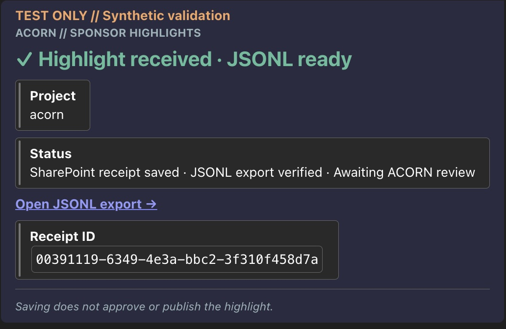
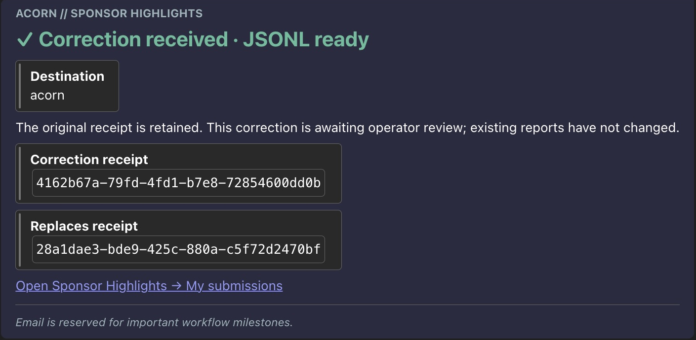

# Teams notification hierarchy

Deployed October 27, 2026. Original-submission owner and contributor notices, both correction notices, and the routine callback Teams template use a green heading, bold labels, indented bordered detail blocks, a divider and muted italic notes. Test-only original submissions use an amber banner. Untrusted project and receipt text remains HTML-escaped.

These are cropped real Teams screenshots containing synthetic receipts only. The client chose its own dark-mode border/background colors while retaining the hierarchy. The guides use fictional examples and identify them as illustrations.

Owner-context original receipt `00391119-6349-4e3a-bbc2-3f310f458d7a` and correction `4162b67a-79fd-4fd1-b7e8-72854600dd0b` returned confirmed exports and delivered the notices shown. The original owner action was read back from Peek code after Save (`owner-deployed.json`). Contributor templates and the routine callback saved successfully. The later standard-license correction run delivered both notices, and the user confirmed the contributor saw the Teams receipt. A fresh routine callback rendering check has not been performed. No synthetic milestone email was sent for this styling change.

Routing, newly-created/verified-export guards, exact-replay suppression, secure inputs/outputs, disabled send retries, and milestone-only email are preserved. Callback Body Content type is now explicitly `html`; the previous action was plain text. Receipt tracking and email actions were not changed.

`*-before` assets preserve the prior presentation. `owner-message.html`, `submitter-message.html`, `callback-message.html` and the submission-editing `correction-message.html` hold current templates. Do not replace live routing or account references with sanitized placeholders. Teams may simplify CSS; semantic heading, bold, blockquote, code and italic elements preserve a readable fallback.
