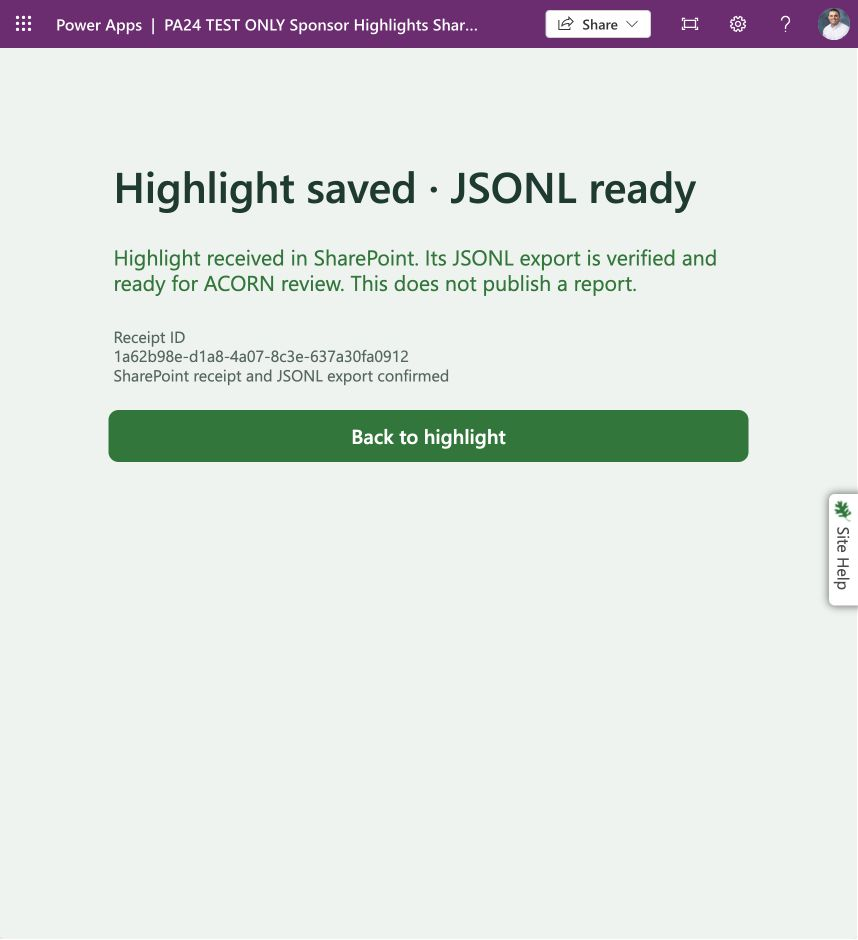

# Accepted recovery set

PA-24 passed October 27, 2026 in **Wohlgemuth, Jason** (`221f44a6-1468-ea4e-b93d-cd52f1723079`). Native exports/imports, current-row recovery and app-driven receipt/collected-file readback were verified in separate test components. All three restored flows are now **Off**. Operational components and data were unchanged. This is current-pilot recovery evidence; it does not establish intended standard-user access, shared-environment deployment or permission to install the exporter repair operationally.

| Native file | Purpose | Bytes | SHA-256 |
| --- | --- | ---: | --- |
| [SponsorHighlightsSharePointNativeBackup20261027_20261027131412.zip](SponsorHighlightsSharePointNativeBackup20261027_20261027131412.zip) | Native SharePoint canvas app plus catalog/intake and connector references; successfully imported as new components | 111899 | `ea1ddd0a0fdb6a34310f8d43737972393a38ae69db6917b67e2d3c96383fd15a` |
| [PA24AcceptedRepairedExporter20261027_20261027131627.zip](PA24AcceptedRepairedExporter20261027_20261027131627.zip) | Accepted PA-23/26/27 candidate from the Off PA26 test flow; successfully imported as a new flow | 5018 | `4a1dcffb64bb68ab3b1a14e2e4007045a1289be3bb596f75fbb4d32efca27bb5` |
| [PA24DeployedExporterRollback20261027_20261027132154.zip](PA24DeployedExporterRollback20261027_20261027132154.zip) | Unchanged older deployed exporter; retained for rollback, not used as the accepted repaired candidate | 4574 | `5768836e29532a0e4458c600b5e8010ff1b072dce9c25778def743808a21f04e` |

These are unchanged vendor-generated package exports, not source ZIPs or a single solution backup. [Native audit](native-package-audit.json) records member hashes, dependencies and credential-pattern inspection with no findings. Connections are references, not portable credentials. [Manifest](manifest.json) records every retained file's size/hash and focused local checks. `PA24-restored-canvas.msapp` is an additional native download of the corrected test canvas, not a substitute for the import packages.

# Component mapping

All storage is under `https://ornl.sharepoint.com/sites/ResearchEnablement`.

| Component | Source | Accepted isolated restore |
| --- | --- | --- |
| Canvas | `163f110f-7f8a-401c-894e-0786b2c018a4` | `ff6b367e-27d8-42f6-9809-62834d6b9ef5` |
| Catalog flow | `6f8a4ab5-dd66-4904-9f5d-f307519ab4d5` | `b17d36d1-738c-4743-8a53-920258af0eeb` |
| Intake flow | `64679e9c-ae76-4263-b8fa-8832835516ca` | `726caf67-bcc4-4c21-ba22-9a66e46cb57a` |
| Accepted exporter | `28cba548-c862-484c-b838-ea21eaf52630` | `654d13ea-c549-42a8-a4c6-d1e48f5ec02d` |
| Deployed older exporter | `51efa5f9-6e69-4d75-a53b-2c2965fd51bd` | Not imported |
| Receipt list | `a904a6c6-5dd0-427b-9575-8167c4c0c412` | `13fa719a-32ae-45de-b444-95d3a33e8048` — PA24 TEST ONLY Receipts |
| Project list | `88dfa78d-a62f-4e0f-aae5-0d5ea52758ed` | `c482b248-39fb-45f8-833e-26baf05cc15c` — PA24 TEST ONLY Projects |
| JSONL library | `684bc3a4-751e-4ded-b118-7dbc568e5621` | `905b083e-e909-4eef-a496-166a2b2bc8d7` — PA24 TEST ONLY JSONL |

Existing SharePoint connection `shared-sharepointonl-4aa12f84-9554-41c4-a184-b21799bd4104` was selected without credential changes. The native intake package also references Teams connection `shared-teams-101f8962-eebf-41cd-ba5a-8ff380c0b050`; the restored test intake's notification action was removed before use. No Teams/email message was sent by this exercise.

# Data and schema backup

Native Power Platform packages **do not contain SharePoint list rows, library files or credentials**. Keep the following alongside the ZIPs:

- [Receipts-snapshot.json](Receipts-snapshot.json): six complete current receipt rows, captured `2026-10-27T13:33:07.6422780Z`, source item-ID cutoff 6. Includes raw payload halves and source metadata.
- [Projects-snapshot.json](Projects-snapshot.json): 13 complete catalog rows, captured `2026-10-27T13:33:08.7590754Z`, cutoff 13.
- [Restored-snapshot.json](Restored-snapshot.json): independent connector readback after restoring those rows, before the seventh app submission.
- [Receipt fields](receipt-fields.json), [project fields](project-fields.json), native CSV-with-schema exports and settings observations preserve column definitions. The receipt CSV includes only visible-view data and **omits UUID/payload fields**; it cannot recover receipts on its own.
- [Data recovery validation](data-recovery-validation.json) records exact payload/catalog comparison, reconstructed file sizes and hashes. [Aggregate validation](aggregate-recovery-validation.json) records the independent seven-row collected download.

Receipt schema: `SubmissionId` is required single-line text, maximum 36, unique and indexed. `PayloadBase64A` is required plain multiline text; `PayloadBase64B` is optional plain multiline text. `ProjectId`, `Summary`, `ExportFileUrl` are plain multiline text. `Title`, `SubmitterEmail`, `ExportStatus` are single-line text, maximum 255. Plain multiline fields do not append changes. Project schema: `Title` and `SourceRevision` are single-line text, maximum 255; `ProjectId` is plain multiline text. Preserve internal column names. Built-in computed/system columns are not custom fields to recreate.

The restored receipt and project lists retain 50 item versions with content approval disabled. The library retains 500 major versions with no expiration, no content approval and no required checkout. Source receipt/library settings and target settings are retained as `*-versioning.txt`. Target lists/library inherit the private Research Enablement site permissions: Members Edit, Owners Full Control, Visitors Read; no permissions were changed. `*-permissions.txt` records the observed policy. Approve the destination's actual audience before any wider deployment.

This is a **current-content recovery set**, not a full SharePoint disaster-recovery export: historical versions, original sharing links, tenant policies and credentials are not backed up. SharePoint numeric IDs, Created/Modified and author metadata are regenerated on restore; original metadata survives in the snapshots. Submission UUIDs, envelope timestamps and payload bytes remain unchanged. Export URLs must reference the new destination.

# Restore procedure

1. Verify archive/data hashes against `manifest.json`. Select an authorized isolated target and use explicit TEST ONLY names. Import the app package through Power Apps **Import canvas app** and the repaired exporter through Power Automate **Import package**. Choose **Create as new** for every app/flow. Do not import over operational components. Bind approved existing connections; credential entry remains with the operator. Confirm generated IDs before continuing.
2. Keep imported flows Off while configuring. Create two empty lists and a new JSONL library. Native **From existing list** copies structure, not rows; verify the required/unique/indexed UUID rule and all field types afterward. If the original lists are unavailable, recreate columns from the retained field definitions using the same internal names, without copying source list/field GUIDs. Apply approved permissions/version settings. Never restore into an existing populated operational destination.
3. Replace every catalog/intake/exporter list ID and library path, including response receipt/export URLs. Inspect all actions, not just visible labels. Remove unrelated test notifications. In the restored exporter, remove the accepted candidate's PA23 single-fixture filter so the new list's full captured cutoff is exported. Retain concurrency 1, secure-data settings, cap checks, prior-file checks and exact readback. The `*-isolation-diff.json` and restored clipboard files show the PA24 destination-only changes.
4. Recover the catalog and receipts from the full snapshot files. The PA24 one-time helper first guarded that both targets were empty, captured/saved source snapshots, **read those files back**, then restored rows sequentially. For offline disaster recovery, begin from the retained snapshots; do not depend on the original lists being available. Preserve UUID, raw `PayloadBase64A`/`PayloadBase64B`, project/summary/submitter fields. Reconstruct each `<SubmissionId>.jsonl` as base64-decoded A+B followed by exactly one LF. Create without overwrite, read it back and require exact bytes before marking the restored row Exported with the new URL. Stop on conflicts or uncertain results; do not blindly rerun or delete rows. The helper source and static write audit are retained for adaptation, not an unattended general-purpose recovery command.
5. Compare restored rows with snapshots by SubmissionId/ProjectId and verify counts and payload bytes. The PA24 helper was bounded to the six/13-row fixture and requests at most 1,001 items; larger backups need explicit paging/count checks. A cutoff excludes newer items; it is not a transactional freeze against in-place edits. Record cutoff/time/digests and capture later arrivals separately. Remove the temporary helper after successful restoration.
6. Open the new canvas in Studio. Native import may retain stale internal flow bindings even when names look right: remove both copied flow bindings and add the two newly imported flows explicitly. Update both formula aliases. Use a separate browser recovery key (`SponsorHighlightPA24RestorePending` here). Replace the exact export-URL allowlist in **both SubmitButton.OnSelect and RestoreDraftButton.OnSelect** with the new library URI. PA24's downloaded canvas has only its new flow IDs, four new-key references and zero original-key references. Run App checker, save and publish only the test app. Allow publication to propagate before retesting.
7. Enable only the test catalog/intake for the acceptance window. Load projects, submit a synthetic highlight, retain its UUID and retry that same receipt; require the app's explicit JSONL-ready result and exactly one new list row/file. Enable the isolated repaired exporter briefly, run it, download `logbook.jsonl`, and compare exact ordered bytes against restored payloads plus the new receipt. Confirm no BOM, one LF per row, correct count and digest. Observe operational data/status read-only afterward.
8. Turn all test flows Off. Preserve packages, snapshots, settings, run IDs and exact readbacks. Operational installation/cutover requires the separate PA-25 decision and PA-22 participant acceptance. Never automatically reroute an unresolved GitLab receipt.

# Acceptance evidence

| Check | Evidence |
| --- | --- |
| Native import | `native-app-import-success.txt/png`, `native-exporter-import-success.png`, `create-new-import-settings.png` |
| Data recovery | Run `08584084988987057788111161650CU11`; six receipts and 13 projects exact; helper then removed |
| Catalog from app | Runs `08584084985601093664215578172CU03`, `08584084985525871534944587435CU24`; all 13 choices |
| New app receipt | UUID `1a62b98e-d1a8-4a07-8c3e-637a30fa0912`; run `08584084985288185970481774653CU07` |
| Same-ID retries | Runs `08584084983294172829344955027CU08`, `08584084982181280781070725475CU21`; seven rows after retries |
| Published feedback | `restored-app-success.txt/png`: Highlight saved · JSONL ready; Version 4 Live, version 5 identical saved download unpublished |
| Collected export | Runs `08584084984876807975605268255CU05`, `08584084984855685264494248586CU09`; both successful |
| Independent download | `restored-logbook.jsonl`: 7 rows / 3965 bytes; SHA-256 `6c1feba07ac7bfcf1b17980cb6352384802034a3f01986de915cb749d130f262` |
| New individual receipt | `app-receipt.jsonl`: 552 bytes; SHA-256 `207c3821962b61707599a954a8ae46eeeff57b66bb83456beba8df9de5def311` |
| Final state | `catalog-final-off.txt`, `intake-test-runs-off.txt`, `exporter-test-runs-off.txt`; all Off |
| Operational preservation | `operational-receipts-unchanged.txt`: six rows; `operational-exporter-unchanged.txt`: On, modified October 26 14:57 |

