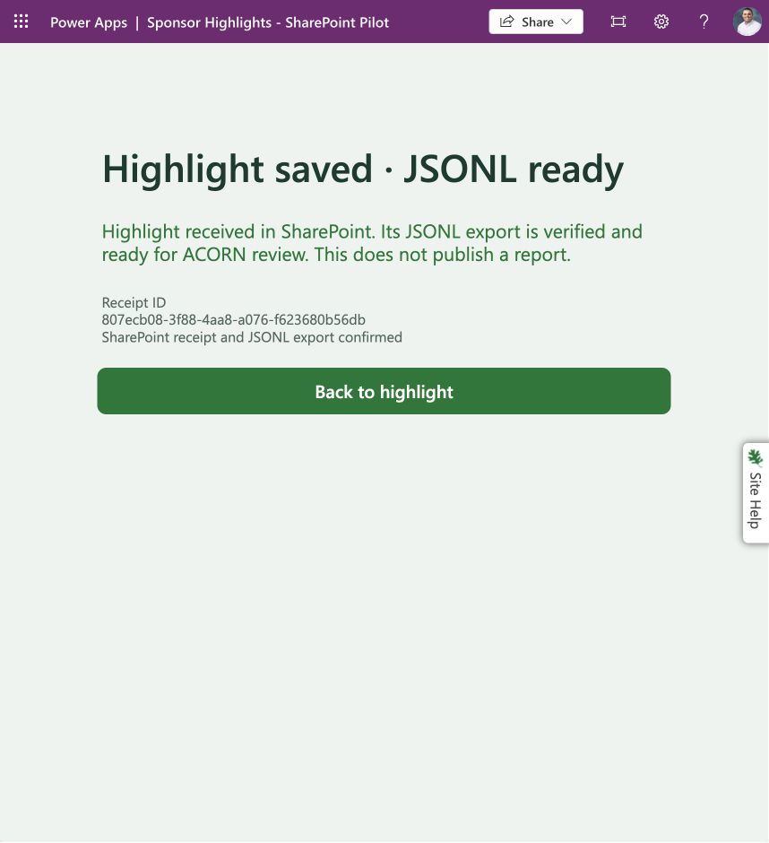

> **Sanitized copy:** Account labels and related assets have been redacted. Historical checksums and import results describe the originals; see [privacy and reuse limits](../../../../../privacy.md).

# Current route

**SharePoint is the default for new highlights. Both GitLab connector flows are Off.** The owner authorized this cutover October 27. The app link, pilot environment and approved owner/participant audience are unchanged. No credentials, permissions, connector definitions or GitLab data were changed or removed.

[Open the published SharePoint form](https://apps.gov.powerapps.us/play/e/221f44a6-1468-ea4e-b93d-cd52f1723079/a/163f110f-7f8a-401c-894e-0786b2c018a4). Environment: **Wohlgemuth, Jason**, `221f44a6-1468-ea4e-b93d-cd52f1723079`.

| Component | ID | Final state |
| --- | --- | --- |
| SharePoint canvas | `163f110f-7f8a-401c-894e-0786b2c018a4` | Saved and published with accepted PA28 feedback |
| SharePoint catalog | `6f8a4ab5-dd66-4904-9f5d-f307519ab4d5` | On; safe response handles all four Select outcomes |
| SharePoint intake | `64679e9c-ae76-4263-b8fa-8832835516ca` | On; unchanged submission and notification logic |
| SharePoint exporter | `51efa5f9-6e69-4d75-a53b-2c2965fd51bd` | On; accepted PA23/26/27 source installed, five-minute schedule and concurrency 1 retained |
| GitLab intake | `ff4a134b-5fd3-4465-ab19-0325c2f2bf1b` | **Off**, verified in [final status](gitlab-intake-off.txt) |
| GitLab catalog | `cd27888f-dd74-4675-9dd1-abc246ba56d5` | **Off**, verified in [final status](gitlab-catalog-off.txt) |
| GitLab canvas | `15ae605b-585b-49f5-a413-2b091f919a35` | Retained unchanged; its two flows are disabled |

The owner-triggered milestone receiver remains separate and unchanged. It continues the manual Teams/email milestones; local CLI processing sends no messages. New SharePoint receipts notify the owner and submitter through the existing Teams gates; an owner submission skips the duplicate submitter notice. Intake sends no routine email.

# Deployment verification

- [Native before](sharepoint-before.msapp) and [installed canvas](sharepoint-installed.msapp) differ in exactly seven PA28 properties. [Audit](app-change-audit.json) proves startup/recovery key and data-source references byte-identical, with zero App checker results. Submission formulas are unchanged. Installed project loading still calls the operational catalog alias.
- [Installed catalog response](catalog-response-installed.json) matches the accepted PA28 response after expression whitespace normalization. [Run-after evidence](catalog-installed-run-after.txt) records Succeeded, Failed, Skipped and TimedOut. The original list query, existing owner-backed connection and run-only audience were retained.
- [Installed exporter scope](exporter-installed-scope.json) matches the accepted production-target clipboard source. The [before scope](exporter-before-scope.json) and [trigger](exporter-before-trigger.json) match the retained native rollback ZIP after editor-representation normalization; [comparison](baseline-comparison.json) records the normalization. The repaired exporter was saved at 12:31 PM ET.
- Published-player refresh preserved confirmed receipt `32baf0fa-96a7-43c0-8e80-cd71c26b4ca3` and fields. Only after verifying confirmation was New highlight used. No pending or unresolved browser receipt was cleared. The deployed player loaded all 13 projects.
- One explicitly synthetic TEST ONLY submission created receipt **`807ecb08-3f88-4aa8-a076-f623680b56db`**, displayed **Highlight saved · JSONL ready**, and succeeded in intake run `08584084878392744473980560609CU11` at 12:37 PM ET. The owner Teams action succeeded; the duplicate submitter chat was skipped because the owner submitted. This proves the send action, not that a person read the message.
- Repaired scheduled exporter run `08584084879849494890355451407CU03` succeeded at 12:35. Manual exporter run `08584084877801675875246644382CU18` succeeded at 12:38 after the new receipt.
- Independent browser downloads proved **8 rows / 4,481 bytes**, all prior seven rows unchanged byte for byte, the new UUID exactly once, and the new row exactly equal to its individual downloaded receipt. SHA-256: `c46ff84f25be44cc9bcb8c4f4d4f080a624957157c99c3ed397717adffa93ee5`. [Validation](deployment-validation.json) retains prior and current hashes; only the [synthetic test row](cutover-test-receipt.jsonl) is copied here. Participant free text remains outside these assets.
- PA22's prior standard-license participant acceptance remains applicable: the same app, audience, owner-backed connections and submission bindings were preserved. This deployment adds an owner-context smoke test; it does not claim a second participant test or wider-group acceptance.

# Restore the GitLab route

This is a reversible flow pause, not connector deletion. Keep the original app, custom connectors, protected connections/token references, project `22464` / `main` / `.acorn/intake/logbook.jsonl`, native packages and browser recovery slot.

1. In the same environment, open **ACORN Project Catalog** (`cd27888f-dd74-4675-9dd1-abc246ba56d5`) and choose **Turn on**. Open **ACORN Logbook GitLab JSONL Intake (Draft)** (`ff4a134b-5fd3-4465-ab19-0325c2f2bf1b`) and choose **Turn on**. No rebuild, package import, rebind or new token is needed while the retained credentials/connections remain valid.
2. Verify both show On and that their existing connections are healthy. Verify the intended users have premium use rights and that GitLab calls succeed; retained credentials can still expire and known network-range 403/504 failures remain possible. PA15/16/17 unfinished GitLab acceptance is not closed by this pause or restoration.
3. Open the retained original app and confirm catalog loading. Reconcile any existing pending UUID against its original payload and immutable GitLab history before allowing a new submission. Use same-ID retry only; uncertain proof stays unresolved. No auto-migration or dual submission across routes.
4. Choose and communicate the default link explicitly if changing it again. SharePoint can remain available; do not delete its data or overwrite its recovery slot merely to restore GitLab.

No in-flight GitLab run appeared in either history before disablement. Other users' browser-local slots cannot be globally inventoried. The old form may open, but project loading/submission cannot succeed while its flows are Off; use the SharePoint link for new entries and contact the owner for unresolved old receipts.

# Roll back only the SharePoint deployment changes

Restoring GitLab does **not** require rolling back SharePoint. These are separate operations. Keep receipt lists, individual files, collected files, connection credentials and audience intact.

- **Canvas:** use the original app's version history to restore the version immediately before the October 27 PA25 publish, then publish that restored version. The exact [native before copy](sharepoint-before.msapp) and [installed copy](sharepoint-installed.msapp) are retained for comparison/recovery. Verify the same app ID, data sources and `SponsorHighlightSharePointPending` key; do not replace it with the test app or clear browser data. The seven-property audit identifies the entire canvas change.
- **Catalog:** restore the saved [before response](catalog-response-before.json), with its original Succeeded-only run-after on Select, in the existing catalog flow. Save and confirm bindings unchanged. This reintroduces the prior silent-failure UX; prefer retaining the accepted response unless an observed regression requires reversal.
- **Exporter:** stop only the exporter, let any active run finish, and inspect receipts/current file independently. The [rollback clipboard scope](exporter-rollback.clipboard.json) comes from the verified older native ZIP, with the retained production connection reference. Replace only `Combined_logbook_export_LB` in the existing flow, retaining its recurrence/concurrency and destination, save, then enable when verified. The [native rollback package](../backup/PA24DeployedExporterRollback20261027_20261027132154.zip) remains available for native recovery. The older scope reintroduces the known prior-read defect; normally keep the accepted repair. Never restore old file bytes blindly after an uncertain write or discard newer receipts.
- After any rollback, verify current catalog, same-ID receipt handling, exporter freshness and independent downloaded bytes. Code rollback must not roll back data. Keep TEST ONLY receipts out of sponsor reports.

# Remaining limits

The current pilot has a 5,000-row / 10 MiB collected-export cap and no automated exporter-failure alert. Check scheduled run history and file freshness before downloading. The JSONL-ready app message confirms the individual receipt, not the latest aggregate. The source list is retained history, not a drained queue. Native backup/data snapshots are dated recovery evidence, not continuous backup. Shared-environment/group rollout remains PA12; direct OAuth download and Vergil automation remain separate plans.
