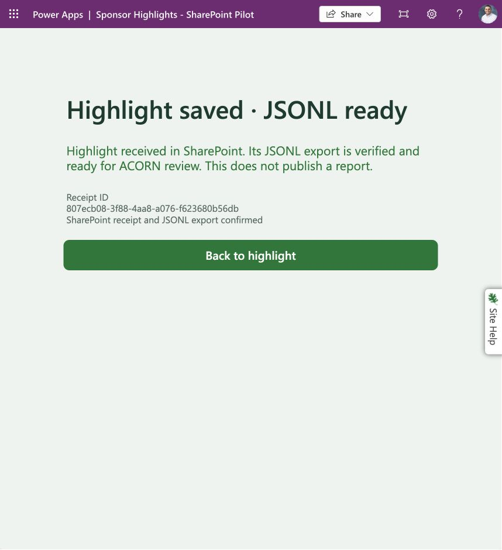

> **Sanitized copy:** Account labels and related assets have been redacted. Historical checksums and import results describe the originals; see [privacy and reuse limits](../../../../../privacy.md).

# Current route

**SharePoint is the default for new highlights.** The retired premium GitLab app and its two flows were deleted with owner confirmation on November 12. At the owner's subsequent request, a replacement `[PREMIUM] Highlights Intake` app (`90dabac0-caf3-4f80-9ba6-6fae22e5408c`) was imported from the fresh canvas backup and published as version 6. Both supporting flows were recovered with explicit owner approval, but recovery is not operational: the final published app still calls the original catalog trigger, which returns `WorkflowTriggerIsNotEnabled`. No post-recovery submission was sent. See the [cleanup and recovery evidence](../intake-approval/cleanup/README.md). The October 27 deployment evidence below describes the earlier reversible pause; it is not the current state of the recovered components. Credentials, permissions, connector definitions and GitLab data were not removed by the cleanup.

[Open the published SharePoint form](https://apps.gov.powerapps.us/play/e/221f44a6-1468-ea4e-b93d-cd52f1723079/a/163f110f-7f8a-401c-894e-0786b2c018a4). Environment: **Wohlgemuth, Jason**, `221f44a6-1468-ea4e-b93d-cd52f1723079`.

| Component | ID | October 27 checkpoint |
| --- | --- | --- |
| SharePoint canvas | `163f110f-7f8a-401c-894e-0786b2c018a4` | Saved and published with accepted PA28 feedback |
| SharePoint catalog | `6f8a4ab5-dd66-4904-9f5d-f307519ab4d5` | On; safe response handles all four Select outcomes |
| SharePoint intake | `64679e9c-ae76-4263-b8fa-8832835516ca` | On; unchanged submission and notification logic |
| SharePoint exporter | `51efa5f9-6e69-4d75-a53b-2c2965fd51bd` | On; accepted PA23/26/27 source installed, five-minute schedule and concurrency 1 retained |
| GitLab intake | `ff4a134b-5fd3-4465-ab19-0325c2f2bf1b` | **Off**, verified in [final status](gitlab-intake-off.txt) |
| GitLab catalog | `cd27888f-dd74-4675-9dd1-abc246ba56d5` | **Off**, verified in [final status](gitlab-catalog-off.txt) |
| GitLab canvas | `15ae605b-585b-49f5-a413-2b091f919a35` | Retained unchanged; its two flows are disabled |

The owner-triggered milestone receiver remains separate and unchanged. It continues the manual Teams/email milestones; local CLI processing sends no messages. New SharePoint receipts notify the owner and submitter through the existing Teams gates; an owner submission skips the duplicate submitter notice. Intake sends no routine email.

# Deployment verification

- [Native before](sharepoint-before.msapp) and [installed canvas](sharepoint-installed.msapp) differ in exactly seven PA28 properties. [Audit](app-change-audit.json) proves startup/recovery key and data-source references byte-identical, with zero App checker results. Submission formulas are unchanged. Installed project loading still calls the operational catalog alias.
- [Installed catalog response](catalog-response-installed.json) matches the accepted PA28 response after expression whitespace normalization. [Run-after evidence](catalog-installed-run-after.txt) records Succeeded, Failed, Skipped and TimedOut. The original list query, existing owner-backed connection and run-only audience were retained.
- [Installed exporter scope](exporter-installed-scope.json) matches the accepted production-target clipboard source. The [before scope](exporter-before-scope.json) and [trigger](exporter-before-trigger.json) match the retained native rollback ZIP after editor-representation normalization; [comparison](baseline-comparison.json) records the normalization. The repaired exporter was saved at 12:31 PM ET.
- Published-player refresh preserved confirmed receipt `32baf0fa-96a7-43c0-8e80-cd71c26b4ca3` and fields. Only after verifying confirmation was New highlight used. No pending or unresolved browser receipt was cleared. The deployed player loaded all 13 projects.
- One explicitly synthetic TEST ONLY submission created receipt **`807ecb08-3f88-4aa8-a076-f623680b56db`**, displayed **Highlight saved · JSONL ready**, and succeeded in intake run `08584084878392744473980560609CU11` at 12:37 PM ET. The owner Teams action succeeded; the duplicate submitter chat was skipped because the owner submitted. This proves the send action, not that a person read the message.
- Repaired scheduled exporter run `08584084879849494890355451407CU03` succeeded at 12:35. Manual exporter run `08584084877801675875246644382CU18` succeeded at 12:38 after the new receipt.
- Independent browser downloads proved **8 rows / 4,481 bytes**, all prior seven rows unchanged byte for byte, the new UUID exactly once, and the new row exactly equal to its individual downloaded receipt. SHA-256: `c46ff84f25be44cc9bcb8c4f4d4f080a624957157c99c3ed397717adffa93ee5`. [Validation](deployment-validation.json) retains prior and current hashes; only the [synthetic test row](cutover-test-receipt.jsonl) is copied here. Participant free text remains outside these assets.
- PA22's prior standard-license participant acceptance remains applicable: the same app, audience, owner-backed connections and submission bindings were preserved. This deployment adds an owner-context smoke test; it does not claim a second participant test or wider-group acceptance.

# Restore the GitLab route

The replacement canvas and both supporting flows have been recovered, but the catalog runtime and app binding still need repair. App checker reported no formula errors; the final published player nevertheless failed because original catalog runtime `cd27888f-dd74-4675-9dd1-abc246ba56d5` reported its trigger Disabled. A brief successful load through another catalog runtime did not persist after publication. The replacement uses a new app ID and does not restore the original app's version history or sharing. Verify stable project loading before submission and intended-user access testing. Microsoft documents [deleted-flow recovery within 21 days](https://learn.microsoft.com/en-us/power-automate/how-tos-restore-deleted-flow), using Restore Deleted Flow as Admin; restored flows are disabled initially. The [cleanup record](../intake-approval/cleanup/README.md) records the recovery run, runtime IDs, app bindings, blocker, and fresh native canvas copy. The dated October 25 flow package was not used for this recovery.

Before choosing a different default link, validate fresh submission, immutable readback, same-ID replay, and conflict behavior, and confirm intended-user sharing and premium rights. Preserve project `22464` / `main` / `.acorn/intake/logbook.jsonl`, existing receipts and browser recovery data. An uncertain old UUID must be reconciled against its original payload and immutable GitLab history; restoration does not authorize duplicate submission or data rollback. Existing GitLab acceptance limits remain open.

# Roll back only the SharePoint deployment changes

Restoring GitLab does **not** require rolling back SharePoint. These are separate operations. Keep receipt lists, individual files, collected files, connection credentials and audience intact.

- **Canvas:** use the original app's version history to restore the version immediately before the October 27 PA25 publish, then publish that restored version. The exact [native before copy](sharepoint-before.msapp) and [installed copy](sharepoint-installed.msapp) are retained for comparison/recovery. Verify the same app ID, data sources and `SponsorHighlightSharePointPending` key; do not replace it with the test app or clear browser data. The seven-property audit identifies the entire canvas change.
- **Catalog:** restore the saved [before response](catalog-response-before.json), with its original Succeeded-only run-after on Select, in the existing catalog flow. Save and confirm bindings unchanged. This reintroduces the prior silent-failure UX; prefer retaining the accepted response unless an observed regression requires reversal.
- **Exporter:** stop only the exporter, let any active run finish, and inspect receipts/current file independently. The [rollback clipboard scope](exporter-rollback.clipboard.json) comes from the verified older native ZIP, with the retained production connection reference. Replace only `Combined_logbook_export_LB` in the existing flow, retaining its recurrence/concurrency and destination, save, then enable when verified. The [native rollback package](../backup/PA24DeployedExporterRollback20261027_20261027132154.zip) remains available for native recovery. The older scope reintroduces the known prior-read defect; normally keep the accepted repair. Never restore old file bytes blindly after an uncertain write or discard newer receipts.
- After any rollback, verify current catalog, same-ID receipt handling, exporter freshness and independent downloaded bytes. Code rollback must not roll back data. Keep TEST ONLY receipts out of sponsor reports.

# Remaining limits

The current pilot has a 5,000-row / 10 MiB collected-export cap and no automated exporter-failure alert. Check scheduled run history and file freshness before downloading. The JSONL-ready app message confirms the individual receipt, not the latest aggregate. The source list is retained history, not a drained queue. Native backup/data snapshots are dated recovery evidence, not continuous backup. Shared-environment/group rollout remains PA12; direct OAuth download and Vergil automation remain separate plans.
