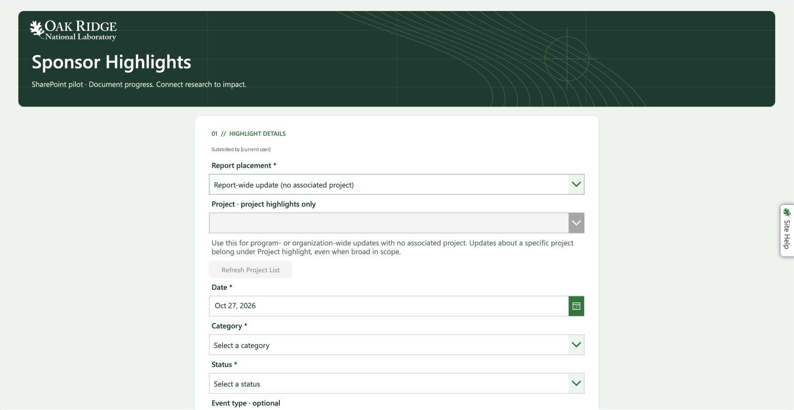

# Report placement and general destination

October 27 update to the existing SharePoint app, ID `163f110f-7f8a-401c-894e-0786b2c018a4`.

Report placement is the first input. New highlights default to **Project highlight**. Project highlights enable Load Project List and, after a successful load, the project selector. **Report-wide update (no associated project)** leaves both controls disabled and submit `projectId: "general"` with `entry.global: true`. The general destination is hidden from project-highlight choices. Submission requires a loaded catalog only for project highlights.

The SharePoint project catalog contains `General updates` / `general` with source marker `manual-general-destination-20261027`. This is an intentional manual catalog entry, not a GitLab commit. Keep it when refreshing the pilot catalog. Existing pending payloads retain their original destination and bytes, including older general updates associated with a project. Recovery keys, connections and flow bindings are unchanged.

## Sources and rollback

`control-properties.json` contains the deployed Power Fx properties without the leading equals sign. Move PlacementLabel and PlacementDropdown immediately after SubmissionContext in EntryForm. `EntryForm-before.pa.yaml` and `current-properties.json` preserve the relevant pre-change controls/formulas. The latter was captured after initial layout changes but before SubmitButton, ProjectHelp and catalog OnSelect edits. These are source records, not a native import package. Restore only the properties affected by this update; do not replace connections or recipients.

## Validation

- Studio readback verified the new formulas, control order and no formula errors for edited properties.
- Preview loaded the 13 project choices and excluded the general destination. Both project controls were disabled before placement and for general updates.
- Published-player readback verified placement above Project and restoration of the prior confirmed receipt without changing its ID.
- A synthetic local `general` row passed `intake stage --batch`, `inspect`, and `apply --yes` against a separate temporary index. Batch `3e921cebb42c25290057029640626f2ecc6ef0c9b8f2d8593a444214a6729590` accepted one row; its applied logbook has `projectId: general` and `global: true`. The test used generic fixture contact metadata, not a production general index.

- Live synthetic receipt `51de45f4-8806-4b40-a602-a4756128440d` returned **Highlight saved · JSONL ready** without loading or selecting a project. Independent SharePoint list readback showed ProjectId `general`, summary `TEST ONLY - General report placement routing`, status `Exported`, and the matching individual JSONL URL. Reload restored the same confirmed UUID. Notification delivery and collected-export inclusion were not separately reaccepted in this check.

## Standalone general reporting requirement

The owner clarified that general updates have **no associated project/index**. The internal envelope destination `general` is a routing key, not a research project. Do not create `general/index.json`, copy another project's contact metadata or route general updates into acorn. The earlier synthetic index test remains project-backed evidence only.

For local batch intake, configure a standalone JSON logbook and its explicit contributor allowlist in the ACRE file. The path is relative to that file; ACORN creates the logbook on the first accepted batch apply:

```json
{
  "options": {
    "generalLogbook": {
      "path": "general/logbook.json",
      "members": ["approved.contributor@example.org"]
    }
  }
}
```

Merge this block into the existing configuration; it does not require GitLab settings. The local `intake stage --batch`, `inspect`, and confirmed `apply` path accepts `projectId: "general"` only with `entry.global: true` and an allowlisted submitter. Corrections preserve the original receipt chain. The general logbook contains entries only; it has no ResearchActivity contact or project metadata. Combined local reports read it into the title page using the report window, including when no project folder is selected. An unknown project ID is never treated as `general`.



## Submission editing

The immutable correction workflow is now published and accepted for the owner and a standard-license contributor. Use **My Submissions → Edit selected → Save correction**. History is caller-filtered; project and placement remain fixed. Each correction creates a new linked receipt, retaining earlier bytes in the list and collected JSONL. Local batch review/apply folds accepted revisions into the latest logical entry. Existing reports are unchanged. See [editing acceptance and current source](../submission-editing/README.md).

Pending or uncertain submissions must retry the frozen UUID and payload. Do not overwrite stored payload columns or create a new receipt merely to retry. Published reports are unchanged until an operator reviews and applies the collected JSONL locally.

## Wording refinement

The owner requested Project highlight as the default and a clearer alternative because a project highlight can also be general in scope. The second choice is now **Report-wide update (no associated project)**. Its help text explains that program- or organization-wide updates without an associated project belong here; updates about a particular project remain project highlights even when broad in scope. The summary placeholder becomes “What changed across the program or organization, and why does it matter?”

The default still derives from `entry.global` when restoring an existing receipt. All label-dependent submission comparisons use the revised wording; the wire fields remain `projectId: general` and `global: true`. Thirteen recorded property values matched the Studio source readback, including the unchanged project gates. No additional synthetic receipt or notification is needed for this wording change.

Published-player verification confirmed Project highlight on a fresh load, successful project catalog loading, both revised choices, disabled project controls for the report-wide choice, and the descriptive summary placeholder. The current screenshot replaces the earlier wording and masks the submitter.
