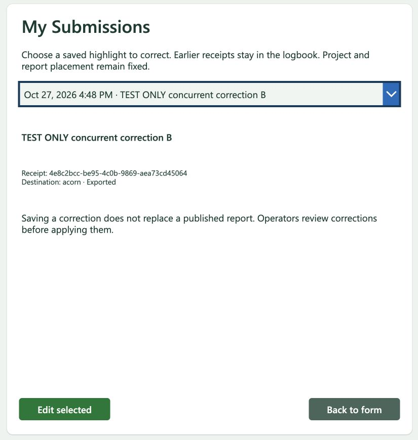
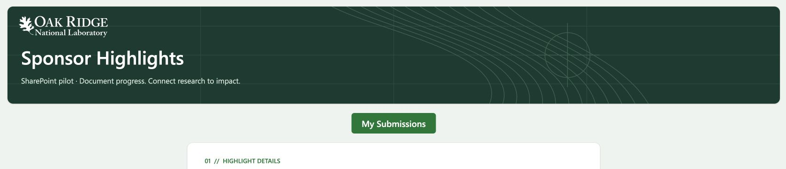

# Submission editing

The correction controls were published in the operational SharePoint app on October 27, 2026. App checker reported zero issues. Owner-context original submission, history selection, correction, Teams delivery, scheduled aggregate download and local stage/inspect/apply passed. Standard-license contributor correction acceptance passed later the same day; PA-31 is accepted.

## Contributor behavior

Open **My submissions**, choose a confirmed highlight, and select **Edit selected**. Correct the date, category, status, event type, summary or supporting details, then select **Save correction**. Project and report placement remain fixed. Cancel editing leaves the saved receipt unchanged.

Each correction receives a new UUID and links its original and immediate predecessor. The original bytes remain in the receipt list and collected JSONL. The app offers only the latest receipt in each chain. A stale edit must load the newer version before saving. Pending or uncertain saves retain their frozen UUID and payload and must reconcile before another edit. Clearing browser storage is not a retry procedure.

Saving a correction does not change a published report or undo graduated metadata. Operators use `acorn intake stage --batch`, `acorn intake inspect`, and confirmed `acorn intake apply`. The local index keeps one logical entry per highlight. Exact predecessor checks stop changes to an independently edited or graduated entry for operator review. General-destination reporting remains PA-29.

## Components

| Component | Identifier | Deployment state |
| --- | --- | --- |
| Isolated app | `2f482a10-8add-444d-af6e-c543fee4a1e3` | Published; test receipt storage only |
| Isolated flow | `d272502c-43d2-f111-a05c-001dd8062052` | Tested; synthetic-original mode and acceptance controls must never be promoted |
| Isolated receipt list | `31a7f178-6729-4252-a2bc-e06a07838f5c` | Four immutable exported receipts |
| Production correction flow | `36695ee1-47d2-f111-a05c-001dd8062052` | Saved and On; bound to the published app; history and correction accepted for owner and standard-license contributor |
| Operational app | `163f110f-7f8a-401c-894e-0786b2c018a4` | Published with My submissions, Edit selected, Save correction and cancel controls |

Both receipt lists have an optional, unique, indexed `CorrectionParentId` text column. Original submissions leave it blank. Corrections populate it at initial item creation, which atomically prevents competing successors. The flow verifies those schema settings on every call. Power Apps synchronous response flows cannot use trigger concurrency limits.

The separate correction flow authenticates the caller from trigger context, filters their history, verifies stored identity fields, and checks ownership, predecessor, root, routing, export state and chronology before writing. It bounds history at 1,000 receipts and 5 MiB of encoded response content; incomplete or inconsistent history fails closed. Receipt links and supplied email addresses are not authorization.

Production originals continue through the existing intake flow. Corrections use the separate flow. Both use the existing browser recovery slot. Test storage uses `SponsorHighlightPA31Pending` and the test JSONL library. The production flow contains no synthetic-original branch or test harness. GitLab remains disabled.

## Acceptance evidence

`acceptance-results.json` records the isolated live outcomes without account identifiers:

- Exact correction replay returned the original correction UUID with verified export.
- Two independent original rows with blank predecessor values were accepted.
- Concurrent sibling corrections produced one saved successor. The losing request first returned unresolved, then a retry returned `conflict` with `stale_revision`; no second child was created.
- Wrong-owner, changed-routing and missing-predecessor requests were rejected without adding rows.
- Reusing a saved UUID with changed content returned conflict.
- The test app recovered the confirmed correction after reload.
- SharePoint retained the original and both successive corrections, plus the unrelated original: four rows total.

The exact submitted bytes were collected in a private test workspace and passed through `stage --batch`, `inspect`, and `apply` against a separate synthetic research activity index. All four lines were accepted and became two logical entries: the latest correction and the unrelated original. Batch `ab542fc87735dc03933fb26e79dbea25201b4c433607540fc9d1e25f1f209116` completed successfully. This private collected fixture is not evidence of a scheduled aggregate download.

`sanitized-live-correction.jsonl` is a deliberately re-encoded four-row illustration with generic contact data. It is not an exact-byte backup or a source for comparing live receipt hashes. The private test initially used an invalid empty destination index, was correctly rejected, then was rerun in a fresh workspace with a complete synthetic fixture; no operational project index was used.

Local validation: 47 focused Power Automate tests, two logbook proposal tests, focused Clippy and CLI build/check passed. The full workspace suite passed 2,713 tests (17 skipped; one reported leaky). Cases cover prior-batch ancestry, same-batch folding, replay, forks, cycles, missing parents, ownership/routing/time/identity changes, changed/graduated predecessors, manifest tampering and rejection by the unsupported single-submission path.

## Source and rollback

Place `MySubmissionsButton` directly in the vertical `SubmitLayout`, between `SubmitHeader` and `EntryForm`. It is centered, 180 pixels wide and 44 pixels tall; the parent's 20-pixel layout gap provides space above and below. Do not paste it inside the banner or position it with absolute header coordinates. The October 27 layout correction was verified in desktop and 375-pixel phone previews and published to the operational app. The refreshed player also showed the corrected placement.

[Phone preview](navigation-phone.png) confirms that the same row remains clear of the banner at narrow widths.

`build-editing.py` creates isolated and production scope/response clipboard packages. Production accepts corrections only. `build-app.py` creates isolated controls, a test-only acceptance panel, and production controls that retain original submission dispatch. `rollback-control-properties.json` captures the operational properties before editing; the full pre-edit screen source is retained privately. Remove only the added history/cancel controls and restore those properties and the former app version to roll back the UI. Do not remove receipt history or the nullable predecessor column to roll back.

Designer paste resets action dependencies: explicitly configure the response to run after all correction-scope outcomes, and notifications after all response outcomes. Notifications remain gated on a newly created, verified exported receipt. Preserve the existing owner/submitter routing from the operational intake copy; use `correction-message.html` for their message text. Do not deploy sanitized account placeholders from older backups. Teams is used on correction submission; email remains milestone-only. No notification is sent by a history read or exact replay.

## Operational acceptance

The published app accepted original receipt `28a1dae3-bde9-425c-880a-c5f72d2470bf` and correction `4162b67a-79fd-4fd1-b7e8-72854600dd0b`. My submissions offered only the caller's history; editing restored fields and locked project/placement. Both saves returned verified JSONL feedback and delivered the owner Teams notice. The refreshed 15-row scheduled aggregate contained each exact individual-file payload once, including the original bytes and the correction's root/predecessor link. See `production-acceptance.json` for hashes.

The two selected exact lines passed local stage, inspect and apply in an isolated synthetic workspace, producing one latest logical entry alongside its unrelated seed entry. Batch `793fedb7fe24eac431cb8ff51ee0df7c49ffb3059118ffb1d8cf50a1a3928393` completed. Two initial fixture setup attempts were correctly rejected (wrong logbook shape, then an empty logbook); neither applied changes. The successful run used a complete valid seeded index. No operational research index, report publication or callback was used.

The shared browser recovery key and original intake dispatcher are preserved. The original-flow response is augmented with an empty `reason` field so Power Fx retains the correction response's error detail in the common result type. History labels have keyboard focus support; App checker reports zero issues. Source properties and new controls are generated by `build-app.py`.

## Standard-license contributor acceptance

Accepted October 27, 2026. The user supplied original receipt `c62dcf3e-e6fe-4b92-95d5-8097b1fd50ac`; independent readback located its correction `1f3a013d-18b5-4020-ae53-0ff9bfef12e8`. The correction changed the summary and retained the same non-owner submitter, `general` destination, original ID and immediate predecessor. The user explicitly confirmed that the contributor saw only their own history and received the Teams confirmation.

Correction run `08584084650010578599029769360CU13`, started at 6:58:04 PM Eastern, succeeded. Owner Teams delivery, contributor chat creation and contributor confirmation actions each succeeded. Secure inputs and outputs remained enabled. The next scheduled aggregate contained 18 unique receipts, including both exact individual-file payloads once; all 15 rows of the earlier acceptance snapshot were unchanged.

`participant-acceptance.json` records the run, hashes and distinction between independent verification and user-confirmed UI behavior. Account identifiers and submitted content are omitted. These were contributor-provided live receipts, so no local reporting, publication, alteration or deletion was performed. This accepts editing and export for the existing pilot; standalone `general` reporting remains PA-29. PA-31 is complete and removed from active plans.
