# Browser recovery acceptance checkpoint

**Cleanup, October 25, 2026:** The two accepted PA-14 simulation apps and their four simulation flows were deleted after acceptance. The dated results below remain evidence; the test launch links are historical. PA-17 restore copies and all operational components were retained. See [cleanup inventory](test-artifact-cleanup.md).

Updated October 25, 2026. PA-14 is accepted. Browser restart and denied-storage results were confirmed by the owner; simulated panels and tab-reload recovery were observed by the agent. Operational Sponsor Highlights, its flows, connections and browser storage were not changed by the agent. The agent did not restart the existing Chrome process because it contains operational tabs and unsaved work.

## Historical test package

The historical `pa14-no-external-effects.zip` was derived from the canvas-app export used for these tests. That ZIP is no longer present in the workspace; the acceptance screenshots, response definitions and binding inspection below are retained. Both packaged flow definitions contain a single response action, with no connector actions, GitLab writes, Teams messages or email actions. The simulated catalog returns one `acorn` entry. The simulated intake returns `conflict`, `rejected` or `unresolved` when its input contains `[conflict]`, `[rejected]` or `[unresolved]`; otherwise it returns `queued` with a synthetic 40-zero commit. These receipts are UI fixtures and are never evidence of a real save.

SHA-256: `1a07a79136fccc9d40f67b47bf4be6fbabdcd28f77b16263f5c014c3a6087172`.

The package suggests **Create as new** for the app and both flows and prefixes their names with **PA14 TEST ONLY**. Package connector dependencies are removed. The embedded canvas source still contains original workflow identifiers for the importer's normal remapping. **Before opening the player or submitting, inspect the imported app's flow bindings and verify that both point to the new simulated flows.** A package inspection alone cannot prove successful runtime remapping. Never select Update for an existing operational component.

The user uploaded the package and Power Apps successfully imported all three resources as new components in both Wohlgemuth, Jason and ORNL Personal Productivity on October 24. Automated upload still requires the Chrome extension's Allow access to file URLs permission; that permission was left unchanged. This simulated package is not a production backup.

## Jason environment import and flow check

| Component | New ID | Verified state |
| --- | --- | --- |
| PA14 TEST ONLY Sponsor Highlights | `62ef8e08-4253-4fd8-91e1-a7c0a13d7fd3` | Rebound to both test flows, saved and published; simulated panels exercised |
| PA14 TEST ONLY ACORN Project Catalog | `8fdddd79-52e5-4576-bd95-19c3ffb40be7` | On; no connections; trigger plus one static catalog response |
| PA14 TEST ONLY ACORN Logbook GitLab JSONL Intake (Draft) | `7364dc72-5b4b-45aa-9dea-c95dc91614be` | On; no connections; trigger plus one simulated response; checker reported zero errors |

A direct simulated-intake run with synthetic UUID `d674aaf7-daf0-47ef-a657-5f77616de291` and `[conflict]` marker succeeded: run `08584087123323260219671440510CU30`, 107 ms. Both trigger and response actions succeeded. Secure input/output settings conceal the response payload in run history, so this proves execution of the isolated fixture, not the app's conflict-panel behavior or a real GitLab receipt.

The imported static catalog also passed a direct flow run: `08584087120905845053918287708CU05`, 126 ms, Succeeded. Both test flows can execute independently. Neither run contacted GitLab.

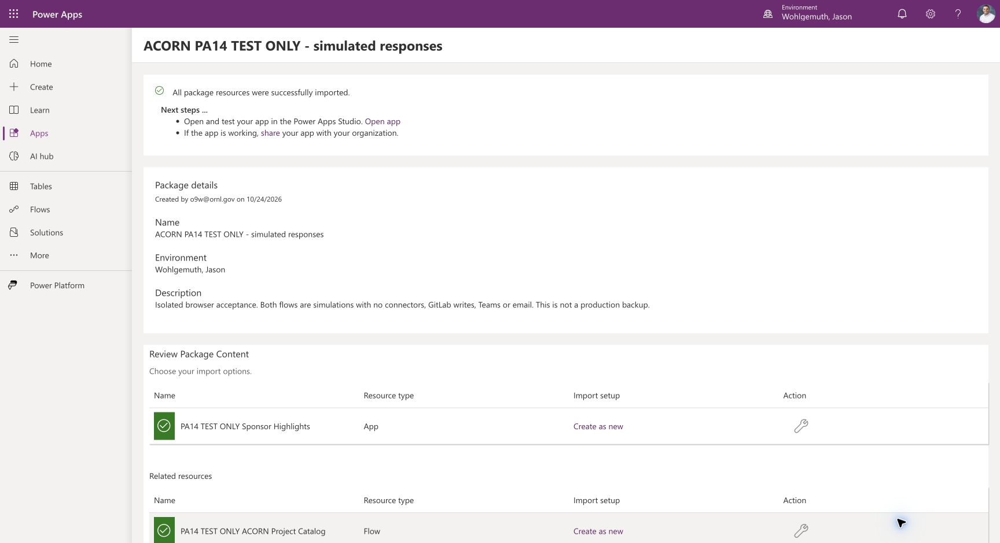

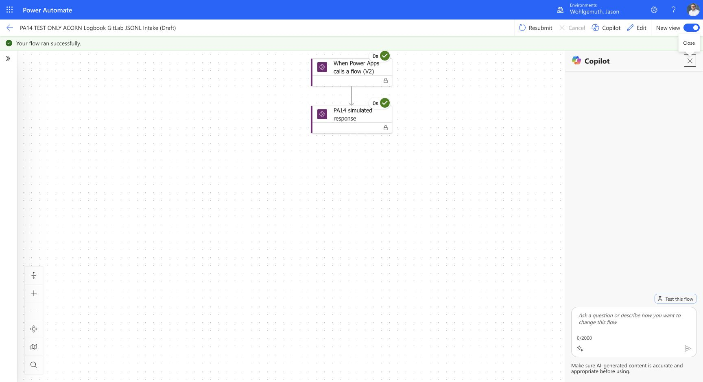

Re-exporting the imported app showed new test flows in its outer dependencies but older embedded canvas datasource IDs. Once Studio opened, the intake Edit link actually targeted operational flow `ff4a134b-5fd3-4465-ab19-0325c2f2bf1b`. No submission was attempted before this check. Both associations were removed from the **test app only** and the two PA14 flows were added explicitly. One intake call and one catalog call were updated to their new aliases. Studio's Edit destinations then matched `7364dc72-5b4b-45aa-9dea-c95dc91614be` and `8fdddd79-52e5-4576-bd95-19c3ffb40be7`. App checker reported **No errors found**. The test app was saved and published with a simulation-only description.

The [pre-repair export inspection](_assets/browser-recovery/jason-binding-inspection.json) preserves why outer dependency remapping alone was insufficient. Microsoft's [canvas package import guidance](https://learn.microsoft.com/en-us/power-apps/maker/canvas-apps/export-import-app-package) and [flow-management guidance](https://learn.microsoft.com/en-us/power-apps/maker/canvas-apps/working-with-flows) cover reconfiguring imported associations. Apply this binding check to every subsequent import before launching it.

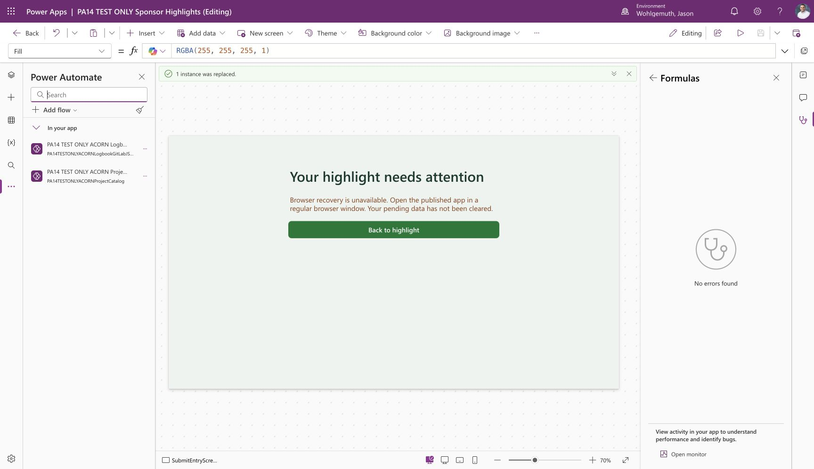

## Published Jason test results

The published test player loaded the single **TEST ONLY - no external writes** project. Tests used only synthetic highlight text. No GitLab, Teams or email action exists in either connected test flow.

| Case | Observed result | Receipt ID |
| --- | --- | --- |
| Queued | Highlight saved panel, synthetic zero commit, fields locked; New highlight resets the form | `9727256d-ede0-44c4-adb0-9c09d0bc688a` |
| Rejected | Highlight needs a correction panel; retry disabled; Edit highlight restores editable text/category/status and requires project reselection | `c1666cac-7a16-431e-91be-ae57a5bb57e7` |
| Unresolved | Retained-pending message and retry offered; fields locked | `d059c600-50d5-4bd1-97e3-b8e8406073db` |
| Tab reload and retry | Pending highlight recovered with the same ID, summary, project, date, category and status; retry returned unresolved with the same ID | `d059c600-50d5-4bd1-97e3-b8e8406073db` |
| Conflict | Receipt needs review panel; fields locked, retry disabled, no Edit/New action | `d059c600-50d5-4bd1-97e3-b8e8406073db` |

For conflict acceptance, the isolated response fixture temporarily returned literal `conflict` on retry of the unresolved envelope. Its original marker-based expression was subsequently restored through the new designer and verified in Code view before saving. The test player retains the synthetic conflict record. These UI results prove response handling, not real GitLab conflict detection, deduplication or persistence. The queued message uses production wording, but its all-zero commit is synthetic and no logbook write occurred.

The test flow history shows all five app-driven calls succeeded, followed by a successful post-restoration smoke run. The final [response definition](_assets/browser-recovery/jason-restored-response.json) contains the original marker-based expression and only a Power Apps response action.

| Call | Run ID | Duration |
| --- | --- | --- |
| Queued | `08584087117211037843181994011CU25` | 107 ms |
| Rejected | `08584087116989333644005128271CU03` | 114 ms |
| Unresolved | `08584087116802819683797655996CU29` | 94 ms |
| Recovered retry | `08584087116637827407357100747CU15` | 108 ms |
| Conflict fixture | `08584087115967527445900057972CU14` | 88 ms |
| Restored fixture smoke | `08584087113129506864214612765CU24` | 116 ms |

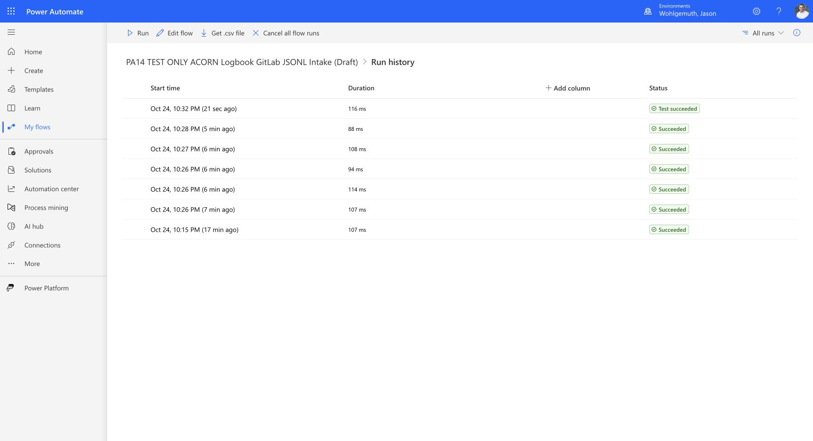

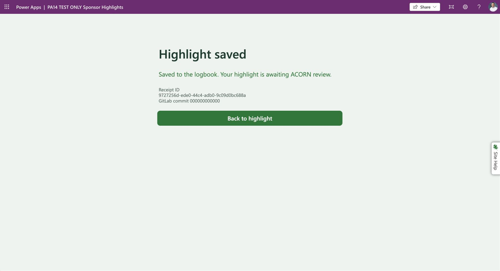

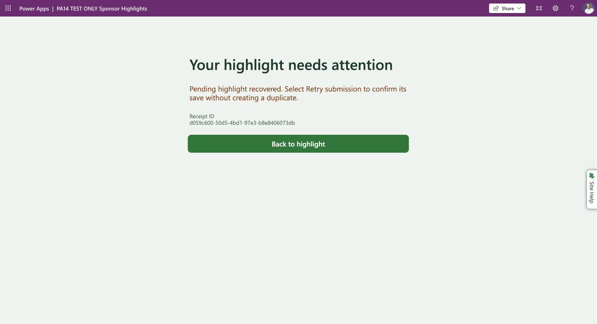

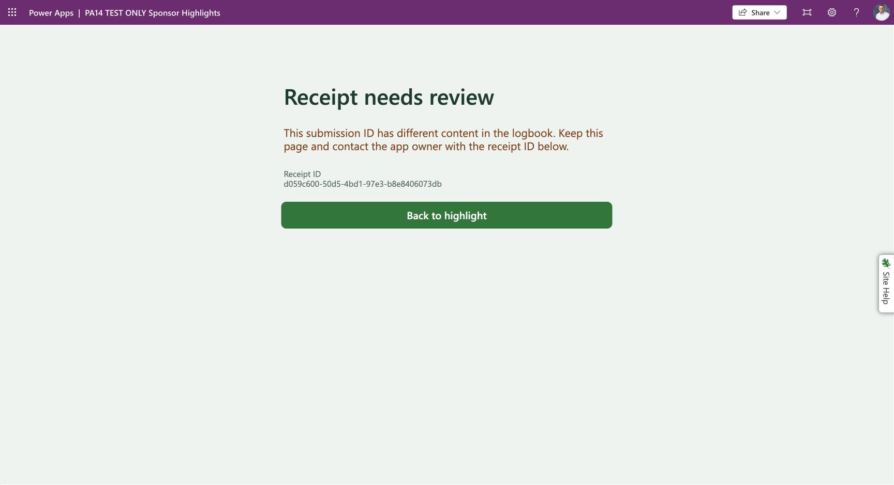

The editor's browser-recovery warning was also visible in Studio. This is not published storage-denial acceptance. A tab reload is not a full browser-process restart.

## ORNL Personal Productivity import and published results

The ORNL Personal Productivity import created app `8fcc3d17-88d3-4dd5-a990-b4ef9843013a`, intake flow `9af88959-801d-4d6f-892c-e34f42c3b38a`, and catalog flow `9f830720-ea02-46aa-bdac-e493052ed32f`. Both flows are On, with no connections and only trigger/response actions. Its initial intake Edit destination still contained the original flow ID, so both test-app associations were removed and re-added. The two formula aliases were corrected; Edit destinations then matched the new IDs and App Checker reported **No errors found**. The test copy was saved and published with a simulation-only description.

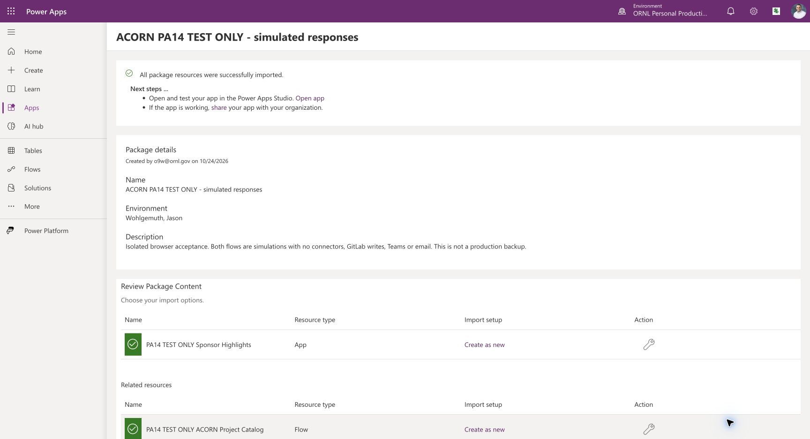

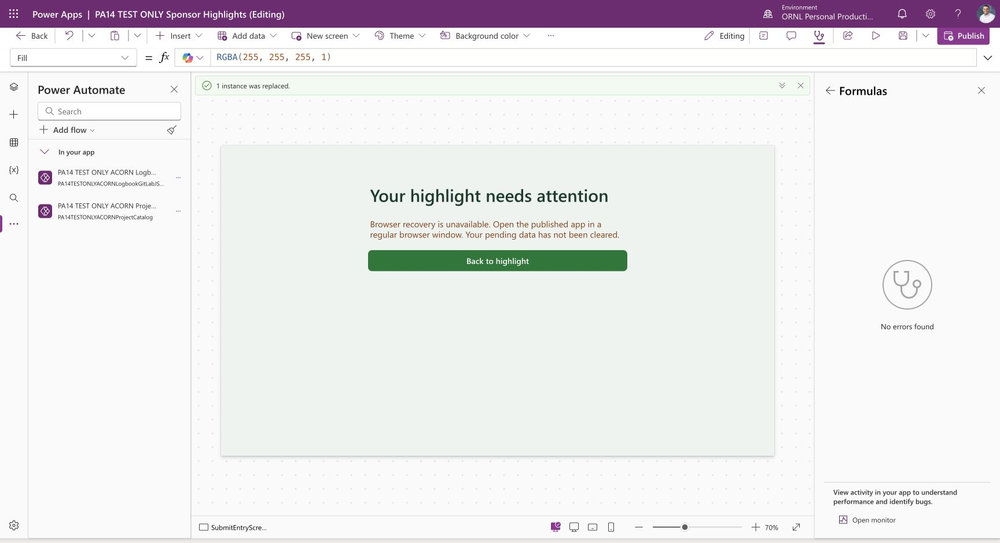

The published player loaded the single simulated project. All inputs were synthetic and neither connected flow contains an external action.

| Case | Observed result | Receipt ID |
| --- | --- | --- |
| Queued | Highlight saved, synthetic zero commit, fields locked; New highlight resets form | `00d16c5a-adac-4c94-8cfe-30db8b97b71b` |
| Rejected | Highlight needs a correction; retry disabled; Edit restores fields and requires project reselection | `e84367b6-d94a-4eeb-adfe-bc08ce2aa1e7` |
| Unresolved | Pending retained, retry offered, fields locked | `ab7a7a68-bb31-4d48-81d3-dcdd42d0894b` |
| Tab reload and retry | Pending recovered with same ID, summary, project, date, category and status; retry returned unresolved with same ID | `ab7a7a68-bb31-4d48-81d3-dcdd42d0894b` |
| Conflict | Receipt needs review, fields locked, retry disabled, no Edit/New action | `ab7a7a68-bb31-4d48-81d3-dcdd42d0894b` |

Conflict was simulated by temporarily returning literal `conflict` for the unresolved envelope. The original marker-based response was restored, verified in Code view and saved. The final [response definition](_assets/browser-recovery/productivity-restored-response.json) and successful post-restoration smoke run preserve that verification. The existing test player retains the synthetic conflict; use a separate clean test profile for a new restart case. These results do not establish real GitLab writes or conflict detection.

| Call | Run ID | Duration |
| --- | --- | --- |
| Queued | `08584087105979141690244791037CU29` | 102 ms |
| Rejected | `08584087105746126445388245487CU26` | 105 ms |
| Unresolved | `08584087105574978088032353281CU03` | 120 ms |
| Recovered retry | `08584087104459448206783851232CU11` | 122 ms |
| Conflict fixture | `08584087103660618394196065344CU23` | 254 ms |
| Restored fixture smoke | `08584087102636161749889909057CU29` | 108 ms |

The restored smoke used UUID `e93bef2c-623c-4d51-bb57-068096288eb6` with an `[unresolved]` summary. Its secure run output is concealed; the observed success establishes execution, while the saved Code view establishes the restored expression.

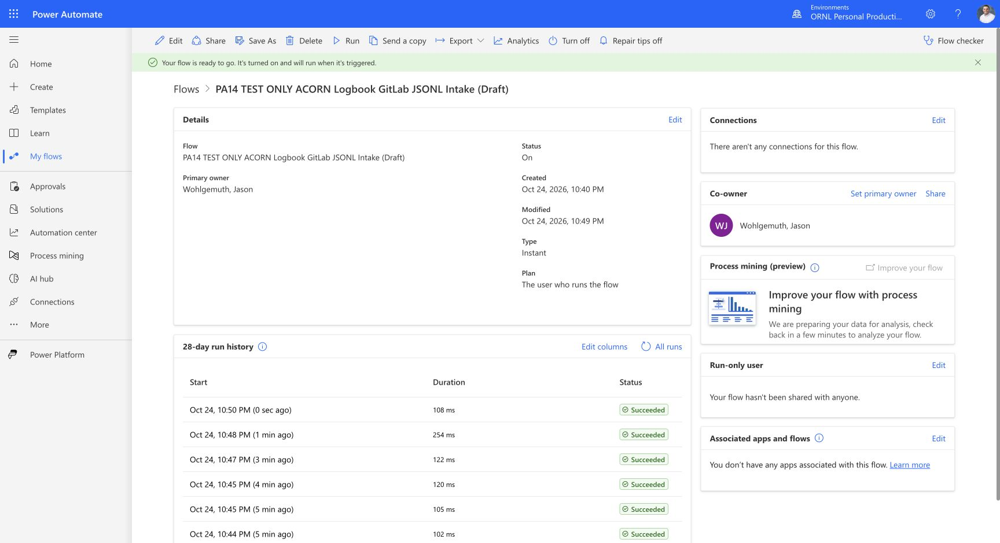

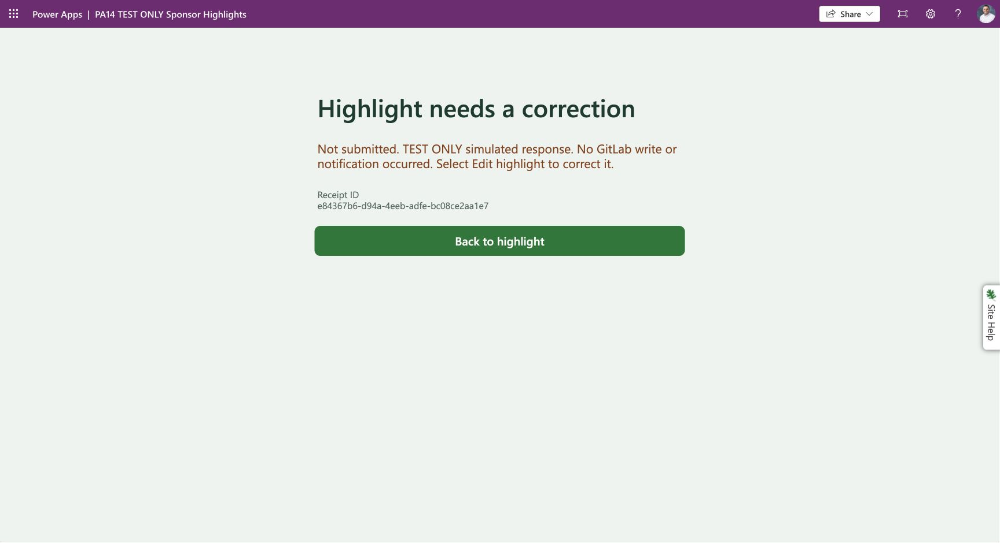

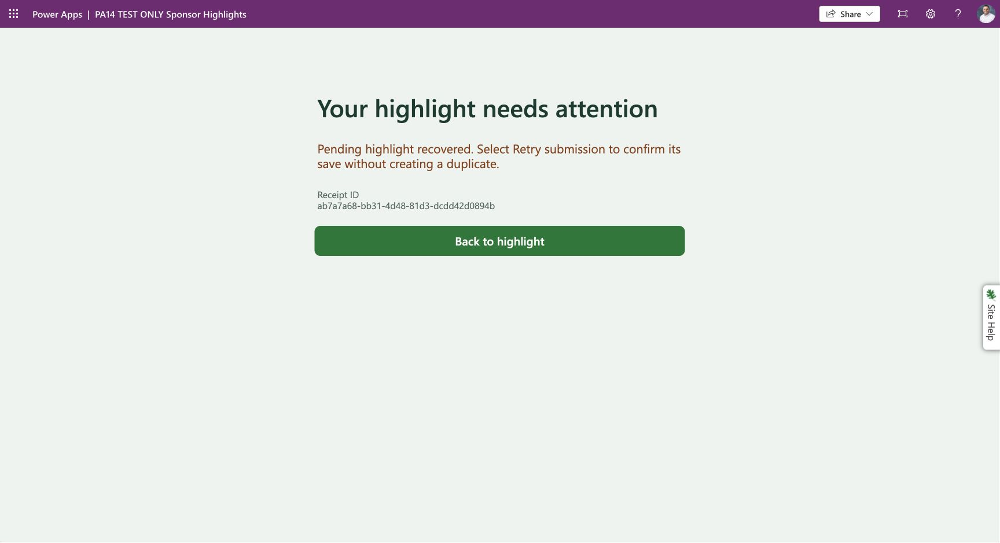

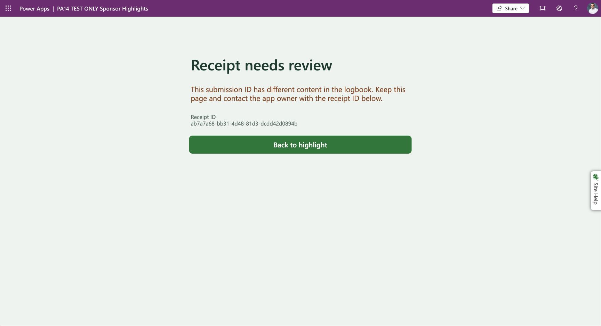

## Owner-reported browser recovery — October 25

The owner confirmed successful browser close/reopen recovery in both test environments on October 25, including locked recovered fields and retry retaining the same receipt ID. Browser-restart acceptance is passed on owner-reported evidence from the requested handoff; it was not independently observed by the agent.

| Environment | Recovered receipt ID | Owner-confirmed result |
| --- | --- | --- |
| Wohlgemuth, Jason | `cf99f6ca-6d11-41a9-bb49-eafe89a52651` | Restored after browser closure; fields locked; retry retained ID |
| ORNL Personal Productivity | `74bb5aa5-b608-42cb-be25-ebe401acea37` | Restored after browser closure; fields locked; retry retained ID |

## Acceptance results

| Case | Wohlgemuth, Jason test copy | ORNL Personal Productivity test copy |
| --- | --- | --- |
| Create new app and simulated flows; verify bindings | Passed after explicit Studio rebinding; published mock catalog and intake executed | Passed after explicit Studio rebinding; published mock catalog and intake executed |
| Queued, rejected, unresolved and conflict panels | Passed with simulated responses | Passed with simulated responses |
| Tab reload and same-ID retry | Passed; supplementary evidence only | Passed; supplementary evidence only |
| Browser restart, locked recovery and same-ID retry | Passed — owner confirmed October 25 | Passed — owner confirmed October 25 |
| Denied local storage blocks flow invocation | Passed — owner accepted October 25 | Passed — owner accepted October 25 |

The owner reported “Worked. Clear that acceptance test and move on” on October 25 after receiving the denied-storage procedure and its required blocked-submission/no-intake-run criteria. Denied-storage acceptance is recorded on that owner report, without claiming an independently captured screenshot or run-history inspection. No additional test details were supplied. PA-14 is closed; its remaining-work phase is removed from the active plan. These simulated-app results do not establish real GitLab persistence or concurrency reliability.
