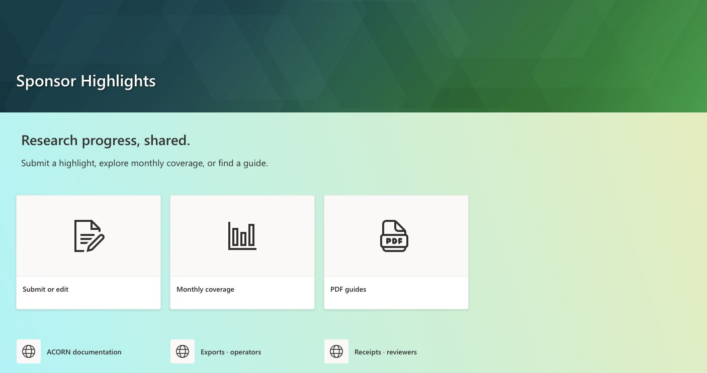
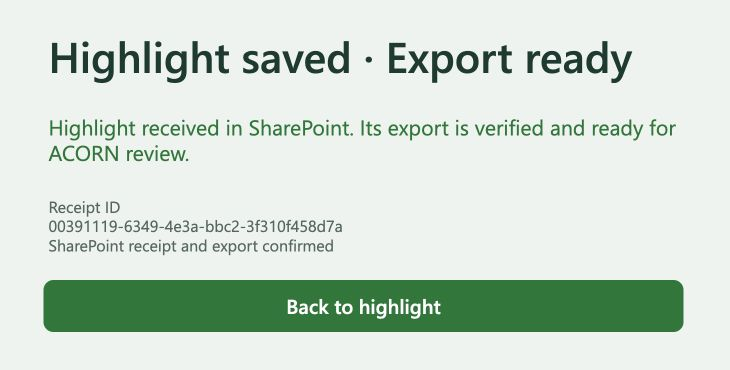

# Entry point

[Sponsor Highlights](https://ornl.sharepoint.com/sites/ResearchEnablement/SitePages/Sponsor-Highlights.aspx) is the published entry page for contributors, reviewers and operators. It is linked as **Sponsor Highlights Hub** immediately below Home in the Research Enablement site navigation. The existing site home is unchanged.

The page reuses the report/dashboard teal-and-green geometric banner, without an author byline. A light blue-to-green section background connects the banner to three large white Quick Links cards: submission/editing, monthly coverage and PDF guides. These use the Grid layout with distinct submission, chart and PDF icons. A separate Compact Quick Links row provides ACORN documentation, operator exports and reviewer receipts. Both web-part titles are hidden. The introduction, workflow strip and brief first-visit/correction reminders keep the page concise. Comments and unrelated recommendations are off. Reviewer destinations retain their existing access restrictions.

# PDF library

[Sponsor Highlights Guides](https://ornl.sharepoint.com/sites/ResearchEnablement/Sponsor%20Highlights%20Guides/Forms/AllItems.aspx) is a dedicated document library, ID `7ae2f775-f82a-4cb5-9c29-8eb26d42a031`. The owner will upload the PDFs later; the page links to the library, not nonexistent files.

Upload these current sources without renaming them:

- [User and reviewer guide](_assets/sponsor-highlights-user-reviewer-guide.pdf)
- [Developer guide](_assets/sponsor-highlights-developer-guide.pdf)
- [Demo walkthrough](../manual-jsonl-ingestion-graduation/_assets/demo-walkthrough.pdf)

Replace each existing file when publishing a revised guide so its SharePoint URL remains stable. Keep backups, credentials, payload fixtures and unreviewed reports out of this reader-facing library.

# Access and acceptance

On October 28, the owner explicitly approved Read access for the existing four dashboard contributors on this page and guide library only. The guide library has unique permissions with its existing owner/member/visitor grants retained; all four direct Read grants were verified after reloading. The hub page (Site Pages item 3) returned **Access granted** for the same four resolved recipients with **Can view** selected and notification emails disabled. Raw submissions, exports and whole-site membership were not expanded.

The published page, banner, site-navigation link and guide-library destination were inspected in the owner session. The October 28 visual redesign was published and all six rendered link destinations were checked against their intended URLs. The final design separates primary action cards from supporting links and replaces the earlier purple filled buttons. Contributor-account access to the new hub and library still needs a participant check; earlier dashboard access checks do not establish this. PDFs remain pending the owner's deferred upload.

# Asset naming — October 28

The published form is **Sponsor Highlights - SharePoint**. Its subtitle is “Document progress. Connect research to impact.” Confirmation headings use **Export ready**, and unresolved exports offer **Retry export**. The published app was opened and refreshed to verify the new name, restored-receipt panel and banner. No submission was created for this wording check.

Current friendly names:

| Asset | Display name |
| --- | --- |
| Receipt list | Sponsor Highlights Intake |
| Project catalog list | Sponsor Highlights Projects |
| Download library | Sponsor Highlights Exports |
| Intake flow | ACORN SharePoint Intake |
| Catalog flow | ACORN SharePoint Catalog |
| Scheduled export flow | ACORN SharePoint Logbook Export |
| Solution | ACORN SharePoint |
| SharePoint connection reference | SharePoint ACORN-0c871 |
| Retained GitLab intake | ACORN Logbook GitLab Intake (Draft) |
| Retained test export libraries | PA19 TEST ONLY Exports; PA24 TEST ONLY Exports |

The intake and correction flows now use **Export ready** / **Export verified** in their Teams messages. Both flow saves returned the ready confirmation. Recipient selection, conditions, payloads and destinations were retained. The active SharePoint flows remain On; GitLab intake and catalog remain Off.

The hub uses **Exports · operators**, and the current guides and workflow maps use the same terminology. Historical screenshots and native backup packages retain their captured labels; they are dated evidence, not current naming instructions. Technical file-format descriptions still say JSONL where the format matters. Existing SharePoint paths, app/flow/list IDs, solution unique name, canvas flow bindings, browser-recovery key and `.jsonl` extensions were preserved so links and processing continue to work. A full source search therefore still finds these terms in technical identifiers and historical evidence.

