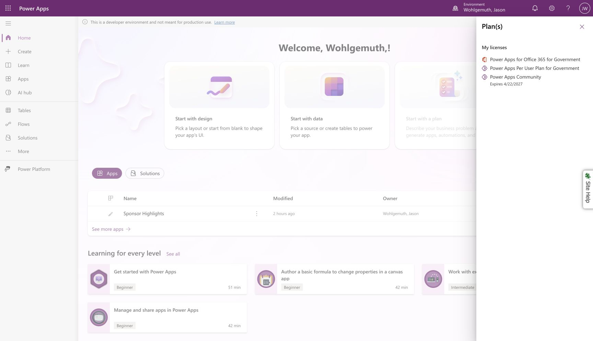
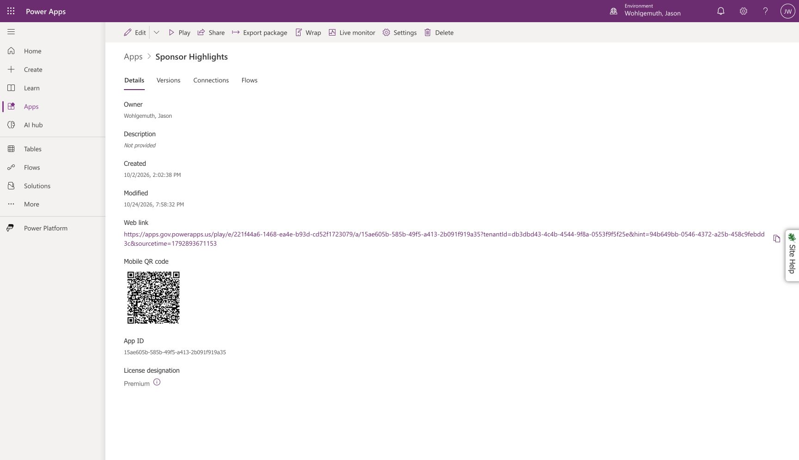

# Intake access and license evidence

Updated October 25, 2026 (America/New_York) in Jason Wohlgemuth's existing signed-in session. The owner reports no administrator ticket and requests using existing access. An administrator ticket is not a prerequisite for isolated testing. No network policy or operational component, credential or connection binding was changed. The owner subsequently created a separate test connection using the existing authorized credential.

## Original participant licensing issue resolved

Owner confirmation, October 26, 2026: DH could not open the original GitLab-backed Sponsor Highlights app because he did not have a premium entitlement and its GitLab custom connector required one. The reported premium-plan prompt is explained; no further DH-specific diagnosis or retest of the original premium app is required. This closes that access investigation without claiming that his license was changed or access to that app was granted.

This licensing issue is separate from the intermittent GitLab network-range 403/504 limitation recorded below. The separate [SharePoint pilot](sharepoint-pilot.md) removes the GitLab bindings and uses standard connectors. [PA-22 participant acceptance](sharepoint-pilot.md#october-27-standard-participant-acceptance) subsequently passed for that route, alongside the separate manual CLI handoff. DH's original denial neither blocks that test nor proves a successful SharePoint submission. No new live test or account/connection change was performed for this closure.

## Known limitation and PA-02 closure

**Owner decision, October 25, 2026:** “Record GitLab connectivity as a known limitation and finish PA-02.” PA-02 is complete under this revised acceptance scope: the Jason-only pilot licensing assessment and observed access behavior are documented; dependable GitLab connectivity is no longer a condition for closing this phase. Its completed execution section has been removed from the active plan.

**Known limitation:** Power Automate-to-GitLab requests intermittently return network-range HTTP 403 responses, despite successful intervening reads and earlier writes. The exact cause of the inconsistent filtering remains unverified. Connectivity has not been repaired or certified reliable. The latest isolated denial and earlier successes remain recorded below.

**Operational effect:** project loading or submission may fail. An unresolved receipt is not proof of persistence; retain its frozen payload and UUID. Preserve conditional writes, immutable receipt verification and disabled automatic write retries. Do not bypass network controls or repeatedly retry an explicit policy denial. For a demo without live access, use the captured fixture and label that intake segment as recorded evidence.

**Follow-up and scope:** the existing network-access handoff in the [pilot runbook](pilot-runbook.md#network-access-handoff) remains available if connectivity remediation is pursued. No ticket, network change or credential change is required by this closure decision. PA-15 boundaries, PA-16 concurrency, PA-17 restoration and PA-12 shared deployment remain independent acceptance work; a connectivity failure can prevent a particular live test from completing, but does not reopen PA-02. The current decision accepts the limitation for this pilot and does not establish licensing or deployment approval for additional users or unattended automation.

The checkpoints below describe the evidence and acceptance position at the time of each test; this decision supersedes their earlier open-phase disposition.

## Licenses observed

Rechecked October 25 at approximately 18:20 America/New_York: the signed-in account still lists **Power Apps Per User Plan for Government**. The Community plan now displays April 23, 2027; that trial is not the basis for the pilot assessment. [Current license capture](_assets/access-acceptance/pa02-current-licenses.png).

The current [Microsoft licensing FAQ](https://learn.microsoft.com/en-us/power-platform/admin/power-automate-licensing/faqs) was checked again on October 25. It distinguishes app-context instant flows, which use the invoking user's Power Apps entitlement, from standalone automation. Both isolated intake details pages identify an Instant flow, Jason as owner, and plan **The user who runs the flow**. Their native definitions use the Power Apps V2 trigger and the published test apps reference them. The optional Associated apps and flows list is empty; that list is not evidence of a missing Power Apps trigger. No association, entitlement, sharing or operational definition was changed.

This supports the existing Jason-only app-triggered intake/catalog use in both environments. It does not establish licensing for additional users, standalone manual runs, callbacks or Vergil. Live app invocation and access results are recorded separately below; license evidence does not prove GitLab write reliability.

Power Apps Settings → Plan(s) lists:

- Power Apps for Office365 for Government
- Power Apps Per User Plan for Government
- Power Apps Community, expiring April 22, 2027

Sponsor Highlights app details designate the app Premium and require an end user to have a Per App Plan or Per User Plan. This provides direct evidence of Jason's assigned per-user entitlement; the earlier claim that all pilot license evidence was missing is superseded. It does not establish licenses for other users.

Microsoft's [licensing guidance](https://www.microsoft.com/licensing/guidance/Power-Platform) includes Power Automate use rights for flows associated with a Power Apps application. Its [Power Automate FAQ](https://learn.microsoft.com/en-us/power-platform/admin/power-automate-licensing/faqs) distinguishes app-context flows from standalone automation. The exported intake and catalog definitions use Power Apps V2 triggers and are dependencies of Sponsor Highlights. Together, these facts support the current Jason-only, app-triggered pilot. This is an assessment of the observed license and configuration, not a tenant-wide licensing determination. A standalone callback or unattended bot must be assessed separately; no additional licenses were purchased or assumed.

## Access remains an empirical acceptance gate

The retained pilot evidence includes both successful app-triggered append/replay and explicit network-range 403 responses. On October 25 the new isolated Jason connector returned HTTP 200 for VerifyMainBranch at 16:35:49 UTC and GetProjectCatalog at 16:36:09 UTC (13 projects). ReadLogbook returned HTTP 404 at 16:36:42 UTC for the isolated file that did not exist at that checkpoint. All three response schemas validated. See [request IDs and screenshots](restore-target-readiness.md#isolated-connector-revision). Those connector tests establish access at those times; no write or exact replay was performed during those connector-only tests. A subsequent native Power Apps-triggered catalog flow passed a manual designer test at 16:55 UTC, run `08584086595609022768772030053CU30`; it returned all 13 projects through the isolated connection. After native solution conversion, resubmission `08584086594173685533974706185CU16` also succeeded overall: the catalog action succeeded in 0.4 seconds, while the response was skipped. This confirms a repeat connector call through the new test reference, not response delivery to an app. After explicit native reference repair, Jason designer test `08584086587813997307821396476CU02` passed all three steps at 17:08 UTC. Native export 1.0.0.4 then restored into ORNL with a separate protected test connection. ORNL designer test `08584086581182120845753124938CU14` passed all three steps at 17:19 UTC; GetProjectCatalog returned HTTP 200, 13 projects, source `config` and the same revision. See [restoration and output evidence](restore-target-readiness.md#ornl-native-restore-acceptance). Later v6 acceptance verified native test-app catalog invocation in Jason and ORNL; ORNL app-driven run `08584086507609818994513589261CU31` passed October 25 at 3:22 PM America/New_York. App-driven intake remains unverified. These read successes do not establish repeatable egress or prove that moving to ORNL Personal Productivity resolves the intermittent denial.

Continue using existing authorized routes and protected connections where compatible. Test each environment's isolated connector against isolated files, recording timestamps, run IDs, HTTP outcomes, receipt identity and immutable readback. Do not rotate credentials to work around network policy. Do not write the operational inbox to demonstrate test access.

At this checkpoint, repeatable access and final flow-context verification were still unaccepted; the owner subsequently closed PA-02 with connectivity recorded as a known limitation. PA-15 and PA-16 may proceed once their isolated route can be exercised safely; they need no new administrative ticket. Their acceptance cannot be inferred from the older single-user demo or from simulated responses.

## October 25 native intake write, replay and renewed denial

Jason's isolated native intake completed manual append `08584086552539263000712925851CU18` at approximately 18:07 UTC and exact replay `08584086551895520151909856703CU06` at approximately 18:08 UTC. Commit `bd5888fa7a1f4b555414384819173bc6409ab70d` added one TEST ONLY line to `.acorn/intake/acceptance/pa17-logbook.jsonl`; immutable readback and exact browser byte comparison passed. Replay skipped the commit. Both skipped Teams. These are manual tests of a Power Apps V2 flow, not app-context licensing or restored-app acceptance.

The next attempt, `08584086551396206729261127404CU24`, returned HTTP 403 from VerifyMainBranch at `2026-10-25T18:09:05Z`. The body explicitly identifies an IP network-range security restriction; action tracking ID `f7c38202-f69f-4e5c-b625-1eb9c38260fd`. Persistence was skipped, the outer unresolved response succeeded, and the isolated file's exact bytes remained unchanged. The flow's overall Succeeded badge reflects handled failure, not persistence. No source IP was included in the captured response, and none is inferred. No retry or network/credential workaround followed the explicit denial.

[Detailed outcomes, run evidence and screenshots](restore-target-readiness.md#jason-native-intake-write-and-replay) establish that intermittent denial persists even after native reference repair and successful writes. PA-02 was open at this checkpoint; no administrator ticket was created or made a prerequisite. Current access still cannot be represented as reliable.

## ORNL restored intake: reads pass, commit denied

Native intake/catalog version 1.0.0.5 imported successfully in ORNL Personal Productivity on October 25. Manual replay `08584086532554165170447843195CU19` and changed-summary conflict `08584086532144607697385592776CU20` both reached their intended responses without writes or delivery. Fresh submission `08584086531530438165830898752CU14` then passed branch, history, catalog and current-file reads but received HTTP 403 at Commit append. The response dated `2026-10-25T18:42:13Z` explicitly identifies a network-range security restriction; action tracking ID `d38bf387-a801-4cf6-823d-fdc4763103f1`. No source IP is inferred.

The unresolved response succeeded, confirmation/queued-new and Teams were skipped, and the isolated file stayed byte-identical at 457 bytes. No retry or network/credential workaround followed. The test intake was returned Off. This proves that successful reads in ORNL do not establish write access or resolve the intermittent restriction. PA-02 was open at this checkpoint. [Restoration and run evidence](restore-target-readiness.md#ornl-native-restore-acceptance).

## October 25 evening PA-02 acceptance

The current test components were inspected through Chrome before execution. Both native intake scopes target only project `22464`, branch `main`, `.acorn/intake/acceptance/pa17-logbook.jsonl`; their notification conditions include the constant-false guard. ORNL persistence connector actions retain retry policy `none`. Separate protected test connections remain bound. No definition, credential, association, permission or operational component was edited. [ORNL preflight](_assets/access-acceptance/pa02-ornl-preflight.json), [Jason preflight](_assets/access-acceptance/pa02-jason-preflight.json).

| Environment and check | Result |
| --- | --- |
| ORNL restored-app catalog | All three actions passed; HTTP 200, 13 projects, revision `bd5888fa7a1f4b555414384819173bc6409ab70d`. Response `2026-10-25T22:20:07Z`; run `08584086401052457796638331029CU19`; action `92b5c9ec-87b5-417e-9984-3f4eeeb97ed6`. |
| Jason test-app catalog | App opening and explicit refresh produced successful runs `08584086400708530166700686724CU18` and `08584086400108555213692603699CU07`. The latter returned HTTP 200, all 13 projects and the same revision at `2026-10-25T22:21:17Z`; all three actions passed; action `a28f0d61-b8dd-434a-854d-33c835b21e89`. |
| ORNL restored-app intake | Run `08584086400397308169855834201CU13`, started `2026-10-25T22:20:45Z`, received submission `89deb952-7c6e-4cbf-b395-83189451e83a`. Branch verification recovered after one existing automatic read retry following GatewayTimeout; envelope, history and catalog checks passed. Current-file read failed with HTTP 403 at `2026-10-25T22:21:18Z`. |
| Failure behavior | Read-failed response succeeded; Existing bytes and Safe tail were Skipped, so their descendant commit path did not execute. The app displayed “Your highlight needs attention” and retained the same pending receipt. The flow's overall Succeeded badge represents handled failure, not a saved record. |
| End state | ORNL test intake was returned Off and verified. Jason test intake remained Off throughout. No replay, second fresh submission or further write test was attempted after observing the policy denial. Catalog flows remain in their original On state. |

The failed read returned:

> Access from your IP address is currently restricted due to security controls applied to your network range.

No source IP was exposed by this response; the caller's browser IP is not assumed to be the cloud connector's source IP. The response also includes `x-ms-apihub-cached-response: true`; this alone does not establish the cache's role in the denial or authorize a cache/network workaround. Browser navigation to the GitLab file separately timed out; it did not establish an independent current-file snapshot. No byte-for-byte post-run repository comparison is claimed. The no-write finding rests on the observed skipped branch and inspected definition.

Evidence: [ORNL catalog](_assets/access-acceptance/pa02-ornl-app-catalog.txt), [Jason catalog](_assets/access-acceptance/pa02-jason-app-catalog.txt), [Jason run history](_assets/access-acceptance/pa02-jason-catalog-history.txt), [read retry](_assets/access-acceptance/pa02-ornl-branch-retry.txt), [403 details](_assets/access-acceptance/pa02-ornl-read-denial.txt), [skipped write branch](_assets/access-acceptance/pa02-ornl-no-write.txt), [unresolved app receipt](_assets/access-acceptance/pa02-ornl-app-unresolved.png), [ORNL Off](_assets/access-acceptance/pa02-ornl-intake-off.png), [Jason Off](_assets/access-acceptance/pa02-jason-intake-off.txt).

### Acceptance disposition

The **Jason-only app-context licensing assessment is complete** for the observed entitlement and intake/catalog configuration. This is not tenant-wide approval or unattended automation licensing. The actual restored-app invocation is now observed; a confirmed save and exact replay remain unaccepted.

The owner subsequently accepted intermittent connectivity as a known limitation and closed PA-02; see the [closure decision](#known-limitation-and-pa-02-closure). The denied read and absent fresh-save/replay acceptance remain factual limits of this test. They do not count as passed PA-15/16/17 cases. No exception or policy change was requested or performed.
