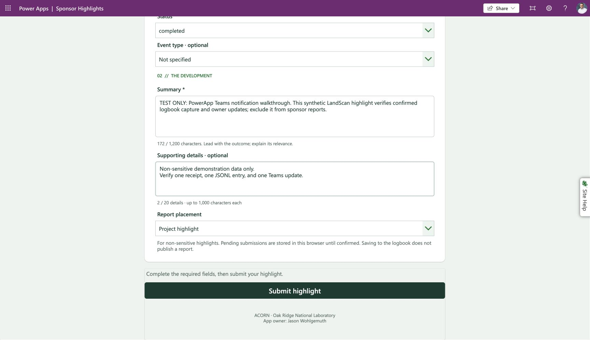
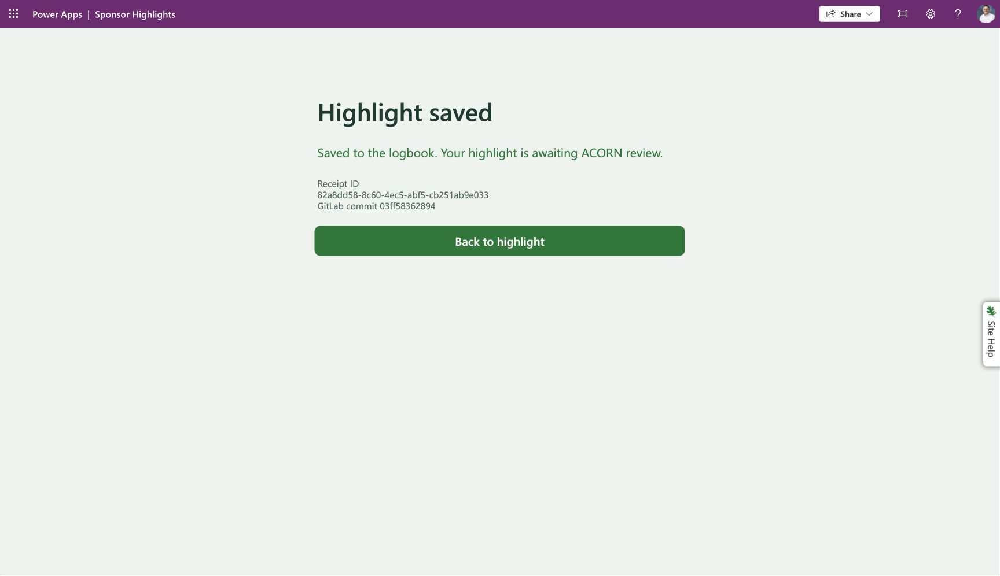
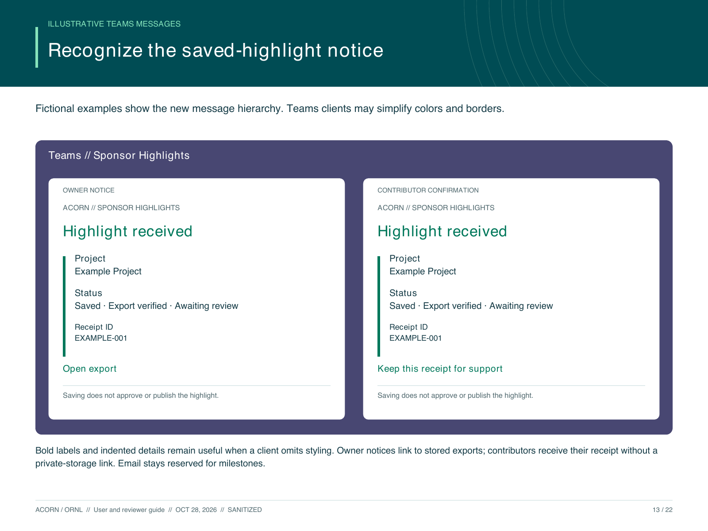

# PowerApp and Power Automate walkthrough

> **Sanitized copy:** Account labels and related assets have been redacted. Historical checksums and import results describe the originals; see [privacy and reuse limits](../../privacy.md).

Updated October 27, 2026, in the **Wohlgemuth, Jason** pilot. GitLab notification acceptance is dated October 24; the parallel SharePoint app/export/Teams tests are dated October 26. Jason Wohlgemuth receives every current workflow notification and milestone email. SharePoint submitters also receive a Teams confirmation; this October 27 routing update supersedes the earlier owner-only descriptions in the dated PDF captures. The updated [contributor/reviewer guide](_assets/sponsor-highlights-user-reviewer-guide.pdf) and [developer guide](_assets/sponsor-highlights-developer-guide.pdf) now identify SharePoint as the default and GitLab as paused, while covering both contracts, with branch-specific receipts, recovery, notifications and current local CLI commands. Screenshots retain explicit evidence dates.

The user guide now includes a workflow map on **user/reviewer page 3 and developer page 2**, styled like the ACORN book diagrams. It shows new submissions and the My Submissions / Edit selected / Save correction path converging on immutable receipts, Teams confirmation, collected JSONL and local review/reporting. A second correction-history diagram on user/reviewer page 18 and developer page 12 explains how all original and correction receipts are preserved while reviewed apply retains one current logbook entry. GitLab connector material is grouped in Appendix A at the end: user/reviewer pages 19–22 and developer pages 13–15. Role tags and colors distinguish user actions, automated Power Automate work, developer/reviewer steps, and developer-only ACORN commands. Users submit and correct; developers run stage, inspect, apply, optional run --index, and report. Downloading JSONL and triggering milestone notices belong to the developer/reviewer. Dashed links identify owner-triggered milestones. Editable [Pikchr source](_assets/notifications/workflow.pikchr), the rendered [vector diagram](_assets/notifications/workflow.svg), and the [printable page](_assets/notifications/workflow.html) are preserved here. The [correction-history source](_assets/notifications/correction-history.pikchr), [vector diagram](_assets/notifications/correction-history.svg) and [printable page](_assets/notifications/correction-history.html) accompany both guides.

## Current notification appearance and corrections

The October 27 [visual hierarchy update](_assets/notifications/visual-hierarchy/README.md) adds green headings, bold labels, bordered indented details, dividers and italic footer notes. Live owner submission and correction delivery were inspected in Teams; the guide mockups remain fictional. Contributor correction delivery succeeded and the user confirmed the visible Teams receipt; revised routine callback rendering remains unverified by a fresh run.

The published SharePoint form now supports **My submissions → Edit selected → Save correction**. It keeps project and report placement fixed and records a new linked receipt without rewriting the original. Pending saves must reconcile before another edit. Corrections await operator review and do not change an existing report. [Editing evidence](_assets/sharepoint/submission-editing/README.md) covers accepted owner and standard-license contributor checks; PA-31 is complete.

## Use SharePoint for new highlights

- [SharePoint workflow](https://apps.gov.powerapps.us/play/e/221f44a6-1468-ea4e-b93d-cd52f1723079/a/163f110f-7f8a-401c-894e-0786b2c018a4): shared list receipt plus one exact JSONL file per UUID. The app confirms **Highlight saved · Export ready** only after export readback. If only the receipt is confirmed, retain the same ID and use **Retry export**. The catalog is a maintained 13-row snapshot, not live GitLab discovery. Standard-license participant access passed October 27 (PA-22).
- Original GitLab app: repository JSONL append and immutable commit receipt. Its intake/catalog are now Off; the app, custom connector and connections are retained for restoration. Intermittent access remains a known limitation. See the [cutover runbook](_assets/sharepoint/cutover/README.md).

Use one branch per highlight. Keep unresolved submissions in their original app. The SharePoint app has a separate recovery slot; it does not migrate GitLab pending records. See [SharePoint deployment and acceptance](sharepoint-pilot.md).

## Retained GitLab walkthrough (use only after restoration)

1. [Open Sponsor Highlights](https://apps.gov.powerapps.us/play/e/221f44a6-1468-ea4e-b93d-cd52f1723079/a/15ae605b-585b-49f5-a413-2b091f919a35). Use one app tab. The catalog loads automatically; **Load Project List** is available before a successful load and **Refresh Project List** afterward.
2. Select the project, date, category, and status. Describe what changed and why it matters. Add optional supporting details, event type, and report placement. Use only non-sensitive highlights: the pending draft is stored locally in the browser.
3. Select **Submit highlight** once. The app freezes the exact payload and receipt ID, disables editing during the request, and waits for a matching result.
4. **Highlight saved** means the exact envelope is in the GitLab JSONL logbook at the displayed commit. It still awaits ACORN review. Keep the receipt ID for support; use **Back to highlight** to return to the preserved entry.
5. If the result is uncertain, retain and retry the existing pending submission. Do not start another highlight for the same content. Rejected input can be edited; a conflicting identity needs owner review.

## Updates at the useful workflow stages

| Stage | Channel | Current trigger and meaning |
| --- | --- | --- |
| New SharePoint receipt and verified export in the same run | Jason's Teams self-chat plus a direct chat with the submitter | Owner receives the export link; submitter receives project, receipt and review status without a private-storage link. Skip the extra submitter message when Jason submits. Exact replay and export first confirmed on a later retry skip both initial notices. |
| GitLab new save (paused) | Jason's Teams self-chat | Automatic intake notice after the new-save response succeeds; includes project, receipt, and immutable commit link. |
| Review workspace created (`mr-created`) | Jason's Teams self-chat | Owner manually supplies the validated event. A later email requests review when ready. |
| No report changes (`report-no-changes`) | Jason's Teams self-chat | Owner manually records that the specified period produced no report changes. No action needed. |
| Review requested (`review-needed`) | Email to Jason | Important action request with the actual review link. |
| Completed report (`artifact-ready`) | Email to Jason | Important deliverable milestone with package metadata. |
| Actionable failure (`failed`) | Email to Jason | Owner attention needed; includes the supplied failure message. |
| Form validation, saving progress, uncertain result | App feedback | No message for keystrokes, project loading, or unconfirmed saves. |
| Exact duplicate callback / intake replay | No new notification | Keep the existing receipt and destination. |

Jason receives all current notices. A SharePoint submitter receives only their own intake confirmation; other contributors are not included. The retained GitLab intake notice is owner-only and paused with its flow. The callback flow is still owner-only and manually triggered. Local CLI ingestion, graduation, and reporting do not invoke it automatically. The Vergil integration and authenticated external callback endpoint remain future work. A later approved group/channel migration belongs to PA-12.

The illustration replaces the personal Teams screenshot in the shared guide. The Teams illustration in the user/reviewer PDF compares fictional SharePoint owner and submitter notices; it is not a captured test result. Only the owner example includes a private-storage link. The paused GitLab notification contract is documented in the appendices. The [guide builder](_assets/build-workflow-guides.py) regenerates both complete guides together, including the Pikchr map and this image. The [illustration command](_assets/notifications/build-teams-example.py) delegates to that builder, so it cannot reinsert the older GitLab-only page.

## SharePoint notification behavior

The SharePoint pilot retains its owner self-chat notice and adds `Notify_submitter_SP` after all outcomes of that notice, only when both receipt creation and exact export confirmation succeed in that run. The condition skips an extra send when the normalized submitter is `owner@example.invalid`; otherwise `Create_submitter_chat_SP` creates/resolves a chat with the validated submitter and `Post_submitter_confirmation_SP` posts as User through the existing operational Teams reference. Microsoft documents Flow bot as unsupported in GCC, so this uses the User poster. The owner remains part of the direct conversation. The app-driven new-save test passed; exact manual replay skipped Teams. The notice omits summary/details and uses a formatted project, status, export link and receipt. It is best effort with retries disabled; a successful later export retry does not resend the initial notice. No durable notice outbox or routine intake email is implemented. Stored receipts remain authoritative. Full run evidence and limits are in [the SharePoint handoff](sharepoint-pilot.md).

The existing owner-only callback continues to handle later milestones. It is separate from the standard-only contributor bindings and retains its Dataverse receipt ledger. The separately accepted participant access and operator CLI handoff remain distinct from notification delivery. The original participant receipt proved only the owner notice; it did not establish submitter delivery.

## What the GitLab flows do

**Intake** (`ff4a134b-5fd3-4465-ab19-0325c2f2bf1b`) retains its existing persistence scope and unresolved-response fallback. `Notify_confirmed_new_submission` runs after all outcomes of `Unresolved_failure`, but its condition requires `actions('Queued_new')?['status']` to be `Succeeded`. It does not run the send on replay, rejection, or unresolved persistence. `Post_intake_update_to_Teams` uses the existing Microsoft Teams Default-52fd4 connection, `PostMessageToSelf`, secure inputs/outputs, and no automatic retries. It omits the highlight summary/details from the message.

The notice is best effort and follows the confirmed response. A Teams failure can mark the overall run failed after the app already received a valid receipt; it does not undo the GitLab commit or trigger another app response. Inspect action outcomes rather than treating every Failed run as a failed save. Reconcile a missing notice separately; replay does not resend it.

On October 26, the intake notice changed from plain text to HTML rich text: an ACORN // Sponsor Highlights label, a **Highlight saved** heading, separate project and review-status paragraphs, a **View saved record** link to the immutable commit, and a receipt ID block. The TEST ONLY banner remains conditional. Project and receipt values are HTML-escaped; the commit ID is URI-encoded. The message still omits the highlight's summary and details. Routing, new-save gating, retries, and secure inputs/outputs are unchanged. The operational flow saved with zero checker errors and zero warnings. This formatting change has not yet been inspected in a newly delivered Teams message; no intake submission was replayed to test presentation.

The intake flow saved successfully. Its checker showed zero errors and nine connection-change warnings directing an app refresh. Studio's intake binding was refreshed, saved, and published, and the published app then submitted successfully with the new Teams action. The earlier screenshot records those warnings accurately.

**Callback** (`dd1d8f67-116c-f55d-7752-7c7d322691c5`) now contains a `Process_notification` scope around the existing claim and guarded delivery scopes. New `mr-created` and `report-no-changes` receipts freeze `teams-self:owner@example.invalid`; other validated events freeze `owner@example.invalid`. Delivery chooses the frozen route, so previously claimed receipts keep their original destination. Legacy Dataverse logical names `cr1d0_emailrecipient`, `cr1d0_emailstate`, and `cr1d0_emailattemptrun` are retained and now describe the one selected channel. They were not renamed or migrated.

Concurrency remains one. The unique receipt key, strict event schema, exact-payload comparison, Pending → Sending → Sent state, recorded attempt, and uncertain-delivery hold remain in place. Both sends have retries disabled and protected inputs/outputs. The milestone email subject is **ACORN Sponsor Highlights milestone**; synthetic IDs receive a TEST ONLY banner in the body. A separate Teams group/channel requires its own delivery state before migration.

Use [Microsoft's Teams connector documentation](https://learn.microsoft.com/en-us/connectors/teams/) for the signed-in-user self-chat operation and government-cloud constraints. The tested action uses Jason's existing connection; no new credentials or permissions were created.

## Owner's manual milestone walkthrough

Open [ACORN Callback Receipt Validation](https://make.gov.powerautomate.us/environments/221f44a6-1468-ea4e-b93d-cd52f1723079/flows/dd1d8f67-116c-f55d-7752-7c7d322691c5/details). Choose **Run**, enter a stable **Webhook ID** and exact **Event JSON** matching [the schema](../vergil-gitlab-jsonl-automation/_assets/callback-event.schema.json), then inspect the run and receipt. Use the actual event only after its stage occurs. Test fixtures are not evidence of real review or publication.

For exact retry, keep the same ID and JSON bytes. Sent skips delivery. A changed payload conflicts. For Sending/unknown state, inspect the recorded attempt and the Teams chat or Outlook Sent Items before reconciliation; never reset Pending solely because a connector timed out. Preserve the original destination and attempt. External acknowledgement, sender lost-response recovery, and Vergil restart acceptance remain unproven.

## Dated acceptance

| Test | Evidence | Outcome |
| --- | --- | --- |
| Published form + intake notice | `08584087205468981614810029297CU09` | Saved and Teams action succeeded; actual Teams receipt inspected. |
| JSONL append | `03ff5836289447034f40f2a4898c155441e6cb66` | Exactly one added line, zero removals; all previous bytes retained; UUID occurs once. Seven synthetic lines total. |
| Exact intake replay | `08584087203368929940105688293CU25` | Queued replay succeeded; Teams action skipped; remote main remained at the original append commit. |
| Routine callback | `08584087211445944033254400953CU14` | Teams succeeded, email skipped, Mark sent succeeded; actual Teams message inspected. |
| Exact routine callback replay | `08584087207751274720312650353CU31` | Duplicate no send succeeded; delivery branch skipped. Expected duplicate claim conflict was handled; overall run succeeded. |
| Milestone callback | `08584087205548109223433666322CU07` | TEST ONLY failed-event email succeeded; Teams skipped; overall run succeeded. Inbox receipt was not independently inspected. |

The captured form receipt is `82a8dd58-8c60-4ec5-abf5-cb251ab9e033`. `_assets/notifications/confirmed-submission.json` preserves that synthetic envelope; `_assets/notifications/append-check.json` records byte preservation and the snapshot hash. Runtime text and screenshots are retained beside this walkthrough. These tests do not establish reliable GitLab egress, concurrent-writer acceptance, or production licensing.

## Source and restoration limits

`../vergil-gitlab-jsonl-automation/_assets/notifications/process-notification.clipboard.json` is the complete current callback scope; `../vergil-gitlab-jsonl-automation/_assets/notifications/callback-claim.clipboard.json` and `../vergil-gitlab-jsonl-automation/_assets/notifications/callback-delivery.clipboard.json` are its constituent scopes. `_assets/notifications/intake-teams.clipboard.json` is the new top-level intake condition, appended after the existing fallback. Bind existing protected connections in the designer; never embed credentials. Imported top-level run-after settings must be verified explicitly. If the designer drops an expression during import, restore it using the Expression editor and inspect it before saving. The intake message and static email subject were verified through live execution.

This is a source backup, not an importable Power Platform solution. The intake clipboard source and fictional Teams illustration include the October 26 HTML template; captured flow screenshots retain their dated appearance. The durable JSONL and Dataverse receipt records remain authoritative; Teams and email are notifications.

The SharePoint intake notice links its individual receipt file. A separate serialized exporter refreshes the [combined logbook](https://ornl.sharepoint.com/sites/ResearchEnablement/Sponsor%20Highlights%20JSONL%20Pilot/logbook.jsonl) every five minutes from the collected list rows. Use that combined file for normal local intake. The exporter sends no additional Teams message or email; app confirmation does not imply the next combined refresh has already finished. See [export evidence](sharepoint-pilot.md#combined-logbook-export).

## October 27 participant delivery repair

The participant reported no Teams message for receipt `341cfb78-c673-4c5c-9e0f-e63c520130f4`. The earlier successful action was `PostMessageToSelf` on Jason's connection, so it never targeted the submitter. No email was expected on submission. The owner reaffirmed Teams for submission and email only for important milestones.

The new guarded SharePoint branch is saved. It uses the existing operational Teams reference, secure inputs/outputs and no automatic retries. Submitter failure cannot undo the stored receipt or response. The owner notice is attempted first; the submitter branch can still run after its failure. The participant message includes no summary/details or private SharePoint link. Exact intake replay still skips the entire initial-notice condition.

Notification-only run `08584084919625153315352587758CU17` at 11:28 AM America/New_York succeeded: owner notice, chat creation and participant confirmation all succeeded. It sent a delayed receipt confirmation to `participant@example.invalid` and an operator notice to Jason without invoking intake, exporting data or adding a JSONL row. This is connector-delivery evidence; recipient reading/Teams alert visibility was not independently observed. The test flow `861f6bdf-4c38-4fa8-902f-b1b0eb277678` is Off after the single run.

The live callback claim was independently inspected: routine events freeze `teams-self:owner@example.invalid`, and all other validated milestone events freeze `owner@example.invalid`. Existing destinations already include Jason, so no callback mutation or test email was necessary. Historical receipt destinations and delivery states remain unchanged.

[Guarded branch source](_assets/notifications/participant-routing/Notify_submitter_SP.clipboard.json), [successful run](_assets/notifications/participant-routing/participant-notification-run.txt), [callback recipient audit](_assets/notifications/participant-routing/callback-claim-audit.json) and [test Off state](_assets/notifications/participant-routing/notification-test-off.txt) preserve evidence. The complete SharePoint notice source is `_assets/sharepoint/Notify_new_export_SP.clipboard.json`; the existing native backup predates this addition, so restore it with this documented branch overlay to retain submitter confirmations.
