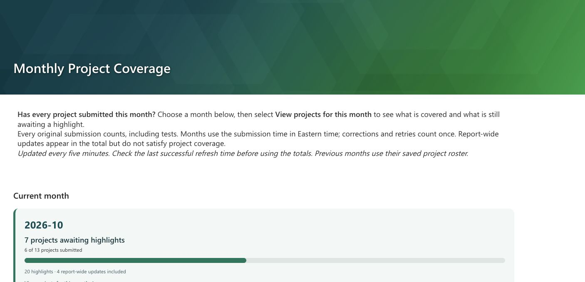
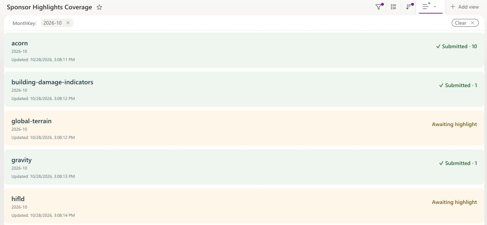
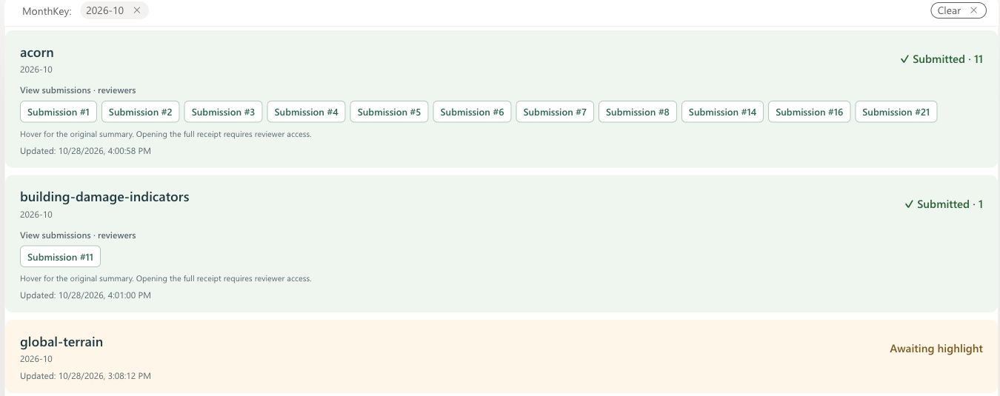
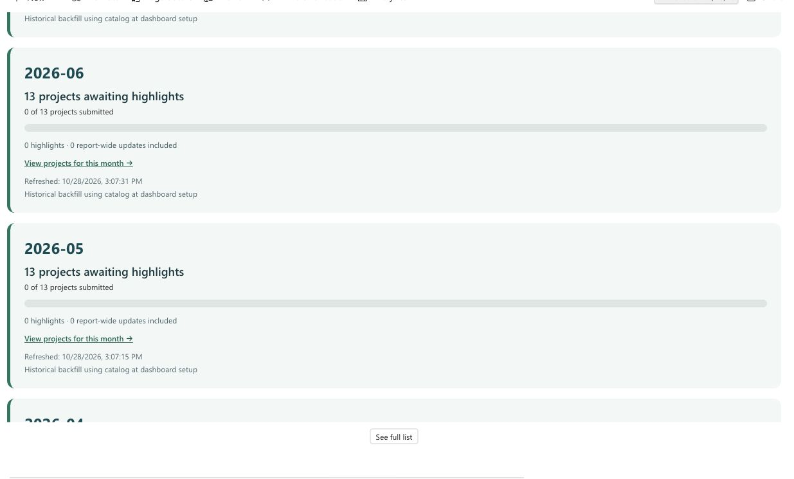
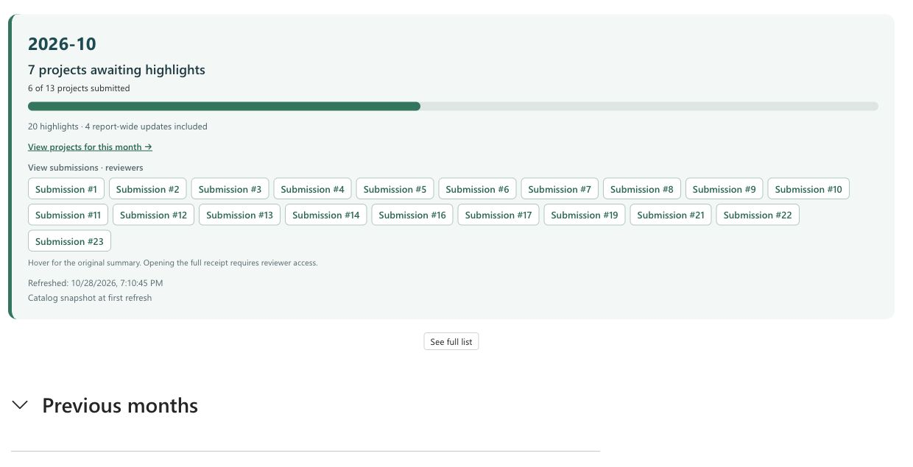
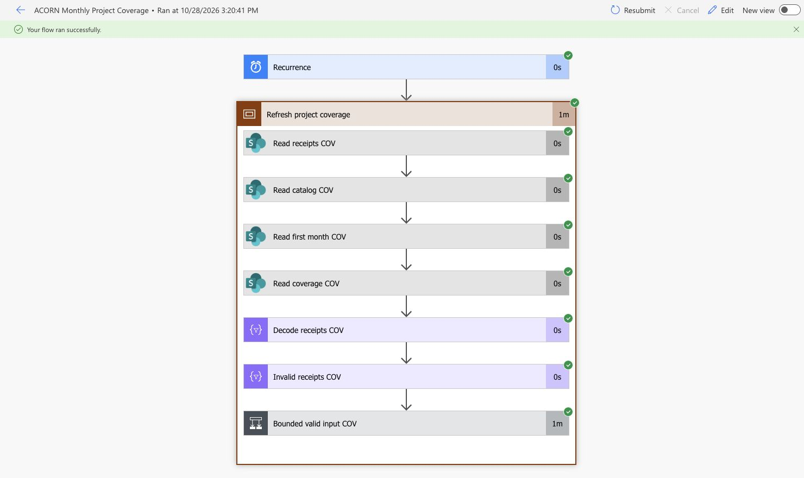

# Current state — October 30, 2026

**Published and refreshing.** [Monthly Project Coverage](https://ornl.sharepoint.com/sites/ResearchEnablement/SitePages/Monthly-Project-Coverage.aspx) shows the current month immediately and eleven preceding months inside a **Previous months** section that starts collapsed. Cards use full month names such as **October 2026**; the sortable/filterable list keys remain `YYYY-MM`. Green progress bars show expected-project coverage; month links open green submitted and amber awaiting project cards. Desktop and SharePoint mobile preview were inspected. List editing controls, comments and unrelated page recommendations are hidden on the dashboard.

The initial independent receipt-list check found **20 rows: 17 originals and 3 corrections**, yielding 5 of 13 projects submitted. During the later submission-link acceptance, new contributor activity increased October to **20 originals, 6 of 13 projects submitted, 7 awaiting, and 4 report-wide updates**; five correction rows were excluded. These are dated acceptance snapshots, not fixed totals. September and the other initialized historical months have zero submissions. The historical roster is explicitly labeled as the catalog available at dashboard setup.

| Verified resource | Current state |
| --- | --- |
| Dashboard flow `87f168d5-5a4f-4d70-a434-a7189514e19e` | **On**, five-minute recurrence, trigger concurrency one. Final saved definition contains only Recurrence and `Refresh_project_coverage`; provisioning and view-configuration scopes were removed after their accepted runs. |
| Duplicate flow `14bc86f9-d7c0-4bd1-9fe2-8d5d287a0251` | Deleted October 30 after confirming the enabled flow above remains. |
| Months list `af93f6ad-3bd4-426b-91e4-0ab479484eee` | Twelve unique months, November 2025–October 2026; full-name `MonthLabel`, stable `YYYY-MM` key, saved roster, coverage totals, original/general counts and refresh timestamp. |
| Coverage list `afdd1164-2589-4366-a415-270daf4efd3c` | Project/month summaries with the same full-name `MonthLabel`. October and September links each displayed all thirteen expected projects. Unique month/catalog-item keys prevent duplicate summaries. |
| Page item | `SitePages` list `184fd8d0-ef24-41e8-b221-98f362cb101c`, item 2; published October 28. |
| Pilot readers | Four current app contributors have explicit **Read** grants on the page and both summary lists, verified after saving. Existing owner/member/visitor grants were retained. On October 28, the owner relayed that a contributor successfully opened both October and September project views from their own account. |

The network/save blocker was resolved by the October 28 retry. The corrected provisioner completed in 12 seconds. Live testing also caught two issues repaired in retained source: the designer stripped empty-string expression arguments, and SharePoint's internal XML parsing rejected raw ampersands in formatter JSON. The deployed expression uses `string(null)`; formatter transport escapes XML metacharacters as JSON Unicode sequences.

The operational app, intake/correction/catalog/export flows, receipt data and JSONL files were not changed. No new raw-data or whole-site membership was granted, and sharing invitation emails were disabled. Entra groups remain deferred by the owner.

The header reuses the exact ACORN report background, `crates/acorn-cli/assets/images/report/title-banner.png`, uploaded to SharePoint. The Banner web part uses **Image and title**, left alignment, white title text, and no additional background gradient. The image is decorative. Published appearance and collapsed history were verified after a fresh reload on October 28.

# Using the dashboard

Open the page and locate the desired full-name month card, such as **October 2026**. The progress bar and “projects awaiting highlights” answer whether every expected project has submitted. Select **View projects for this month** to see the individual project counts, then use the browser's Back button to return. Expand **Previous months** to browse earlier month cards; select the heading again to collapse them. **See full list** opens the corresponding current or historical list view.

Months are maintained automatically. Every five-minute refresh ensures that the current month and the preceding eleven months exist, writes a `MonthLabel` formatted as `MMMM yyyy`, and refreshes the current-month flag. No page or list edit is required when the calendar advances. `Title` and `MonthKey` remain `YYYY-MM` internally so descending sort, filters and project drill-down URLs stay stable across locales.

Refresh the browser page to retrieve the latest saved summary. The background flow runs every five minutes; an already-open page is not a live push display. Check **Refreshed** before relying on the figures. The current card shows **Refresh overdue** after fifteen minutes without a successful refresh. Project **Updated** timestamps change only when that project's summary changes; unchanged historical cards keep their previous verification timestamp.

## Reviewer submission links

Each populated month and project card includes **View submissions · reviewers**, followed by a link for each original receipt counted on that card. Month links include report-wide updates; project links include only that project and month. Empty months/projects have no receipt links. Select **Submission #N** to open the corresponding SharePoint receipt in a new tab. The number is its list item ID, not its submission UUID or its sequence within the month. A receipt can have later corrections; the link intentionally opens the original counted receipt rather than counting or displaying corrections as additional highlights.

The owner explicitly selected **“Reviewers only; keep current access.”** Links are visible on the shared dashboard, but opening them requires existing access to the intake list. The owner subsequently approved **summary tooltips for all dashboard viewers**. Hovering a submission label now shows its original summary. Only the summary and numeric item ID are projected into the shared dashboard lists; details, payloads and submitter identity are not copied. No sharing token, anonymous link or new raw-list permission is included. Contributors' own-history and correction workflow remains in the PowerApp. Do not grant raw-list access merely to make these links work for contributors.

The refresh derives the `ReceiptItemIds` plain-text field from the same filtered originals used for each count. Both summary lists retain semicolon-separated numeric SharePoint item IDs. A separate plain-text `ReceiptLinks` field stores each ID paired with its original `entry.summary` for the tooltip. Percent signs, semicolons and pipes are escaped in that order before joining and decoded in reverse order by native formatting, preserving punctuation and literal escape sequences. Summaries render as plain text, not HTML. Missing summaries display “Summary unavailable.” Comparing both derived fields on refresh also repairs missing/stale links or summaries when counts have not changed. Native formatting uses `split` and `forEach` as described in the [SharePoint formatting reference](https://learn.microsoft.com/en-us/sharepoint/dev/declarative-customization/formatting-syntax-reference#foreach). Keep the `forEach` expression free of internal spaces; a space after the `split` comma caused populated rows to fail rendering during acceptance and was removed. Link groups wrap and scroll within the card when necessary.

## Collapsed historical months

The published page uses two public views of the existing Months list, with the same card formatter and fields:

| View | ID | Filter |
| --- | --- | --- |
| Current Month | `717cde47-2b63-48f5-9627-656d43bb3c96` | `IsCurrentMonth` equals Yes |
| Previous Months | `326e57b4-3a0c-488f-9387-5f1e1e9e56ae` | `IsCurrentMonth` equals No |

Both sort `Title` descending. The existing refresh sets the current-month flag using Eastern time, so no monthly page edit is needed. The original All Items view remains available. Current Month appears in the normal **Current month** List web part. Previous Months appears in the **Monthly history** List web part within the **Previous months** native collapsible section (default display: Collapsed). Both hide list controls and retain full-list navigation, project links and submission-summary tooltips. This changes presentation only; list permissions, receipt data and flow definitions are unchanged.

To restore this layout, use **Save view as** from All Items for each named view, then **Edit current view** to apply the Boolean filter. Retain all formatter fields. Bind the page's two List web parts to their respective views, enable **Make this section collapsible** on the history section, set its default display to **Collapsed**, and publish. When changing the month formatter later, apply the generated `months-format.json` to **all three month views**; `views.clipboard.json` configures only the original default view. Do not overwrite the two named views' filters.

# Counting and history contract

- Track **projects**, not people. Any authorized submitter can contribute to any selected project; project membership is not inferred from identity.
- Count each original saved receipt once by its server `Created` timestamp converted from UTC to `Eastern Standard Time`, including daylight-saving transitions. Activity date and client `submittedAt` do not select the month.
- Include test records. Saving counts immediately; export, reviewer decisions, graduation and publication are not prerequisites. This dashboard rule does not change ACORN report generation or make the existing standalone-general reporting work complete.
- Corrections and exact retries do not add a highlight. The current form fixes project and report placement during correction. A future feature allowing project reassignment needs an explicit coverage migration rule; it is not implemented here.
- The existing unique `SubmissionId` receipt column prevents exact retry rows. Validate stored payload/column identity and correction-parent consistency before deriving counts.
- Initialize a contiguous history of at least the current and preceding eleven months, including empty months. Include earlier original receipts when present, and retain the earliest stored month as time advances. The implementation bounds automatic backfill to 120 months and stops rather than silently dropping older history.
- Snapshot the project catalog (excluding `general`) for each month on its first successful refresh. Later catalog changes apply to newly initialized months. Historical snapshots created during setup are explicitly labeled as using the setup-time catalog; they are not evidence of historical project membership.
- `general` submissions are counted separately and do not satisfy project coverage. All original submissions contribute to the overall highlight total, including destinations no longer in that month's expected roster; expected-project counts use only the saved roster.
- Show the latest successful current-month refresh timestamp and warn after 15 minutes. Historical records show their last verification time. A failed refresh must not update the monthly success timestamp.

# Deployed implementation

| Resource | Purpose |
| --- | --- |
| `Sponsor Highlights Months` | Unique `Title` month key (`YYYY-MM`), user-facing `MonthLabel` (`MMMM yyyy`), frozen expected-project JSON, expected/covered project totals, original/general highlight counts, counted `ReceiptItemIds` and summary-bearing `ReceiptLinks`, current-month flag, roster basis and verification time. |
| `Sponsor Highlights Coverage` | Unique month/catalog-item key, project identity/name, stable `MonthKey`, user-facing `MonthLabel`, distinct original count, counted `ReceiptItemIds` and summary-bearing `ReceiptLinks`, first/last received times and last changed timestamp. Long project IDs use plain multiline text. |
| `ACORN Monthly Project Coverage` | Independent scheduled flow; reads existing intake/catalog and writes only the two new summary lists. |
| `Monthly Project Coverage` page | Native SharePoint List web parts; monthly progress cards link to project rows filtered to the selected month. Previous months remain available in the same month list. The deployed dashboard uses the standard SharePoint connector and does not require Power BI. |

The refresh reads source receipts/catalog plus existing summary lists once, computes each month's counts, and updates only changed project rows. It updates the current month's success timestamp each run; unchanged historical summaries are not rewritten. Month and project loops are serialized. Trigger concurrency is verified as one. REST summary reads fail closed on continuation markers or list limits; source connector reads request 5,001 rows and reject more than 5,000. The current pilot is below these limits. Local contract tests cover rejection at the bounds; maximum-size service load testing has not been performed.

Individual project writes are not a cross-list transaction. A failure can leave partially updated project rows while the month's success timestamp stays unchanged; the next serialized run reconciles them. Do not present a partial run as a completed monthly refresh. Project cards label their timestamp “Updated,” distinct from the month-level success timestamp.

# Maintenance and recovery

1. Inspect the existing dashboard flow and its latest run before retrying a failed save; ambiguous network failures previously created a duplicate. Use the retained flow ID above, and keep the duplicate Off.
2. Rebuild `provision.clipboard.json` and `refresh.clipboard.json` with `python3 build_dashboard.py`, and the two native list formatters plus `views.clipboard.json` with `python3 build_views.py`. Run `PYTHONDONTWRITEBYTECODE=1 python3 test_dashboard.py` from the asset directory. These are designer clipboard actions, **not native importable backups**.
3. Provisioning is a one-time operation. It creates lists only on confirmed 404 responses and columns only after successful empty field-collection lookups. Access/server failures stop setup. Preserve existing list data, roster snapshots and unique keys when repairing a deployment.
4. Apply view formatting through the saved configuration scope or **Format current view → Advanced mode**. Keep all referenced fields in the view. Remove setup scopes before enabling the recurring refresh; it should contain only Recurrence and `Refresh_project_coverage`.
5. After a refresh repair, compare current and historical counts with original receipts, confirm the last-success timestamp advances only after project writes finish, and verify a repeated run does not add duplicate rows. Preserve the five-minute recurrence and trigger concurrency one. Fault-injection fixtures belong in isolated storage, never the operational intake list.
6. If the 5,000-row or 120-month bounds are reached, the refresh stops and the visible timestamp becomes stale. Implement and validate pagination/archival before increasing scale; do not remove the guard or present a partial response as complete.

# Manually managed access

The owner maintains direct permissions for the pilot. Use the current app sharing list as the contributor roster and maintain reviewer assignments separately. A person on both rosters is classified as Reviewer and can still submit. The project-only dashboard does not display personal roles or names.

| Resource | Contributor | Reviewer |
| --- | --- | --- |
| Sponsor Highlights app | Direct run access | Direct run access |
| Dashboard page and both summary lists | Read | Read |
| Raw intake list and JSONL export library | No additional access | Retain existing operator permissions; grant separately when required |

For onboarding, inspect existing effective permissions, grant app run access where missing, and grant read access to the dashboard page plus **both** summary lists. App sharing does not automatically grant dashboard access, and page access alone does not grant list access. Use resource-specific permissions; do not add contributors as whole-site Members or grant them raw receipt/export access to make the dashboard load. Retain any automatically required parent Limited Access.

For offboarding, remove the person's direct app and dashboard/list grants and check for access inherited through another assignment. Removing a contributor assignment must not revoke separately authorized reviewer access. The owner/reviewer view is verified and the page is published. Contributor-account access to current and historical project views is accepted from the owner's October 28 confirmation. The approved resource-level grants have been verified; raw intake/export permissions were not modified. Keep the actual account roster in the service's permission controls, not public guides or wiki assets.

Entra groups **Sponsor Highlights Contributors** and **Sponsor Highlights Reviewers** remain an optional future simplification. They are deferred, not a release gate or an active group-creation task. A future migration should preserve direct grants until equivalent group access passes acceptance. Shared-environment migration remains the separate PA-12 decision.

# Validation record

| Check | Evidence |
| --- | --- |
| Provisioning | `08584083930745778447951535741CU19`, 2:56:50 PM Eastern; succeeded in 12 seconds. |
| Initial complete backfill | `08584083925645444182431820932CU06`, 3:05:20 PM; succeeded in 3 minutes 10 seconds. |
| Repeat and formatting acceptance | `08584083920356726592489713831CU11`, 3:14 PM, 1 minute 33 seconds; `08584083917899339244033273629CU29`, 3:18 PM, 1 minute 29 seconds; both succeeded. |
| Final refresh-only definition | `08584083916444015872315114881CU22`, 3:20:41 PM; succeeded in 1 minute 20 seconds. |
| Automatic recurrence | `08584083913442439130387925364CU17`, 3:25 PM; started automatically and succeeded in 1 minute 18 seconds. |
| Reviewer link installation | `08584083905554844533744894320CU08`, 3:38:50 PM; succeeded in 1 minute 34 seconds. Added only the two summary fields and view formatting, then refreshed the same original receipt selection. One-time setup was removed from the saved recurring flow afterward. |
| Link-aware recurring replay | `08584083903461385664375623248CU12`, 3:42 PM; succeeded in 1 minute 23 seconds after removing setup. Flow remains On; persisted project formatting shows 16 original links and seven awaiting projects with no links. |
| Link selection/navigation | October displays 20 original links, including four general receipts; project cards contain 16 links across six covered projects. Correction item IDs 15, 18, 20, 24 and 25 are absent. The project link for original item 14 opened its matching receipt, with empty correction parent. September and awaiting projects have no submission links. No permissions changed. |
| Collapsed history | Published October 28. Initial page load shows the current month and a collapsed Previous months heading. Expanding reveals eleven historical months (September 2026–November 2025), with the current month appearing only once. The heading expands and collapses again. September’s project link opened thirteen awaiting project rows. A fresh page load again showed only October with history collapsed; filters use the existing current-month flag rather than hard-coded dates. |
| Summary tooltip acceptance | `08584083893390726965849110959CU25`, October 28 at 3:59:06 PM Eastern; succeeded in 2 minutes 7 seconds. All 20 month labels and 16 project labels have nonempty summary titles; every project title matches the corresponding month title. Counts remained 20 originals / 6 covered / 7 awaiting / 4 general. One-time setup removed; saved recurring flow remains On. No raw-list or export permissions changed. |
| Full month-name acceptance | Successful manual refresh on October 28 backfilled `MonthLabel` on all twelve month rows and their project summaries. Current, historical and project-detail cards render **October 2026**, **September 2026**, and the remaining full names through **November 2025**. Drill-down links and list sorting retain `YYYY-MM` keys. Previous months were expanded for inspection, then returned to their collapsed default. |
| Independent totals | [Aggregate-only source check](_assets/project-coverage/source-counts.json): 20 source rows, 17 originals, 3 corrections; dashboard matches 5/13 project coverage and 3 general updates. |
| Replay/unchanged input | Repeated successful refreshes retained the same counts, month keys and visible project row IDs. October's success timestamp advanced to 3:21:59 PM; September remained 3:08:08 PM and unchanged project timestamps were retained. |
| History/navigation | November 2025–October 2026 cards visible. October and September links opened thirteen project rows each; September showed thirteen awaiting and no submitted projects. |
| Display | [Desktop cards](_assets/project-coverage/dashboard-live.png), [project detail](_assets/project-coverage/project-detail.png), and [mobile preview](_assets/project-coverage/mobile-dashboard.png) inspected. |
| Access | Four app contributors have Read on the individual page and both lists. Unique resource permissions retain existing assignments. No invitation emails sent. On October 28, the owner answered “Both months open successfully” to the contributor-account October/September navigation check. This user-reported acceptance completes PA-33. |

Nineteen local tests pass against generated WDL expressions/conditions: original/correction counting, Eastern month boundaries and DST, frozen rosters, year/month rollover, twelve-month history, zero counts, unique project credit, payload/column consistency, bounded reads/history, failed project refresh preventing the month-success update, idempotent field setup, XML-safe formatting, original receipt link selection and missing/stale-link repair with unchanged counts, summary punctuation/Unicode/markup preservation, summary-only repair, and full-name month labels without changing sortable keys. The small evaluator does not emulate Power Automate connectors. Connector binding, provision/save/run, actual totals, repeated refresh and native view rendering were separately verified in the service. Maximum-volume service testing and deliberately injected connector outages were not performed against operational data.

PA-32 deployment and PA-33 contributor-access acceptance are complete; both phases are pruned. Service failures remain visible through run history and stale timestamps; no extra notification channel was added.

