# ORNL Personal Productivity restore readiness

Updated October 25, 2026 using Jason Wohlgemuth's signed-in Chrome session. PA-18 native connector/reference export and ORNL catalog restoration are accepted. Complete app/intake/callback restoration remains open under PA-17; this is not approval for shared production deployment.

Environment: `ORNL Personal Productivity(default)`, ID `Default-db3dbd43-4c4b-4544-9f8a-0553f9f5f25e`.

| Check | Observed result |
| --- | --- |
| Open environment and Solutions | Passed; existing organizational solutions are visible. |
| Import isolated canvas package | Passed; the response-only PA-14 package created a new app and two new flows. Both app associations required explicit Studio rebinding before use. |
| Create isolated empty solution | Passed; created `ACORN PA17 Restore Readiness Test` (`ACORNPA17RestoreReadinessTest`), version `1.0.0.0`, with the existing default publisher. |
| Create Dataverse table | Unavailable: New → Table is disabled. The solution displays a warning that one or more commands are unavailable due to current privileges. |
| Connector authoring | Passed: created `ACORN PA17 GitLab TEST ONLY` inside the test solution, including API-key authentication schema, five operations and the catalog custom code enabled only for GetProjectCatalog. No credential connection was created and no operation was run. |
| Connector solution export and import | Passed: unmanaged `1.0.0.1` exported from ORNL Personal Productivity and imported as a new solution in Jason's environment. Restored catalog code matches the archive byte-for-byte. Jason branch/catalog connector tests and a native read-only catalog flow subsequently passed. Native reference repair enabled export 1.0.0.4, which imported into ORNL with its protected test binding. The restored native catalog flow returned all 13 configured projects; all three steps succeeded. |
| Flow authoring | Imported two response-only test flows and enabled both. Their definitions contain no external connector, GitLab, Teams or email actions. |
| Full restore | Partial. Native catalog restoration passes. Callback/table package import failed October 25 because this account lacks `prvCreateEntity`; component processing and activation did not occur. Native intake `1.0.0.5` restoration/replay/conflict passed; native canvas `1.0.0.6` import and app-driven catalog passed. App-driven intake remains pending. |

The [test solution](https://make.gov.powerapps.us/environments/Default-db3dbd43-4c4b-4544-9f8a-0553f9f5f25e/solutions/ffb8de5b-17d0-f111-a05c-001dd806277c) now contains the isolated connector, explicit connection reference and native catalog flow. Its ID is `ffb8de5b-17d0-f111-a05c-001dd806277c`. It was not set as the preferred solution. The PA-14 simulation app and two flows were subsequently imported separately. No tables or permissions were changed. The owner subsequently created the separate protected test connection described below. No GitLab writes or notifications were triggered. The existing pilot components and editor tabs were not changed.

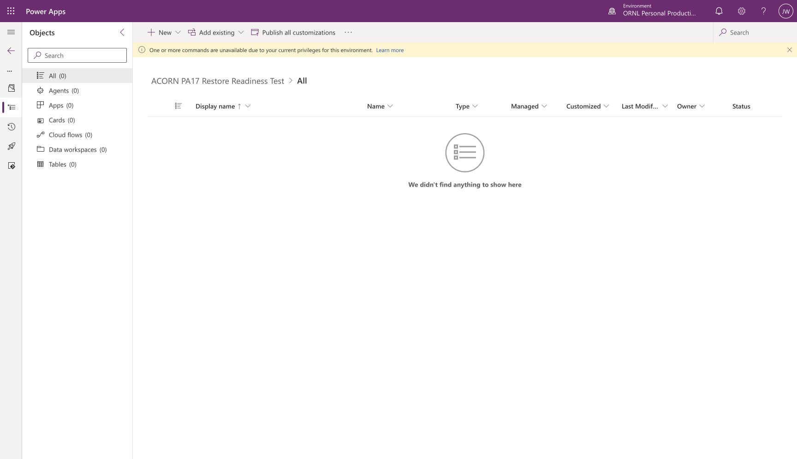

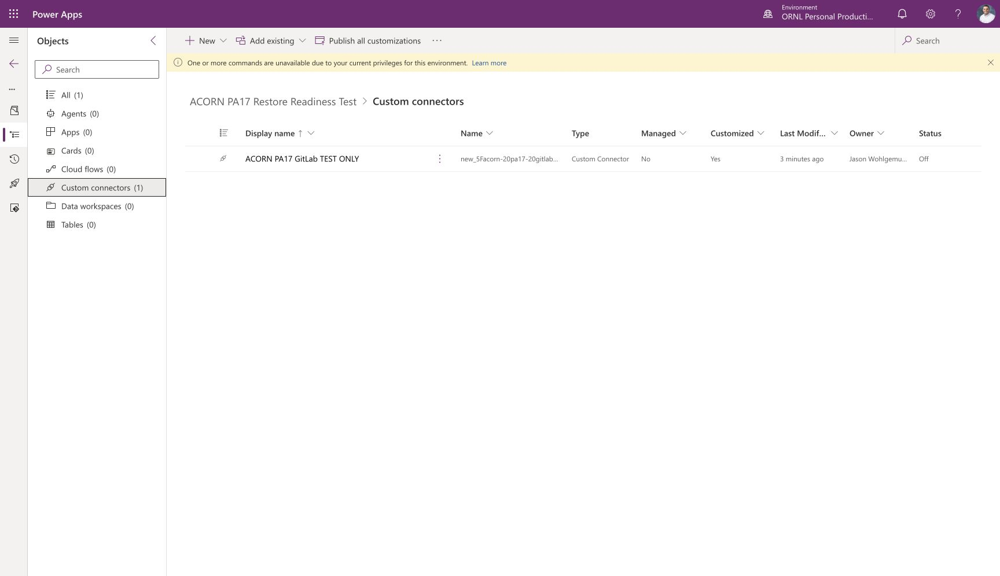

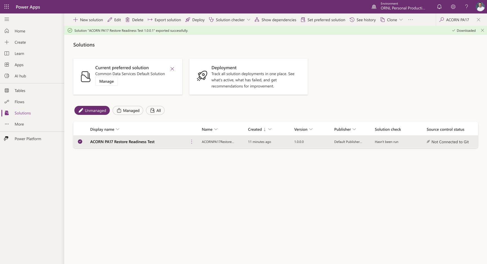

## October 25 evening app invocation checkpoint

PA-02 subsequently exercised the restored ORNL app against its native intake flow. The app reached the correct flow and received an unresolved response after `Read current PA17v2` returned the same network-range HTTP 403 at `2026-10-25T22:21:18Z`. The write branch was skipped; the test flow returned Off. Catalog calls passed in both environments. This establishes app invocation and failure feedback, **not successful intake restoration or repeatable access**. The full current record is in [PA-02 acceptance](intake-access-decisions.md#october-25-evening-pa-02-acceptance). Earlier checkpoints below remain dated evidence.

## Current backup artifacts and limits

Use the [native backup manifest](_assets/solution-export/pa17-native-backup-manifest.json), [restore instructions](_assets/solution-export/pa17-native-restore-instructions.md), and [consolidated handoff](_assets/solution-export/PA17-RESTORE-HANDOFF.md). Current import inputs are the native v6 app/intake/catalog solution and the separate callback test solution. Operational app and callback backups are retained separately and must never be imported over operational components for testing.

Asset cleanup on October 25 removed superseded v1/v2/v4/v5 solution ZIPs, the earlier sanitized canvas export, unsupported derivative packages and their builder, obsolete upload/credential handoffs, and intermediate authoring drafts. Historical hashes and run outcomes below describe those earlier checkpoints; they are not current download instructions. The unchanged native v6 export supersedes those app/connector/flow packages. Current packages, guide sources and unique acceptance/failure evidence are retained.

The original connector-only import into Jason passed; restored catalog code matched SHA-256 `38d6b9ca805cb6e862521e343fb67afce4b7859fd99c431b754ee0a9f99725c0`. The PA-14 simulated apps separately passed browser recovery acceptance in both environments. See [browser recovery evidence](browser-recovery-acceptance.md).

## October 25 backup and isolation progress

A fresh export attempt of the operational solution at its unchanged version `1.0.0.1`, without publishing customizations, failed with the same custom-connector dependency error. The preflight also identified the callback's missing Teams and Outlook connection references. Neither reference was added to the operational solution. The [failure screenshot](_assets/solution-export/source-export-failed-20261025.png) preserves the service result; the operational connector was not migrated or rebound.

### Callback/table backup

Created a separate export container, **ACORN PA17 Callback Backup**, ID `cc2c6665-91d0-f111-a05c-001dd8062052`, in Jason's environment. Existing callback, table and connection-reference components were included by reference for export only. This is a packaging association, not a cloned runnable flow. No definition, operational connection binding, table data, enabled state or published app was changed. The container was not made the preferred solution and Publish all customizations was not used.

The native unmanaged [callback backup ZIP](_assets/solution-export/ACORNPA17CallbackBackup_1_0_0_1.zip), version `1.0.0.1`, exported successfully. SHA-256: `118c9984b423e80db61e43c0cb151aa0e553493f221bde7756417a3a42665a06`.

Archive inspection found:

- One callback flow with its existing manual Button trigger.
- Table `cr1d0_ACORNCallbackReceipt`, including its ID, Webhook ID, Payload JSON, Email State, Email Recipient and Email Attempt Run columns.
- Dataverse, Teams and Outlook connection references.
- Zero `MissingDependency` entries in `solution.xml`.
- No GitLab token marker, bearer credential marker or signed callback query in the inspected files. Connection credentials and table rows are not part of this solution export.

This archive retains original component identities. **Do not import it into Jason's operational environment as an isolated test:** that could update the existing components. Restore into an inspected empty target or prepare components with separate identities first. Do not invoke its notification actions during isolation tests.

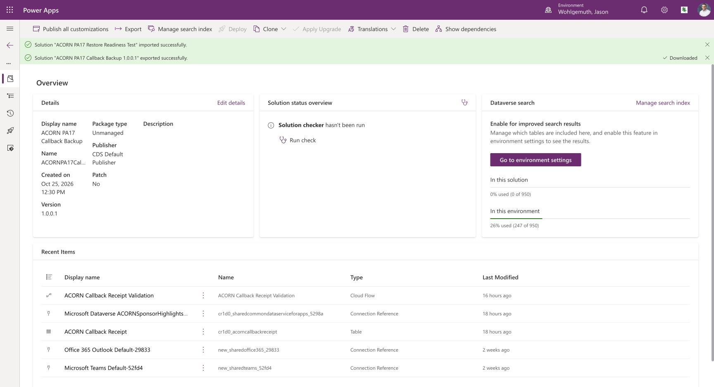

### Isolated connector revision

The restored **test connector only** in Jason's environment was updated so `ReadLogbook`, the `ListLogbookCommits` path enum and the `CommitLogbook` file-path enum all target `.acorn/intake/acceptance/pa17-logbook.jsonl`. Host, project `22464` and branch `main` are unchanged. The catalog code remains enabled only for `GetProjectCatalog`, with the same 6,901 bytes and SHA-256 recorded above.

The service reported a successful connector update. Its native unmanaged solution export version 1.0.0.2 (retired artifact; use the current native v6 package) also succeeded. SHA-256: `fac2885f1e1dac61d01f3a9cee7e5b4f1baa1d0e91bc36e25308e9d590dede27`. Inspection of the exported OpenAPI definition confirmed all three isolated-file references and no original operational logbook path. The exported custom code has the original hash. The [saved Swagger](_assets/solution-export/jason-isolated-connector.swagger.yaml) preserves the definition.

The earlier `1.0.0.1` connector archive retains its original routes and is unsuitable for write testing. Native `1.0.0.4` includes the isolated route revision plus the catalog/reference repair. It imported into the existing **test solution only** in ORNL, where all three isolated paths were verified. A schema enum is not a security boundary: every restored flow's actual commit body and read/history inputs must also be inspected before enabling writes.

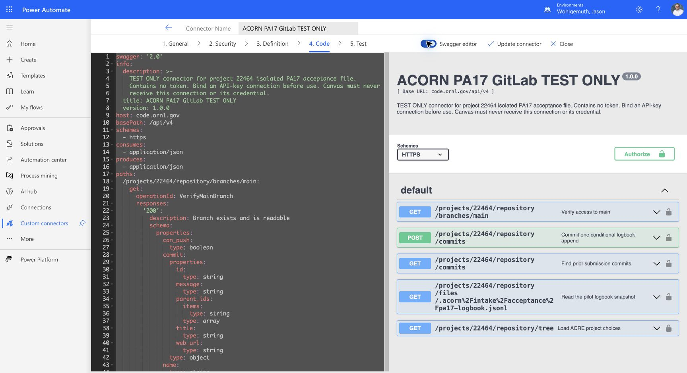

The owner created the separate **ACORN PA17 GitLab TEST ONLY** connection (creation time `2026-10-25T16:35:07.249401Z`). No secret was read or entered by the agent. Three native connector Test operations then reached GitLab:

| Operation | UTC response time | Result |
| --- | --- | --- |
| VerifyMainBranch | October 25, 16:35:49 | HTTP 200, schema valid; protected `main`, `can_push: true`, commit `03ff5836289447034f40f2a4898c155441e6cb66`; request `01M5SYP66QTRBX5B4DSNAPWXQF`. |
| GetProjectCatalog | October 25, 16:36:09 | HTTP 200, schema valid; config source, 13 projects, same revision. Restored custom code executed successfully. |
| ReadLogbook | October 25, 16:36:42 | HTTP 404 `File Not Found` at the isolated route, schema valid; request `01M5SYQSV0BVA3S5QT3TR14GFH`. The test file has not been created. |

These are connector test calls, not app-triggered flow runs. No commit was attempted. This is positive access evidence for Jason's environment at the stated times, not proof of repeatable writes, concurrency safety or ORNL target runtime.

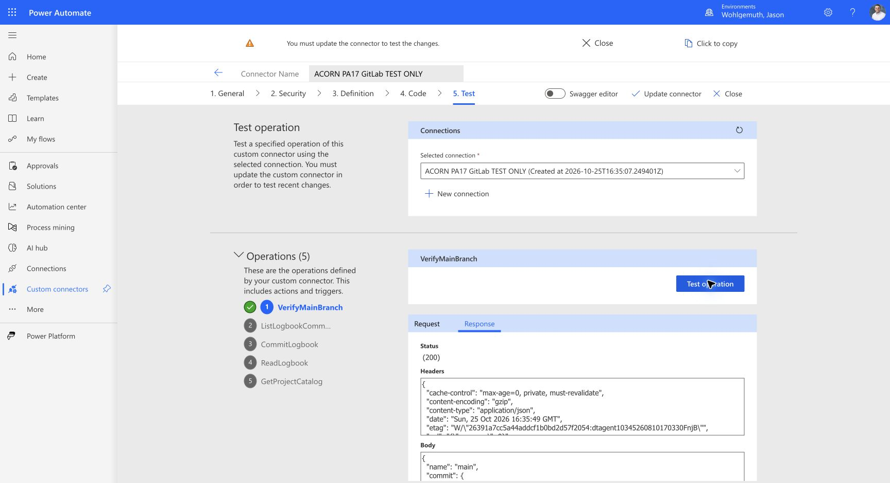

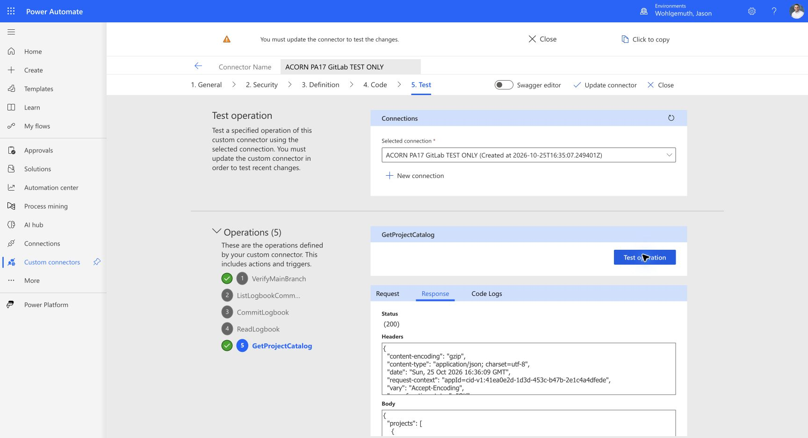

### Retired derivative-package attempts

Two edited legacy canvas-package revisions failed with the generic import error despite Create as new settings and isolated mappings. Correcting the first revision's stale short connector name did not resolve the second failure. These packages and their builder were removed during asset cleanup. Do not regenerate or deploy them: use the unchanged native v6 solution. No operational definition, binding, enabled state or inbox was changed by those failed attempts.

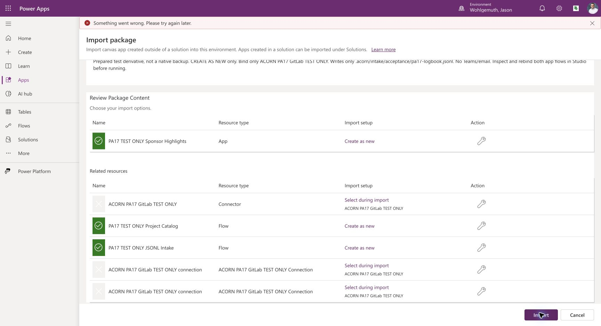

Native authoring replaced this unsuccessful route. The accepted exports and restore results follow.

### Native catalog flow acceptance

After both derivative canvas packages failed, a separate **PA17 TEST ONLY Native Catalog** flow was created through Power Automate's native designer. Flow ID `c572aa21-beb9-4167-8b29-b35cdbdf7938`. It contains a Power Apps V2 trigger, `GetProjectCatalog` through **ACORN PA17 GitLab TEST ONLY**, and a Power Apps text response named `catalog`. There are no commit, Teams, email or Dataverse row actions.

Manual designer test run `08584086595609022768772030053CU30` succeeded on October 25, 2026 at 12:55 PM America/New_York (16:55 UTC), with total duration one second. All three steps succeeded; the connector action took 0.5 seconds. The response input contains all 13 configured projects at revision `03ff5836289447034f40f2a4898c155441e6cb66`. The saved [response definition](_assets/solution-export/jason-native-catalog-response.json) returns the serialized catalog body. This establishes native flow creation, protected test binding and a successful read-only run. It does not establish app-driven restoration, write reliability or ORNL target runtime.

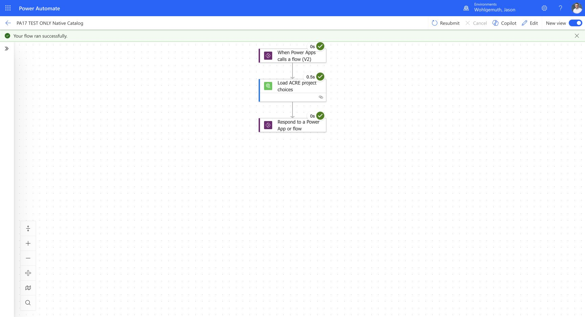

The new flow was then added through Add existing → Automation → Cloud flow → Outside Dataverse to the isolated test solution. Power Platform created connection reference `new_sharednew5facorn20pa1720gitlab20test20only5f06923fc38f4e1ce0_0f6ff`. Its properties show the test connector and the protected **ACORN PA17 GitLab TEST ONLY** connection. A resubmission, run `08584086594173685533974706185CU16`, succeeded overall after this conversion: trigger Succeeded, catalog Succeeded in 0.4 seconds, response Skipped. This repeat establishes connector execution through the solution reference, not response delivery to a calling app.

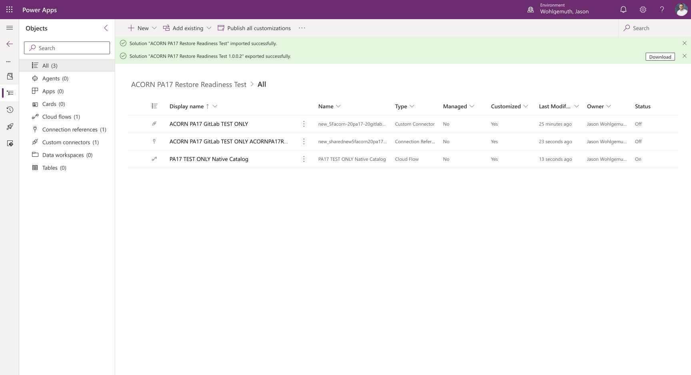

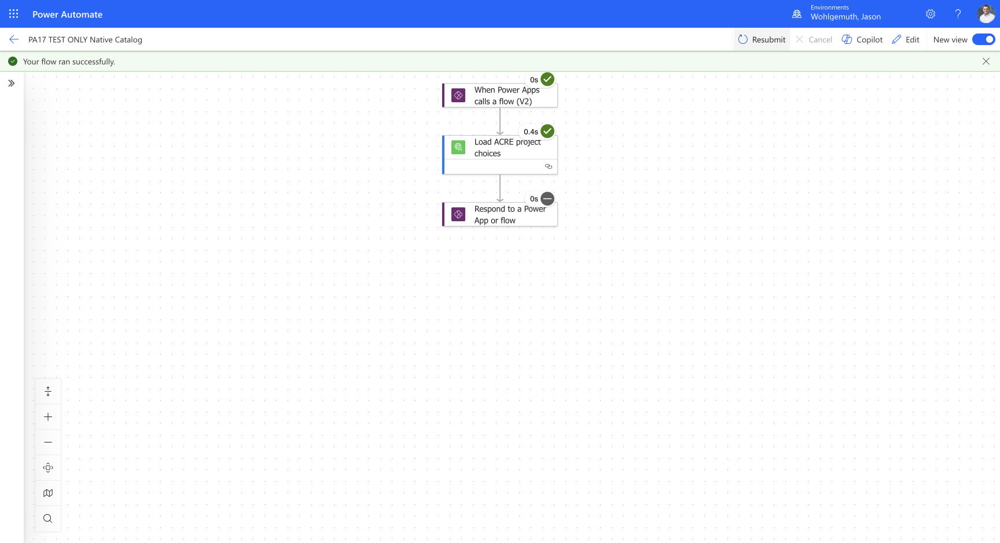

### Native connection-reference export defect

Native unmanaged export `1.0.0.3` failed even though the test connector, catalog flow and connection reference are all listed in the solution. The service reports that exporting the reference requires connector `shared_new-5facorn-20pa17-20gitlab-20test-20only-5f06923fc38f4e1ce0` to be added to a Dataverse solution. No `1.0.0.3` archive was produced. Publish all customizations was not used. Version `1.0.0.2` was the latest successful export at that checkpoint; the PA-18 repair below produced `1.0.0.4`.

Microsoft's [solution connector guidance](https://learn.microsoft.com/en-us/connectors/custom-connectors/customconnectorssolutions) requires a solution-aware connector before exporting its references and requires connector import before dependent flows/references. Listed membership and successful runtime alone did not establish export readiness. The successful PA-18 repair follows below; the service's internal cause was not directly inspected.

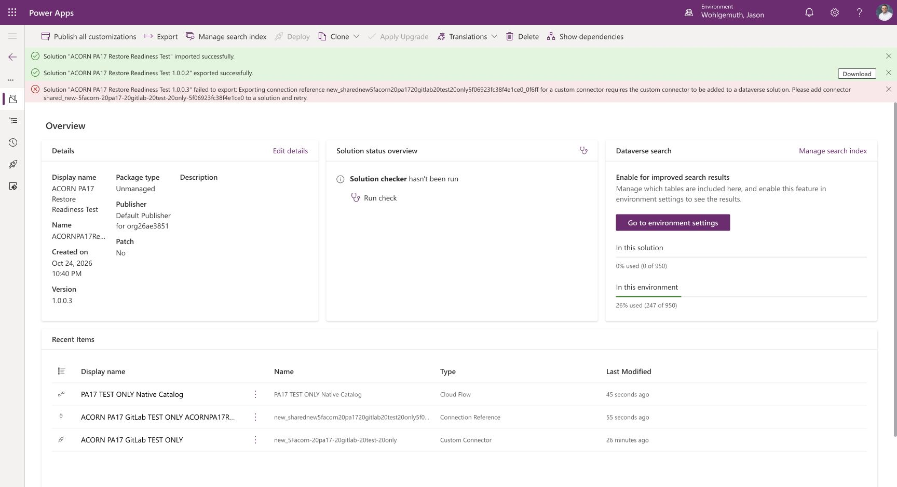

### PA-18 native reference repair and export

Created **PA18 TEST ONLY GitLab Reference** (`new_PA18TESTONLYGitLabReference`) directly with New → More → Connection Reference inside the test solution, selecting the existing test connector and existing protected test connection. Rebound only **PA17 TEST ONLY Native Catalog** to it and saved. Removed the earlier auto-created reference **from this solution only**; it was not deleted from the environment. Operational components, credentials and connection bindings were unchanged.

Manual test `08584086587813997307821396476CU02` passed at 13:08 America/New_York (17:08 UTC) on October 25. Trigger, catalog and response all Succeeded; the catalog action took 2.1 seconds. This is a designer test, not a calling-app test.

The native unmanaged version 1.0.0.4 export (retired artifact; use the current native v6 package) then succeeded without Publish all customizations. The downloaded bytes were copied unchanged to this directory. SHA-256: `35005c4793be3654bdf3413f3bb14300f9f9e2ef5b424c4bbbee1702ebb4a62c`.

Inspection verified:

- One catalog workflow (`3cb20a10-95d0-f111-a05c-001dd8062052`), one connector and the new reference; no missing dependencies.
- The exported reference includes a `customconnectorid` link to `0a228a52-574e-4756-9468-c2f65a261368`; the flow references the new logical reference and the connector logical name.
- The old failing reference and operational app/intake/catalog IDs are absent.
- Catalog custom-code SHA-256 is unchanged: `38d6b9ca805cb6e862521e343fb67afce4b7859fd99c431b754ee0a9f99725c0`.
- All three file-route references use `pa17-logbook.jsonl`; the operational inbox path is absent. The flow only calls GetProjectCatalog and returns its body.
- The API-key parameter contains a credential schema without a value/default. No token, bearer credential or signed callback markers were found in the inspected text.

Creating the reference explicitly and removing the former reference from the package is the demonstrated repair. There is no exported copy of the former reference to prove which internal metadata field differed. The current catalog export retains `runtimeSource: invoker`; PA-17 must review caller/owner binding for the eventual restored app/intake workflow. Export success does not establish full intake restoration.

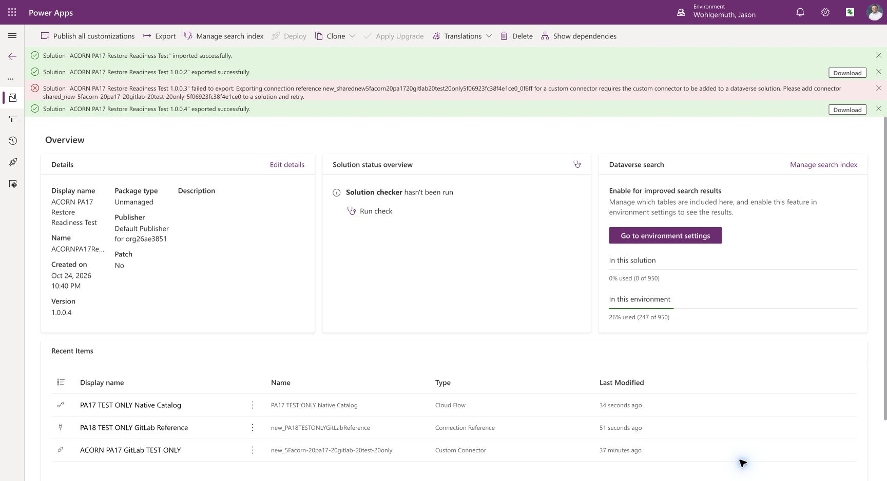

### ORNL native restore acceptance

The owner uploaded the unchanged native `1.0.0.4` archive and created **ACORN PA18 ORNL TEST ONLY** using the existing intake credential. No secret was read or entered by the agent. The wizard showed a valid connection for `new_PA18TESTONLYGitLabReference`. Import into the existing test solution succeeded at approximately 13:18 America/New_York on October 25; import activity ID `b510628a-6914-40b2-aafb-1ce10edfd36b`. Existing connector registration satisfied the connector-first prerequisite.

The restored solution lists exactly the test connector, explicit reference and native catalog flow. Flow `3cb20a10-95d0-f111-a05c-001dd8062052` is On, owned by Jason, bound to **ACORN PA18 ORNL TEST ONLY**, unshared and has no associated app. Its [saved action definition](_assets/solution-export/pa18-ornl-restored-catalog-action.json) targets ORNL API `shared_new-5facorn-20pa17-20gitlab-20test-20only-5f976d672c6fd8d650`. The internal connection key retains its source-derived suffix; the target API and actual protected binding are correct.

Read-only inspection of the [restored Swagger](_assets/solution-export/pa18-ornl-restored.swagger.yaml) verified all three file paths as `.acorn/intake/acceptance/pa17-logbook.jsonl`, with no operational inbox path. The [restored custom code](_assets/solution-export/pa18-ornl-restored-catalog-code.cs) remains 6,901 bytes with SHA-256 `38d6b9ca805cb6e862521e343fb67afce4b7859fd99c431b754ee0a9f99725c0`, enabled only for GetProjectCatalog. No connector update was saved during inspection.

Manual designer test [08584086581182120845753124938CU14](https://make.gov.powerautomate.us/environments/Default-db3dbd43-4c4b-4544-9f8a-0553f9f5f25e/flows/3cb20a10-95d0-f111-a05c-001dd8062052/runs/08584086581182120845753124938CU14) passed at 13:19 America/New_York (17:19 UTC). Trigger, catalog and response all Succeeded. The catalog took 1.2 seconds and returned HTTP 200, source `config`, all 13 projects and revision `03ff5836289447034f40f2a4898c155441e6cb66`; [captured output](_assets/solution-export/pa18-ornl-catalog-response.json), response timestamp `2026-10-25T17:19:28Z`, action tracking ID `a22a0ca6-f1ff-4020-9388-dbfc140ebc83`.

This accepts PA-18's native export, protected target binding and read-only restoration, and releases PA-17. It does not establish app invocation, JSONL writes/replay, callback/table restoration, repeatable egress or shared deployment. Only isolated test components were changed; no operational components, credentials, inbox data, notifications or browser storage were changed.

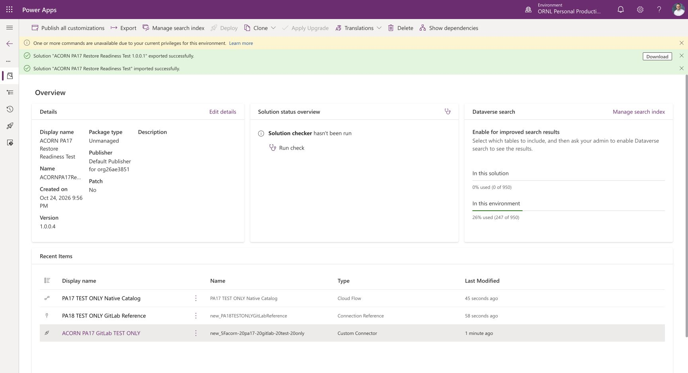

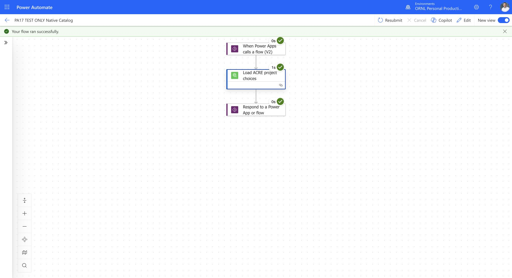

## PA-17 native intake assembly checkpoint

On October 25, a native **Save As** created **PA17 TEST ONLY Native Intake**, workflow ID `9be4b2b3-98d0-f111-a05c-001dd8062052` (My flows runtime alias `a679a492-e3fd-119c-0734-44c5b8fc61b4`), in Jason's environment. The source operational flow was unchanged. At the assembly checkpoint the new copy was **Off**, unshared, with no associated app and no runs. It was subsequently enabled only for the isolated manual acceptance recorded below.

The saved test definition uses **PA18 TEST ONLY GitLab Reference** for branch verification and all seven persistence connector actions. Its history input and commit-body file path target `.acorn/intake/acceptance/pa17-logbook.jsonl`. The notification branch retains its original Teams action with an additional constant-false guard, so test execution cannot send that notice. The outer unresolved response retains Failed, Skipped and TimedOut dependencies; notifications retain all four completion statuses.

Native authoring exposed two designer conversions that were corrected before the accepted save: reused action names retained cached connector identifiers, and string-form If expressions were replaced with empty comparisons. Distinct `_PA17v2` action names and equivalent structured Boolean conditions preserve the source logic. The persistence scope retains its original nesting depth. A recursive comparison during authoring found no differences after normalizing status casing, expression whitespace and equivalent string-response interpolation. The [verified designer definition](_assets/solution-export/pa17-native-persistence-v2-verified.json) remains as inspection evidence; superseded clipboard drafts were removed. The native v6 solution is the import input.

Save succeeded and Flow checker reported **Errors (0), Warnings (0)**. The subsequent details page confirms Off and no run history. Its generic potential-problem banner persists despite the designer's clean checker; runtime remains untested. Native solution membership and export subsequently passed as recorded below. App binding, target imports and runtime acceptance are still pending. No GitLab write, notification, operational definition, binding, credential or browser storage change occurred.

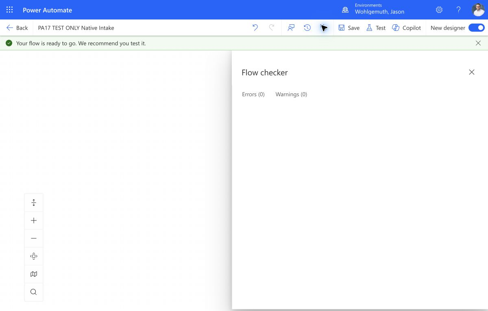

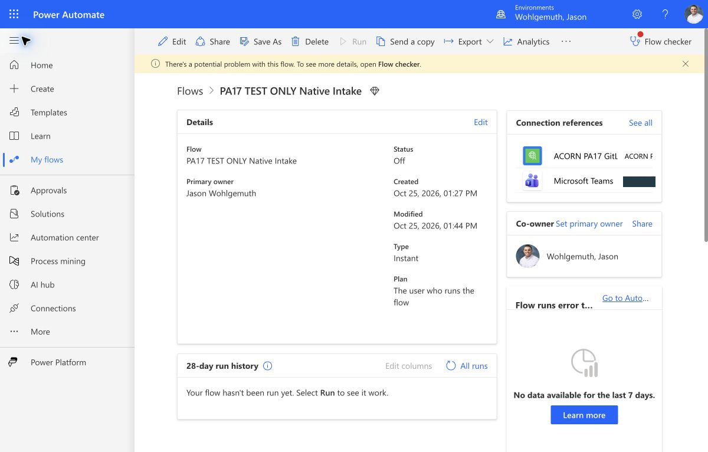

### Native intake export

The unchanged native intake/catalog solution 1.0.0.5 (retired artifact; use the current native v6 package) exported successfully. SHA-256: `3c3cb862334446f588543a8027e2c0718a9fcef9ca0116224f2f40470273d17f`. It includes both test flows, the isolated GitLab connector, **PA18 TEST ONLY GitLab Reference**, and dedicated **PA17 TEST ONLY Teams Reference** (`new_PA17TESTONLYTeamsReference`). No missing dependencies or operational inbox path occur in the archive. Catalog code retains its original 6,901-byte hash. The exported notification condition contains `equals(false, true)`. Credentials were not included; inspected text contains no token, bearer credential or signed callback markers. The package has no canvas app yet.

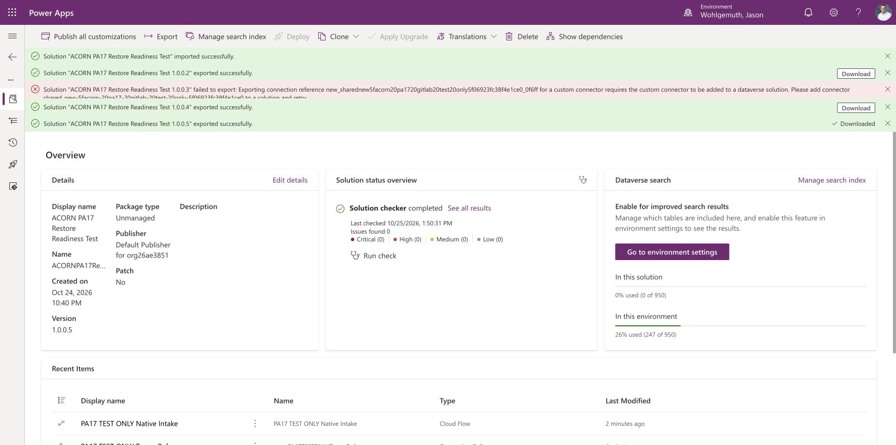

### Isolated native callback/table package

Created **ACORN PA17 Callback Restore Test**, solution `e8684aae-9cd0-f111-a05c-001dd8062052`, containing a native Save As callback `3ab08ca2-9cd0-f111-a05c-001dd8062052`, table `new_PA17CallbackReceipt` (`2e2158c6-9cd0-f111-a05c-001dd8062052`), and dedicated test Dataverse, Teams and Outlook references. The references bind existing protected owner connections without modifying the operational references or entering credentials.

The new table has required Webhook ID (400 characters), Payload JSON (65,536), Email Recipient (400), Email State (100), and Email Attempt Run (100). Its `new_uniquewebhookid` alternate key on `new_webhookid` is **Active**. The advertised entity set is `new_pa17callbackreceipts`.

The callback preserves its manual trigger, required inputs, concurrency of one, validation and receipt lookup. Every Dataverse action targets the new table. A constant-false condition prevents the delivery branch from running; the test-only alternate branch accepts Pending or Sent as a confirmed receipt without sending. This tests storage and duplicate/conflict handling; it does not accept notification delivery. Fresh designer loading resolved stale reference and token diagnostics. Save returned “Your flow is ready to go” and Flow checker reported zero errors and warnings.

Native unmanaged [callback/table restore package 1.0.0.1](_assets/solution-export/ACORNPA17CallbackRestoreTest_1_0_0_1.zip) exported successfully, with no missing dependencies. SHA-256: `93c75c2fce0cdc100da6927c775bb5606e2689aedaaf09ec1204a2fd57d1b489`. Archive inspection confirms the isolated table/columns/key, all three dedicated references, notification guard, and absence of original `cr1d0_` table identifiers in the flow. No token, bearer credential or signed callback markers were found. This separate native package avoids importing the original callback/table identities over the operational components. Jason receipt creation, duplicate replay and changed-payload rejection passed as recorded below; ORNL callback/table import was subsequently denied for missing `prvCreateEntity`.

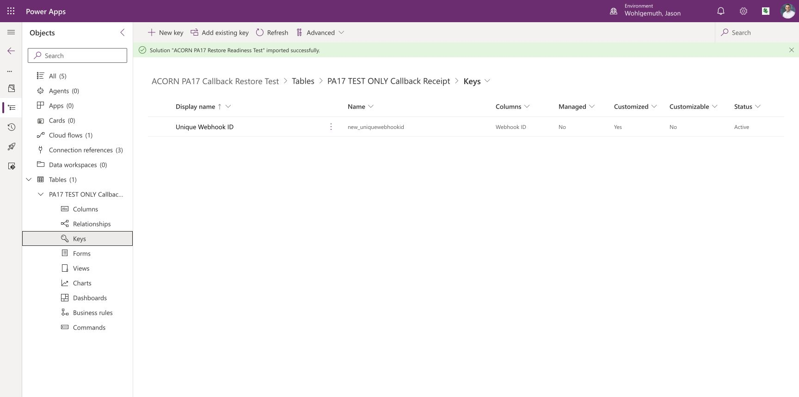

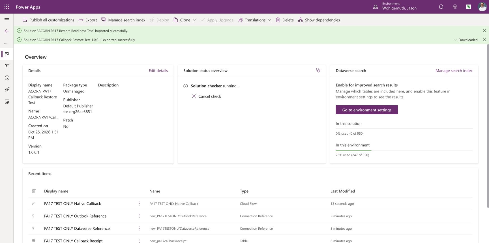

## Next acceptance

PA-17 can now continue from the accepted native connector/reference/catalog restore. Do not retry the edited canvas ZIPs.

The native canvas identity, distinct draft-storage key, test-only bindings and v6 export are now complete; restore the v6 app and inspect destination bindings before calling-app acceptance. Intake restoration and manual ORNL replay/conflict acceptance are now recorded below. Fresh ORNL writes remain denied by network policy; callback/table restoration remains denied by missing `prvCreateEntity`. A complete package restore and app-driven runtime acceptance in both environments are still required for PA-17. This work does not select ORNL Personal Productivity as the PA-12 production destination.

### Jason isolated callback receipt acceptance

Manual runs used Webhook ID `acorn-test-pa17-restore-jason-20261025-1800` and synthetic event `{"event":"report-no-changes","project_id":"acorn","through":"2026-10-25"}`. The first run created one row in `new_pa17callbackreceipts`, row ID `46cbf9f9-9dd0-f111-a05c-001dd8062052`, at `2026-10-25T18:00:35Z`. The row remained Pending, with no delivery attempt. A read-only browser view opened from the table's own API link confirmed the row.

| Case | Run ID | Observed result |
| --- | --- | --- |
| First receipt | `08584086556506027360035317154CU18` | Succeeded; claim, lookup and same-payload branch passed. |
| Exact replay | `08584086554115530831001719589CU13` | Succeeded; alternate key rejected the duplicate insert, lookup found the existing row, and Duplicate no send passed. |
| Same ID, changed `through` to `2026-10-26` | `08584086553792298710512294497CU02` | Expected failure; Payload conflict termination executed. Existing row/payload remained unchanged. |

In every run, Mark sending, Send Teams once, Send email once and Mark sent were **Skipped**. After replay and conflict, the table still contained exactly one row with unchanged payload, modified timestamp and version `2797787`. No operational table or notification action was used. This accepts the isolated source callback's receipt behavior; target restoration and real delivery remain separate.

The replay run viewer also displayed a `NullReferenceException` UI diagnostic while reporting the run and its action statuses successfully. The conflict banner highlights the duplicate-key claim failure, but expanded action outcomes confirm that the intended Payload conflict termination executed. Neither banner was treated as evidence of delivery.

Evidence: [initial receipt](_assets/solution-export/pa17-jason-callback-receipt-evidence.json), [replay action outcomes](_assets/solution-export/pa17-jason-callback-replay-dom.txt), [conflict action outcomes](_assets/solution-export/pa17-jason-callback-conflict-dom.txt).

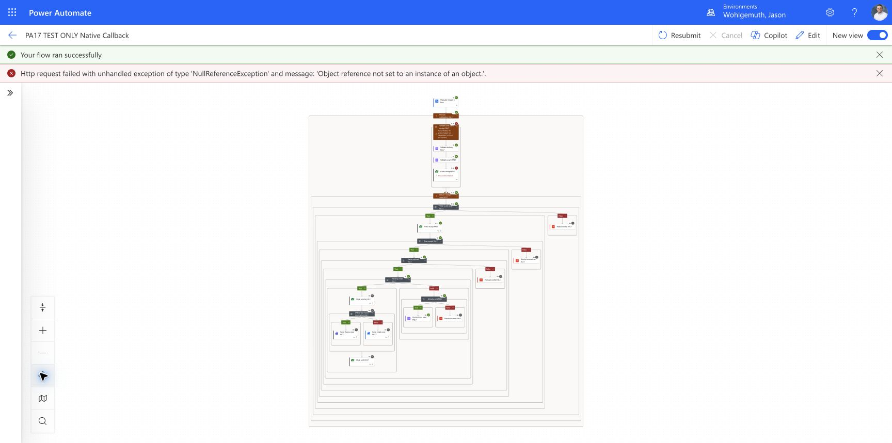

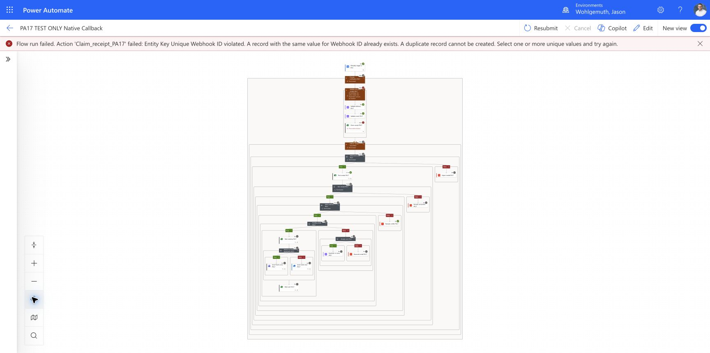

### Native package inventory and restore order

[Package manifest](_assets/solution-export/pa17-native-backup-manifest.json) records native archive sizes, versions, SHA-256 hashes and workflow entries. [Isolated restore instructions](_assets/solution-export/pa17-native-restore-instructions.md) distinguish the tested catalog import from remaining intake, callback and app acceptance. The native ZIPs are unchanged downloaded bytes.

The owner uploaded and started import of `ACORNPA17CallbackRestoreTest_1_0_0_1.zip`. The ORNL failure and next upload are recorded below. The owner previously chose manual upload because the browser extension lacks local-file access. Studio in the accessible Chrome tab rendered a blank canvas; the final tab inventory shows Power Apps Home and no canvas editor. At that earlier checkpoint no PA17 app copy or app binding had been created; the later v6 checkpoint supersedes this. The operational editor and player were not edited or reloaded.

### Jason native intake write and replay

The isolated native intake was enabled with its existing test GitLab/Teams bindings. A manual run, not a calling-app invocation, submitted frozen UUID `983545be-9d86-4d9c-8e67-3cd667a74a7d` for project `acorn`. Run `08584086552539263000712925851CU18` succeeded: branch access, commit, immutable readback, byte confirmation and Queued new succeeded; the outer unresolved response and Teams notice were skipped.

GitLab commit [`bd5888fa7a1f4b555414384819173bc6409ab70d`](https://code.ornl.gov/research-enablement/experiments/power-automate/-/commit/bd5888fa7a1f4b555414384819173bc6409ab70d), parent `03ff5836289447034f40f2a4898c155441e6cb66`, adds exactly one line to the new `.acorn/intake/acceptance/pa17-logbook.jsonl`, with no other changed file. Browser Copy file contents matched the frozen submission plus one LF exactly: 457 UTF-8 bytes, SHA-256 `adcbd471fb91c075b4d48604648d118e6fd2c3de30b1688780de845827a71f15`. The operational inbox was not changed.

Exact replay `08584086551895520151909856703CU06` succeeded through Queued replay; Commit append and the Teams notice were skipped. A fresh browser file read retained the same commit and exact bytes. This confirms isolated native manual write/replay at the recorded time. It does not establish calling-app integration, ORNL restored intake, sustained egress, field/size boundaries or concurrent-write acceptance.

Evidence: [frozen submission](_assets/solution-export/pa17-jason-native-intake-fixture.json), [confirmed file](_assets/solution-export/pa17-jason-confirmed-logbook.jsonl), [structured acceptance](_assets/solution-export/pa17-jason-native-intake-evidence.json), [first-run outcomes](_assets/solution-export/pa17-jason-native-intake-first-run-dom.txt), [replay outcomes](_assets/solution-export/pa17-jason-native-intake-replay-dom.txt).

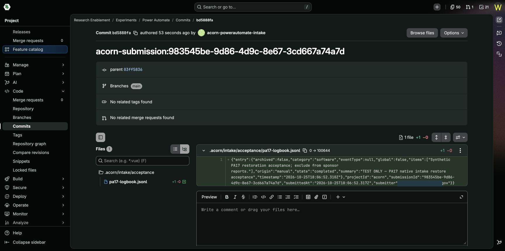

The changed-payload intake attempt, run `08584086551396206729261127404CU24`, did **not** reach conflict evaluation. VerifyMainBranch returned HTTP 403 at `2026-10-25T18:09:05Z`, explicitly stating that the source IP's network range is restricted. Action tracking ID: `f7c38202-f69f-4e5c-b625-1eb9c38260fd`. Persistence and all its write/response branches were skipped; the outer Unresolved failure response succeeded and Teams was skipped. The overall flow's Succeeded status represents successful error handling, not a saved record or accepted conflict case. Browser readback still matched the same 457 bytes. No retry or network/credential workaround was attempted after this explicit denial. See [raw response and action evidence](_assets/solution-export/pa17-jason-native-intake-denial-dom.txt).

The isolated native intake and callback were returned to **Off** after their acceptance attempts. Their fixtures and receipt remain for inspection; no operational component, protected connection or browser storage was changed. The read-only native catalog retains its prior state.

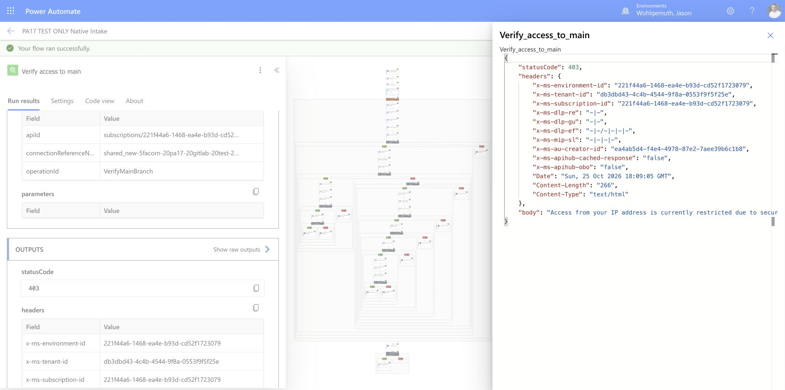

## ORNL callback import privilege failure

On October 25, the owner uploaded the unchanged native callback/table package `ACORNPA17CallbackRestoreTest_1_0_0_1.zip` and started its import in **ORNL Personal Productivity(default)**. The agent observed “Currently importing” before the final failure. The package name/version in the downloaded log match the intended isolated package.

Power Platform rejected import with `SecLib::CheckPrivilege failed`, missing **`prvCreateEntity`**, required depth **Basic**. This establishes that the previously disabled table-authoring control also blocks importing this new table under the current account. It is not an archive schema or missing-dependency failure: the import log marks XSD package validation Processed, while the solution, `new_PA17CallbackReceipt`, callback workflow and workflow activation are Unprocessed. No callback runtime acceptance occurred in ORNL. The failure does not justify importing over an existing operational table or changing security roles.

The [downloaded native import log](_assets/solution-export/pa17-ornl-callback-import-log.xml) and [visible error text](_assets/solution-export/pa17-ornl-callback-import-failure.txt) preserve the service evidence. Package transformation/validation entries are timestamped `18:15:40.72`–`18:15:40.73` in the log; the log does not label their timezone. The user ID is `8a18be4c-ed8d-ed11-81ad-001dd80715ac`, and privilege ID is `341e3ebf-74b8-4335-84f3-7f617bb7d081`.

The callback import was not retried, and no permissions, operational components or connection credentials were changed. With current rights, ORNL callback/table restore remains unavailable. Jason's isolated source acceptance and native export remain valid partial evidence, not substitute target restoration.

The owner subsequently uploaded **`ACORNPA17RestoreReadinessTest_1_0_0_5.zip`**, containing intake/catalog flows and references without a table dependency. The import succeeded; restored runtime outcomes are recorded below. At that earlier checkpoint the canvas backup was pending; the later v6 checkpoint supersedes this.

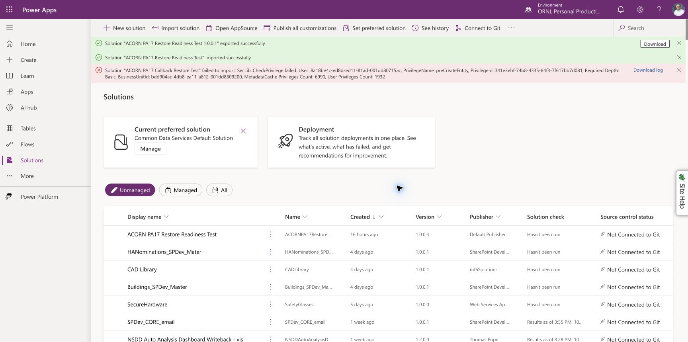

## Native canvas and solution 1.0.0.6 checkpoint

Studio subsequently opened. A read-only native operational export was downloaded unchanged as [SponsorHighlightsNativeBackup20261025_20261025185256.zip](_assets/solution-export/SponsorHighlightsNativeBackup20261025_20261025185256.zip), 112,188 bytes, SHA-256 `656cf0b614527875cecad5aa436ba5c4ac28e9eed5e9e31a70571b7667c7930c`. This legacy package contains the canvas and both dependent operational flow definitions/references, with Create as new export settings. It retains operational paths, storage and notifications: recovery evidence only, never an isolated test input. The original app was not saved or published.

Native Save As created **PA17 TEST ONLY Sponsor Highlights**, app `b4336414-edfb-4aae-b4e3-d8b994c19b65`, solution schema `new_pa17testonlysponsorhighlights_e01a0`. Only the copy was edited: operational flow associations removed, native test intake/catalog added, formula aliases replaced, and all four pending-storage calls changed to `PA17SponsorHighlightPending`. Formula checker found no errors. The copy was saved and published. Its published player loaded all 13 projects; this is source calling-app catalog evidence, not submission acceptance. Test intake was enabled briefly to complete binding and returned Off; no intake submission or notification was sent.

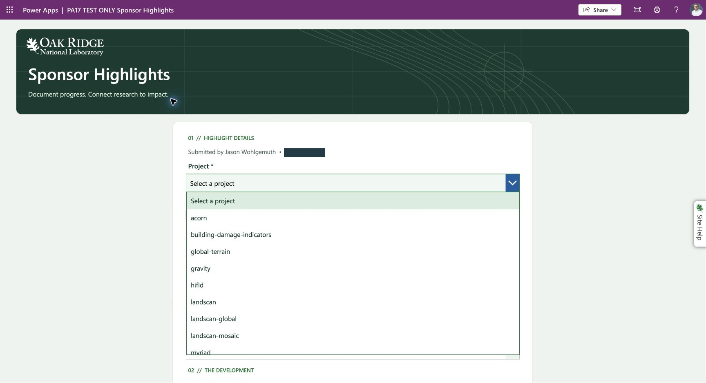

The app was added to the existing Jason test solution after closing its authoring session. Unchanged native [solution 1.0.0.6](_assets/solution-export/ACORNPA17RestoreReadinessTest_1_0_0_6.zip) exported successfully, 121,925 bytes, SHA-256 `8c318a1f537ed3250932fa77b897dc80aff0a96ff49e4e64bc4997119d079063`. It includes one canvas app, both test flows, one custom connector and two connection references. The solution checker reported zero issues at 3:03:08 PM local. ZIP and embedded canvas integrity passed; MissingDependencies is empty. Embedded source has the two test workflow entity IDs and four isolated pending-slot references. Inspected text has no operational app/flow IDs or inbox path, and no GitLab-token/Bearer-value pattern matches. This pattern scan is not an exhaustive secret proof. See [archive audit](_assets/solution-export/pa17-native-v6-audit.json).

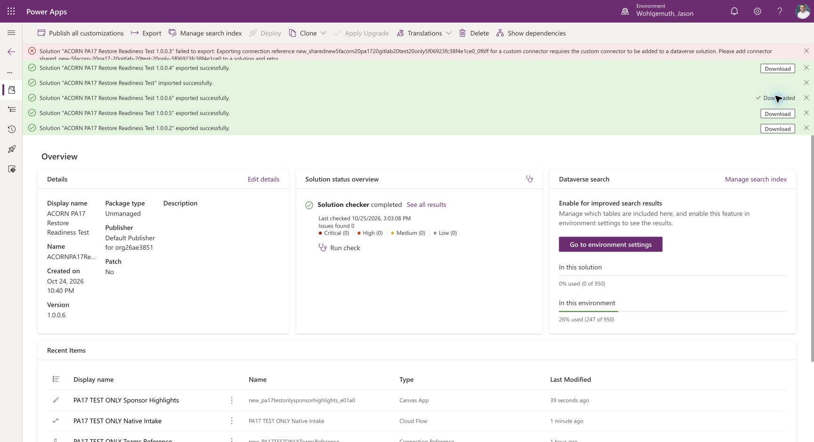

The ORNL **Import a solution** panel is prepared for owner upload of v6, following the owner's manual-upload preference. Import must update only ACORNPA17RestoreReadinessTest, retain existing protected test connections, and leave automatic activation unchecked. Then inspect restored app/flow bindings and verify app catalog invocation. Fresh app submission still depends on resolving the explicit GitLab network-range denial; callback/table restore still requires unavailable `prvCreateEntity`. PA-17 remains open. Operational components were unchanged.

## ORNL native canvas restoration accepted

Native solution **1.0.0.6** imported successfully October 25, **3:18–3:19 PM America/New_York**, as an Update. Activity ID `f8525c54-972a-46a7-a164-d751d8994483`. The owner had already started the import when control resumed; the automatic-activation checkbox was not observed. Import details showed Overwrite customizations **No**. Post-import inspection verified native intake **Off**, catalog **On**, one canvas app, two flows, two connection references and one connector. No operational component was modified. All v6 workflow/connector files are byte-identical to v5.

Restored app **PA17 TEST ONLY Sponsor Highlights**, ID `abd4b93f-3abc-43f1-82ae-1cc33e1f3527`, launched successfully. Its existing GitLab test connection **ACORN PA18 ORNL TEST ONLY** and owner Teams connection were shown Connected. After normal connection consent, all 13 projects appeared. App-driven catalog run `08584086507609818994513589261CU31` at **3:22 PM** succeeded in 677 ms; trigger, catalog and response actions all succeeded. This verifies native canvas import and destination catalog binding without Studio repairs.

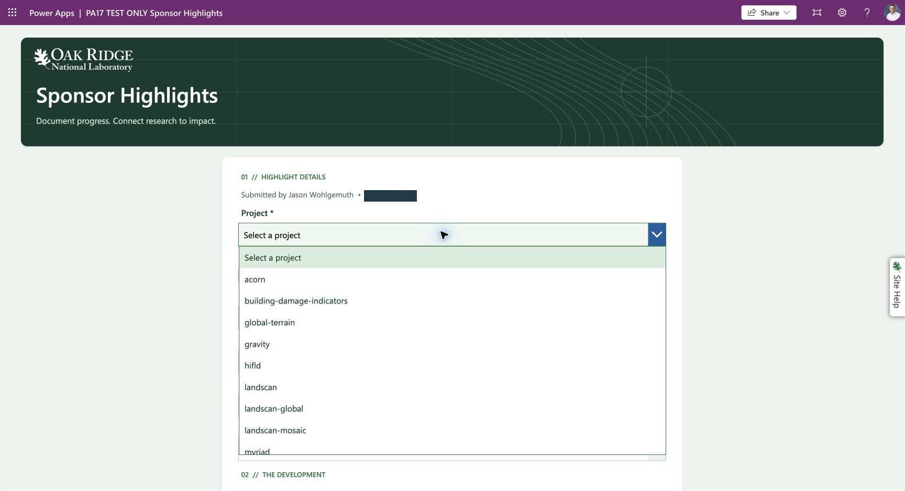

[Import history](_assets/solution-export/pa17-ornl-v6-import-history.txt), [catalog run](_assets/solution-export/pa17-ornl-restored-app-catalog-run.txt), and [structured evidence](_assets/solution-export/pa17-ornl-v6-restore-evidence.json) preserve the result. No intake request or notification was sent in this acceptance. The known explicit network-range denial still prevents claiming reliable fresh writes, and ORNL callback/table restoration remains blocked by `prvCreateEntity`. PA-17 stays open for app-driven intake and callback/table acceptance; the native canvas artifact/import/catalog work is complete.

Final restored-intake inspection confirmed both existing connection references, Status Off, and unchanged latest run `08584086531530438165830898752CU14`. Flow checker reported **0 errors**, with its only warning **This flow is off**. The separate Associated apps list was empty; app-driven intake invocation remains unverified. See [final checker evidence](_assets/solution-export/pa17-ornl-v6-intake-checker.txt).

## Remaining PA-17 gate

On October 25, all seven manifest-listed native ZIPs were rechecked against their recorded SHA-256 hashes and passed ZIP integrity. The current [restore handoff](_assets/solution-export/PA17-RESTORE-HANDOFF.md) and [consolidated bundle](_assets/solution-export/PA17-native-backup-set-20261025.zip) preserve accepted work. The outer bundle is not an importable solution; extract and use the named inner native ZIPs. PA-17 is blocked until permitted app-driven writes and ORNL callback/table restore acceptance can be demonstrated. No repeated request under the unchanged denial, privilege workaround, operational edit, or acceptance reduction was performed.
