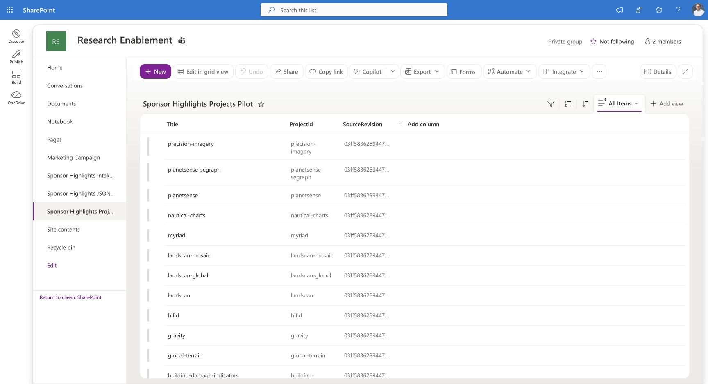
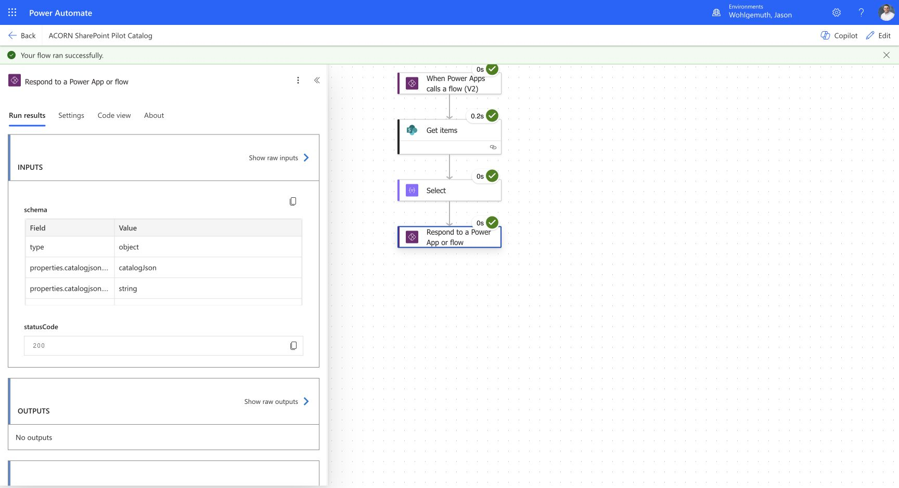
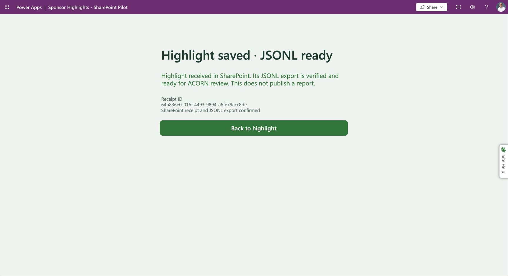
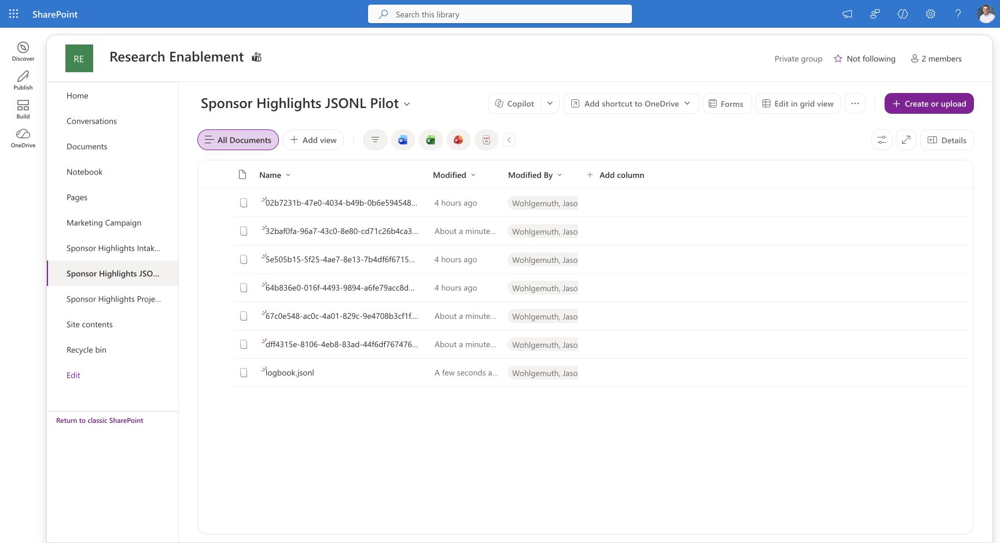

> **Sanitized copy:** Account labels and related assets have been redacted. Historical checksums and import results describe the originals; see [privacy and reuse limits](../../privacy.md).

# Current deployment

**October 27 deployment checkpoint:** SharePoint is the approved default for owner/participant. PA25 installed the accepted exporter and catalog feedback in the existing published app/flows. The live smoke submission, Teams action and exact eight-row collected download passed. Both GitLab flows are Off with components and credentials retained. [Current deployment, evidence and rollback](_assets/sharepoint/cutover/README.md). Dated checkpoints below describe their state at the time.

On October 30, the completed SharePoint TEST ONLY flows and apps described in dated checkpoints below were deleted; [the cleanup inventory](test-artifact-cleanup.md#october-30-power-platform-cleanup) names them. Operational components and PA-15/17 acceptance copies remain.

The operational app now also binds the standard SharePoint history/correction flow. **My Submissions → Edit selected → Save correction** is published. Owner-context original/correction saves, Teams delivery, exact rows in a 15-row scheduled aggregate and local review/apply passed. Standard-license contributor correction, private-history visibility and Teams confirmation also passed; the 18-row aggregate preserves the linked receipts exactly. PA-31 is accepted. My Submissions now occupies its own centered row between the banner and form, verified in the published player and a phone preview. See [editing evidence](_assets/sharepoint/submission-editing/README.md) and [notification appearance](_assets/notifications/visual-hierarchy/README.md).

October 26, 2026: the owner requested a shared list through the ORNL SharePoint directory. The existing private [Research Enablement site](https://ornl.sharepoint.com/sites/ResearchEnablement) exposes creation rights and currently displays two group members. Its membership and sharing settings were not changed. This is shared site storage, not a personal Microsoft Lists location; it does not establish access for every intended contributor.

Created in that site:

| Component | Location | State |
|---|---|---|
| Intake list | [Sponsor Highlights Intake](https://ornl.sharepoint.com/sites/ResearchEnablement/Lists/Sponsor%20Highlights%20Intake%20Pilot/AllItems.aspx) | TEST ONLY receipts from manual and published-app acceptance; list ID `a904a6c6-5dd0-427b-9575-8167c4c0c412` |
| Project catalog | [Sponsor Highlights Projects](https://ornl.sharepoint.com/sites/ResearchEnablement/Lists/Sponsor%20Highlights%20Projects%20Pilot/AllItems.aspx) | 13 project rows plus the reserved general destination; list ID `88dfa78d-a62f-4e0f-aae5-0d5ea52758ed` |
| JSONL library | [Sponsor Highlights Exports](https://ornl.sharepoint.com/sites/ResearchEnablement/Sponsor%20Highlights%20JSONL%20Pilot/Forms/AllItems.aspx) | Receipt-named JSONL files; exact readback passed in manual and app-driven runs |

The original Sponsor Highlights app, GitLab intake/catalog bindings and operational logbook are unchanged. Native Save As created and published [Sponsor Highlights - SharePoint](https://apps.gov.powerapps.us/play/e/221f44a6-1468-ea4e-b93d-cd52f1723079/a/163f110f-7f8a-401c-894e-0786b2c018a4), app ID `163f110f-7f8a-401c-894e-0786b2c018a4`, in Wohlgemuth, Jason. Its GitLab intake/catalog bindings were removed after switching formulas to the two SharePoint pilot flows. Studio reports no formula or data-source errors. Owner-context app submissions passed; the later PA22 participant and PA25 cutover records supersede this initial checkpoint.

Solution **ACORN SharePoint** (`0fafd397-64d1-f111-a05c-001dd8062052`) was created with the two pilot flows and SharePoint connection reference `cr1d0_sharedsharepointonline_0c871`. This registers the flows for selection in Studio; it does not add Dataverse data actions to the intake. The subsequent Teams action uses existing **Microsoft Teams Default-52fd4**, under `owner@example.invalid`; the connection credentials were not changed. The app uses `SponsorHighlightSharePointPending` for browser recovery, separate from the original GitLab key. It distinguishes a received SharePoint receipt from a confirmed JSONL export; a pending export retains the UUID and offers a safe retry. [Form formula changes](_assets/sharepoint/form-patches.json) were compared with the live [layout](_assets/sharepoint/layout.pa.yaml) and [result panel](_assets/sharepoint/result-panel.pa.yaml). No original GitLab bindings, commit fields, queued states or original storage key remain in those captured controls. The app and both flows are included in the October 27 [native package backup and accepted isolated restore](_assets/sharepoint/backup/README.md); the separate repaired-exporter package and data snapshots complete this recovery set.

The owner's October 26 confirmation resolves DH's original access report as a missing premium entitlement for the GitLab custom connector. [Access resolution](intake-access-decisions.md#original-participant-licensing-issue-resolved) records that conclusion. No DH-specific retest is pending; PA-22 acceptance below verifies this SharePoint app with the approved standard-license participant.

# Intake storage contract

| Column | Saved type/settings | Purpose |
|---|---|---|
| Title | Existing single-line text | Short receipt display label; not the full summary |
| SubmissionId | Single-line text, required, unique, maximum 36 characters | Stable receipt UUID, enforced unique by SharePoint |
| PayloadBase64A | Plain multiline text, required, append changes off | First 45,000 characters of base64 of the original UTF-8 envelope |
| PayloadBase64B | Plain multiline text | Remaining base64 characters, empty for smaller envelopes |
| ProjectId | Plain multiline text | Supports the existing 512-character project ID contract |
| Summary | Plain multiline text | Readable summary; preserves the existing 1,200-character limit in the flow |
| SubmitterEmail | Single-line text | Caller email after server-side verification |
| ExportStatus | Single-line text, default `Pending` | `Exported` only after exact JSONL readback |
| ExportFileUrl | Plain multiline text | Confirmed export location |

The two payload fields avoid the per-field multiline text ceiling for the existing maximum 65,535-byte envelope. Base64 is encoding, not encryption. The flow must still enforce the envelope schema, raw size and newline rules, caller identity, timestamps, project membership and exact replay comparison. List column creation alone supplies none of those validations.

Export must decode A followed by B and preserve the exact original JSON bytes, then add one LF. The intake preserves one receipt-named `.jsonl` file per accepted submission. The separate serialized exporter collects list rows into the shared `logbook.jsonl` described below. Do not reconstruct JSON from display columns or treat the list's CSV/Excel export as JSONL. A received list receipt and an exported file are distinct states; neither means ACORN admission, graduation, merge or publication.

# Project catalog acceptance

The catalog is seeded from the retained [October 25 response](_assets/solution-export/pa18-ornl-catalog-response.json), revision `03ff5836289447034f40f2a4898c155441e6cb66`. It is a recorded configuration snapshot, not a fresh repository scan. All 13 rows have `Title`, `ProjectId` and `SourceRevision`; display labels currently equal IDs. Future catalog maintenance is explicit until a separate synchronization path is accepted.

`ACORN SharePoint Catalog` is saved in Wohlgemuth, Jason (`221f44a6-1468-ea4e-b93d-cd52f1723079`), flow ID `6f8a4ab5-dd66-4904-9f5d-f307519ab4d5`. Its only external connector is standard SharePoint, using connection reference `shared-sharepointonl-4aa12f84-9554-41c4-a184-b21799bd4104` under the existing ORNL account. No credential values are stored here.

The native flow uses Power Apps V2, Get items, Select and Respond to a Power App or flow. Get items orders by Title, requests 1,001 entries and enables pagination to 1,001. The response text output `catalogjson` contains `{source: "sharepoint", projects: [{id, label}]}`. More than 1,000 results produces an empty catalog with `error: "catalog_limit"`; the app must treat that as failure. Overflow behavior is authored but not yet exercised with a large fixture.

Manual run `08584085728203907521416207681CU22` succeeded at 17:01:05 UTC on October 26. All four actions succeeded; the response contained all 13 expected IDs and labels. This proves owner-context connector execution, not an app-driven run or standard-user licensing acceptance.

# Intake implementation and acceptance

`ACORN SharePoint Intake` is saved in the same environment, flow ID `64679e9c-ae76-4263-b8fa-8832835516ca`. It uses the existing SharePoint and Teams connections and no GitLab connector. After Teams was added, the designer checker reported zero errors and eight connection-refresh advisories. The app binding was subsequently refreshed, republished and successfully exercised. The response is intentionally retained for confirmed receipt feedback.

October 26 owner-run acceptance used non-sensitive receipt `5e505b15-5f25-4ae7-8e13-7b4df6f6715e` with Unicode and escaped newlines:

| Case | Run ID | Observed result |
|---|---|---|
| New submission | `08584085716278869310025255830CU17` | One receipt and file, exact export readback, Exported status. Response metadata was subsequently repaired. |
| Exact replay | `08584085712650569052440212072CU08` | Receipt creation skipped; non-overwrite file creation failed as expected, existing file readback passed, response succeeded. |
| Same UUID, changed payload | `08584085711980621045990695644CU06` | Conflict branch succeeded; receipt/file creation and export update skipped. |
| Malformed envelope | `08584085711189995757802689639CU25` | Parse failed, persistence skipped, outer response succeeded. |

The [independent receipt readback](_assets/sharepoint/receipt-readback.json) confirmed exactly one matching row and byte-identical original payload after replay and conflict. Flow readback compared the JSONL bytes with the original UTF-8 envelope plus one LF; an independently downloaded file has not been verified. Secure response values were hidden in run history. The subsequent published-app tests below verified the successful receipt/export response; app-driven conflict and pending-export responses remain unaccepted. Preserved action-status evidence: [replay](_assets/sharepoint/replay-run-evidence.txt), [conflict](_assets/sharepoint/conflict-run-evidence.txt), [malformed input](_assets/sharepoint/invalid-run-evidence.txt).

Remaining acceptance includes catalog overflow, payload size boundaries, concurrent attempts, export-failure recovery, app-driven conflict/replay and standard-license participant access.

# Published-app acceptance and notifications

The published pilot loaded all 13 projects through the SharePoint catalog. App-driven run `08584085698401694139777770661CU04` created receipt `02b7231b-47e0-4034-b49b-0b6e594548e0`, confirmed its export, and displayed **Highlight saved · Export ready**. A full page reload restored the same UUID, confirmation and frozen form fields. Starting a new highlight cleared only the pilot recovery slot and reloaded the catalog. The [saved list envelope](_assets/sharepoint/app-submission.json) independently retains the submitted Unicode details. This is page-reload evidence; it does not repeat full browser-restart or denied-storage acceptance for the new app.

After adding Teams, the intake binding was refreshed and the pilot app republished. App-driven run `08584085694369117892624466851CU16` created receipt `64b836e0-016f-4493-9894-a6fe79acc8de`. Receipt creation, JSONL creation/readback, export status, response, and **Post SharePoint update to Teams** all succeeded. See [action outcomes](_assets/sharepoint/teams-app-run-evidence.txt) and [native Teams action](_assets/sharepoint/teams-action-native.json). This proves connector execution; it does not establish that a recipient read the message.

Manual exact replay of the original app envelope (`02b7231b-47e0-4034-b49b-0b6e594548e0`) passed in run `08584085692740963250031363046CU21`. Receipt creation was skipped; non-overwrite file creation failed as expected, existing-file readback and exact-export verification succeeded, and the response succeeded. **Post SharePoint update to Teams** was skipped. See [replay action outcomes](_assets/sharepoint/teams-replay-run-evidence.txt). This verifies the deployed notification gate without creating another receipt or sending another notice; it is not an app-driven retry test.

The formatted Teams notice goes to Jason through the existing connection's self-notification action. It includes the project, verified export link and receipt ID, with a TEST ONLY marker for test summaries. It runs after response handling and requires both a newly created receipt and a confirmed export, so receipt feedback is independent of notification delivery and ordinary replays skip delivery. Notification is best effort with automatic retry disabled. If export is first confirmed on a later retry, this initial-only notification gate skips the notice; durable delivery/recovery tracking is not implemented. No routine intake email was added. Existing milestone-email handling in the manual workflow is unchanged.

The reproducible [clipboard builder](_assets/sharepoint/build-intake.py) retains the existing envelope and caller validation, creates a unique list receipt, compares exact stored payload bytes, creates a receipt-named file without overwriting, and reads the file back before marking it exported. Its two generated clipboard actions are deployment source, not an importable Power Platform backup. Compose and Parse JSON retain the platform-supported secure-input settings. The native classic designer required `string(null)` for empty string expression arguments. Response fields require dynamic-field schema metadata; configure the response to run after all four scope outcomes in the designer because clipboard insertion resets that outer dependency.

PA-19 storage/catalog and PA-20 validated intake/exact export are accepted below. The [accepted PA-28 catalog-feedback overlay](_assets/sharepoint/catalog-recovery/README.md) is saved separately; the [PA25 cutover](_assets/sharepoint/cutover/README.md) installs it with the accepted exporter; PA-22 intended-user access is accepted below. Owner-context manual handoff and PA-24 native backup/restore using the accepted PA-23/26/27 exporter are accepted. Preserve GitLab pending receipts in the original app and never automatically reroute an unresolved submission. The SharePoint app uses its own browser storage key and reports received/exported independently of GitLab commit receipts.

# Combined logbook export

The SharePoint list is the collection source of truth. [Download the combined logbook](https://ornl.sharepoint.com/sites/ResearchEnablement/Sponsor%20Highlights%20JSONL%20Pilot/logbook.jsonl), rather than assembling individual receipt files. `ACORN SharePoint Logbook Export` (`51efa5f9-6e69-4d75-a53b-2c2965fd51bd`) runs every five minutes in Wohlgemuth, Jason with trigger concurrency one, using the existing standard SharePoint connection. It does not change either intake flow, app bindings, permissions or notifications.

Each run captures the highest list item ID, retrieves rows through that cutoff in ascending ID order, decodes the original payload, validates receipt/project identity and rejects literal newlines. It joins exact original JSON strings with LF and adds the final LF. It rebuilds the snapshot rather than appending concurrently. New arrivals after the cutoff are collected on the next run. Normal intake does not modify prior payloads; this is not a transactional snapshot against manual list edits or deletion.

Pagination requests 5,001 rows so the 5,000-row guard rejects overflow. A separate UTF-8 byte calculation caps the snapshot at 10 MiB. Read, decoding, validation or size failure stops publication and retains the prior file. Exact matching content skips the write. Changed content replaces logbook.jsonl and is read back for byte equality. Individual UUID files remain receipt evidence. The app's JSONL-ready message refers to its individual receipt file; allow the next scheduled refresh before downloading the collected logbook. Exporter failures are visible in run history; no new notification outbox was added.

Saved source: [exporter builder](_assets/sharepoint/build-logbook-export.py) and [clipboard action](_assets/sharepoint/Combined_logbook_export_LB.clipboard.json). These are not a native backup.

October 26 evidence: initial run `08584085656857537345648662769CU31` succeeded; repeat `08584085656693382083258906261CU24` succeeded with Write logbook skipped and exact readback/export receipt succeeded. [Repeat action evidence](_assets/sharepoint/combined-export-repeat-evidence.txt) is retained. The library visibly contained logbook.jsonl alongside the three test receipt files. Secure-data propagation hides the count receipt, so an independent downloaded row count is not claimed. The browser download attempt stalled and returned no verified local file. At that checkpoint, download-to-CLI and the broader matrix remained unaccepted. The later live demonstration below accepts the owner-context downloaded-file-to-CLI path; standard-user access remained open, and the aggregate cases were accepted in the October 27 record below. Test-only receipts must be excluded from real reports.

# October 26 live demonstration and local report

At the owner's request, three new explicitly synthetic highlights were submitted through the published SharePoint app. Each displayed **Highlight saved · Export ready**, and each intake run's **Post SharePoint update to Teams** action succeeded. No routine email was expected or sent by intake. The examples cover Data/Completed, Software/In progress and Collaboration/Upcoming, all routed to `acorn`.

| Example | Receipt | Intake run |
| --- | --- | --- |
| Geospatial data quality review | `dff4315e-8106-4eb8-83ad-44f6df767476` | `08584085557069877718061222716CU28` |
| Map validation dashboard | `67c0e548-ac0c-4a01-829c-9e4708b3cf1f` | `08584085556666191837902385414CU30` |
| Analyst walkthrough | `32baf0fa-96a7-43c0-8e80-cd71c26b4ca3` | `08584085556294438987943610816CU22` |

The combined exporter was manually triggered without changing its schedule or definition. Run `08584085556021667768976833698CU24` succeeded. The single-file browser download completed: [logbook.jsonl](_assets/sharepoint/demo-20261026/logbook.jsonl) contains six LF-terminated UTF-8 records, 3,413 bytes, SHA-256 `84eef36810338f5ebabb074d4e9993a09b9a910e38da82dc458f4344a18a09c7`. Its first 1,395 bytes exactly match the earlier three-row download. The three new rows were selected by their receipt IDs without reserializing their bytes; prior acceptance records were excluded from the report.

ACORN 0.5.1 staged and inspected the selected batch (`7f481b73c72c1a294ee0bfa64585ec604f19bbd84d237c79e7006cdc30652da8`): three accepted, zero rejected or replayed. The reviewed synthetic batch was applied with `--yes` only to a separate local demo index. Local snapshot `af48c2fc35150e2aa7766410941cc946d77a1b10` then generated the [three-page ACORN report](_assets/sharepoint/demo-20261026/sharepoint-demo-report.pdf) using `report --offline --dry-run --combine`, with the global `--offline` flag placed before `report`. The reporting window is October 26 inclusive through October 27 exclusive, UTC. All three PDF pages were rendered and visually checked; all three summaries/details are present. No GitLab publication, canonical index update, metadata graduation, Vergil processing or milestone email occurred.

[Machine-readable evidence and hashes](_assets/sharepoint/demo-20261026/evidence.json), [selected exact rows](_assets/sharepoint/demo-20261026/selected-demo.jsonl), [review diff](_assets/sharepoint/demo-20261026/inspect.txt), and [ingested demo index](_assets/sharepoint/demo-20261026/ingested.json) preserve the handoff. The local report proves owner-context download-to-CLI reporting. It does not establish standard-license user access or close PA-22/23. Independent comparison with every stored list payload, concurrent arrivals, empty/overflow/size/failure cases remain open. A bulk receipt ZIP download did not complete; the successful single-file download is the source used here.

For the current repeatable command flow using `acorn`, interactive apply and default report paths, see [SharePoint download to a combined local PDF](../manual-jsonl-ingestion-graduation/walkthrough.md#sharepoint-download-to-a-combined-local-pdf). The retained evidence above preserves the original command options and hashes.

# October 26 plan review: exporter failure contract

At the earlier October 26 review, the saved builder and clipboard definition let `Read_previous_logbook_LB` failure, timeout or skip proceed to `Changed_logbook_LB`; that condition can call the overwrite operation. They do not distinguish a confirmed missing file from a denied or unavailable read. Readback mismatch terminates after the attempted write and does not restore the old file. The earlier preservation statement applies to validation/read/size failures that stop before publication; it is not a rollback guarantee after a write begins. The initial finding was a saved-source review. A later read-only inspection confirmed the same deployed path, and the isolated PA-26 repair below is accepted. At that checkpoint the operational exporter still retained its original revision. The later October 27 PA-24 restore and PA-25 operational installation are accepted; see the current deployment summary above.

# October 26 isolated storage and catalog acceptance (PA-19)

PA-19 accepted against separate copies in Research Enablement, using the existing authorized SharePoint connection in Wohlgemuth, Jason. Operational list schemas, rows, permissions, catalog, app bindings and flow definitions were unchanged. The original catalog still contained 13 projects, the receipt list six rows and the JSONL library seven files in the final storage inventory. This does not establish standard-license participant access (PA-22).

| Isolated resource | ID |
| --- | --- |
| PA19 TEST ONLY Receipts | `fcae092f-c899-4254-bf13-1108997a0a77` |
| PA19 TEST ONLY Projects | `40f2847e-3698-4ae6-b84b-7e42002c84eb` |
| PA19 TEST ONLY Exports | `03074b27-a5e9-4c22-8fd4-0bd991a11a79` |
| PA19 TEST ONLY SharePoint Catalog | `d696dacf-9ed1-f111-a05c-001dd8062052` |

The lists/library copied the corresponding pilot schemas without copying their content. Each inherits the parent site's Research Enablement Members (Edit), Owners (Full Control) and Visitors (Read) roles. No permissions were changed. Limited-access users are reported by SharePoint; inheritance inspection does not prove every intended contributor can access the site or app.

The receipt list stored and reopened exactly 65,536 UTF-8 bytes, including Unicode, encoded across PayloadBase64A (45,000 characters) and PayloadBase64B (42,384). Both reopened columns matched exactly. A second item using the same submission UUID was rejected with “This value already exists in the list”; it was cancelled and only one fixture row remained. This synthetic storage fixture deliberately is not a valid intake envelope and must never enter reports. It proves column capacity, not PA-20 envelope acceptance.

The catalog flow was saved as an isolated copy and its Get items destination changed only to the test project list. The retained query requests 1,001 rows ordered by Title. A test-only seeding action after the response created 1,001 synthetic rows once, only when the list was empty. Setup run `08584085450931705878654358585CU21` succeeded; site contents independently showed exactly 1,001 rows. Bulk grid paste had failed to populate the empty list and was cleared before this setup; no incomplete paste was counted as acceptance.

Overflow acceptance run `08584085448123335092835947515CU11` succeeded on its first attempt. The unchanged response expression returned `{"error":"catalog_limit","projects":[],"source":"sharepoint"}` after reading the real test list. The error did not expose a truncated project selection. No mocked connector outputs were used. The existing successful 13-project pilot evidence remains the normal-path acceptance; no live GitLab synchronization is claimed.

[Capacity and duplicate evidence](_assets/sharepoint/validation-20261026/pa19-capacity.json), [overflow run](_assets/sharepoint/validation-20261026/pa19-overflow-run.txt), [site counts](_assets/sharepoint/validation-20261026/pa19-site-counts.txt), and the three permission captures in that directory preserve the acceptance. The isolated list/library URLs use their displayed names under the Research Enablement site. These resources are retained for PA-23 and reproducible acceptance evidence; the capacity fixture is not input for an exporter test. PA-19's seeding helper is test-only and is not part of any release candidate.

The PA19 catalog test flow was verified Off after acceptance. Its synthetic resources remain isolated for subsequent validation; no release/cutover was performed.

# October 26 isolated intake acceptance (PA-20)

The separate `PA20 TEST ONLY SharePoint Intake` flow (`cad28673-a0d1-f111-a05c-001dd8062052`) copies the deployed native intake validation and persistence actions. Its receipt writes and file creation/readback point only to PA19 test storage. Notifications were removed. The test catalog query selects `Title eq 'PA19 TEST ONLY 1'` from the 1,001-row test list; the native project-match and catalog-count guards remain intact. A 20-second test-only wait immediately before receipt creation makes concurrent creation attempts overlap. Neither fixture selection nor this wait belongs in a production release.

The flow checker reported zero errors and seven connection-change warnings for the unassociated test copy. Native saved action definitions and the dated [acceptance ledger](_assets/sharepoint/validation-20261026/results.json) are retained alongside the fixtures. Operational components and their credentials were unchanged.

| Case | Accepted evidence |
| --- | --- |
| Exact raw payload limit | Run `08584085441170884863666160316CU20` stored 65,535 UTF-8 bytes, including Unicode. Reopened payload columns matched exactly (45,000 + 42,380 Base64 characters). The independently downloaded file matched the original bytes plus one LF: 65,536 bytes, SHA-256 `b25034445713786717829a342f903214e252ae7c405991c39753627b8c3e4701`. |
| One byte over raw limit | Run `08584085440963351392169365439CU03` reached `Rejected SP`; receipt operations were skipped and no receipt/file for that UUID existed. The submitted envelope was 65,536 bytes. |
| Simultaneous same-ID submissions | Runs `08584085438999226522209242785CU23` and `08584085438999125457678915904CU26` overlapped their pre-create waits. One receipt creation succeeded and the other failed; both reconciled to the exact receipt and completed `Mark exported SP`. One row and one file existed for UUID `440d8060-e073-4aa7-bbdc-64b672ef29d5`; reopened payload and independently downloaded 436-byte JSONL matched exactly. |
| Export failure and recovery | Run `08584085434970746138533118727CU15` stored the exact receipt but could not create its file in a deliberately missing test folder. The receipt remained Pending and `Mark exported SP` was skipped. After restoring the normal test folder, run `08584085431401560075107709995CU23` retried the same UUID/payload, skipped receipt creation, reused row 6 and completed verified export. One 438-byte file matched the original bytes plus LF, SHA-256 `6385ebecccef18607df62c29cea329cbbcca85dd1db30ae6799399572d266c02`. |

Exact-limit acceptance took two attempts. The first, `08584085441978075346553308797CU14`, stopped before intake because the fixture query tried to filter the multiline `ProjectId` column, which SharePoint disallows. The test-only query was corrected to the single-line Title column. The over-limit case and concurrent pair each passed on their first attempt. A green overall run alone was never counted as acceptance.

The failure/recovery pair passed on its first attempt. UUID `73ea24a0-929c-438c-9140-f5e05e120e7e` retained the same exact payload and receipt ID across Pending and Exported states. File absence before recovery and independent downloaded bytes afterward corroborate the action statuses. The fault changed only the test file-creation destination; receipt storage and readback destinations stayed isolated and correct. This accepts recovery from that missing-folder failure, not every outage or permission failure.

PA-20 is accepted with the previously retained new/replay/conflict/malformed and notification evidence. The normal test file-creation URI was restored and checked in saved code, and the test flow was verified **Off**. The isolated receipt list contains four fixture rows and the library three individual files. Keep the invalid PA-19 capacity fixture out of aggregate-export inputs and all synthetic rows out of real reports.

[Failure actions](_assets/sharepoint/validation-20261026/pa20-export-failure-run.txt), [recovery actions](_assets/sharepoint/validation-20261026/pa20-recovery-run.txt), [downloaded recovery file](_assets/sharepoint/validation-20261026/pa20-recovery-downloaded.jsonl), and [final Off state](_assets/sharepoint/validation-20261026/pa20-final-off.png) preserve the result. The individual JSONL evidence does not accept the collected-logbook exporter (PA-23/26), browser recovery (PA-21), or standard-user licensing (PA-22). Neither operational pilot was edited or disabled.

# October 26 isolated canvas acceptance (PA-21)

Native Save As produced **PA21 TEST ONLY Sponsor Highlights SharePoint**, app `eb6ed2fe-2855-48bb-a439-b6bbd95099b8`, in Wohlgemuth, Jason. The source remains the unchanged operational SharePoint app `163f110f-7f8a-401c-894e-0786b2c018a4`. The test app was saved and published; Studio's formula checker reported **No errors found**. Its [bindings capture](_assets/sharepoint/pa21-20261026/app-bindings.png) shows only PA19 test catalog and PA20 test intake.

Isolation changes were limited to four recovery-key references (`SponsorHighlightPA21TestPending`), one catalog alias, one intake alias, and two exact export-URL checks targeting the PA19 test library. The unused operational flow attachments were removed from the copy. The catalog selects `Title eq 'PA19 TEST ONLY 1'` from the existing test list. Its setup-only seed condition is now `length(Get_items.value) == -1`, so app calls cannot seed more projects. Neither this filter nor the seeding helper belongs in a release candidate. The PA20 intake still has only test destinations, no notifications, and its existing 20-second test creation barrier.

| App-driven case | Accepted evidence |
| --- | --- |
| Pending export, reload and same-payload replay | Initial run `08584085417102234312362972660CU22` saved receipt `1fa33754-c8f8-472b-94d7-125ea1c4effb` (list item 7) while file creation targeted the deliberately absent test folder. The app displayed **Highlight received · export pending**. Reload retained the UUID, fields and pending-export state. After restoring the normal test folder, Retry export invoked `08584085416185671699426701564CU26`: receipt creation was skipped, exact receipt/file checks passed, and the app displayed **Highlight saved · Export ready** with the same UUID. |
| Independent exact bytes | Reopened list payload was exactly 555 UTF-8 bytes. The independently downloaded file was that payload plus one LF: 556 bytes, SHA-256 `5e76ce56e45f0da059b05b3d70b6e2af873e624d9060eb4dbf286f2d29f7d67f`. One receipt existed for the UUID. |
| Unconfirmed submission and pending reload | With only the PA20 test intake Off, a second synthetic app submission retained UUID `8ec06581-ab13-496d-a78b-2657427f9c57` and displayed the honest unconfirmed-save warning. Reload recovered the same pending UUID and fields. |
| Conflict panel and no overwrite | After re-enabling the test intake, a manual fixture run `08584085413982458168014730572CU25` created a different valid payload under that pending UUID (item 8). The app's unchanged pending payload then retried in run `08584085413623242930149204480CU14`. Conflict SP succeeded; receipt creation and export actions were skipped. The app displayed **Receipt needs review**. Reopened stored payload matched the seed exactly; no existing receipt was edited to create this scenario. |

Each app case passed on its first scenario attempt. Adding the initially Off PA20 test flow to Studio needed a second attempt after it was enabled; that setup retry is not a failed acceptance run. The published player briefly retained the older copy revision; its native “Refresh to use the latest version” prompt was used before the successful export retry. No direct browser-storage injection or synthetic mocked response was used.

[Acceptance ledger](_assets/sharepoint/pa21-20261026/results.json), [downloaded receipt](_assets/sharepoint/pa21-20261026/receipt.jsonl), [recovery actions](_assets/sharepoint/pa21-20261026/recovery-run.txt), [conflict actions](_assets/sharepoint/pa21-20261026/conflict-run.txt), [pending panel](_assets/sharepoint/pa21-20261026/export-pending.png), [successful recovery](_assets/sharepoint/pa21-20261026/export-recovered.png) and [conflict panel](_assets/sharepoint/pa21-20261026/conflict-panel.png) preserve the result.

**PA-21 accepted October 26:** the owner replied **Complete** to the requested full browser-restart and denied-local-storage procedure in the [published test app](https://apps.gov.powerapps.us/play/e/221f44a6-1468-ea4e-b93d-cd52f1723079/a/eb6ed2fe-2855-48bb-a439-b6bbd95099b8). This is owner-attested acceptance of restoring the pending UUID/fields after fully closing/reopening the isolated browser, then verifying recovery-unavailable feedback and blocked submission with storage denied, followed by restoring storage. The reply did not supply the UUID or browser/profile; neither is inferred from earlier fixtures. These two checks were not directly observed by the agent. Together with the app-driven evidence above, this closes PA-21, which is pruned from the active plan.

**Final test state:** PA20 test intake is **Off**, with its normal test-library URI restored. PA19 test catalog was turned **Off** after the owner's confirmation; [saved status](_assets/sharepoint/pa21-20261026/catalog-final-off.txt) and [screenshot](_assets/sharepoint/pa21-20261026/catalog-final-off.png) verify shutdown. The test app remains published, with isolated fixtures retained as acceptance evidence. The operational SharePoint/GitLab apps, flows, credentials, lists and inbox were not edited, disabled or rebound. This acceptance does not establish standard-user licensing, collected-export reliability or native backup restoration.

# October 26 isolated exporter repair acceptance (PA-26)

**PA-26 is accepted.** The generated exporter now blocks publication unless the prior-file read succeeds with content or fails with an explicit numeric 404. First creation uses `overwrite=false`; denied, unavailable, skipped or timed-out reads cannot authorize overwrite. After an uncertain write, only exact successful readback produces an export receipt. Failed or mismatched readback reports `LogbookOutcomeUnresolved`, without a preservation claim, blind retry or rollback over a later snapshot.

The read-only baseline captured the unchanged operational exporter `51efa5f9-6e69-4d75-a53b-2c2965fd51bd`. The repair was saved and exercised only in **PA26 TEST ONLY SharePoint Logbook Export**, `28cba548-c862-484c-b838-ea21eaf52630`, in Wohlgemuth, Jason. It uses the PA19 receipt list/library and the existing standard SharePoint connection, with concurrency one and no notifications. Both receipt queries select synthetic UUID `1fa33754-c8f8-472b-94d7-125ea1c4effb`, excluding the invalid capacity fixture.

| Acceptance | Result |
| --- | --- |
| Generated publish graph | Seven focused local tests passed, including failed/timed-out reads and writes, missing outputs, exact readback, unchanged content and no blind rollback. Local injected traces are distinct from native evidence. |
| Real missing-file creation | Run `08584085391268511565691464645CU24` admitted the failed 404 read, created the isolated logbook and emitted a receipt only after exact readback. Its selected payload is the independently accepted 556-byte PA21 fixture; no new independent aggregate download is claimed here. |
| Native fault matrix | Run `08584085381247382641544582529CU13` passed all ten cases: 403, 500, 503, timeout, timeout carrying 404, committed/uncommitted lost response, failed readback, mismatched later content and unchanged content. Assertions checked final bytes, write execution and receipt status. The fourth matrix attempt passed after correcting harness-only observation and newline handling; earlier attempts are retained as diagnostics. |
| Cleanup and final state | Temporary fault scope removed, clean exporter saved, editor Flow checker reported zero errors/warnings, and test flow verified Off. The operational exporter remains On with its original October 26 2:57 PM modification time. |

Native prior-read codes/timeouts were injected at the connector observation boundary. Lost responses used deliberately failed native actions with real test-library writes/readbacks; no actual network timeout was induced. Before-publish failures attempted zero publish writes. A committed lost response reconciled exact bytes without retry; an uncommitted response remained unresolved. Failed readback made no false success claim; mismatched later content was retained without rollback. The unchanged case skipped writing. Fixture setup writes are separate from publish writes.

[Acceptance ledger and hashes](_assets/sharepoint/export-failure-tests/results.json), [reproduction and operational handoff](_assets/sharepoint/export-failure-tests/README.md), [native case evidence](_assets/sharepoint/export-failure-tests/native-accepted-run.txt), [successful matrix screenshot](_assets/sharepoint/export-failure-tests/native-accepted-run.png), and [final Off state](_assets/sharepoint/export-failure-tests/final-off.png) preserve the result. The final editor contains only Recurrence and the repaired export scope. The earlier saved isolated scope matches the prepared definition ignoring designer metadata; the source captures are not native importable backups.

At this October 26 checkpoint, PA-23 still owned full downloaded snapshot comparison, arrivals/cutoff, empty/capacity/size cases and repeated local staging; the October 27 acceptance below closes those checks. Native backup/restore subsequently passed PA-24 below; PA-25 owns any later installation/cutover. Neither operational pilot, app binding, credential, permission, notification or receipt was modified by PA-26.

### October 27 collected-export acceptance

The isolated PA26 exporter (`28cba548-c862-484c-b838-ea21eaf52630`) uses only PA19 test receipts/library. Operational apps and flows remain unchanged. Native run `08584085021210650362198562601CU21` accepted the captured cutoff and next snapshot: a third row inserted after high-water capture was absent from the first file and present in the next. Independent downloads matched every original UTF-8 byte: 940 bytes/two rows, SHA-256 `4218e52014ed65938a319e2f1f7335d34d449fadb8822eaccc1c1d41763bc9a9`; 1,410 bytes/three rows, SHA-256 `5a148f7552f61dac3364365dcc3924f26166f068fa7f85891d77a97a7d4b4bd2`.

That run exposed a zero-byte response defect. A successful SharePoint read returned HTTP 200 and `Content-Length: 0` with no body; the exporter failed to recognize the empty file. PA-27 normalizes only this explicit successful zero-byte response to empty content. Failed, timed-out, ambiguous and nonzero responses retain the existing refusal behavior. Eight local graph tests pass. Native run `08584085015900723503151365921CU25` then passed zero-row publication, unchanged-empty repeat with skipped write, and malformed-row preservation of the exact prior file. The isolated native harness uses Compose markers for expected guard failures so its independent file assertions can execute; it does not change the release guard conditions. [Native evidence](_assets/sharepoint/aggregate-tests/recovery-run.txt), [screenshot](_assets/sharepoint/aggregate-tests/recovery-passed.png), and [empty response observation](_assets/sharepoint/aggregate-tests/empty-read-observation.json) preserve these findings.

[Downloaded snapshot CLI evidence](_assets/sharepoint/aggregate-tests/cli-download-acceptance.json) uses the existing local `target/coverage/acorn` binary (hash recorded), offline operation and one separate local intake state/index. The two-row snapshot applied two entries; the three-row snapshot replayed two and applied one. Reordered full-snapshot staging replayed all three; a changed payload with an existing UUID was rejected. Repeat/conflict checks preserved the final three-entry index digest. No remote receipt was acknowledged, deleted or changed by CLI ingestion.

Native run `08584085013254438335041330656CU30` passed all four generated-array boundary cases. Independent downloads confirm exact 10 MiB (10,485,760 bytes, 162 records each no larger than 65,000 bytes) and the 5,000-row generated snapshot. The 10 MiB + 1 byte, 5,001-row and malformed cases each retained the exact 34-byte prior file with SHA-256 `1d34e5917456c430d9615ce98e9535fe1be9b15e6278c3a873a8d6caf6a4e07b`. The zero-row file downloaded as zero bytes. [Boundary run](_assets/sharepoint/aggregate-tests/boundary-run.txt), [screenshot](_assets/sharepoint/aggregate-tests/boundaries-passed.png), and [independent byte/hash checks](_assets/sharepoint/aggregate-tests/independent-downloads.json) preserve the result. Large reproducible expected fixtures live under ignored `output/pa23-20261027/boundary-fixtures`, rather than duplicating 25 MiB in wiki assets.

Supplementary CLI checks accepted all 162 records from the exact 10 MiB download without applying them. A 5,000-new-row, one-project stress attempt was rejected: 162 UUIDs reused from the preceding staged size fixture had different raw padding, and further proposals exceeded the existing 1,000-entry `Logbook.entries` schema limit. [The complete counts and reasons](_assets/sharepoint/aggregate-tests/cli-boundary-acceptance.json) are retained; the local index stayed unchanged. The exporter’s 5,000-row cap describes collected-source capacity, not permission to exceed a destination index’s schema limit. Operators still select suitable rows/destinations for local ingestion; this phase does not change retention or index limits.

Real pagination then passed in run `08584085011106798746802183030CU28` (7m19s). Fifty sequential 100-item batches each verified 100 created responses in PA19 test storage. The unchanged GetItems pagination configuration retrieved all 5,000 rows; after one further test receipt, the 5,001-row guard refused publication. Independently downloaded `page5000` matched every original record in order (2,370,000 bytes; SHA-256 `c4e739fdf1ee2ac14c86bbaf6d40f0bdaf4ed6b7021453962ce02fa87d41254f`). The `page5001` file retained the exact 34-byte prior snapshot. [Native run](_assets/sharepoint/aggregate-tests/pagination-run.txt), [screenshot](_assets/sharepoint/aggregate-tests/pagination-passed.png), and [independent comparison](_assets/sharepoint/aggregate-tests/pagination-downloads.json) establish actual connector pagination, beyond the earlier generated-array guard tests.

PA-23 and the bounded PA-27 repair are accepted. The temporary test scopes were removed, the clean repaired scope saved with normal secure-data settings and its original single valid fixture filter, and final native smoke run `08584085004435567040138500880CU11` succeeded in 820 ms. The isolated exporter is **Off**. [Clean editor](_assets/sharepoint/aggregate-tests/final-clean-editor.txt), [final Off state](_assets/sharepoint/aggregate-tests/final-off-state.txt), [screenshot](_assets/sharepoint/aggregate-tests/final-off.png), and [candidate hashes](_assets/sharepoint/aggregate-tests/candidate-hashes.json) identify the retained release candidate. The eight local fault/empty-response tests and deterministic generated-source check pass. No Rust code or dependencies changed; no full workspace suite was needed.

The test list retains synthetic fixtures for reproducibility; the clean isolated exporter remains filtered to its original single valid fixture. The later PA-24 native restore below and PA-25 approved installation are separate; this acceptance does not deploy the repair operationally. The operational receipt list still contains six rows and the operational exporter remains On, modified October 26 at 14:57, as observed read-only during this acceptance.

# October 27 native SharePoint backup and restore acceptance

PA-24 passed in **Wohlgemuth, Jason**, using separate **PA24 TEST ONLY** app, catalog, intake, exporter, two lists and JSONL library. The [native backup set and recovery procedure](_assets/sharepoint/backup/README.md) identify all original/restored IDs, archive hashes, schema/settings evidence and data limitations. These are native vendor-exported packages; the deployed older exporter is retained separately for rollback, and was not imported over the accepted repaired candidate.

Native app/catalog/intake import and repaired-exporter import succeeded as Create New. The restored canvas required explicit removal/re-addition of its flow bindings, a separate browser recovery key and replacement of both exact export-URL allowlists. The downloaded restored canvas confirms only PA24 catalog/intake IDs and four uses of the separate key. Studio reported no formula errors. Version 4 is Live; downloading the identical saved canvas created unpublished version 5. The test intake's Teams action was removed before running, so this exercise sent no notifications.

Data recovery run `08584084988987057788111161650CU11` captured six source receipts through ID 6 at `2026-10-27T13:33:07.6422780Z` and 13 projects through ID 13. It saved snapshots, read the files back, restored the new lists and reconstructed receipt files from the original base64 payload plus LF. Exact raw payload/catalog comparisons and per-file readback passed. The source CSV receipt view omits payload/UUID fields and is schema evidence only; the full JSON snapshots are the data backup. Unique required/indexed SubmissionId, list/library schemas, inherited permissions and version policies were checked. The temporary restore helper was then removed.

The published app loaded all 13 projects and submitted synthetic UUID `1a62b98e-d1a8-4a07-8c3e-637a30fa0912`. Initial run `08584084985288185970481774653CU07` and two same-ID retries (`08584084983294172829344955027CU08`, `08584084982181280781070725475CU21`) succeeded, leaving seven list rows. The final app displayed **Highlight saved · Export ready** for that UUID. Earlier pending feedback exposed the stale copied export-URL allowlist; the corrected published test app accepted the explicit test-library receipt URL. No operational formula was changed.

Restored exporter runs `08584084984876807975605268255CU05` and `08584084984855685264494248586CU09` succeeded. The independently downloaded collected file contains exactly the original six rows followed by the new 552-byte receipt: **7 rows, 3,965 bytes**, SHA-256 `6c1feba07ac7bfcf1b17980cb6352384802034a3f01986de915cb749d130f262`. [Data validation](_assets/sharepoint/backup/data-recovery-validation.json), [aggregate validation](_assets/sharepoint/backup/aggregate-recovery-validation.json), [native audit](_assets/sharepoint/backup/native-package-audit.json) and the [app screenshot](_assets/sharepoint/backup/restored-app-success.png) preserve the proof.

All three restored flows are **Off**. Original SharePoint receipts remain six rows; the operational exporter remains On with its October 26 14:57 modification time. No operational app, flow, source data, credentials or permission settings were modified. This accepts native recovery in the current pilot environment; PA-22 intended standard-user access and PA-25 approved operational installation/cutover remain separate.

# October 27 participant catalog-access failure

The owner reported that a standard-access participant could open the SharePoint app, but the project selector remained disabled and the button continued to say Load Project List. No participant submission was reported. Read-only inspection found repeated catalog failures between 10:31 and 10:35 AM America/New_York, with one successful run at 10:32. Inspected run `08584084951683106531538354315CU08` (10:35:17 AM) reached the Power Apps trigger successfully, then SharePoint Get items returned **403 Forbidden**, `System.UnauthorizedAccessException`, “Attempted to perform an unauthorized operation.” Select and Respond were skipped. Caller identity was not independently matched to the participant, so this is contemporaneous failure evidence rather than a claim of verified caller attribution.

The catalog's Run-only settings use **Provided by run-only user** for SharePoint. The intake also uses **Provided by run-only user** for both SharePoint and Teams. The displayed owner connection reference does not override this caller-supplied setting. Both explicit run-only user lists were empty; this alone does not establish missing app-trigger permission because the observed catalog trigger succeeded. The private site's existing permissions do not imply access for app users. The observed failure is a SharePoint authorization denial, not a premium-license prompt; it does not close end-to-end standard-user acceptance.

Next access decision: either approve the participant's least-privilege SharePoint permissions for the existing caller-connection design, or approve using an owner/service connection through tightly scoped flow actions for a defined app audience. Do not grant broad site membership or silently switch execution identity. Review catalog, intake and Teams together; solving catalog read access alone does not establish submission or notification access. Record the selected identity/audience and retest under the actual participant account. Microsoft documents these two execution modes in [Share a cloud flow](https://learn.microsoft.com/en-us/power-automate/create-team-flows).

The failure also exposes a feedback gap: the catalog response is skipped when Get items fails, and the participant saw only the disabled selector. The subsequent [PA-28 isolated repair](#october-27-catalog-failure-feedback-acceptance) supplies a safe error response and persistent retry guidance; PA-25 subsequently installed the repair. PA-22 was open at this investigation; the subsequent acceptance below closes it. [Catalog error](_assets/sharepoint/participant-access/catalog-forbidden.txt), [catalog connection mode](_assets/sharepoint/participant-access/catalog-run-only.txt) and [intake connection modes](_assets/sharepoint/participant-access/intake-run-only.txt) preserve the read-only evidence. No app, flow, credential, sharing or permission setting was changed in this investigation.

## October 27 owner-connection settings applied

The owner reported saving both prepared run-only dialogs. Reopening them verified catalog/intake SharePoint now use the existing owner connection and intake Teams uses the existing notification connection; both flows show modified October 27 at 11:05 AM America/New_York. Read-only catalog run `08584084933267645819237841434CU19` then succeeded in 251 ms with all four actions successful. [Saved settings, exact connection references and rollout procedure](contributor-access.md) retain evidence. This changes connector execution identity without changing authenticated submitter validation or granting direct SharePoint access. The participant-context retest below subsequently passed; group rollout and developer-environment sharing capacity remain deferred wider-deployment work. No app rebind, list mutation or notification was performed by this verification.

# October 27 standard-participant acceptance

PA-22 is accepted for the current two-account pilot. The owner supplied receipt `341cfb78-c673-4c5c-9e0f-e63c520130f4` in response to the standard-license participant retest. The downloaded receipt identifies `participant@example.invalid`, project `acorn`, and submission time `2026-10-27T15:11:36.856Z`. This corroborates successful form/project selection and submission after the saved owner-backed connection change. The standard-license classification is the owner's report; this is not an independent tenant entitlement audit. No new direct SharePoint grant or app rebind was needed.

Intake run `08584084929876126307246013085CU22` at 11:11:37 AM America/New_York succeeded, including the intake, response, and **Post SharePoint update to Teams** action. This proves connector send success, not that Jason read the message. Routine intake has no email milestone. The individual JSONL receipt is 529 bytes, SHA-256 `0e0889bc36f80d0f625f0af8e2c15a620844665b4334e1516b69c2bbf9605e6c`.

The operator independently downloaded the collected `logbook.jsonl` after its 11:15 AM update. It contains **7 rows, 3,942 bytes**, SHA-256 `01d836fdea6ef590d8b7b5fadda3a3f8d075ada280f282e8ee1f4de5306b130c`. Its bytes equal the accepted six-row October 26 snapshot followed by the exact new receipt line; the UUID occurs once. All rows parse as UTF-8 JSON, with a final LF and no BOM. The prior six rows are unchanged. The accepted October 26 stage → inspect → confirmed apply → combined local PDF proof supplies the operator CLI handoff; it was not repeated or represented as participant licensing proof.

[Validation and hashes](_assets/sharepoint/participant-access/participant-acceptance.json) and [run action evidence](_assets/sharepoint/participant-access/participant-intake-run.txt) retain the check. The participant's free text is not copied into the wiki or ingested into a report; the downloaded files remain in the operator's Downloads. PA-22 is pruned from the active plan. The accepted PA-28 error-feedback revision, PA-25 approved installation/cutover, and PA-12 wider deployment remain separate. Both operational routes remain enabled.

## October 27 submitter notifications

The SharePoint intake now sends a Teams confirmation to the validated submitter as well as the existing owner notice. Jason (`owner@example.invalid`) remains included in all current Teams and milestone-email routes; self-submissions skip the extra recipient send. The participant confirmation omits private-storage links. Routine submissions send no email. The notification-only delivery check passed without modifying JSONL data, and its helper flow is Off. See the [routing and acceptance record](notification-walkthrough.md#october-27-participant-delivery-repair).

# October 27 catalog-failure feedback acceptance

PA-28 is accepted in the separate **PA28 TEST ONLY Sponsor Highlights SharePoint** app (`de4cfeaf-7944-4342-bd84-efc6ea99b3ef`). The persistent amber error distinguishes access denial from temporary connection trouble, exposes **Retry Project List**, clears stale choices and resets loading state. Invalid/empty catalogs remain unavailable; a valid retry restores selection while preserving unsent draft text.

The [acceptance record and installation overlay](_assets/sharepoint/catalog-recovery/README.md) include the native `.msapp`, exact control readback, zero-error App Checker result, response source, run-after settings and screenshots. A native failed-action run reached the safe response; controlled denied-access, transport-timeout and malformed-response fixtures passed in Studio. The final real SharePoint retry succeeded in run `08584084892369290985114926623CU16`. Fault injections were removed; the PA28 catalog is Off and the bound PA20 intake remained Off. No highlight was submitted and no notification was sent.

This closes isolated UX acceptance. The live form and both operational routes remain unchanged. PA-25 owns applying the accepted response and form overlay alongside the accepted exporter, preserving operational destinations, owner-backed connections, app identity, participant audience and recovery state.

# October 27 approved SharePoint cutover (PA25)

The owner requested PA25 implementation and reversible GitLab disablement. The [cutover record](_assets/sharepoint/cutover/README.md) preserves the exact deployed revisions, native before/after app copies, old exporter package and component-only rollback instructions. The same approved app/audience loaded 13 projects and returned JSONL ready for synthetic receipt `807ecb08-3f88-4aa8-a076-f623680b56db`; its intake and Teams action succeeded. The independent eight-row combined download preserved all seven prior rows exactly and matched the individual new receipt. Both GitLab intake/catalog flows were then verified Off. Their app, custom connectors, protected connections, credentials and data remain intact. No unresolved receipt was rerouted or cleared. PA25 is pruned; PA12 shared migration remains separate.

# October 27 participant confirmation after cutover

The owner reported that an additional participant successfully tested the published SharePoint form and supplied receipt **`66fc289f-2bd2-4365-ac7f-1c468707446a`**. This was a different participant from the earlier acceptance test. This adds participant-reported success after PA25 deployment; it does not replace the earlier participant acceptance or its receipt.

Evidence source: the owner's direct report that the additional participant successfully tested the form (paraphrased to remove the account label). The preceding test request covered project loading, submission, JSONL-ready feedback and Teams confirmation, but the reply did not itemize those outcomes. No separate cloud run, collected-file readback, notification delivery or license audit was performed for this receipt in this follow-up. No access, app, flow or notification configuration was changed.

# October 27 report placement and separate general destination

Report placement now precedes Project. Project highlight is selected by default and enables project loading and selection. Choose Report-wide update (no associated project) to use the dedicated `general` destination without a project choice. See [form change, verification and correction proposal](_assets/sharepoint/report-placement/README.md). Existing pending receipts retain their exact payloads. The owner specifies no associated project/index. PA-29 therefore tracks standalone general-logbook ingestion and title-page reporting. The successful local synthetic project-backed test does not close that requirement.
