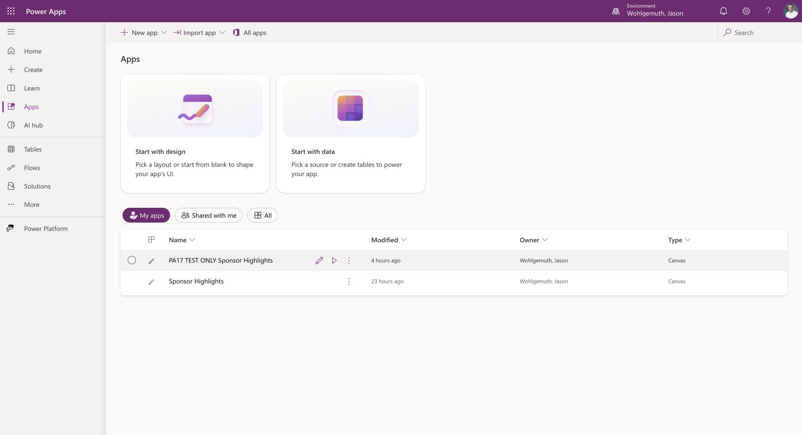
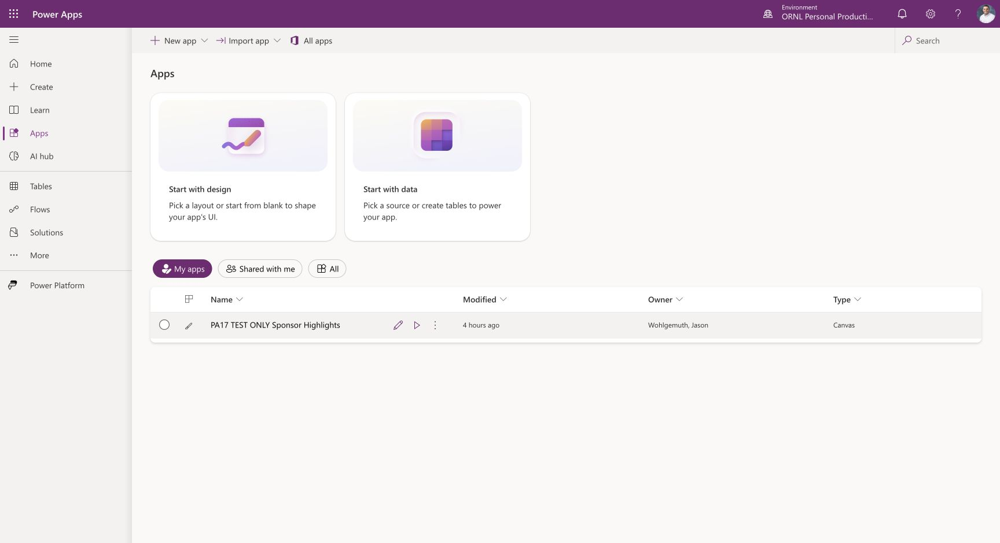
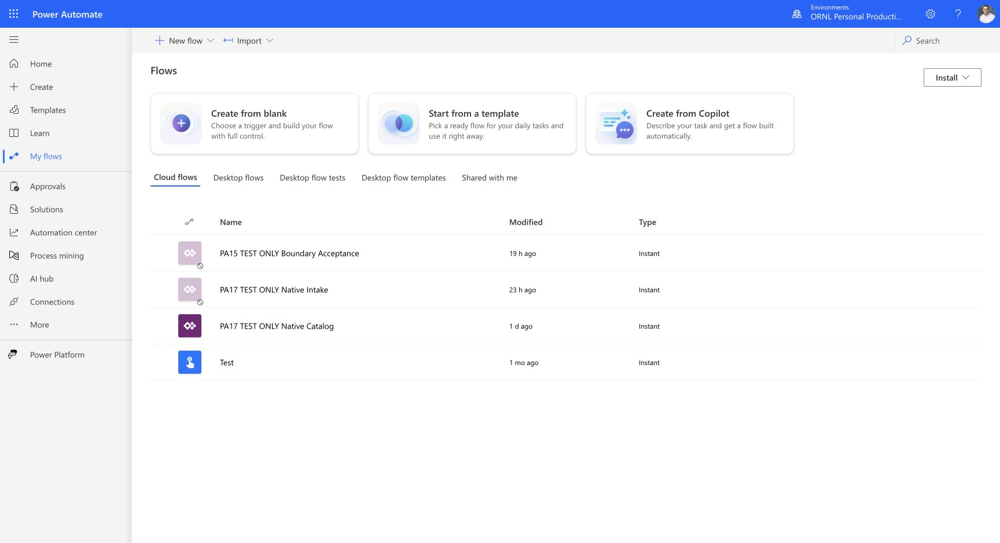
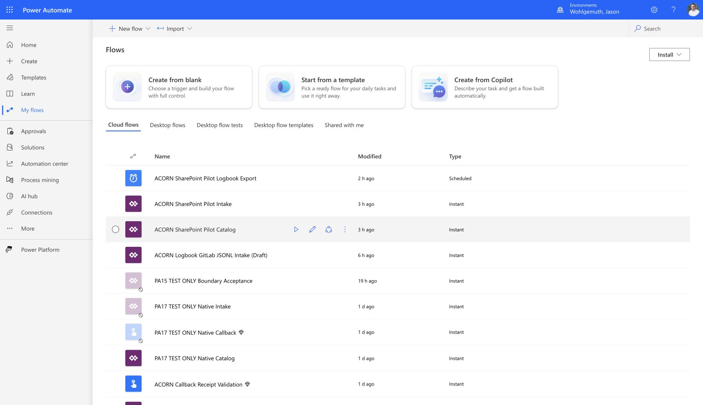
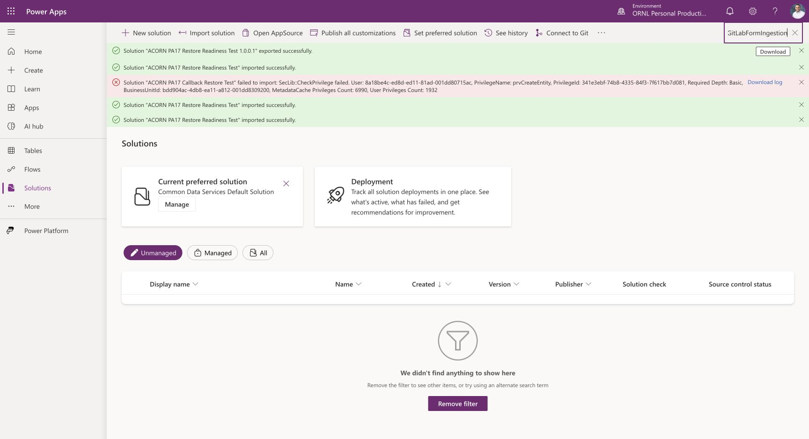

# Power Platform test artifact cleanup

Owner-requested cleanup performed October 25, 2026. Only completed, explicitly test-only resources were removed. Operational apps, flows, connectors, connections, credentials, inbox, callback table and receipts were not edited.

## Removed cloud resources

| Environment | Resource | ID |
| --- | --- | --- |
| Wohlgemuth, Jason | PA14 TEST ONLY Sponsor Highlights | `62ef8e08-4253-4fd8-91e1-a7c0a13d7fd3` |
| Wohlgemuth, Jason | PA14 TEST ONLY intake simulation | `7364dc72-5b4b-45aa-9dea-c95dc91614be` |
| Wohlgemuth, Jason | PA14 TEST ONLY catalog simulation | `8fdddd79-52e5-4576-bd95-19c3ffb40be7` |
| ORNL Personal Productivity | PA14 TEST ONLY Sponsor Highlights | `8fcc3d17-88d3-4dd5-a990-b4ef9843013a` |
| ORNL Personal Productivity | PA14 TEST ONLY intake simulation | `9af88959-801d-4d6f-892c-e34f42c3b38a` |
| ORNL Personal Productivity | PA14 TEST ONLY catalog simulation | `9f830720-ea02-46aa-bdac-e493052ed32f` |
| Wohlgemuth, Jason | ACORN Intake Failure Acceptance TEST ONLY 2026-10-24 | workflow `74365385-02d0-f111-a05c-001dd8062052`; listing identity `1e5461ab-a4b6-3c27-66ba-cefca88e553a` |

The app IDs were checked on their Details pages before removal. The failure mock was Off, had no associated apps and no custom solution references. Refreshed inventories verified the removed resources were absent. [Browser-recovery evidence](browser-recovery-acceptance.md) and [failure-response evidence](write-failure-acceptance.md) remain; their cloud links are now historical.

## Retained resources

- Operational Sponsor Highlights, its intake/catalog flows, and manual callback receipt/notification workflow.
- Both PA-17 native test apps, test solutions, intake/catalog flows, callback test flow, connectors and protected references. Full restore acceptance is unfinished.
- The two PA-15 boundary copies, with notifications disabled, for the remaining acceptance matrix. Their IDs and final states are recorded in [boundary acceptance](boundary-acceptance.md).
- October 25 retained the older notification/intake/Test flows pending investigation. Their October 26 dispositions are recorded below; the unused ORNL intake prototype and owner-approved legacy notification flow were removed.
- Native restore archives, manifests, current PDFs, demo packet and durable acceptance evidence.

## Wiki asset cleanup

Two personal Teams screenshots were removed from plan assets. Current guides use the fictional `teams-example.png`; the personal screenshots were already excluded from distributed archives. Four byte-identical duplicate files were removed, preserving their canonical copies and updating the current runbook link. Exact paths and replacements are recorded in [asset-cleanup.json](_assets/boundary-tests/asset-cleanup.json).

Source/demo archives and manifests were rebuilt from their selected current files. Historical failure screenshots and native restore packages are retained because they explain unresolved acceptance or support recovery. This cleanup does not certify PA-15, PA-16 or PA-17.

## October 26 portfolio and inventory review

Reviewed all 33 executable plans and two coordination records, with focused current-code checks and live flow/solution inventories in Wohlgemuth, Jason and ORNL Personal Productivity. No additional whole plan was proven complete; the manual-ingestion plan was already retired. Its walkthrough, PDF guides, exact demo fixtures and handback procedure remain useful documentation. PA completed-history prose was condensed into linked evidence. SharePoint user access (PA-22), native restoration (PA-24), and optional cutover (PA-25) now have separate acceptance ownership; PA-12 depends on the selected route rather than forcing GitLab gates onto SharePoint.

### Cloud cleanup and retained dependencies

| Resource | Environment | Disposition and evidence |
| --- | --- | --- |
| ACORN Logbook Intake (`e3a4ad29-ac14-4afe-887b-8b905f9e8dbb`) | ORNL Personal Productivity | Deleted October 26. Owner Jason; created/modified October 7; never run, unshared, no associated apps. Refreshed cloud-flow inventory contains four remaining flows and no matching ID. |
| ORNL Automation / GitLabFormIngestion (`5c269b88-62a5-f111-b8de-001dd806277c`) | ORNL Personal Productivity | Empty unmanaged v1.1.0.0 solution: All/Apps/Flows/Tables each zero, dependency results empty. Deleted after explicit owner confirmation. Search by its unique name returned no results after removal. |
| ACORN Logbook Canvas Notifications (`ece463d8-fe39-72b6-dffe-f0b98faadc23`) | Wohlgemuth, Jason | Deleted after explicit owner confirmation naming this legacy flow. Before removal it was enabled with successful October 22 runs and no listed app/custom-solution associations. Automatic approval review initially rejected deletion because non-use was uncertain; the owner then specifically authorized removal. Refreshed inventory has ten flows and no matching ID. Current inline intake notices and the durable callback receipt flow remain enabled. |
| Test (`bd0497c0-a06e-4c14-bfd4-be7fa383ddb0`) | ORNL Personal Productivity | Retained as unrelated. Read-only definition inspection found a manual Teams booking-link message, not Sponsor Highlights intake. No edits, saves or runs. |
| PA15 TEST ONLY Boundary Acceptance (both environments) | Both | Retained Off for unfinished PA-15/16 matrices. |
| PA17 TEST ONLY Native Intake (both) and Native Callback (Jason) | Both/Jason | Retained Off for unfinished restore acceptance. Native catalogs remain On for app/catalog checks. |
| PA17 native readiness/restore/backup solutions and operational intake solution | Both | Retained: dependency containers, native restore acceptance or operational recovery. Names containing TEST ONLY do not make unfinished acceptance resources disposable. |
| SharePoint app, three flows and ACORN SharePoint Pilot solution | Wohlgemuth, Jason | Retained enabled and unchanged; PA-19–24 acceptance is incomplete. |

The Jason inventory has 10 flows after removal of the legacy notification flow. ORNL has four after deletion: PA15 boundary Off, PA17 intake Off, PA17 catalog On and unrelated Test On. The operational GitLab intake/catalog and SharePoint intake/catalog/combined exporter remain enabled. No app bindings, connections, credentials, list/library records, callback rows, recipient settings or operational JSONL bytes were changed by cleanup.

The live Jason list identifies the operational GitLab intake as `6039f419-420f-6922-46ef-04b00d2290f1`; older saved-source/run evidence retains `ff4a134b-5fd3-4465-ab19-0325c2f2bf1b`. These are recorded by observation context; cleanup did not rebind either app or rewrite historical identities.

### Local cleanup

Removed **19 unreferenced superseded drafts and intermediate screenshots**, totaling **1,421,827 bytes**, plus generated `catalog-tests/bin` and `catalog-tests/obj` directories. [The removal manifest](_assets/cleanup/20261026-manifest.json) records exact paths, hashes and reasons. Names were checked against wiki text, remaining repository references and ZIP members before deletion. Current form/connector sources, PDFs, selected demo archives, native packages and exact-byte historical JSONL fixtures remain. Historical import failures retain their written diagnostic evidence; obsolete screenshots do not need to duplicate it.

Validation passed for wiki plan metadata, all wiki Markdown file targets, four manifest-listed native archive sizes/hashes/ZIP integrity, and whitespace. One pre-existing Rhai runtime link was corrected to its current module path. No changed documentation is embedded in a retained ZIP, so those archives were not rebuilt. No application code was modified and no cloud submission or notification was sent as a cleanup test. Existing staged documentation and unrelated source edits were preserved.

## October 26 post-validation wiki cleanup

After the isolated PA-19/20 acceptance, removed **31 redundant artifacts totaling 2,066,614 bytes**. The [removal manifest](_assets/cleanup/20261026-post-validation-manifest.json) records each path, digest, reason and retained replacement evidence. Removed files were intermediate Off-state/inventory captures, superseded import/editor screenshots, two byte-identical restored catalog-code copies, and two transient PA-20 editor/run captures. Repository text references and all eight retained ZIP member lists were checked before removal; no deleted file belongs to those archives. Superseded screenshot links now point to retained retry ledgers. Restored catalog code links to the byte-identical canonical source, with the observed hash preserved.

Native backup packages, current PDFs and their build inputs, exact-byte JSONL fixtures, failure diagnostics, final Off-state proofs and current acceptance ledgers remain. The dated demo ZIP retains its captured version of `sharepoint-pilot.md`; consult the live [SharePoint record](sharepoint-pilot.md) for subsequent validation. Archives are retained captures, not automatically refreshed copies of active plans.

PA-19 and PA-20 remain pruned after acceptance. PA-15's active readiness statement now lists remaining cases and links its detailed history. Root portfolio prose was condensed and synchronized with the new acceptance. All 35 executable plans and two coordination records still have remaining work; no additional whole plan was retired. This cleanup changed only local wiki files. It made no cloud-resource, connection, permission, operational-flow or notification changes. PA19/20 test resources remain needed for PA-21/23/26 and were not deleted.

Validation passed: planning metadata and dependencies, 593 Markdown file targets, all eight ZIP integrity checks, four native-package manifest sizes/hashes, removal/replacement paths, and whitespace. No application behavior changed, so no workspace test suite was run.
