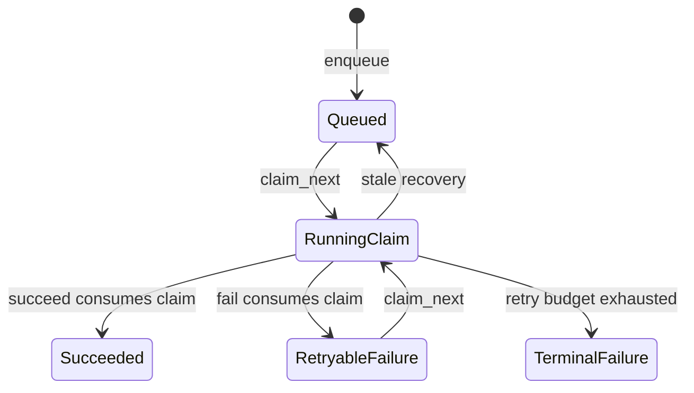

# Goal

Represent a claimed GitLab bot operation as an owned capability that can be settled exactly once by local Rust code, while retaining database state as the authority for recovery and cross-process concurrency.

# Current evidence

- `OperationQueue::claim_next` returns `ClaimedOperation`, but its operation key, delivery data, event JSON, and attempt count are public.
- `OperationQueue::succeed` accepts an arbitrary operation-key string rather than proof that the caller owns a running claim.
- `OperationQueue::fail` borrows `ClaimedOperation`, so the same value can be failed repeatedly or reused after another settlement call.
- `ClaimedOperation` derives `Clone`, so consuming methods alone would not make the capability single-use.
- The shared `update_state` query updates by operation key alone. It does not require the row to remain `running` at the claimed attempt.
- `Server::process_next` retains the claim through processing, then chooses success or failure, which is already the correct ownership boundary for a consuming API.
- `gitlab::database` and its settlement methods are public, so private fields and consuming signatures are source-breaking changes for downstream callers.
- `Server::process_next` currently routes a failed success-settlement update into `fail`; a consuming claim requires processing errors and ambiguous settlement errors to take different paths.
- `OperationQueue` opens concrete database connections internally, so the plan needs a deterministic test-only failure seam to exercise ambiguous settlement without broadening the production queue abstraction.
- Persisted `OperationState` is required for restarts, stale-claim recovery, metrics, and multiple workers; compile-time capability modeling cannot replace it.

# Decision

Make `ClaimedOperation` an opaque capability returned only by `claim_next`. Settle it through queue methods that consume the capability:

```rust
OperationQueue::succeed(&self, claim: ClaimedOperation) -> ApiResult<()>
OperationQueue::fail(&self, claim: ClaimedOperation, error: &str) -> ApiResult<OperationState>
```



- Make claim fields private and expose read-only getters needed by the worker: `operation_key`, `delivery_id`, `event_json`, and `attempts`.
- Remove `Clone` from `ClaimedOperation` and do not expose any public constructor or duplication mechanism.
- Keep `OperationState` as the serializable runtime state returned by queue inspection.
- Replace the generic settlement update with a guarded transition that matches `operation_key`, `state = 'running'`, and the claim's attempt number.
- Treat a zero-row guarded update as a stale or already-settled claim error, distinct from an unknown operation key where practical.
- Do not add marker generics to the queue itself. The capability value, consuming settlement methods, and guarded SQL transition encode the relevant state with less machinery.

# Compatibility boundary

This is an intentional breaking `acorn-lib` API change at the same documented release boundary as the Hugging Face request refactor. Remove arbitrary-key `succeed`, borrowed-claim `fail`, public claim fields, and `Clone` in one change. Do not retain a compatibility method that settles by raw operation key, because it would preserve the invalid state this plan removes.

Release notes must map field access to getters and old settlement calls to the consuming queue methods.

# Concurrency and failure boundary

Rust ownership prevents double settlement only within one process. The database remains authoritative when stale recovery, restart, or another worker changes a row.

If settlement returns a database error, the consumed claim is not returned to the caller. The operation remains `running` or has an unknown outcome and is recovered through the existing stale-claim timeout. This avoids retrying an ambiguous terminal update from the same process. Log the operation key before consuming the claim so settlement failures remain diagnosable.

Stale recovery must increment the attempt on the next successful claim. The guarded attempt predicate ensures that an older worker cannot settle a newer lease.

Add a `#[cfg(test)]` optional function-pointer hook to `OperationQueue`, configured only by unit tests and invoked immediately before the guarded settlement update. A hook error simulates a deterministic settlement failure while leaving the operation `running`. Function pointers preserve the queue's existing clone/debug behavior, and the field plus setter do not exist in production builds. Run the same worker assertion under the default SQLite and DuckDB feature matrices; do not introduce a production storage trait solely for failure injection.

| Worker outcome | Settlement action | Settlement error behavior |
| --- | --- | --- |
| Decode and processing succeed | Consume the claim with `succeed`. | Return the settlement error; do not call `fail`. Leave ambiguous running state to stale recovery. |
| Decode or processing fails | Consume the claim with `fail(error)`. | Return the original processing context plus settlement failure; do not attempt another transition. |
| Guarded settlement updates zero rows | Return a stale/already-settled claim error. | Do not retry with the consumed claim; current durable state wins. |
| Claim/migration fails before a claim is returned | Return the queue error. | No settlement action exists because no capability was acquired. |

# Implementation order

| Order | Impact | Difficulty | Change | Verification |
| --- | --- | --- | --- | --- |
| 1 | high | medium | Guard settlement SQL by operation key, `running` state, and attempt number before changing the public API. Return a stale/already-settled error on zero rows. | Backend tests prove an older attempt cannot settle after recovery and reclaim. |
| 2 | high | low | Privatize claim fields, add getters, remove `Clone`, and remove public construction or duplication paths. | Compile-fail rustdoc covers both `claim.clone()` and reuse after a consuming call. |
| 3 | high | medium | Change `succeed` and `fail` to consume `ClaimedOperation`; update `process_next` to give ownership to exactly one processing-result branch. | Worker tests cover success, processing failure, and decode failure without cloning the claim. |
| 4 | high | medium | Implement the settlement-error table and the `#[cfg(test)]` pre-settlement function-pointer hook. A hook failure leaves the row running and a failed success update is never converted into an operation failure. | The same deterministic worker test runs under SQLite and DuckDB, proves no second transition occurs, advances the claim beyond the stale timeout, and proves recovery/reclaim succeeds. |
| 5 | medium | medium | Rewrite retry tests to exercise real claim/fail/reclaim transitions instead of mutating attempt counters; update docs and release notes for the intentional breaking API. | SQLite and DuckDB configurations pass the same lifecycle assertions and public docs expose getters plus consuming methods only. |

# Validation

1. Run `cargo test --doc -p acorn-lib` for the moved-value compile-fail example.
2. Run the focused GitLab queue, webhook-worker, and bot API tests.
3. Run `cargo nextest run -p acorn-lib io::api::gitlab` with the default database backend.
4. Run `cargo nextest run -p acorn-lib --no-default-features --features duckdb io::api::gitlab` and `cargo check -p acorn-lib --no-default-features --features duckdb`.
5. Run `cargo doc -p acorn-lib --no-deps` and verify raw-key settlement, public claim fields, and `Clone` are absent.
6. Run `cargo fmt --check`, `cargo clippy -p acorn-lib --all-targets --no-deps -- -D warnings`, and `git diff --check`.

# Acceptance criteria

- Only `claim_next` can construct a `ClaimedOperation` outside its defining module.
- `ClaimedOperation` is not `Clone`; successful or failed settlement consumes the claim, and ordinary callers cannot duplicate or reuse it.
- Settlement updates only the matching running attempt; an old or already-settled claim cannot overwrite newer durable state.
- Stale recovery, bounded retry, terminal failure, counters, and restart behavior remain intact for SQLite and DuckDB.
- `Server::process_next` has one explicit ownership path to success or failure without cloning a claim.
- A success-settlement error is not passed to `fail`; ambiguous running state is recovered only through the stale-claim path.
- A test-only pre-settlement hook deterministically proves the ambiguous-settlement behavior under SQLite and DuckDB without changing the production queue API.
- Tests no longer depend on externally mutating a claim's attempt count.
- Public documentation and release notes explain the intentional breaking migration; no arbitrary-key settlement compatibility path remains.

# Related plans

- [GitLab bot analysis and citation intake](gitlab-webhook-bot-workflows.md) defines the durable worker workflow whose settlement boundary this plan hardens.
- [Hugging Face request readiness](huggingface-request-readiness.md) is the higher-priority, lower-operational-risk typestate-readiness refactor.
