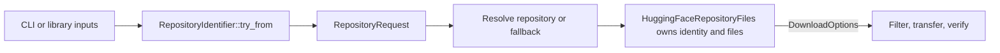

# Project code boundaries

- **Update:** `crates/acorn-lib/src/io/api/huggingface.rs`, model import/download callers, CLI planning modules, public docs, and tests; later `acorn-api`/`acorn-service`.
- **Create:** operation-specific repository-resolution and download request types.
- **Delete:** legacy public `Options` and test-only long-signature wrappers after the complete call surface migrates.

# Dependencies

Coordinate request composition with [request parameters](request-parameter-composition.md) and durable transition semantics with [claimed operations](gitlab-claimed-operation-capabilities.md); preserve the API/service split.

# Parallel execution

Operation-specific request types and tests confined to `io/api/huggingface.rs` can run with portability work. Migration of shared CLI planners, `io/api/mod.rs`, manifests, public documentation, or shared snapshots waits for the API/CLI integration owner. Do not remove legacy `Options` until all dependent slices have rebased.

# Goal

Make repository resolution accept only a semantically valid repository identifier and make file download use the identity that produced the resolved file set. Invalid identifiers must fail before network or filesystem effects, and callers must not be able to pair one repository's files with another repository's identity.

# Current evidence

- `crates/acorn-lib/src/io/api/huggingface.rs` uses one public `Options` type for repository discovery, candidate selection, tree parsing, filtering, and download. Both `identifier` and `output` are optional.
- `HuggingFaceRepositoryFiles::parse` and `HuggingFaceRepositoryFiles::resolve` independently reject a missing identifier at runtime.
- `HuggingFaceRepositoryFiles::download` independently rejects a missing identifier or output directory at runtime.
- `crates/acorn-cli/src/commands/download/model/plan.rs` and `crates/acorn-cli/src/commands/import/model.rs` construct overlapping subsets of `Options`, then pass them into operations with different readiness requirements.
- `CandidateSelector` receives all of `Options` even though candidate choice needs only selection context. The TUI callback consequently depends on a broader request shape than it uses.
- Public `CandidateSelector`, `CandidateSelection`, and `HuggingFaceRepository` contracts mention `Options`; retaining only the struct would not preserve compatibility when those signatures change.
- `HuggingFaceRepositoryFiles` already stores the identifier and revision that produced its files, while `download` separately reads identifier and revision from `Options`. The values can disagree.
- Current model-download paths create destination directories before building the Hugging Face request, so builder presence alone does not guarantee invalid input fails before filesystem effects.
- The existing `parse_identifier` accepts traversal-shaped values such as `../name`, `owner/..`, and Windows backslash segments, while download destinations use `root.join(identifier)`.
- `HuggingFaceRepositoryFiles` exposes public identity and file fields plus a public constructor, so callers can forge or mutate an identity/file mismatch even if download options stop carrying identity.

# Decision

Use a validated repository-identifier newtype plus operation-specific request structs instead of marker-generic `Options<State>` types. Builders enforce field presence; fallible identifier construction enforces semantic validity.

- `RepositoryIdentifier` is created through `TryFrom<&str>` or `FromStr` and owns validated `owner` and `name` components. Require exactly one `/`; require each component to be 1–96 characters of alphanumeric, `-`, `_`, or `.`; reject leading or trailing `-` or `.`, consecutive `--` or `..`, whitespace, control characters, backslashes, platform separators, and URL delimiters. Direct HTTP URLs remain separate source variants and do not enter this type.
- Expose read-only `owner()`, `name()`, and canonical display getters. Build destinations as `root.join(identifier.owner()).join(identifier.name())`, normalize against an absolute root, and reject any result outside that root before creating directories.
- `RepositoryRequest` owns a `RepositoryIdentifier`, revision, fallback/search policy, offline behavior, and candidate-selection context.
- `DownloadOptions` owns a non-optional `PathBuf` output directory plus filter, ignore, quiet, and checksum controls. It contains no repository identifier or revision.
- `HuggingFaceRepositoryFiles::download(&DownloadOptions)` builds checksum and file URLs from `self.identifier` and `self.revision`, making the resolved file set the single identity authority.
- Make `HuggingFaceRepositoryFiles` fields private and replace public `new` with a private or `pub(crate)` constructor used only by repository parsing/resolution. Expose read-only identifier, revision, file-slice, and iteration access. Filtering, preferred-file selection, and required-shard selection return new values that preserve the original identity and revision internally; migrate the CLI's current direct `new` call to the required-shard method.
- Candidate selection receives a narrow `SelectionContext`. Change `CandidateSelector`, `CandidateSelection`, and the TUI callback together so none depends on the broader legacy type.
- Keep `RepositoryResolution<T>`, `HuggingFaceRepositoryFiles`, and `Downloaded` as result types; this refactor changes request readiness, not response modeling.
- A fallback result owns the resolved identifier in `HuggingFaceRepositoryFiles`; download never reconstructs identity from the originally requested repository.

# Compatibility boundary

This is an intentional breaking `acorn-lib` API change at a documented release boundary. Replace `Options` and every public signature that exposes it, including `CandidateSelector`, `CandidateSelection`, and `HuggingFaceRepository`; privatize `HuggingFaceRepositoryFiles` fields and construction; and do not retain legacy traits, callbacks, constructors, or adapters that keep invalid states reachable.

Inventory the complete public surface in generated documentation before implementation and record the migration mapping in release notes. Workspace call sites migrate in the same change. The plan is not complete while a public repository-resolution or download path still accepts legacy `Options`.

# Implementation order

| Order | Impact | Difficulty | Change | Verification |
| --- | --- | --- | --- | --- |
| 1 | high | medium | Add component-owning `RepositoryIdentifier`, `SelectionContext`, `RepositoryRequest`, and `DownloadOptions` with private fields and required builder inputs. Replace string-based destination joins with validated owner/name joins and an absolute-root containment check. | Tests reject empty, malformed, extra-segment, dot-segment, repeated-dot/dash, backslash, platform-separator, control-character, URL-delimiter, and Windows traversal inputs; rustdoc `compile_fail` examples prove required builder inputs cannot be omitted. |
| 2 | high | medium | Change the complete public surface: `CandidateSelector`, `CandidateSelection`, `HuggingFaceRepository`, repository parsing, resolution, fallback selection, and download. Remove `Options` rather than leaving a legacy execution path. | Generated public docs contain no item or signature named `Options`; migration prose may mention the removed name. Existing API tests retain selection, response, filtering, fallback, and checksum behavior. |
| 3 | high | medium | Make `HuggingFaceRepositoryFiles` an opaque download identity authority. Privatize fields and construction, pass only `DownloadOptions`, generate URLs from the resolved value, and add identity-preserving filter, preferred-file, and required-shard transforms. | Public callers cannot construct or mutate the file set; tests prove every transform retains identity and every fallback download URL plus `Downloaded` result uses the resolved identity. |
| 4 | high | medium | Migrate model import, model download, GGUF fallback, TUI selection, and tests. Validate and build requests before `create_dir_all`; directory creation belongs to download execution after request validation. | Invalid identifiers perform no network request and leave no output directory; focused CLI tests pass with default, no-default, and TUI feature configurations. |
| 5 | medium | low | Update public examples and release notes with the intentional breaking migration from `Options` to the new narrow types. | Documentation builds without warnings and documents the old-to-new call mapping. |

# Failure handling

- Missing required fields fail during builder use. Empty or malformed repository identifiers fail through `RepositoryIdentifier` construction before network access or directory creation.
- Path-safe component validation and the absolute-root containment check fail before `create_dir_all`; rejected identifiers cannot escape or collapse the intended `root/<owner>/<name>` destination on Windows or Unix.
- Network, fallback selection, filtering, filesystem, and checksum failures retain their current error behavior.
- A fallback repository returns a new resolved file-set value whose identity is authoritative; do not mutate the original request or copy its identity into download options.
- Directory creation starts only inside download execution after both `RepositoryIdentifier` and `DownloadOptions` exist. Side-effect tests use a fresh nonexistent destination and verify it remains absent after request-validation failure.

# Validation

1. Run `cargo test --doc -p acorn-lib` for compile-fail builder examples.
2. Run `cargo nextest run -p acorn-lib io::api::huggingface`.
3. Run `cargo nextest run -p acorn-cli commands::download`.
4. Run `cargo nextest run -p acorn-cli --no-default-features commands::download`.
5. Run `cargo nextest run -p acorn-cli --no-default-features --features tui commands::download`.
6. Run `cargo nextest run -p acorn-cli commands::import::tests::test_model`.
7. Run `cargo check -p acorn-cli --no-default-features` and `cargo check -p acorn-cli --no-default-features --features tui` as broader compile gates.
8. Run `cargo doc -p acorn-lib --no-deps` and verify no public item or signature is named `Options`, no public `HuggingFaceRepositoryFiles` constructor exists, and its fields are private; migration prose may mention removed names.
9. Run `cargo fmt --check`, `cargo clippy -p acorn-lib --all-targets --no-deps -- -D warnings`, `cargo clippy -p acorn-cli --all-targets --no-deps -- -D warnings`, and `git diff --check`.

# Acceptance criteria

- Repository resolution cannot be called without path-safe validated owner/name components, and destination resolution cannot escape the configured root.
- Download uses identity and revision only from `HuggingFaceRepositoryFiles`; download options cannot supply or override them.
- `HuggingFaceRepositoryFiles` identity, files, and construction are opaque to public callers; read-only access and transforms cannot change provenance.
- Workspace and public APIs use `RepositoryRequest`, `SelectionContext`, or `DownloadOptions`; legacy `Options` and signatures that expose it are removed at the declared breaking release boundary.
- Runtime errors dedicated only to absent identifier or output fields are removed from ready-type execution paths.
- Invalid and traversal-shaped identifiers cause no network or filesystem side effects, including output-directory creation, on Windows and Unix.
- Existing fallback selection, filtering, checksum verification, offline behavior, and TUI selection remain behaviorally unchanged.
- Public documentation and release notes explain the intentional breaking migration and construction of each narrow request type.

# Related plans

- [Request parameter composition](request-parameter-composition.md) covers shared parameter assembly after request readiness is established.
- [GitLab claimed-operation capabilities](gitlab-claimed-operation-capabilities.md) applies the same invalid-state prevention principle to durable worker settlement.
