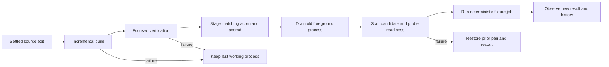

# Incremental builds, reload and daemon development

This is the development-loop contract for the [Blaze qualification plan](index.md), coordinated with the [acornd service plan](../../features/acornd-service.md). Updated November 12, 2026 against `6c2a51b8` and the existing worktree. It connects the daemon's existing reload proposal to compiler qualification without making production service delivery depend on an experimental compiler.

## What the daemon plan already promised

The daemon plan names authenticated `acorn.jobs.reload`, watches research inputs to schedule jobs, supports service restart/upgrade, and proposes an optional Hotcode experiment on one pure synchronous function. These are four distinct mechanisms. Current [run_foreground](../../../crates/acorn-daemon/src/lib.rs) loads configuration and waits for Ctrl-C; none of these runtime reload behaviors is implemented there yet. Portable coalescing policy exists in [job/mod.rs](../../../crates/acorn-service/src/job/mod.rs).

The current [config loader](../../../crates/acorn-daemon/src/config.rs) consumes the `daemon` section of ACRE through `ApplicationConfiguration::read`; [the shared schema](../../../crates/acorn-lib/src/io/config/application.rs) owns `bind`, `tls`, `jobs` and camel-case schedules. [The foreground CLI](../../../crates/acorn-daemon/src/main.rs) currently accepts a positional configuration path: `acornd run PATH`. The older standalone version-1 YAML and `--config` descriptions were stale; the associated daemon plan is reconciled in this change. No alternate development config schema is proposed.

## Route changes to the correct owner

| Changed input | Response | State boundary | Owner and prerequisite |
|---|---|---|---|
| Research input watched by a configured job | Debounce and enqueue one bounded rerun; do not compile | Preserve process, pause state and immutable run history | ACD-06 scheduler |
| ACRE daemon job configuration | Explicit authenticated reload, optionally requested by the development supervisor after a settled save | Validate first; swap one complete job generation at a scheduling boundary | ACD-08A; CLI command in ACD-09 |
| Listener address, TLS or other restart-only settings | Reject live reload with a restart-required diagnostic and keep active config | No partial listener/security reconfiguration | ACD-08A; ordinary lifecycle restart |
| Rust function/type/macro, generated Pomsky/proto input, Cargo manifest/lockfile | Incremental build, focused validation, stage a consistent binary pair, bounded restart and readiness probe | Durable pause/history survive; ephemeral process state is recreated | BLZ-11 supervisor; BLZ-12 actual daemon integration |
| Dioxus RSX or browser Rust | Existing Dioxus update/rebuild behavior | Framework decides HMR versus full page reload | Existing `make web-dev`; BLZ-08 compatibility only |
| Map JS/TS/CSS | Existing Vite Fast Refresh | Existing browser/map lifecycle | `make web-dev` and frontend quality plan |
| Isolated pure function in an experimental harness | Optional in-process function patch if its contract is proven | No references or state cross a reload boundary | BLZ-13; never daemon runtime or production release |

The ACORN daemon and the Blaze compiler daemon are separate processes with separate responsibilities. `acornd` does not compile itself or watch Rust sources. The development supervisor coordinates build/run operations; the application scheduler continues to watch user data only. Exclude build output, staging, logs, history, reports and compiler caches from development watches to prevent rebuild loops. Coalesce save bursts and changes during a build into at most one newer build request.

## One observable edit-to-ready pipeline

Cargo is the baseline backend; Blaze is an explicitly selected, qualified alternative. No silent fallback that makes Blaze timings include hidden Cargo work. A successful plain Cargo path is useful even when Blaze fails qualification. Official Cargo verification remains required before accepting/shipping source changes; the fast inner loop may run only the recorded focused tests and reports that limited scope.

Measure **edit-to-observed-result**, not only compiler completion:

`detect + build + verify + stage + drain + start + readiness + fixture job = feedback latency`

Record components, total median/p95, daemon memory and startup state restoration. Compare Cargo plus restart with Blaze plus the same restart protocol. Compare config reload and pure-function patch separately because they change different inputs and preserve different state. Report compile-only speedups alongside total latency; a fast build with slow drain or job execution is not a fast developer loop.

## Binary generations and safe restart

Each disposable development generation contains both `acorn` and `acornd`, produced from the same source revision plus working patch, lockfile, feature set, compiler backend and build configuration. Record artifact hashes and paths; matching package versions alone are insufficient. The daemon resolves a sibling CLI, so never build a new daemon while leaving its old sibling on PATH. Shared domain changes conservatively rebuild/revalidate both consumers. Keep each staged generation immutable and record which generation a fixture run used in the supervisor log; no production history schema change is needed for this evidence.

Before stopping the last working process, complete both builds and selected tests, verify the artifacts are independently launchable from the staged directory, and validate the candidate config. Blaze execution may depend on its compiler runtime/cache: test standalone launch explicitly. If it cannot supply a runnable matched pair, retain Cargo restart support and mark the Blaze restart backend unqualified; do not change production binary resolution to accommodate it.

Run foreground processes only with temporary config/data/cache/report roots, loopback ports and fixture jobs. Use the daemon's accepted shutdown contract to stop scheduling and drain work within a bounded timeout. Record forced termination as interrupted through the existing recovery contract; never leave two global workers running against one history database. Wait for old listeners to release before candidate launch. On readiness failure, stop the candidate and restore the previous pair/config; report rollback failure visibly. Development schema changes are restart-only and require a fresh disposable store unless backward compatibility is proven; do not roll an old binary back over an incompatible migrated store.

A compile/test failure preserves the running generation. A later edit supersedes an unfinished candidate, and only the newest fully built and verified generation may activate. Ctrl-C stops supervisor-owned watchers/children and restores terminal state. Never install a service, replace a signed bundle, touch user history, or stop the user's unrelated compiler daemon for an experiment.

## Atomic configuration reload contract

ACD-08A owns this behavior; BLZ tooling only exercises it. Load a fresh complete ACRE document and validate the daemon subset, paths, duplicate IDs, supported runner actions, schedule and unchanged restart-only fields before mutating runtime state. An invalid or partially written file leaves every active watcher, schedule, job and listener unchanged. The response identifies the applied generation or a bounded rejection reason without secrets.

Use a single scheduler serialization point to publish one immutable job snapshot and its prepared watcher set. If watcher preparation or publication fails, retain the old generation. Concurrent reload/run/pause/resume calls have an explicit serialized order. A successful response occurs only after that generation is active; replaying an identical reload makes no new startup jobs.

Running work finishes against the snapshot under which it started. Removed jobs receive no further runs; their history remains readable. For a changed job, discard superseded queued work and schedule at most one run of its new snapshot once the old in-flight run completes. New unpaused jobs get one startup run; unchanged jobs keep their coalescing state and do not run solely because reload happened. Persisted pause state follows a stable job ID. Watch callbacks carry generation identity so delayed callbacks from a removed watcher cannot enqueue obsolete work. History for an old run must never be relabeled with a replacement job definition.

Listeners, TLS settings and binary paths require restart in this first contract. A config edit containing both job changes and restart-only changes is rejected as a whole. Production reload remains explicit through authenticated mutation-gated control; automatic config watching is a development-supervisor option, not an implicit new production feature.

## Hotcode and Blaze live-code experiment

[Hotcode 1.0.3 documentation](https://docs.rs/hotcode/1.0.3/hotcode/) requires a library with `dylib` and `rlib` outputs and a function attribute. It excludes generic functions and warns that ABI changes and retained static references can cause undefined behavior. Those constraints justify the original daemon plan's pure-function-only experiment. They do not establish compatibility with async workers, existing state, transports or arbitrary application changes.

The [pinned Blaze linker preparation](https://github.com/indexable-inc/blaze/blob/39452df1ec738b68fbec6ff6e0d8919839d45355/crates/blaze-cargo/src/serve/unit/codegen.rs#L60) rejects an explicitly requested Rust `dylib`. Therefore do not stack Hotcode on Blaze by assuming they compose. Compare **Cargo + Hotcode** and **Blaze's own live-code mechanism** as independent experimental candidates against Cargo/Blaze rebuild-and-restart. Recheck the selected binaries' actual capabilities; the pinned source contains newer live-image support while some overview documentation remains stale.

Use a separate disposable one-function harness with owned scalar input/output, fixed signature, no generics, async tasks, callbacks, returned references or static state. First establish safe refusal/restart behavior for incompatible changes without running ABI-invalid code. Observe changed output and unchanged process identity only for an accepted body-only edit. Measure latency, runtime overhead, allocations/memory growth and repeated reload behavior. Do not annotate a production ACORN function, add a runtime dependency or alter a crate type for this experiment. Any future integration requires its own accepted API/state boundary and bounded plan; it is not a prerequisite for shipping `acornd`.

## Acceptance matrix

| Scenario | Required observable result |
|---|---|
| Code edit accepted | New generation's output is observed after readiness; paired binaries and feature set are recorded |
| Compile/test failure | Old process remains ready; no candidate artifacts activated |
| Rapid saves during a build | At most one pending rebuild; obsolete generation never replaces the newest verified candidate |
| Config reload accepted | PID unchanged, one complete snapshot active, unchanged jobs not duplicated, paused jobs remain paused |
| Config malformed or restart-only setting changed | Old snapshot remains active; no partial scheduling/listener change |
| Reload while job runs; delayed old watcher event | Old run finishes with old snapshot, removed job not requeued, at most one current-generation rerun |
| Restart with running/pending/paused jobs | Bounded shutdown/recovery; interrupted status accurate; pause/history preserved; no double execution by overlapping workers |
| Candidate fails readiness | Candidate stopped; prior compatible pair/config restored; failure visible |
| Browser edit | Existing Dioxus/Vite behavior and cleanup preserved; no compiler-only claim substituted for browser acceptance |
| Pure-function experiment | Body edit changes output without restart only when safe; incompatible change requests/refuses reload; no production dependency |

The shared fixture/source corpus and generation record make these outcomes comparable. ACD validates production reload/recovery semantics; BLZ validates development build/activation and timing. Neither plan duplicates the other's implementation or completion claims.
