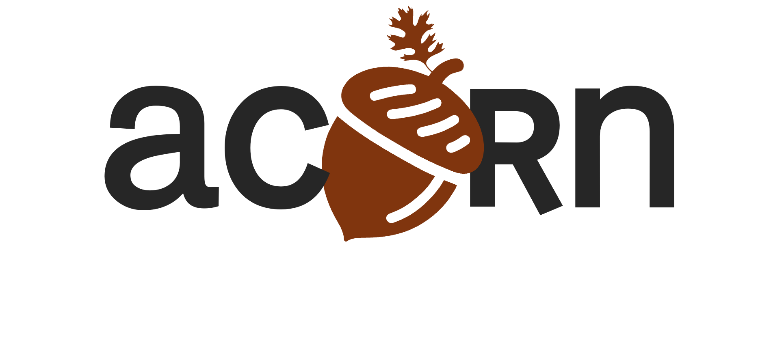

  <picture>
    <source media="(prefers-color-scheme: dark)" srcset="docs/src/_assets/dark/banner.png">
    <source media="(prefers-color-scheme: light)" srcset="docs/src/_assets/light/banner.png">
    
  </picture>

 
 

> Accessible Content Optimization for Research Needs

:seedling: ACORN is a Rust CLI and library for validating research activity data (RAD), adding linked-data context, and exporting records as PDF, PowerPoint, CFF, Markdown, JSON, YAML, or ZON. Its source records are portable files that can be version controlled and processed locally.

ACORN is context-aware at the data and workflow level. It keeps project descriptions with their identifiers, provenance, and relationships so people and software can interpret records in context. That awareness can unlock a fuller understanding of the work by making documented connections and gaps visible.

> [!NOTE]
> **AI assistance disclosure, Level 4.** ACORN uses AI in accordance with [`VisidataMachineAssistanceLevel::Significant`](./crates/acorn-schema/src/research_activity/aspect/mod.rs): humans author most project code, while AI tools may directly create or edit auxiliary files such as documentation and tests. Humans retain review and decision authority. AI-assisted contributions at this level must identify the model and version used and the responsible human operator in the contribution metadata.

[[_TOC_]]

## What ACORN does
The `acorn` command checks and formats research records, adds linked-data context, and creates reusable outputs. It runs on Windows, macOS, and Linux. See [Why ACORN?](https://acorn.ornl.gov/motivation.html) for the project-level research model and its intended uses.

Direct inference supports OpenCode, Codex, and Claude through ACP. Use `acorn infer run summarize input.json --agent claude` with an installed, authenticated Claude Agent ACP adapter. See [inference setup](docs/src/cli-reference/commands/infer.md#claude-through-acp) for installation, usage costs, and the content-only permission policy.

The bot can also consume a GitLab JSONL logbook inbox, durably admit authorized submissions, and propose project updates through review. See [ACRE inbox configuration](docs/src/concepts/acre.md#gitlab-logbook-inbox).

ACRE application configuration accepts JSON, JSONC, YAML, and RON. See the [ACRE format guide](docs/src/concepts/acre.md) for filenames, validation, and formatting behavior.

Prose checks use Vale from `PATH` when available. Otherwise, ACORN downloads its pinned Vale 3.28.1 release into a versioned per-user cache, so an older cached binary does not override a pin update.

The source-built `acornd run [CONFIG]` serves authenticated requests and runs configured check/gather jobs in the foreground. Its authenticated `acorn.jobs.reload` JSON-RPC method applies a complete job configuration without restarting the process and returns the active generation. Listener and TLS changes require a restart. On Linux, place matching `acorn` and `acornd` binaries together, create a private token at the daemon data path, then run `acorn daemon install --config /path/to/.acorn.jsonc` to register and start a systemd user service. Add `--linger` only when this user should remain active after logout. `acorn daemon service-status`, `start`, `stop`, `restart`, and `uninstall` manage the user service; `list`, `status JOB_ID`, `history JOB_ID`, `run JOB_ID`, `pause JOB_ID`, `resume JOB_ID`, and `reload` use the protected token through an owner-only Unix socket. The daemon protects its data directory before opening that socket. TCP JSON-RPC remains bearer authenticated for other clients. Pass `--config PATH` to job commands when the service uses a non-default config path.

For a signed Linux release, keep `acornd-vVERSION-TARGET.tar.gz` and its `.minisig` file together. Run `acorn daemon verify-bundle /path/to/acornd-vVERSION-TARGET.tar.gz` to check the signature, target, manifest, and binary hashes. Run `acorn daemon install --config /path/to/.acorn.jsonc --bundle /path/to/acornd-vVERSION-TARGET.tar.gz` to stage the paired binaries, create an owner-only control token when needed, and activate the user service. Uninstall an existing source-built service before the first signed installation; later signed releases can upgrade in place. The installer retains earlier release directories for rollback and preserves daemon data on uninstall.

For an SSH-managed Linux host, put the daemon configuration on that host first, then run `acorn daemon --host ssh://user@host install --config /host/path/.acorn.jsonc --bundle /local/path/acornd-vVERSION-TARGET.tar.gz`. Keep the detached `.minisig` beside the local bundle. The CLI detects the host architecture, verifies the signed bundle locally, checks transferred bytes on the host, and uses the paired CLI to activate the service and check readiness. A release CLI can fetch its matching bundle from its embedded package registry; a source build needs `--release-url HTTPS_BASE_URL` when `--bundle` is omitted. Use `acorn daemon --host ssh://user@host list` and the other daemon subcommands for host-side control. The token stays on the host, and `--offline` requires a local `--bundle`.

For an access-controlled package registry, download the archive and its `.minisig` with your registry credentials, then pass the local archive with `--bundle`. Remote installation does not transmit registry credentials or the daemon token to the host.

On macOS, the same paired source-built binaries and private token can be registered with `acorn daemon install --config /absolute/path/to/.acorn.jsonc` from the selected user's account. The command requests administrator access only to install a root-owned system LaunchDaemon and manage launchd; `acornd` runs as that user with its home and an owner-only umask. The config and token must be private regular files owned by that user. `--linger` applies only to Linux. `stop` unloads the LaunchDaemon, `start` loads it, and `uninstall` removes its registration while preserving user data.

Logbooks accept both dated activity entries and project status updates. Status updates record the monthly change, its significance, project health, optional evidence and risk, and the reporting range used by reports. Existing activity entries retain their JSON format.
For existing local project indexes, `acorn intake stage --batch --source <URI-or-path>` groups JSONL into one reviewable multi-project batch. Sources can be local paths, `file:` URIs, or GitLab file URLs; remote sources are captured at an immutable commit for offline review. `intake inspect` previews routes and diffs before `intake apply --batch-id` writes them. After ingestion, `intake run --index` supports `--dry-run` previews, `--interactive` review, and `--force` to accept all eligible promotions. See [intake sources and review](docs/src/cli-reference/commands/intake.md).

## Installation
See [the ACORN book](https://acorn.ornl.gov) for detailed installation instructions for the [CLI application](https://acorn.ornl.gov/getting-started.html#installation) and [🦀Rust packages](http://acorn.ornl.gov/packages/README.html). Portable integrations can use `acorn-schema`, `acorn-analysis`, and `acorn-service` directly; authenticated JSON-RPC and typed gRPC deployments use `acorn-server`. Python users can use the independently maintained [🐍`acorn-py` companion project](https://code.ornl.gov/research-enablement/acorn-py). Contributors can check the portable Rust surface using the [WebAssembly development guide](http://acorn.ornl.gov/packages/acorn-web.html).

The local [browser](crates/acorn-web/README.md) provides ten research tools without a backend. Its RADS template picker offers three validated starters in JSON or YAML with highlighted previews, and Review accepts bounded `code`, `template`, and HTTPS file `url` links. Run `make web-setup` once, then `make web-dev`; use `make web-check`, `make web-test`, `make web-build` and `make web-preview` for validation and release-preview review.

## Architecture

The browser's [3D model asset library](crates/acorn-web/assets/models/README.md) contains 51 validated GLBs: research objects, U.S. landmarks and 33 drone-related assets, with editable sources and ORNL colors. Run `npm --prefix crates/acorn-web run models` to browse them with orbit controls at [localhost:8085](http://127.0.0.1:8085/). Twelve Risk assets are delivered separately under `/Users/o9w/dev/risk`; the guide includes their viewer command. Models and tooling are excluded from crate releases; live-globe integration remains planned.

> See [ARCHITECTURE.md](./ARCHITECTURE.md)

## Contributing
> See [CONTRIBUTING.md](./CONTRIBUTING.md)
