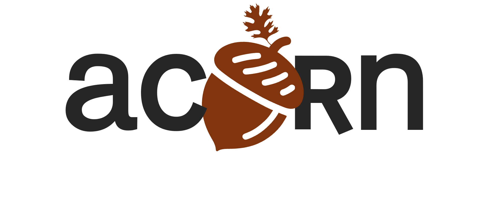

  <picture>
    <source media="(prefers-color-scheme: dark)" srcset="docs/src/_assets/banner_dark_mode.png">
    <source media="(prefers-color-scheme: light)" srcset="docs/src/_assets/banner_light_mode.png">
    
  </picture>

 
 

> Accessible Content Optimization for Research Needs

:seedling: ACORN is a Rust CLI and library for validating research activity data (RAD), adding linked-data context, and exporting records as PDF, PowerPoint, CFF, Markdown, JSON, YAML, or ZON. Its source records are portable files that can be version controlled and processed locally.

ACORN is context-aware at the data and workflow level. It keeps project descriptions with their identifiers, provenance, and relationships so people and software can interpret records in context. That awareness can unlock a fuller understanding of the work by making documented connections and gaps visible.

> [!NOTE]
> **AI assistance disclosure, Level 4.** ACORN uses AI in accordance with [`VisidataMachineAssistanceLevel::Significant`](./crates/acorn-schema/src/research_activity/aspect/mod.rs): humans author most project code, while AI tools may directly create or edit auxiliary files such as documentation and tests. Humans retain review and decision authority. AI-assisted contributions at this level must identify the model and version used and the responsible human operator in the contribution metadata.

[[_TOC_]]

## What ACORN does
The `acorn` command checks and formats research records, adds linked-data context, and creates reusable outputs. It runs on Windows, macOS, and Linux. See [Why ACORN?](https://acorn.ornl.gov/motivation.html) for the project-level research model and its intended uses.

The bot can also consume a GitLab JSONL logbook inbox, durably admit authorized submissions, and propose project updates through review. See [ACRE inbox configuration](docs/src/concepts/acre.md#gitlab-logbook-inbox).
For existing local project indexes, `acorn intake stage --batch` groups a JSONL file into one reviewable multi-project batch; `intake inspect` previews routes and diffs before `intake apply --batch-id` writes them. See [local logbook review](docs/src/concepts/acre.md#standalone-local-logbook-review).

## Installation
See [the ACORN book](https://acorn.ornl.gov) for detailed installation instructions for the [CLI application](https://acorn.ornl.gov/getting-started.html#installation) and [🦀Rust packages](http://acorn.ornl.gov/packages/README.html). Portable integrations can use `acorn-schema`, `acorn-analysis`, and `acorn-service` directly; authenticated JSON-RPC and typed gRPC deployments use `acorn-server`. Python users can use the independently maintained [🐍`acorn-py` companion project](https://code.ornl.gov/research-enablement/acorn-py). Contributors can check the portable Rust surface using the [WebAssembly development guide](http://acorn.ornl.gov/packages/acorn-web.html).

## Architecture
> See [ARCHITECTURE.md](./ARCHITECTURE.md)

## Contributing
> See [CONTRIBUTING.md](./CONTRIBUTING.md)
