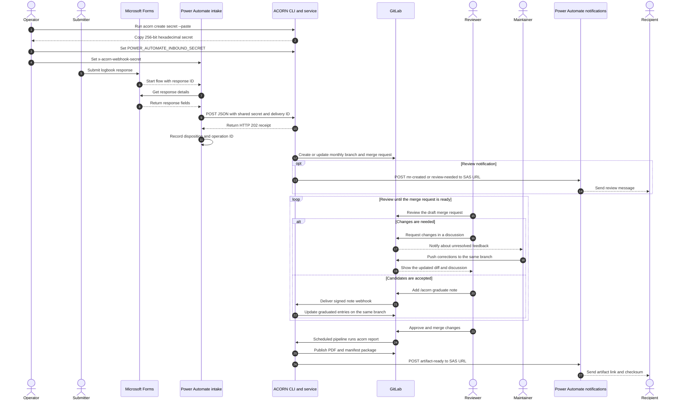

# PowerAutomate logbook reporting

ACORN can accept Microsoft Forms submissions through Power Automate, open one monthly merge request per configured project, and publish approved PDF reports to the GitLab generic package registry. Power Automate owns the form and notification recipients. ACORN owns validation, deduplication, review branches, report generation, and package publication.

## How the workflow fits together

1. A Microsoft Forms response starts an intake cloud flow.
2. The flow maps the response to ACORN's versioned JSON contract.
3. The flow sends the request directly to ACORN with a shared-secret header.
4. ACORN validates the submission and opens or updates the project's monthly merge request.
5. A reviewer graduates selected entries and a person merges the merge request.
6. A scheduled GitLab pipeline publishes the approved report and ACORN calls a Power Automate notification flow.
7. The notification flow sends Teams or email messages.

The [Mermaid sequence diagram](https://mermaid.ai/open-source/syntax/sequenceDiagram.html) follows the submission from Forms through iterative review and artifact delivery. Solid arrows are requests or commands. Dashed arrows are responses and notifications.



The integration connects both flows directly and does not require an HTTPS security gateway. Intake authentication uses a random shared secret in the `x-acorn-webhook-secret` request header. Callback authentication uses the SAS signature embedded in the Power Automate HTTP trigger URL. Keep both values out of source control and flow run histories.

The direct callback requires the HTTP trigger's legacy `Anyone` mode. If tenant policy disables that mode, do not weaken the policy: use an approved intermediary or add Microsoft Entra service-principal authentication to the ACORN callback client before enabling callbacks.

## Prerequisites

- A Microsoft Form with the logbook fields your organization needs.
- Permission to create Power Automate cloud flows and their connections.
- Access to the premium HTTP action used to call ACORN.
- An HTTPS deployment of `acorn serve bot` that Power Automate can reach.
- A GitLab project where the bot can create branches and merge requests.
- A GitLab token available as `GITLAB_TOKEN`, `PRIVATE_TOKEN`, or `CI_JOB_TOKEN`.

## 1. Create the intake shared secret

Use ACORN to generate one random value for authenticating form submissions:

```bash
acorn create secret --paste
```

The command generates one 64-character lowercase hexadecimal value from the operating system's cryptographic random-number generator and copies it to the system clipboard without printing the value. Paste it into the two protected settings below, then clear or replace the clipboard contents. ACORN does not store the generated value.

For a headless session without clipboard access, omit the option and capture standard output:

```bash
POWER_AUTOMATE_INBOUND_SECRET="$(acorn create secret)"
export POWER_AUTOMATE_INBOUND_SECRET
```

The command writes the secret only when standard output is redirected or piped. Running `acorn create secret` directly in an interactive terminal is intentionally silent. `--clipboard` remains an alias for `--paste`.

Store the same value in two places:

| Location | Purpose |
| --- | --- |
| `POWER_AUTOMATE_INBOUND_SECRET` in the ACORN runtime | Validates intake requests |
| The Power Automate intake flow | Sends the same generated value in `x-acorn-webhook-secret` |

Keep the value in protected application settings or an approved secret store. Power Platform can reference Azure Key Vault secrets through a Secret environment variable. If that facility is unavailable for an initial deployment, limit flow ownership and enable **Secure Inputs** and **Secure Outputs** on every action that handles the value. Do not put it in Microsoft Forms, ordinary Compose actions, source control, or notification messages.

Every intake request must include these headers:

```text
content-type: application/json
x-acorn-delivery-id: <submission UUID>
x-acorn-webhook-secret: <shared secret>
```

Keep the same submission UUID and delivery ID when Power Automate retries a response. ACORN compares the secret in constant time and uses the form's submission ID as its durable deduplication key.

## 2. Create the callback notification flow

Create an automated cloud flow with the Power Automate **When an HTTP request is received** trigger. Microsoft documents the trigger authentication choices as tenant users, selected tenant users, and the legacy open `Anyone` mode in [OAuth authentication for HTTP request triggers](https://learn.microsoft.com/en-us/power-automate/oauth-authentication).

1. Set **Who can trigger the flow** to **Anyone**.
2. Save the flow so Power Automate generates its HTTP POST URL.
3. Copy the complete URL, including the `sig` query parameter, into the protected `POWER_AUTOMATE_CALLBACK_URL` setting used by ACORN.
4. Treat the URL as a credential. Microsoft documents how to [regenerate the SAS key](https://learn.microsoft.com/en-us/power-automate/regenerate-sas-key) if it is exposed.
5. Enable **Secure Inputs** on the trigger and **Secure Inputs** and **Secure Outputs** on actions that can reveal callback content.

The `Anyone` label means there is no Entra identity check; possession of the complete SAS URL authorizes the request. Restrict flow ownership, never log the URL, and rotate its SAS key after suspected exposure. ACORN marks callback URLs as sensitive and does not follow redirects when sending callback data.

Use this request schema for the notification flow:

```json
{
  "type": "object",
  "properties": {
    "checksum": { "type": "string" },
    "event": {
      "type": "string",
      "enum": [
        "artifact-ready",
        "failed",
        "mr-created",
        "report-no-changes",
        "review-needed"
      ]
    },
    "mergeRequestUrl": { "type": "string" },
    "message": { "type": "string" },
    "packageUrl": { "type": "string" },
    "projectId": { "type": "string" },
    "through": { "type": "string" }
  },
  "required": ["event", "projectId"]
}
```

Add a **Switch** action on `event` and route messages as follows:

| Event | Useful fields | Suggested action |
| --- | --- | --- |
| `mr-created` | `mergeRequestUrl` | Notify reviewers that a monthly merge request is ready |
| `review-needed` | `mergeRequestUrl` | Remind reviewers that entries still need a decision |
| `artifact-ready` | `packageUrl`, `checksum`, `through` | Send the approved artifact link and checksum |
| `report-no-changes` | `through` | Record or optionally announce that no approved entries were added |
| `failed` | `message` | Alert the workflow operator |

Keep recipient lists and message formatting in Power Automate. Return a successful 2xx response after accepting a callback. ACORN retries callbacks that do not receive a successful response.

## 3. Configure ACORN

Add a `powerAutomate` section to `.acorn.json`:

```json
{
  "powerAutomate": {
    "callback_destination": "powerautomate",
    "variables": {
      "callback_url": "POWER_AUTOMATE_CALLBACK_URL",
      "inbound_secret": "POWER_AUTOMATE_INBOUND_SECRET"
    },
    "gitlab_project": "12345",
    "package": "acorn-automated-artifacts",
    "projects": [
      {
        "members": ["researcher@example.org"],
        "path": "projects/pilot/index.json",
        "project_id": "pilot"
      }
    ]
  }
}
```

Configuration rules:

- `timezone` is optional and defaults to `UTC`; no other reporting timezone is currently supported.
- Every project path must be repository-relative, remain inside the repository, and end in `index.json`.
- `project_id` is the value sent by the intake flow as `projectId`.
- `members` is the allowlist for that project. ACORN validates and normalizes each email address when it loads the configuration.
- `variables.callback_url` and `variables.inbound_secret` name environment variables. They do not contain URLs or secret values themselves.
- `gitlab_project` identifies the GitLab repository that stores every configured project file and the immutable generic-package artifacts.
- `projects` maps each Power Automate `projectId` to its repository file and member allowlist.
- `package` is the generic-package name used for immutable artifacts.

Set the runtime environment:

```bash
export GITLAB_TOKEN='<project-access-token>'
export GITLAB_WEBHOOK_SIGNING_TOKEN='<gitlab-webhook-token>'
export POWER_AUTOMATE_CALLBACK_URL='https://<region>/workflows/<id>/triggers/manual/paths/invoke?...&sig=<secret>'
export POWER_AUTOMATE_INBOUND_SECRET='<64-character-random-value>'
```

## 4. Start the bot endpoint

Run the bot behind an HTTPS reverse proxy or load balancer. Hybrid mode lets ACORN poll GitLab and receive webhook events. Registering the webhook connects merge-request notes to the review workflow.

```bash
acorn serve bot 12345 \
  --bind 0.0.0.0:3000 \
  --config .acorn.json \
  --event-source hybrid \
  --public-url https://acorn.example.org \
  --register-webhook
```

The form intake endpoint is:

```text
https://acorn.example.org/webhooks/powerautomate/forms
```

## 5. Create the Microsoft Forms intake flow

Microsoft's [Forms connector reference](https://learn.microsoft.com/en-us/connectors/microsoftforms/) provides the **When a new response is submitted** trigger and **Get response details** action used here.

1. Create an automated cloud flow.
2. Add **Microsoft Forms: When a new response is submitted** and select the form.
3. Add **Microsoft Forms: Get response details** using the form ID and response ID from the trigger.
4. Add a **Compose** action named `Submission ID` with the expression `guid()`. Reuse its output for `submissionId` and `x-acorn-delivery-id` so retries remain identifiable.
5. Add an **HTTP** action with method `POST` and the ACORN form intake endpoint as its URI.
6. Add `Content-Type: application/json`, `x-acorn-delivery-id: <Submission ID output>`, and `x-acorn-webhook-secret: <shared secret>` to the HTTP action's headers.
7. Map the response fields to the JSON body below. Use UTC RFC 3339 timestamps such as `2026-09-18T14:30:00Z`.
8. In the HTTP action's settings, enable **Secure Inputs** and **Secure Outputs** so the secret does not appear in run history.
9. Treat HTTP 202 as accepted. Store the returned `operationId` with the Forms response ID for operational support and auditing.

The HTTP action accepts custom headers and a request body. Use a solution-aware flow and source the shared secret from an approved store where possible; Microsoft documents [Secret environment variables backed by Azure Key Vault](https://learn.microsoft.com/en-us/power-apps/maker/data-platform/environmentvariables-azure-key-vault-secrets) for this purpose.

Example request body:

```json
{
  "schemaVersion": 1,
  "submissionId": "8f4dd992-62d6-42b1-9ccb-55ea5f2fe70a",
  "projectId": "pilot",
  "submittedAt": "2026-09-18T14:30:00Z",
  "submitter": {
    "email": "researcher@example.org"
  },
  "entry": {
    "timestamp": "2026-09-18T14:30:00Z",
    "category": "research",
    "eventType": "meeting",
    "items": ["Recorded decisions and follow-up actions"],
    "state": "completed",
    "summary": "Completed the monthly research coordination meeting."
  }
}
```

Allowed controlled values:

| Field | Values |
| --- | --- |
| `category` | `administration`, `collaboration`, `data`, `engagement`, `funding`, `infrastructure`, `method`, `other`, `personnel`, `publication`, `research`, `software` |
| `state` | `completed`, `in-progress`, `upcoming` |
| `eventType` | `conference`, `exhibition`, `meeting`, `other`, `presentation`, `tour`, `training`, `workshop` |
| `classification` | `unclassified`, `confidential`, `secret`, `top-secret` |

`classification`, `eventType`, and `items` are optional. Omit fields that do not apply. Do not send null values or additional properties.
ACORN retains the envelope's `projectId` on the normalized logbook entry so later processing can route the entry to its project metadata.

An accepted response resembles:

```json
{
  "disposition": "inserted",
  "operationId": "powerautomate:form:v1:8f4dd992-62d6-42b1-9ccb-55ea5f2fe70a"
}
```

Retries can return a duplicate disposition with the same operation ID. This is expected and prevents the same Forms response from creating another entry.

## 6. Review and merge the monthly merge request

ACORN uses a branch named `acorn/powerautomate/<project>/<year-month>`. Keep review feedback in GitLab discussions so changes remain attached to the same draft merge request. A maintainer can push corrections to the rolling branch, resolve discussions, and request another review. New authorized form submissions for the same project and month also update that merge request.

When the proposed content is correct, reviewers use merge-request notes to graduate entries:

```text
/acorn graduate
```

Graduate only selected entries by including their IDs:

```text
/acorn graduate 550e8400-e29b-41d4-a716-446655440000
```

The commenter must have at least the GitLab Developer role. ACORN updates the same branch after graduation, so the reviewer can inspect the new diff and request more changes before approving it. A person merges the merge request; the bot does not merge it.

## 7. Schedule artifact creation

Include the maintained reporting job in `.gitlab-ci.yml`:

```yaml
include:
  - local: templates/gitlab/reporting.gitlab-ci.yml
```

Create a monthly pipeline schedule for the default branch, shortly after the start of the UTC month. GitLab documents schedule ownership and inputs in [Scheduled pipelines](https://docs.gitlab.com/ci/pipelines/schedules/).

Add this schedule variable:

```text
ACORN_POWER_AUTOMATE_REPORTING=true
```

Optionally point to a different configuration file:

```text
ACORN_REPORT_CONFIG=config/acorn.json
```

Add protected, masked CI variables for `POWER_AUTOMATE_CALLBACK_URL` and any required `GITLAB_TOKEN`. The inbound secret is needed by the bot service, not the scheduled reporting job. GitLab's [generic package registry](https://docs.gitlab.com/user/packages/generic_packages/) accepts CI job tokens when project permissions allow package publication.

The first report includes approved entries through the current cutoff. Later reports use the interval from the previous cutoff up to, but not including, the current cutoff. The job uploads the PDF before its manifest. A no-change interval uploads only the manifest and emits `report-no-changes`.

## Test the workflow before enabling the schedule

First, test report generation without publishing or sending a callback:

```bash
acorn report \
  --config .acorn.json \
  --root . \
  --through 2026-10-01T00:00:00Z \
  --output .acorn/reports \
  --dry-run
```

Then perform one end-to-end smoke test:

1. Start the bot with its production configuration and secrets.
2. Submit a test form using an allowlisted email and configured project ID.
3. Confirm the intake flow receives HTTP 202 and records the operation ID.
4. Confirm ACORN creates the expected monthly branch and merge request.
5. Add `/acorn graduate` as an authorized reviewer and inspect the updated project file.
6. Merge the merge request after human review.
7. Run the scheduled job manually with `ACORN_POWER_AUTOMATE_REPORTING=true`.
8. Confirm the GitLab package contains the expected manifest and PDF.
9. Confirm the notification flow receives `artifact-ready` and sends the configured message.
10. Retry the original form submission with the same `submissionId` and confirm ACORN reports a duplicate instead of creating another entry.

## Troubleshooting

| Symptom | Check |
| --- | --- |
| HTTP 400 from the intake endpoint | Validate the JSON field names, project ID, submitter allowlist, controlled values, project path, and timestamps. Unknown fields are rejected. |
| HTTP 401 from the intake endpoint | Check `x-acorn-webhook-secret`, the ACORN environment value, and whether the HTTP action resolved the protected value. |
| HTTP 503 from the intake endpoint | The bot accepted HTTP traffic before its processing queue became ready. Retry with the same submission ID. |
| Entry timestamp is rejected | The timestamp is older than the latest report cutoff and cannot be added to a closed reporting interval. |
| Callback repeats | The Power Automate trigger did not return a successful 2xx response. Check the complete SAS URL and flow run history before suppressing retries. |
| Callback returns HTTP 401 or 403 | Confirm the trigger uses `Anyone` mode and the configured URL includes the current `sig` value. If tenant policy forbids `Anyone`, direct callbacks require an approved intermediary. |
| Package contains only a manifest | No approved entries fell within the reporting interval. This is the expected no-change result. |
| Merge-request note has no effect | Confirm the exact `/acorn graduate` command, the commenter's GitLab role, webhook registration, and webhook token. |
