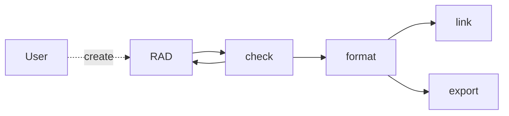

# Commands
- [🕵️‍♂️ Audit](./audit.md)
- [✅ Check](./check.md)
- [👨‍⚕️ Doctor](./doctor.md)
- [📥 Download](./download.md)
- [📤 Export](./export.md)
- [🤖 Format](./format.md)
- [🕸️ Link](./link.md)

## ACORN Command Workflow
