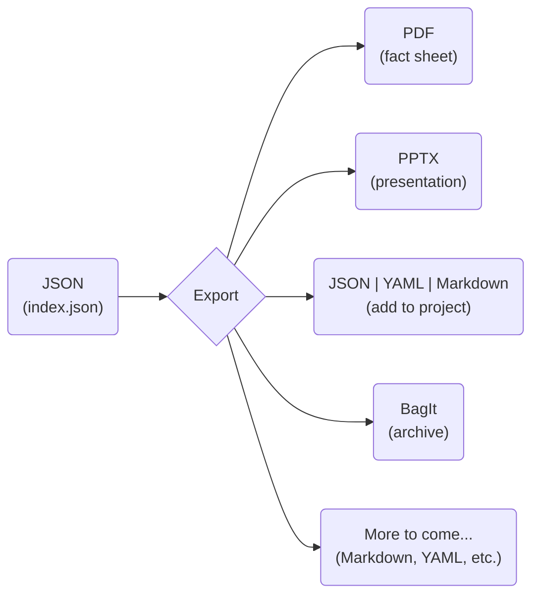

# 📤 Export
> Export research activity data to various formats for analysis and sharing

This command allows you to export research activity data from ACORN into formats such as PDF, Markdown, YAML, or PPTX. With `export`, you can easily share your research with sponsors, collaborators, or the general public in a variety of contexts.

`export` supports exporting individual research activity indices or entire directories containing multiple indices.

ACORN allows you to maintain research activity data as persistent, interconnected [single sources of truth](https://en.wikipedia.org/wiki/Single_source_of_truth). As such, you can easily create a variety of output artifacts while ensuring consistency and accuracy across all selected formats.



> [!TIP]
> You can see some export command results by visiting the [ORNL Research Activity Index](https://research.ornl.gov), which features a variety of research activity data presented in different formats.

## Example Usage
```sh
# Export research activity data to PDF fact sheet
acorn export /path/to/index.json --format pdf

# Create PowerPoint presentations from all research activity data in a directory
acorn export /path/to/project/ --format powerpoint
```

> [!NOTE]
> Each export format uses the `--output` option to specify the output file or directory path. If not provided, ACORN will generate a default output path based on the input path and selected format. For example, `--format pdf` and `--format powerpoint` will generate files in the default export location (`./export/`) with names based on the project parent folder(s), `--format bag` will add `.zip` to the output path (i.e., `--output ./export` will create `./export.zip` and `--output /path/to/bag` will create `/path/to/bag.zip`).

## PowerPoint Reference Template
Customize the PowerPoint export by providing a reference template using the `--reference` option. This allows you to define specific styles, layouts, and branding for your presentations.

```sh
acorn export /path/to/index.json \
    --format powerpoint \
    --reference /path/to/reference.pptx
```

The reference template allows you to specify which values are used and where, using placeholder text in the format `{{ PLACEHOLDER_NAME }}`. During export, ACORN will replace these placeholders with corresponding data from the associated research activity data. You can find an example PowerPoint reference template in the [ACORN GitLab repository](https://code.ornl.gov/research-enablement/acorn/-/blob/main/tests/fixtures/data/highlight/reference.pptx?ref_type=heads).

### Available Placeholders

The following placeholders can be used in your PowerPoint reference template:

#### String values
- `caption` - First image caption
- `challenge` - Challenge description
- `citation` - DOI citation
- `email` - Contact email
- `first` - Contact first name
- `focus` - Research focus area
- `last` - Contact last name
- `managers` - Manager names (joined with `"and"`)
- `mission`
- `notes` - Presentation notes (intended to be added PowerPoint speaker notes)
- `partners` - Partner names (joined with `", "`)
- `programs` - Program names (joined with `"and"`)
- `subtitle`
- `title`

#### Lists (bullet points)
- `achievement`
- `areas` - Research areas
- `impact`
- `technical` - Technical approach