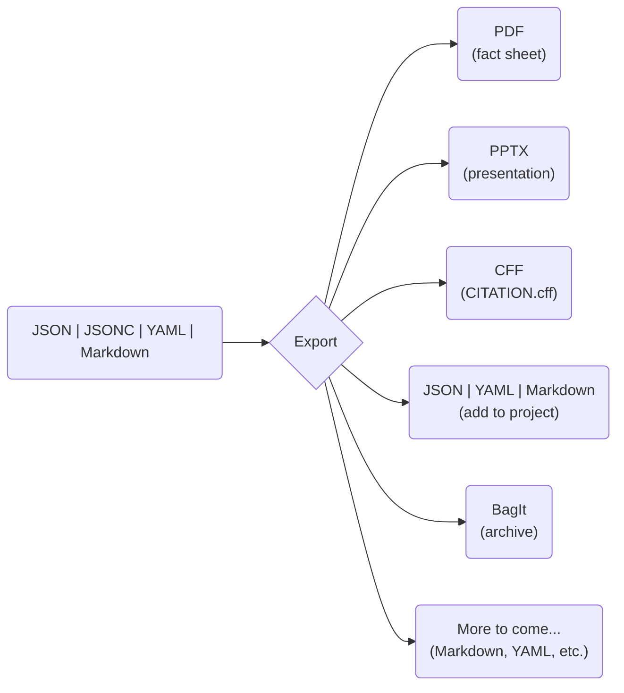

# 📤 Export
> Export research activity data to various formats for analysis and sharing

This command allows you to export research activity data from ACORN into formats such as CFF, PDF, Markdown, YAML, or PPTX. With `export`, you can easily share your research with sponsors, collaborators, or the general public in a variety of contexts.

Markdown RAD is accepted as an input for the same RAD export targets as JSON and YAML. Exported Markdown uses YAML frontmatter with `schema: acorn/research-activity`; its generated `## ASPECT` section includes nested data and model details.

`export` supports exporting individual research activity indices or entire directories containing multiple indices.

ACORN allows you to maintain research activity data as persistent, interconnected [single sources of truth](https://en.wikipedia.org/wiki/Single_source_of_truth). As such, you can easily create a variety of output artifacts while ensuring consistency and accuracy across all selected formats.



> [!TIP]
> You can see some export command results by visiting the [ORNL Research Activity Index](https://research.ornl.gov), which features a variety of research activity data presented in different formats.

## Example Usage
```sh
# Export research activity data to PDF fact sheet
acorn export /path/to/index.json --format pdf

# Create PowerPoint presentations from all research activity data in a directory
acorn export /path/to/project/ --format powerpoint

# Create a CITATION.cff file from a research activity index
acorn export /path/to/project/index.json --format cff
```

> [!NOTE]
> Most export formats use the `--output` option to specify the output file or directory path. If not provided, ACORN will generate a default output path based on the input path and selected format. For example, `--format pdf` and `--format powerpoint` will generate files in the default export location (`./export/`) with names based on the project parent folder(s), `--format bag` will add `.zip` to the output path (i.e., `--output ./export` will create `./export.zip` and `--output /path/to/bag` will create `/path/to/bag.zip`). CFF output is the exception described below.

## Standard crosswalks

Use `--to` with JSON or YAML export to convert metadata between DataCite, DCAT, InvenioRDM, and HuWise. ACORN can infer the source standard from recognizable fields, but `--from` is recommended for repeatable scripts and for records with an ambiguous shape.

```sh
# Convert one DataCite JSON record to DCAT JSON
acorn export datacite.json --format json --from datacite --to dcat --output ./export

# Convert DCAT JSON to DataCite YAML
acorn export dataset.json --format yaml --from dcat --to datacite --output ./export

# Preview a directory conversion without writing files
acorn export ./metadata --format json --from invenio --to dcat --dry-run
```

The source and target may each be `datacite`, `dcat`, `invenio`, or `huwise`. Every pairing among those four standards is accepted. Some conversions use DataCite as an intermediate representation:

| Source | Direct targets | Targets routed through DataCite |
|---|---|---|
| DataCite | DCAT, InvenioRDM, HuWise | — |
| DCAT | DataCite | InvenioRDM, HuWise |
| InvenioRDM | DataCite | DCAT, HuWise |
| HuWise | DataCite | DCAT, InvenioRDM |

Crosswalk export has these constraints:

- The input and output must be JSON or YAML. PDF, PowerPoint, CFF, BagIt, and Markdown are not crosswalk targets.
- A single object or an array of objects is accepted. Directory export writes one target file for each resolved source file.
- Conversion can be lossy because the standards have different fields and cardinalities. Normal direct conversions report field-level crosswalk warnings when ACORN has a mapping for that pair.
- Warning collection is currently limited to direct DataCite mappings and DCAT → DataCite. Routed conversions can lose metadata without a complete end-to-end warning report.
- `--strict` is intended to fail when conversion loses data, but the current export path does not retain warnings in strict mode. Do not use it as a lossless-conversion guarantee until that behavior is corrected.
- CKAN package records are not currently a supported source or target standard. A CKAN API response is not DCAT merely because CKAN can expose DCAT through an extension; convert or export it to a supported DCAT representation before using `--from dcat`.

Run `acorn check --standard <target> <output>` after conversion when the target artifact must pass ACORN's schema and validation checks.

## Citation File Format (`CITATION.cff`)

Use `--format cff` to convert ACORN research activity data (RAD) into a CFF 1.2.0 citation file:

```sh
acorn export /path/to/project/index.json --format cff
```

The generated `/path/to/project/CITATION.cff` includes the RAD title, research purpose as the abstract, contact information as author and contact metadata, keywords, and DOI information when available. ACORN also supplies the CFF version and default citation message.

For CFF export:

- The input must be RAD in JSON, JSONC, YAML, or canonical/legacy ACORN Markdown. Existing `.cff` input is skipped because it is already in the target format.
- The output is always named `CITATION.cff` and written beside its source RAD file. `--output` does not relocate CFF output.
- ACORN generates at most one `CITATION.cff` per source directory. When several discovered RAD files share a directory, they resolve to the same output path and only one is exported.

Run `acorn check /path/to/project/CITATION.cff` after export to validate the generated citation metadata.

## Chrome selection for PDF export

Use `--chrome-path` to select an installed Chrome or Chromium executable. `CHROME_PATH` provides the same setting through the environment, and an explicit command-line value takes precedence.

```sh
# macOS
acorn --offline export /path/to/index.json --format pdf \
    --chrome-path "/Applications/Google Chrome.app/Contents/MacOS/Google Chrome"

# Linux
CHROME_PATH=/usr/bin/google-chrome-stable \
    acorn --offline export /path/to/index.json --format pdf
```

```powershell
# Windows
acorn --offline export C:\path\to\index.json --format pdf `
    --chrome-path "$env:ProgramFiles\Google\Chrome\Application\chrome.exe"
```

When configured, this path is validated and used without checking ACORN's browser cache or downloading Chrome. Without it, offline export uses the cached pinned browser when available and otherwise lets `chromiumoxide` detect an installed browser. Connected export retains the pinned browser download fallback.

## PowerPoint Reference Template
Customize the PowerPoint export by providing a reference template using the `--reference` option. This allows you to define specific styles, layouts, and branding for your presentations.

```sh
acorn export /path/to/index.json \
    --format powerpoint \
    --reference /path/to/reference.pptx
```

The reference template allows you to specify which values are used and where, using placeholder text in the format `{{ PLACEHOLDER_NAME }}`. During export, ACORN will replace these placeholders with corresponding data from the associated research activity data. You can find an example PowerPoint reference template in the [ACORN GitLab repository](https://code.ornl.gov/research-enablement/acorn/-/blob/main/tests/fixtures/data/highlight/reference.pptx?ref_type=heads).

### Available Placeholders

The following placeholders can be used in your PowerPoint reference template:

#### String values
- `caption` - First image caption
- `challenge` - Challenge description
- `citation` - DOI citation
- `email` - Contact email
- `first` - Contact first name
- `focus` - Research focus area
- `last` - Contact last name
- `managers` - Manager names (joined with `"and"`)
- `mission`
- `notes` - Presentation notes (intended to be added PowerPoint speaker notes)
- `partners` - Partner names (joined with `", "`)
- `programs` - Program names (joined with `"and"`)
- `subtitle`
- `title`

#### Lists (bullet points)
- `achievement`
- `areas` - Research areas
- `impact`
- `technical` - Technical approach
