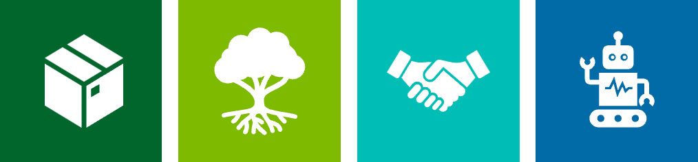
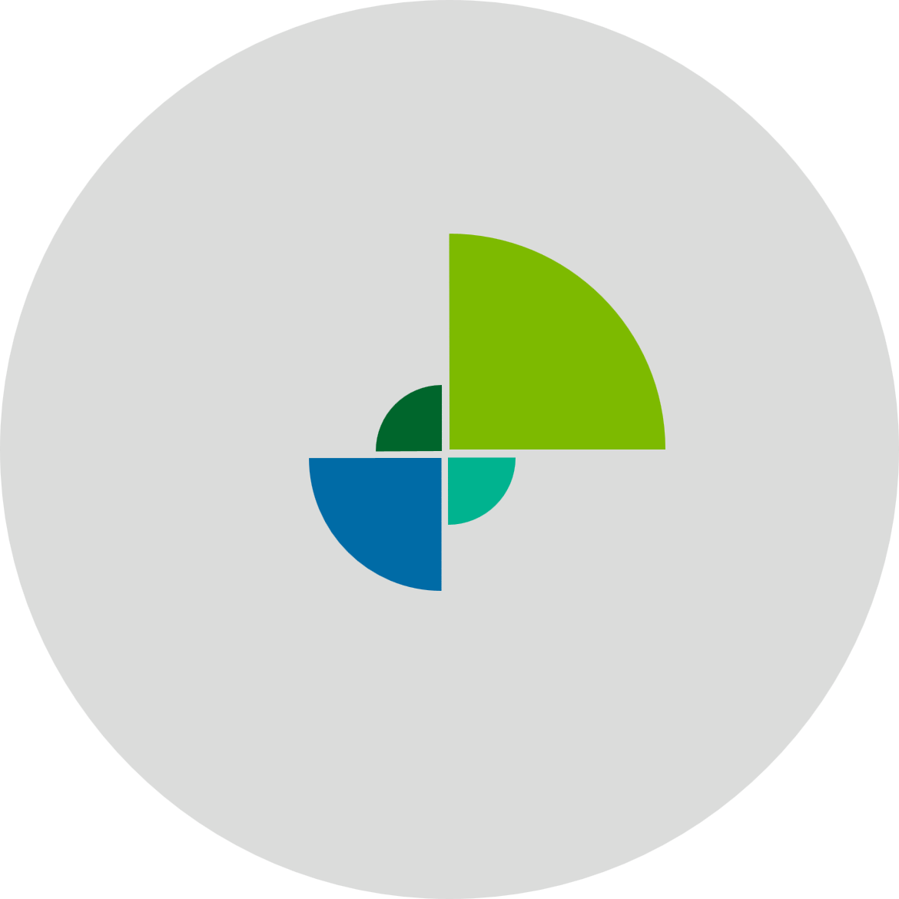

# ASPECT
> **A** **S**cientific **P**aradigm for the **E**fficient **C**lassification of **T**echnology

*portability* | *autonomy* | *maturity* | *motivity*

The ASPECT framework classifies technology across portability, maturity, autonomy, and motivity. It gives projects a shared vocabulary for describing capabilities and requirements.

The same classifications apply to automation, AI and machine learning, and classical software.

> [!TIP]
> [Read docs.rs documentation for ASPECT](https://docs.rs/acorn-schema/latest/acorn_schema/research_activity/aspect/index.html)

## Components

### Primary attributes

Expand an attribute to see its levels.

  
📦 <a href="./portability.md">Portability</a>

- Limited (level 0)
- Source (level 1)
- Containerized (level 2)
- Installer (level 3)
- Package manager (level 4)
- WebAssembly (level 5)

  
🪴 <a href="./maturity.md">Maturity</a>

- Unvalidated (level 0)
- Discovery (level 1)
- Concept (level 2)
- Development (level 3)
- Prototype (level 4)
- Proven (level 5)

  
🤝 <a href="./autonomy.md">Autonomy</a>

- Manual (level 0)
- Machine-assisted (level 1)
- Human-as-primary (level 2)
- Machine-as-primary (level 3)
- Human-supervised (level 4)
- Machine-only (level 5)

  
🦾 <a href="./motivity.md">Motivity</a>

- Inert (level 0)
- Computational (level 1)
- Perceptive (level 2)
- Projective (level 3)
- Reactive (level 4)
- Adaptive (level 5)

### <a href="./data.md">Data</a>

Data is recorded separately from the four primary attributes.

Its dimensions include:

- Real or synthetic
- Availability
- Modality
- Quality

## Example

The following fictional project shows how four levels form one ASPECT classification.

| Attribute | Level | Details |
|---|---|---|
| 📦 Portability | Level 1 | ***Source*** |
| 🪴 Maturity | Level 3 | ***Development*** |
| 🤝 Autonomy | Level 1 | ***Machine-assisted*** |
| 🦾 Motivity | Level 2 | ***Perceptive*** |

### Badge visualization

An ASPECT badge gives project portfolios a compact view of the four attribute levels.

  

<em>ASPECT badge for a project</em>

The annotated version identifies the position of each attribute. The same badge can be used in dashboards, reports, and presentations.

  

<em>Annotated ASPECT badge</em>

