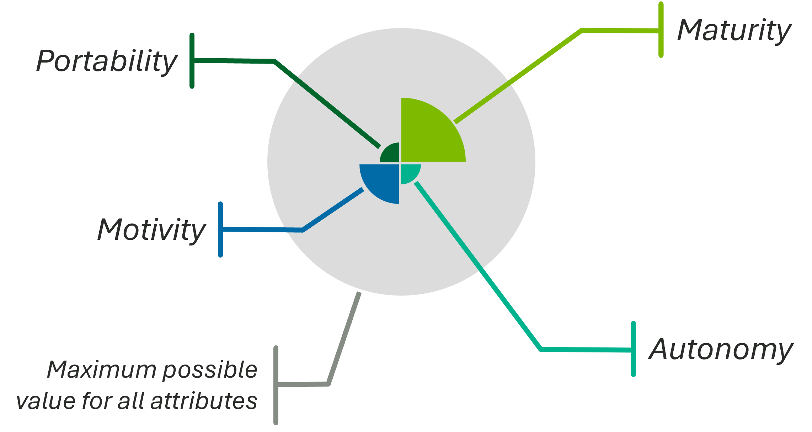

# ASPECT
> **A** **S**cientific **P**aradigm for the **E**fficient **C**lassification of **T**echnology

The **ASPECT** framework is a standardized methodology for classifying and describing technology components within the ACORN ecosystem. It provides a structured approach to defining the attributes and relationships of various technological elements, ensuring consistency and interoperability across different systems and applications.

**ASPECT** was designed to unify our understanding of automation, AI/ML technology, and "classical" software. We focus on "technology" instead of "***AI/ML*** technology" because the latter is a subset of the former. Focusing on AI/ML as the end goal is not fruitful or correct. In fact, doing so is backward. AI/ML software is not novel in any meaningful sense. Even if it was, it would still be 100% predicated on the scientific principles of software.

In the context of technology, AI/ML and automation are the same.

> [!TIP]
> [Read docs.rs documentation for ASPECT](https://docs.rs/acorn-lib/latest/acorn_lib/schema/research_activity/aspect/index.html)

## Key Components

### Primary attributes

portability | maturity | autonomy | motivity

*click arrow to expand or collapse*

  
📦 <a href="./portability.md">Portability</a>

- Limited (level 0)
- Source (level 1)
- Containerized (level 2)
- Installer (level 3)
- Package manager (level 4)
- WebAssembly (level 5)

  
🪴 <a href="./maturity.md">Maturity</a>

- Unvalidated (level 0)
- Discovery (level 1)
- Concept (level 2)
- Development (level 3)
- Prototype (level 4)
- Proven (level 5)

  
🤝 <a href="./autonomy.md">Autonomy</a>

- Manual (level 0)
- Machine-assisted (level 1)
- Human-as-primary (level 2)
- Machine-as-primary (level 3)
- Human-supervised (level 4)
- Machine-only (level 5)

  
🦾 <a href="./motivity.md">Motivity</a>

- Inert (level 0)
- Computational (level 1)
- Perceptive (level 2)
- Projective (level 3)
- Reactive (level 4)
- Adaptive (level 5)

### 💾 <a href="./data.md">Data</a>

Data is not included in primary four attributes, but is very important when characterizing technology.

Data has multiple dimensions
- Real or Synthetic
- Availability
- Modality
- Quality

## Real-world Example

The ASPECT framework can be applied in various scenarios

### [AI-driven Gravity Mapping](https://research.ornl.gov/gravity/)
| Attribute | Level | Details |
|---|---|---|
| 📦 Portability | Level 1 | ***Source*** |
| 🪴 Maturity | Level 3 | ***Development*** |
| 🤝 Autonomy | Level 1 | ***Machine-assisted*** |
| 🦾 Motivity | ***Type 1A*** | Receive input from environment |

#### Badge Visualization
ASPECT can be visualized in a badge-like form for visual project portfolio management

  

<em><b>Figure 1</b>: ASPECT badge for the AI-driven Gravity Mapping project</em>

**Figure 1** is an example of an ASPECT badge that provides immediate feedback on the state of the project and its technology components. It can be used in project dashboards, reports, and presentations to communicate the current status and future goals of the project in a clear and concise manner. **Figure 2** below shows the same badge as depicted in *figure 1*, but with the attributes annotated for clarity.

  

<em><b>Figure 2</b>: Annotated ASPECT badge</em>
