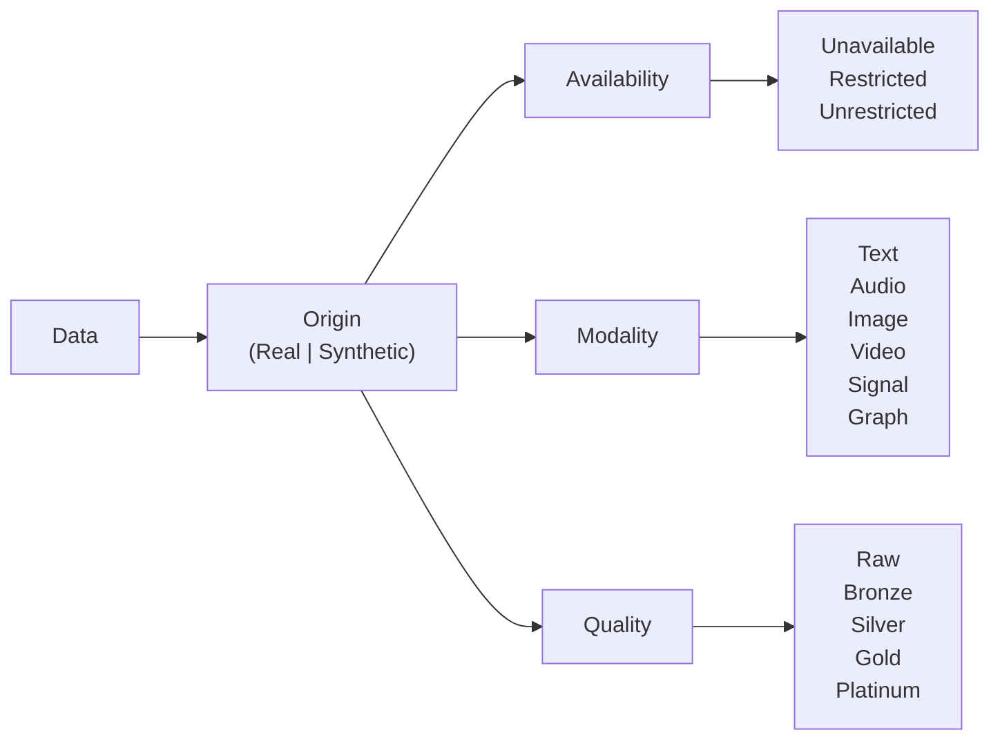

# 💾 Data

## Discussion

When discussing data, we can evaluate four core aspects:
- **Origin**: Is the data collected from real-world observations or generated synthetically?
- **Availability**: Is the data unavailable, restricted, or unrestricted?
- **Modality**: What type of data is it (e.g., textual, visual, auditory, etc.)?
- **Quality**: What is the quality of the data (e.g., gold, silver, bronze)?

### Geospatial Data
Geospatial data describes features and events tied to location. Common formats include raster data, such as satellite imagery, and vector data, such as points, lines, and polygons. These datasets support mapping, navigation, and spatial analysis. For geospatial work, *data processing level* is an important additional quality dimension.

Based on NASA's [Data Processing Levels](https://www.earthdata.nasa.gov/learn/earth-observation-data-basics/data-processing-levels), geospatial data can be described with the following processing levels:
- Level 0: Raw
- Level 1A: Annotated
- Level 1B: Processed Annotated
- Level 1C: Spectral Variables
- Level 2: Derived Geophysical
- Level 2A: Derived Surface
- Level 2B: Processed Derived Surface
- Level 3: Gridded
- Level 3A: Periodic Summaries
- Level 4: Model Output