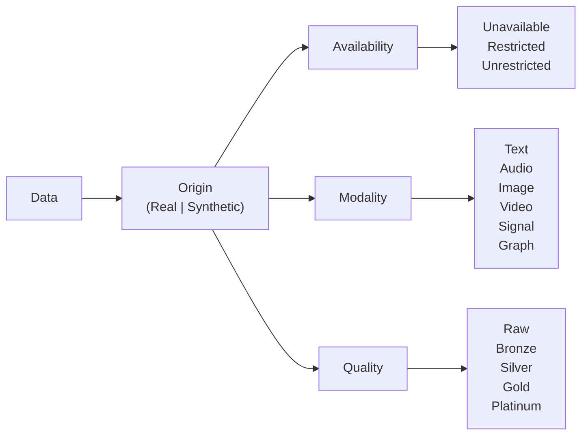

# 💾 Data

## Discussion

When discussing data, we can evaluate four core aspects:
- **Origin**: Is the data collected from real-world observations or generated synthetically?
- **Availability**: Is the data unavailable, restricted, or unrestricted?
- **Modality**: What type of data is it (e.g., textual, visual, auditory, etc.)?
- **Quality**: What is the quality of the data (e.g., gold, silver, bronze)?

### Origin

### Availability

### Modality

### Quality

### Geospatial Data
Geospatial data describes features and events tied to location. Common formats include raster data, such as satellite imagery, and vector data, such as points, lines, and polygons. These datasets support mapping, navigation, and spatial analysis. For geospatial work, *data processing level* is an important additional quality dimension.

Based on NASA's [Data Processing Levels](https://www.earthdata.nasa.gov/learn/earth-observation-data-basics/data-processing-levels), geospatial data can be described with the following processing levels
- Level 0 — Raw
- Level 1A — Annotated
- Level 1B — Processed Annotated
- Level 1C — Spectral Variables
- Level 2 — Derived Geophysical
- Level 2A — Derived Surface
- Level 2B — Processed Derived Surface
- Level 3 — Gridded
- Level 3A — Periodic Summaries
- Level 4 — Model Output

Most remote sensing sources (e.g. satellites) provide metadata that includes the data processing level. Processing the geospatial data with techniques such as atmospheric correction, pansharpening, and orthorectification can improve the quality and usability of the data for various applications, thereby increasing the associated processing level. For example, orthorectification corrects for terrain-induced distortions, improving the spatial accuracy of the data and increasing its processing level from Level 1B to Level 2B.

Geospatial data processing level relates to ASPECT's data quality attribute in that higher processing levels typically indicate higher quality data. For instance, Level 2B data, which has been processed to correct for atmospheric effects and terrain distortions, would generally be considered higher quality than Level 1B data, which is only annotated and not fully processed. However, the specific quality designation (e.g., gold, silver) would depend on additional factors such as the intended use case and the presence of any remaining artifacts or limitations in the data. For example, orthorectification might be the difference between gold and silver quality data for AI/ML applications.