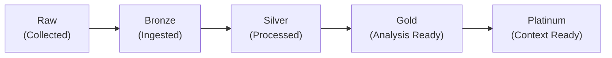

# 💾 Data

```pikchr
scale = 0.7
A:  cylinder "Data" wid 0.6in ht 0.5in fill white
B:  box "Origin" "(Real | Synthetic)" wid 1.3in ht 0.45in fill white with .w at A.e+(0.4in,0)
C:  box "Availability" wid 1.2in ht 0.35in fill white with .w at B.e+(0.4in,0.75in)
D:  box "Modality"     wid 1.0in ht 0.35in fill white with .w at B.e+(0.4in,0)
E:  box "Quality"      wid 1.0in ht 0.35in fill white with .w at B.e+(0.4in,-0.75in)
C1: box "Unavailable" "Restricted" "Unrestricted" wid 1.3in ht 0.6in fill white \
    with .w at C.e+(0.3in,0)
D1: box "Text / Audio / Image" "Video / Signal / Graph" wid 1.6in ht 0.45in fill white \
    with .w at D.e+(0.3in,0)
E1: box "Raw / Bronze / Silver" "Gold / Platinum" wid 1.6in ht 0.45in fill white \
    with .w at E.e+(0.3in,0)

arrow from A.e  to B.w  thick color 0x00662C
arrow from B.e  to C.w  thick color 0x00662C
arrow from B.e  to D.w  thick color 0x00662C
arrow from B.e  to E.w  thick color 0x00662C
arrow from C.e  to C1.w thick color 0x00662C
arrow from D.e  to D1.w thick color 0x00662C
arrow from E.e  to E1.w thick color 0x00662C
```

## Discussion

When discussing data, we can evaluate four core aspects:
- **Origin**: Where does the data come from, and how was it produced?
- **Availability**: How accessible is the data to intended users and systems?
- **Modality**: What forms of information does the data contain?
- **Quality**: How well does the data support its intended use?

### Attributes
#### Origin
Data origin describes whether the data is collected from real-world observations (real) or generated synthetically (synthetic). Real data is often considered more valuable for certain applications, such as training machine learning models, because it captures the complexity and variability of the real world. However, synthetic data can be useful for testing, simulation, and augmenting real datasets, especially when real data is scarce or sensitive.

NVIDIA Omniverse Replicator[^omniverse] is an example of a tool that can generate synthetic data, particularly in the context of computer vision and robotics. By creating realistic virtual environments and scenarios, it allows researchers to generate large amounts of labeled data without the need for costly and time-consuming real-world data collection.

#### Availability
Availability describes the extent to which data can be accessed and used. It is strongly related to the concept of "openness" and the "presumed open principle" for data.

Where openness is characterized as open, public, shared, or closed, ASPECT data availability takes a more direct approach to describing the actual availability of data, which may be "open" but still unavailable due to other factors (e.g., technical barriers, legal barriers, etc.).

#### Modality
Data modality describes the type or format of data, which can include:
- Text: Unstructured or structured textual data, such as documents, articles, or social media posts.
- Audio: Sound recordings, such as music, speech, or environmental sounds.
- Image: Visual data, such as photographs or scanned images.
- Video: Moving image data, such as movies or surveillance footage.
- Signal: Time-series data, such as sensor readings or financial market data.
- Graph: Structured data representing relationships between entities, such as social networks or knowledge graphs.

Multi-modal data combines multiple modalities, such as video with audio or text with images, to provide richer context and insights. In the context of ASPECT, data modality is a list and multi-modal data can be described by including multiple modalities in the list (e.g., ["text", "image"] for research activity data that relies on both textual and visual data).

#### Quality



Data quality leverages the metaphor of precious metals to provide an intuitive and memorable way to describe the quality of data.

Data quality describes the level of processing and readiness of the data for analysis and use. The levels were developed with inspiration from data readiness levels [^1], anaylsis ready data[^2], and multiple other data quality frameworks. For example, the transition from gold to platinum maps nearly directly to a transition from band B to band A in the data readiness levels, with the key difference being that ASPECT's quality levels are designed to be more intuitive and directly actionable for researchers working with data in the context of research activities. See [the geospatial data section below](#geospatial-data) for an example of how data processing levels relates to data quality.

### Geospatial Data
Geospatial data describes features and events tied to location. Common formats include raster data, such as satellite imagery, and vector data, such as points, lines, and polygons. These datasets support mapping, navigation, and spatial analysis. For geospatial work, *data processing level* is an important additional quality dimension.

Based on NASA's Data Processing Levels[^nasa-dpl], geospatial data can be described with the following processing levels
- Level 0 — Raw
- Level 1A — Annotated
- Level 1B — Processed Annotated
- Level 1C — Spectral Variables
- Level 2 — Derived Geophysical
- Level 2A — Derived Surface
- Level 2B — Processed Derived Surface
- Level 3 — Gridded
- Level 3A — Periodic Summaries
- Level 4 — Model Output

Most remote sensing sources (e.g. satellites) provide metadata that includes the data processing level. Processing the geospatial data with techniques such as atmospheric correction, pansharpening, and orthorectification can improve the quality and usability of the data for various applications, thereby increasing the associated processing level. For example, orthorectification corrects for terrain-induced distortions, improving the spatial accuracy of the data and increasing its processing level from Level 1B to Level 2B.

Geospatial data processing level relates to ASPECT's data quality attribute in that higher processing levels typically indicate higher quality data. For instance, Level 2B data, which has been processed to correct for atmospheric effects and terrain distortions, would generally be considered higher quality than Level 1B data, which is only annotated and not fully processed. However, the specific quality designation (e.g., gold, silver) would depend on additional factors such as the intended use case and the presence of any remaining artifacts or limitations in the data. For example, orthorectification might be the difference between gold and silver quality data for AI/ML applications.

[^1]: Data Readiness Levels: https://arxiv.org/abs/1705.02245
[^2]: Analysis Ready Data (ARD): https://ieeexplore.ieee.org/document/8899846
[^omniverse]: NVIDIA Omniverse Replicator: https://docs.omniverse.nvidia.com/extensions/latest/ext_replicator.html
[^nasa-dpl]: NASA Data Processing Levels: https://www.earthdata.nasa.gov/learn/earth-observation-data-basics/data-processing-levels