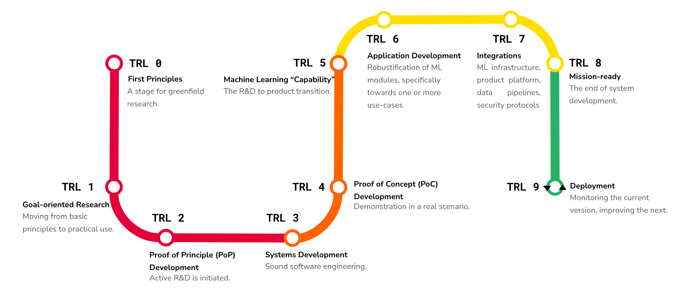

# 📈 Maturity

## Levels
- "Greenfield" research
- Basic research ("*Goal-oriented research*", TRL 1)
- Technology concept ("*Proof of principle*", TRL 2)
- Feasible ("*Systems development*", TRL 3)
- Developing ("*Proof of concept*", TRL 4)
- Prototype ("*Application development*", TRL 5)
- Operational ("*Integrations*", TRL 6)
- Mission ready (TRL 7)
- Mission capable ("*Deployment*", TRL 8)

> [!TIP]
> [Read docs.rs documentation for maturity levels](https://docs.rs/acorn-lib/latest/acorn_lib/schema/enum.TechnologyReadinessLevel.html)

## Discussion
ASPECT leverages an augmented version of technology readiness levels (TRL). [Wikipedia](https://en.wikipedia.org/wiki/Technology_readiness_level) defines TRLs as "a method for estimating the maturity of technologies during the acquisition phase of a program. TRLs enable consistent and uniform discussions of technical maturity across different types of technology." The U.S. federal acquisitions community widely uses TRLs to assess the maturity of a particular technology. Additionally, ASPECT incorporates work[^lavin] that adapted TRLs to directly address the particular nuances of machine learning systems. Additionally, ASPECT maturity levels work well with the capability maturity model but go beyond maintenance processes and efficiency to characterize a technology's maturity in practice. Specifically, ASPECT's openness and portability attributes create a well-defined understanding of a given technology.

**Maturity** in ASPECT reflects the degree to which a system has been tested, validated, and proven in real-world scenarios, as well as its readiness for deployment and integration into existing workflows. In combination with the other ASPECT attributes, ASPECT's maturity attribute provides a holistic view of the system under consideration, beyond  a technology's age or quality.  

[^lavin]: A. Lavin et al., "Technology readiness levels for machine learning systems," Nat Commun, vol. 13, no. 1, p. 6039, Oct. 2022, [doi: 10.1038/s41467-022-33128-9](https://www.nature.com/articles/s41467-022-33128-9).

