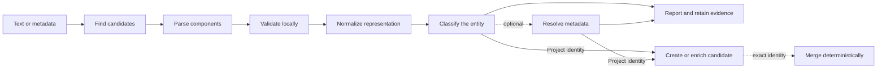

# Persistent identifier lifecycle

ACORN treats a persistent identifier (PID) as evidence that moves through several distinct stages. Finding a PID does not by itself prove that it is valid, and parsing it does not contact its registration authority.



## Supported identifiers

The typed Rust API supports ARK, DOI, ISBN, ORCID, RAiD, ROR, and US patent parsing. The generic [`Identifier`](https://docs.rs/acorn-lib/latest/acorn/schema/pid/struct.Identifier.html) representation also recognizes HTTP(S) URLs. `PIDINST` and `Unknown` are classification values, but they do not currently have typed parsers.

| Kind | Local validation | Normalized display | Candidate role |
|---|---|---|---|
| ARK | NAAN and assigned-name structure | ARK, retaining a supplied resolver | Project identity |
| DOI | DOI prefix and suffix structure | Bare DOI | Project identity |
| ISBN | ISBN-13 length and check digit | Hyphenated ISBN components | Project identity |
| ORCID | Length and ISO 7064 check digit | `https://orcid.org/...` | Person evidence |
| RAiD | DOI-like prefix and suffix structure | Bare RAiD DOI | Project identity |
| ROR | Crockford Base32 length and check digits | `https://ror.org/...` | Organization evidence |
| Patent | Supported US number and kind-code structure | Spaced US patent number | Project identity |
| URL | HTTP(S) syntax | URL without a trailing slash | Supporting evidence |

Validation is local. It checks syntax, components, and a checksum where the implemented identifier specification defines one; it does not resolve the identifier or confirm that a registration record exists.

## 1. Find candidates

Each typed PID implements `PersistentIdentifierParse::find_all`. The finder scans unstructured text with the PID's recognition pattern and returns parsed values:

```rust
use acorn::schema::pid::{DOI, PersistentIdentifier, PersistentIdentifierParse};

let text = "The dataset is available at https://doi.org/10.11578/dc.20250604.1.";
let found = DOI::find_all(text);

assert_eq!(found.len(), 1);
assert_eq!(found[0].identifier(), "10.11578/dc.20250604.1");
```

The `gather` command runs the supported finders across file, document, URL, standard-input, and literal-text content. It removes duplicate normalized discoveries from the report while retaining the source reference for discovery history.

## 2. Parse components

`from_string` decomposes one value into a typed structure. Parsing is intentionally separate from validation: malformed input can produce an empty or partial value, so callers that require a usable PID must validate it.

```rust
use acorn::schema::pid::{DOI, PersistentIdentifier, PersistentIdentifierParse};

let doi = DOI::from_string("https://doi.org/10.11578/dc.20250604.1");

assert_eq!(doi.prefix().as_deref(), Some("10.11578"));
assert_eq!(doi.suffix().as_deref(), Some("dc.20250604.1"));
assert_eq!(doi.url(), "https://doi.org/10.11578/dc.20250604.1");
```

The `PersistentIdentifier` trait provides common component access through `identifier`, `prefix`, `suffix`, `check_digit`, `schema_uri`, and `url`. The meaning of a component depends on the PID specification.

## 3. Validate locally

Use the typed `is_valid` method when a boolean is convenient. Schema fields use the helpers in `schema::validate`, which return `Result<(), ValidationError>` for composition with the RAD validators.

```rust
use acorn::schema::pid::{DOI, PersistentIdentifierParse};
use acorn::schema::validate::is_doi;

assert!(DOI::is_valid("10.11578/dc.20250604.1"));
assert!(is_doi("10.11578/dc.20250604.1").is_ok());
assert!(is_doi("not-a-doi").is_err());
```

The local checks do not make a network request. Identifier resolution is a later, optional operation.

## 4. Normalize a representation

`format` parses a value and renders the type's standard display form. It is a formatting operation, not a validity result:

```rust
use acorn::schema::pid::{DOI, ORCID, PersistentIdentifierParse};

assert_eq!(DOI::format("https://doi.org/10.11578/dc.20250604.1"), "10.11578/dc.20250604.1");
assert_eq!(ORCID::format("0000-0002-2057-9115"), "https://orcid.org/0000-0002-2057-9115");
```

For discovery and ingestion, `Identifier::normalized` is the safer combined boundary. It trims surrounding prose punctuation, parses according to the declared kind, formats the result, validates it, and returns `None` when the value is unsupported or invalid. `PID::Unknown` asks ACORN to detect a supported kind.

```rust
use acorn::schema::pid::{Identifier, PID};

let raw = Identifier {
    kind: PID::DOI,
    value: "<https://doi.org/10.11578/dc.20250604.1>".to_string(),
};
let Some(normalized) = raw.normalized() else {
    panic!("expected a valid DOI");
};

assert_eq!(normalized.value, "10.11578/dc.20250604.1");
assert_eq!(normalized.identity_key(), "doi:10.11578/dc.20250604.1");
```

This distinction matters: the normalized display is suitable for RAD fields and reports, while the identity key is suitable for exact matching.

## 5. Classify the evidence

`PID` records what an identifier identifies. ACORN currently divides discoveries into two groups:

- DOI, RAiD, ISBN, patent, and ARK values are project-like identifiers. Each can independently create or match a research activity candidate.
- ORCID, ROR, PIDINST, unknown identifiers, and arbitrary URLs are entity or supporting evidence. They remain in reports and discovery history but cannot independently create or merge a candidate.

A provider can explicitly relate person or organization evidence to a project, but ACORN does not infer that relationship merely because the values occur in the same input.

## 6. Resolve optional metadata

`acorn gather --resolve` runs after local discovery. Resolution can add only data that maps without information loss, currently supported identifiers, a title, and a provider-confirmed project URL. A resolver failure does not turn a locally valid identifier into an invalid one; it is reported as separate evidence.

Remote DOE CODE project matches use a provider identity such as `osti-project:<code_id>` and add a DOI when one is available. DOE CODE people and organization searches remain report-only.

## 7. Build exact identities and persist candidates

Before persistence, project identifiers become namespaced identity keys such as `doi:10.11578/dc.20250604.1`. ACORN lowercases the namespace. DOI, RAiD, ISBN, and patent identity values are also compared case-insensitively; ARK and provider-specific values preserve their value case. Keys are sorted and deduplicated.

Bucket ingestion also adds a repository-qualified RAD identity, and providers can add their own project identity. These are identity keys rather than new PID types.

Persistence uses exact identity overlap:

1. No matching row creates a candidate with a portable NanoID.
2. One matching row fills missing fields and unions unique arrays and identities.
3. Repeated identical evidence leaves the row unchanged.
4. Conflicting populated values keep the stored value and add the observation to provenance.
5. Evidence matching multiple rows reports a conflict and does not mutate them.

Use [`acorn gather`](../cli-reference/commands/gather.md) to inspect this lifecycle from the command line. Add global `--no-local-database` when you want discovery and reporting without history or candidate persistence.
