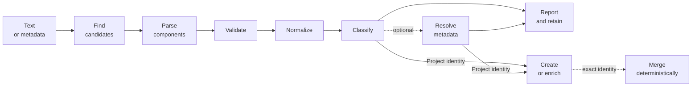

# Persistent identifier lifecycle

ACORN treats a persistent identifier (PID) as evidence that moves through several distinct stages. Finding a PID does not by itself prove that it is valid, and parsing it does not contact its registration authority.



## Supported identifiers

The typed Rust API supports ARK, arXiv, DOI, Handle, ISBN, ISNI, ORCID, RAiD, ROR, SWHID, and US patent parsing. The generic [`Identifier`](https://docs.rs/acorn-lib/latest/acorn/schema/pid/struct.Identifier.html) representation also recognizes HTTP(S) URLs. `PIDINST` and `Unknown` are classification values, but they do not currently have typed parsers.

| Kind | Validation | Normalized | Role |
|---|---|---|---|
| ARK | NAAN and assigned-name structure | ARK, retaining a supplied resolver | Project identity |
| arXiv | Modern or legacy arXiv identifier structure | `arXiv:` identifier with an optional version | Project identity |
| DOI | DOI prefix and suffix structure | Bare DOI | Project identity |
| Handle | Naming-authority prefix and non-empty local name | Bare Handle, preserving case | Supporting evidence |
| ISBN | ISBN-13 length and check digit | Hyphenated ISBN components | Project identity |
| ISNI | Length and ISO 7064 check digit | `https://isni.org/isni/...` | Person or organization evidence |
| ORCID | Length and ISO 7064 check digit | `https://orcid.org/...` | Person evidence |
| RAiD | DOI-like prefix and suffix structure | Bare RAiD DOI | Project identity |
| ROR | Crockford Base32 length and check digits | `https://ror.org/...` | Organization evidence |
| SWHID | SWHID v1 core and qualifier rules | `swh:1:<type>:<object-id>` with canonical qualifiers | Software project identity |
| Patent | Supported US number and kind-code structure | Spaced US patent number | Project identity |
| URL | HTTP(S) syntax | URL without a trailing slash | Supporting evidence |

Validation is local. It checks syntax, components, and a checksum where the implemented identifier specification defines one; it does not resolve the identifier or confirm that a registration record exists.

ACORN's regression suite maintains shared test-vector parity with [Metadata Tools](https://github.com/caltechlibrary/metadatatools) for arXiv, DOI, ISBN, ISNI, ORCID, RAiD, and ROR, and with [idutils](https://github.com/inveniosoftware/idutils/blob/master/tests/test_idutils.py) for ARK, arXiv, DOI, Handle, ISBN, ISNI, ORCID, RAiD, ROR, and SWHID. Here, parity means ACORN runs corresponding upstream cases for these overlapping identifier types; it does not mean the libraries have identical APIs, normalization policies, or support for other identifier families.

Schema validation recognizes ISNI in DataCite name, affiliation, publisher, and funder identifiers; InvenioRDM person or organization identifiers; and RAiD contributors whose `schemaUri` is `https://isni.org`.

## 1. Find candidates

Each typed PID implements `PersistentIdentifierParse::find_all`. The finder scans unstructured text with the PID's recognition pattern and returns parsed values:

```rust
use acorn::schema::pid::{DOI, PersistentIdentifier, PersistentIdentifierParse};

let text = "The dataset is available at https://doi.org/10.11578/dc.20250604.1.";
let found = DOI::find_all(text);

assert_eq!(found.len(), 1);
assert_eq!(found[0].identifier(), "10.11578/dc.20250604.1");
```

The `gather` command runs the supported finders across file, document, URL, standard-input, and literal-text content. It removes duplicate normalized discoveries from the report while retaining the source reference for discovery history. To avoid classifying ordinary paths as Handles, unstructured discovery requires `hdl:` or an `hdl.handle.net` resolver URL; structured fields and direct parsing also accept bare Handles.

## 2. Parse components

`from_string` decomposes one value into a typed structure. Parsing is intentionally separate from validation: malformed input can produce an empty or partial value, so callers that require a usable PID must validate it.

```rust
use acorn::schema::pid::{DOI, PersistentIdentifier, PersistentIdentifierParse};

let doi = DOI::from_string("https://doi.org/10.11578/dc.20250604.1");

assert_eq!(doi.prefix().as_deref(), Some("10.11578"));
assert_eq!(doi.suffix().as_deref(), Some("dc.20250604.1"));
assert_eq!(doi.url(), "https://doi.org/10.11578/dc.20250604.1");
```

The `PersistentIdentifier` trait provides common component access through `identifier`, `prefix`, `suffix`, `check_digit`, `schema_uri`, and `url`. The meaning of a component depends on the PID specification.

## 3. Validate locally

Use the typed `is_valid` method when a boolean is convenient. Schema fields use the helpers in `schema::validate`, which return `Result<(), ValidationError>` for composition with the RAD validators.

```rust
use acorn::schema::pid::{DOI, PersistentIdentifierParse};
use acorn::schema::validate::is_doi;

assert!(DOI::is_valid("10.11578/dc.20250604.1"));
assert!(is_doi("10.11578/dc.20250604.1").is_ok());
assert!(is_doi("not-a-doi").is_err());
```

The local checks do not make a network request. Identifier resolution is a later, optional operation.

## 4. Normalize a representation

`format` parses a value and renders the type's standard display form. It is a formatting operation, not a validity result:

```rust
use acorn::schema::pid::{DOI, ISNI, ORCID, PersistentIdentifierParse};

assert_eq!(DOI::format("https://doi.org/10.11578/dc.20250604.1"), "10.11578/dc.20250604.1");
assert_eq!(ISNI::format("0000 0004 9229 9539"), "https://isni.org/isni/0000000492299539");
assert_eq!(ORCID::format("0000-0002-2057-9115"), "https://orcid.org/0000-0002-2057-9115");
```

For discovery and ingestion, `Identifier::normalized` is the safer combined boundary. It trims surrounding prose punctuation, parses according to the declared kind, formats the result, validates it, and returns `None` when the value is unsupported or invalid. `PID::Unknown` asks ACORN to detect a supported kind.

```rust
use acorn::schema::pid::{Identifier, PID};

let raw = Identifier {
    kind: PID::DOI,
    value: "<https://doi.org/10.11578/dc.20250604.1>".to_string(),
};
let Some(normalized) = raw.normalized() else {
    panic!("expected a valid DOI");
};

assert_eq!(normalized.value, "10.11578/dc.20250604.1");
assert_eq!(normalized.identity_key(), "doi:10.11578/dc.20250604.1");
```

This distinction matters: the normalized display is suitable for RAD fields and reports, while the identity key is suitable for exact matching.

arXiv identifiers convert to their work-level DataCite DOI with `DOI::from(arxiv)`, producing the `10.48550/arXiv.*` namespace and omitting any revision suffix. The reverse conversion uses `ARXIV::try_from(doi)` because publisher DOIs and other DOI namespaces do not encode an arXiv identifier.

Research activity metadata stores both DOI and arXiv publication identifiers in `meta.doi`; validation and export classify each value by its format. Handles are stored in `meta.handle` and cross into CFF as `other` identifiers. SWHIDs are stored separately in `meta.swhid` and exported to CFF with identifier type `swh`.

## 5. Classify the evidence

`PID` records what an identifier identifies. ACORN currently divides discoveries into two groups:

- arXiv, DOI, RAiD, ISBN, patent, ARK, and SWHID values are project-like identifiers. Each can independently create or match a research activity candidate. Versioned arXiv identifiers retain their revision in evidence but share the unversioned work identity.
- Handle, ISNI, ORCID, ROR, PIDINST, unknown identifiers, and arbitrary URLs are entity or supporting evidence. They remain in reports and discovery history but cannot independently create or merge a candidate.

A provider can explicitly relate person or organization evidence to a project, but ACORN does not infer that relationship merely because the values occur in the same input.

## 6. Resolve and enrich optional metadata

`acorn gather --resolve` runs after local discovery. arXiv and DOI evidence is sent to CiteAs, Handle evidence to the public Handle proxy REST API, ORCID evidence to ORCID, RAiD evidence to the RAiD resolver, and SWHID evidence to the Software Heritage resolver. Handle resolution retains the complete public record as provenance and maps only direct HTTP(S) `URL` string values to websites on a project candidate found in the same source; it does not interpret `10320/loc` or make a Handle project identity. SWHID resolution confirms archive presence and returns resolver metadata, not citation data. ISNI is normalized and retained as local evidence but does not currently have a remote resolver integration. A successful response contributes only values with a direct candidate mapping: identifiers, title, description, websites, keywords, sponsors, partners, and related activities. A resolver failure does not turn a locally valid identifier into invalid evidence. In `--raw` output, resolved arXiv and DOI values use the citation family selected by `--citation-format`, then `ACORN_CITATION_FORMAT`, then IEEE; resolved ORCIDs use `Given Family (normalized ORCID)` with public credit name as fallback, and failed resolutions retain the original normalized identifier while reporting a failure on stderr.

Remote DOE CODE project matches enter the same candidate pipeline with a provider identity such as `osti-project:<code_id>` and a DOI when one is available. DOE CODE supplies project descriptions, websites, and role-separated organization names. A `--lab` filter additionally associates the selected laboratory's known ROR. With `--resolve`, valid ORCIDs enrich person reports, project DOIs and person ORCIDs receive structured resolver outcomes and resolved raw rendering, repository URLs can contribute provider-reported programming languages, and provider-confirmed links are checked for liveness. These optional online operations retain the original DOE CODE result when they fail. DOE CODE people and organization searches remain report-only.

GitLab work-item intake uses the same artifact candidate representation but is separate from the `gather` command. An embedded or repository `CITATION.cff` can contribute normalized DOI and other supported identifiers, title, abstract, author names, an explicitly declared singular contact, landing and repository websites, canonical keywords, and repository languages. It does not infer sponsors, partners, or a contact from the author order. Dates, contributor roles, licenses, and award identifiers are not currently mapped or placed in notes; dedicated typed schema fields are planned.

All enrichment follows the same merge rules:

1. Accept values only from a provider field with a defined semantic mapping; do not infer relationships from proximity or list order.
2. Normalize recognized identifiers before identity or field mapping.
3. At database persistence, prefer an existing populated scalar value and fill only missing scalar values.
4. Union and deduplicate list values, using the URL as the identity for websites; normalize keywords and technologies through their controlled vocabularies.
5. When resolver or provider evidence is persisted, retain it as provenance; do not coerce an unsupported value into an unrelated field.

RAiD organization roles are mapped independently from ROR name resolution. `Funder` produces a sponsor relationship; every supported non-funder organization role produces a partner relationship. A mixed-role organization can therefore be both. A single organization without a role is treated as the RAiD default lead organization, but roleless entries in a multi-organization record are not classified. The organization name is emitted only when its ROR is present in ACORN's embedded sponsor or partner vocabulary; an unknown ROR remains organization evidence without a guessed name.

## 7. Build exact identities and persist candidates

Before persistence, project identifiers become namespaced identity keys such as `doi:10.11578/dc.20250604.1` or `arxiv:2106.09685`. A qualified SWHID uses `swhid:<core-swhid>` so origin, path, and fragment context do not change byte identity; the complete qualified value remains in evidence. ACORN lowercases the namespace. arXiv versions are removed from identity keys, while normalized evidence retains them. DOI, arXiv, RAiD, ISBN, patent, and SWHID identity values are compared case-insensitively; ARK and provider-specific values preserve their value case. Keys are sorted and deduplicated.

Bucket ingestion also adds a repository-qualified RAD identity, and providers can add their own project identity. These are identity keys rather than new PID types.

Persistence uses exact identity overlap:

1. No matching row creates a candidate with a portable NanoID.
2. One matching row fills missing fields and unions unique arrays and identities.
3. Repeated identical evidence leaves the row unchanged.
4. Conflicting populated values keep the stored value and add the observation to provenance.
5. Evidence matching multiple rows reports a conflict and does not mutate them.

Use [`acorn gather`](../cli-reference/commands/gather.md) to inspect this lifecycle from the command line. Add global `--no-local-database` when you want discovery and reporting without history or candidate persistence.

## Calculate local SWHIDs

The host CLI can hash working-tree objects or traverse an existing local SHA-1 Git repository. It never clones, fetches, changes refs, or writes working-tree files.

```console
acorn swhid README.md --raw
acorn swhid ./src --kind directory --raw
acorn swhid . --kind revision --reference HEAD --raw
acorn swhid . --kind git-tree --reference HEAD --raw
acorn swhid . --kind release --reference v1.0.0 --raw
acorn swhid . --kind snapshot --raw
```

`--verify <SWHID>` recalculates the selected object and compares core identifiers. Qualifiers are intentionally ignored for that byte/object comparison. Directory calculation traverses the supplied filesystem directory and does not apply Git ignore rules; use `--kind git-tree` for committed tree state.
