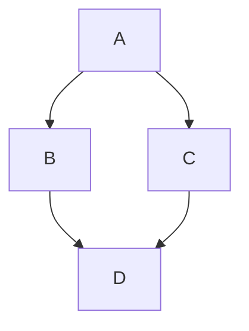

# ACORN
> Accessible Content Optimization for Research Needs

> [!WARNING]  
> This documentation is a work in progress. Some sections may be incomplete or subject to change.

Normal text{{footnote: Or is it?}} in body.




```pikchr
D: [
    # ANCHOR: diagram
        arrow right 200% "Markdown" "Source" color White
        box rad 10px "Markdown" "Formatter" "(mdbook)" fit color White
        arrow right 200% "HTML+SVG" "Output" color White
        arrow <-> down 70% from last box.s color White
        box same "Pikchr" "Preprocessor" "(mdbook-pikchr)" fit
    # ANCHOR_END: diagram
]
box color None fill None rad 10px behind D \
    width D.width+20px height D.height+20px at D.center
```