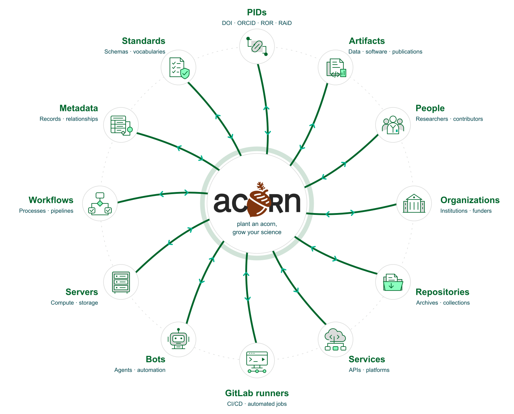

# Why ACORN?

ACORN helps researchers and communicators describe projects as analysis-ready research activity data. Its schemas record what the research does, how it works, and how it relates to people, organizations, publications, funding, and other projects.

The schemas use statically typed and dynamically validated data structures implemented in memory-safe [Rust](https://rust-lang.org). Persistent identifiers[^pid] connect records to established research systems and support open science practices.

## The problem

Scientific work is often represented through publications, people, approvals, timelines, and budgets. Each source records part of a project:

- Publications[^doi] omit projects that have not produced a paper and may not show how projects relate.
- People[^orcid] move between groups, change roles, and leave organizations.
- Approval and timeline systems may not integrate with other persistent identifiers or research systems.
- Budgets rarely contain enough scientific detail to explain the work.

Publication pressure can favor output quantity and discourage researchers from sharing negative results or data that does not support a hypothesis.[^publish] When underlying data and code are unavailable, other researchers may be unable to reproduce otherwise useful results.[^reproducibility]

## Project-level records

ACORN uses the project as the primary research object. A project record links the people, publications, organizations, funding, approvals, data, code, methods, and results that other systems hold separately. ACORN supplements those systems by giving their records shared project context.

This context helps readers understand a project's purpose, evidence, participants, and outputs as parts of the same activity. It also makes relationships between projects easier to follow and gives people and software more evidence for finding gaps or conflicting information.

The resulting structure supports project-level search, reporting, gap analysis, and machine processing. The source record remains available as a portable file instead of depending on one hosted application.

    

## Connecting the research ecosystem

ACORN provides paths between research records, people, organizations, and the infrastructure that processes their work. Portable records and shared identifiers carry project context across tools, services, and automated workflows.

<figure>
    
    <figcaption>The dashed rim represents loose connections among ecosystem elements. Solid green routes show how ACORN can shorten paths between them, with arrows indicating two-way exchange. This is a conceptual view, rather than a catalog of implemented integrations.</figcaption>
</figure>

## Risks and durability

ACORN can store sensitive research data, so deployments must control access and follow the guidance in [`SECURITY.md`](https://code.ornl.gov/research-enablement/acorn/-/blob/main/SECURITY.md). Continued development also depends on adoption, funding, and available maintainers.

The file-based design limits the effect of a discontinued service. Records remain readable files that can be versioned with their assets and validated against an open JSON Schema. Citation, PDF, and PowerPoint outputs can then be regenerated without an ACORN-hosted service.

## Using ACORN

Researchers can submit project metadata through a form and generate fact sheets in PDF, web, or PowerPoint form. The resulting JSON file becomes the maintained source for each project.

When the schema changes, run `acorn format` to apply formatting and controlled-vocabulary migrations, then review the diff. `acorn check` reports incompatible data. Existing JSON remains readable as a flat file, and CI templates can pin an ACORN version so each bucket adopts updates explicitly. See [ACORN schemas](concepts/acorn.md) and [`CHANGELOG.md`](https://code.ornl.gov/research-enablement/acorn/-/blob/main/CHANGELOG.md).

[^pid]: ACORN supports [CURIEs](https://cthoyt.com/2021/09/14/curies.html) and [research activity identifiers (RAiDs)](https://www.raid.org).
[^doi]: For example, a [DOI](https://www.doi.org).
[^orcid]: For example, an [ORCID](https://orcid.org).
[^publish]: D. R. Grimes, C. T. Bauch, and J. P. A. Ioannidis, "Modelling science trustworthiness under publish or perish pressure," Royal Society Open Science, vol. 5, no. 1, p. 171511, Jan. 2018, doi: [10.1098/rsos.171511](https://royalsocietypublishing.org/rsos/article/5/1/171511/93707/Modelling-science-trustworthiness-under-publish-or).
[^reproducibility]: M. Baker, "1,500 scientists lift the lid on reproducibility," Nature, vol. 533, no. 7604, Art. no. 7604, May 2016, doi: [10.1038/533452a](https://www.nature.com/articles/533452a).
