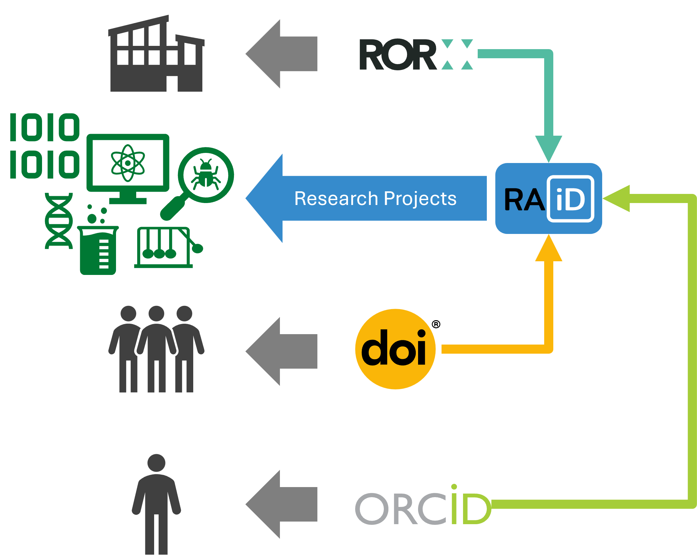

# 🤔 So what? Big deal? Who cares?
> [!IMPORTANT]
> If you do science, you need ACORN.

## 🎯 What is ACORN trying to solve?
*Accessible Content Optimization for Research Needs*, **ACORN**, allows science achievers and communicators to create analysis-ready research activity data. ACORN's associated schemas standardize how research is codified and communicated to capture the entire research architecture, including what research is being done, how it's done, and how it all relates.

Built with memory-safe [Rust](https://rust-lang.org), **ACORN** is a portable solution that uses statically typed and dynamically validated data structures. Schemas include unique identifiers[^pid] to support open science principles and practices.

**ACORN** can help inform researchers, sponsors, and partners, as well as train machines on existing research projects — and identify where gaps in our research exist. 

## 🆕 How is it novel?
**ACORN** focuses on research at the *project* level. While there are other systems that track research projects tangentially — through people, publications, or organizations — there is no system that we know of that employs projects as the primitive source of information. We believe codifying research activity data at the project level is the key to unlocking deep insights about an organization's resources, funding, partnerships, and accomplishments. This network of linked data surpasses what may be already present but siloed in current search tools. 

    

With existing tools, we can see
- *publications*[^doi], but we don't know about projects without journal publications or how projects relate,
- *people*[^orcid], but people move groups, change job roles, and leave organizations, and
- *approvals and timelines*, but these systems aren't often designed to integrate with other PIDs or systems
- *budgets*, but budgets do not include the level of project details necessary to capture appropriate scientific understanding

**ACORN** does not replace or remove these systems. Each supports part of the puzzle. **ACORN** can help ensure they integrate and work together to provide users with valuable information from a central source of truth, no matter their entry point. 

## ⚠️ What are the risks?
There are very few risks to ACORN. They would simply include anything that could preclude continued development of ACORN like lack of funding or human resources to support further development of the project. They also include any security risks inherent in projects at locations that host potentially sensitive data.

Even if it completely fails[^fail], our "escalator turns to stairs" and will never truly fail. It is open-source[^oss], designed to be local and decentralized, and built on existing systems, with information stored in flat files so it will never be lost or unshareable.

> [!TIP]
> Research activity data curated and controlled by ACORN and its associated schemas and processes will ***never*** be without value.

## 🎁 Why should I use ACORN?
You should use ACORN if you want your project to be part of the research conversation. We initially developed ACORN for researchers, to help capture and communicate their projects more effectively. ACORN helps cut down on administrative burden, allowing the PI or a project designee to submit descriptive metadata to a form and receive automatically generated fact sheets in PDF, web, or PowerPoint form. This form, kept as a JSON file in a designated repository[^bucket], becomes the single source of truth for information on each project. We continue to develop the metadata schema and talk with research groups to benefit organization processes.

[^pid]: ACORN provides [CURIE](https://cthoyt.com/2021/09/14/curies.html)s and will soon also work with [research activity identifiers (RAiD)](https://www.raid.org)
[^doi]: e.g., [DOI](https://www.doi.org)s
[^orcid]: e.g., [ORCiD](https://orcid.org)s
[^fail]: Realistically, the only mode of failure is complete lack of adoption...
[^oss]: [https://www.osti.gov/doecode/biblio/156286](https://www.osti.gov/doecode/biblio/156286)
[^bucket]: We call these repositories, "buckets" (see the page on [buckets]() for details)