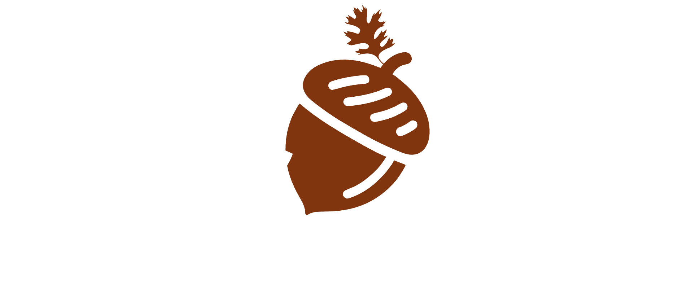
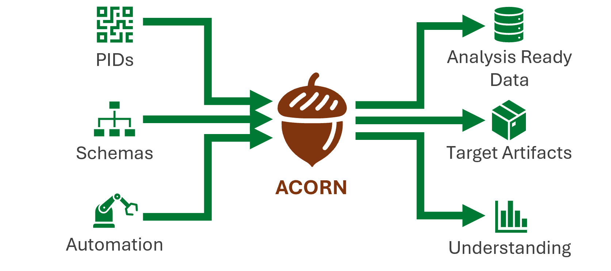

<style>
    .ayu img.banner.light,
    .coal img.banner.light,
    .navy img.banner.light {
        display: none;
    }
    .light img.banner.dark,
    .rust img.banner.dark {
        display: none;
    }
</style>
<div align="center">
    <p>
        
        
    </p>
</div>

<div align="center">
  <div>
    <a href="https://code.ornl.gov/research-enablement/acorn">
        
    </a>
    <a href="https://crates.io/crates/acorn-cli">
        
    </a>
    <a href="https://code.ornl.gov/research-enablement/acorn/-/releases">
        
    </a>
    <a href="https://www.aihonestybadge.com">
        
    </a>
  </div>
</div>
<br/>

🌱 ACORN[^acronym] is a Rust CLI and library for validating research activity data (RAD), adding linked-data context, and exporting records as PDF, PowerPoint, CFF, Markdown, JSON, or YAML. Its source records are portable files that can be version controlled and processed locally.

ACORN is context-aware at the data and workflow level. It keeps project descriptions with their identifiers, provenance, and relationships so people and software can interpret records in context. That awareness can unlock a fuller understanding of the work by making documented connections and gaps visible.

ACORN's validation, formatting, linking, and export workflows are deterministic. Optional AI tooling can discover and download local GGUF models, configure them for OpenCode, VS Code, Goose, and llama-swap, and provide compatible agents with ACORN-specific operating instructions through [`acorn skill`](cli-reference/commands/skill.md).

> [!NOTE]
> **AI assistance disclosure, Level 4.** ACORN uses AI in accordance with [`VisidataMachineAssistanceLevel::Significant`](https://code.ornl.gov/research-enablement/acorn/-/blob/main/crates/acorn-schema/src/schema/research_activity/aspect/mod.rs#L154): humans author most project code, while AI tools may directly create or edit auxiliary files such as documentation and tests. Humans retain review and decision authority. AI-assisted contributions at this level must identify the model and version used and the responsible human operator in the contribution metadata.

[^acronym]: ACORN stands for "Accessible Content Optimization for Research Needs"

<br/>



## Choose your trail

Start with the outcome closest to your work:

| I am a… | Start here | You will learn to… |
|---|---|---|
| Researcher | [Validate your first RAD](learn/quick-quest.md) | check, improve, link, and export a project record |
| Developer | [Build with ACORN](learn/developer.md) | use schemas, prompt and model APIs, agent skills, external Python bindings, and WebAssembly |
| Platform engineer | [Operate ACORN](learn/platform-engineer.md) | operate local models, agent tools, runners, and automation services |

Not sure yet? The [role guide](learn/) shows every trail at a glance.

## Explore ACORN

Choose a route to explore its concepts and commands.

### Research activity data

```pikchr
scale = 0.8
circle radius 0.07in fill 0x00662C thickness 0
arrow right 0.635in thick color 0x00662C
box "Research activity data" wid 1.35in ht 0.42in rad 0.08in fill white thickness 0
arrow right 0.635in thick color 0x00662C
Check: box "Check and format" wid 1.25in ht 0.42in rad 0.08in fill white thickness 0
arrow right 0.635in thick color 0x00662C
Linked: box "Linked data" wid 1.0in ht 0.42in rad 0.08in fill white thickness 0
arrow right 0.635in thick color 0x00662C
End: circle radius 0.1in fill white thickness 0
circle radius 0.05in fill 0x00662C thickness 0 at End
Artifacts: box "Shareable artifacts" wid 1.25in ht 0.42in rad 0.08in fill white thickness 0 at Linked+(0,-0.65in)
arrow from Check.e right 0.317in then down until even with Artifacts then to Artifacts.w thick color 0x00662C
arrow from Artifacts.e right 0.317in then up until even with End then to End.w thick color 0x00662C
```

[Explore: research activity data](concepts/acorn.md) · [check and format](cli-reference/commands/check.md) · [linked data](cli-reference/commands/link.md) · [shareable artifacts](cli-reference/commands/export.md)

### Persistent identifier lifecycle

```pikchr
scale = 0.8
circle radius 0.07in fill 0x00662C thickness 0
arrow right 1.129in thick color 0x00662C
box "Research activity data" wid 1.35in ht 0.42in rad 0.08in fill white thickness 0
arrow right 1.129in thick color 0x00662C
box "Persistent identifiers" wid 1.4in ht 0.42in rad 0.08in fill white thickness 0
arrow right 1.129in thick color 0x00662C
End: circle radius 0.1in fill white thickness 0
circle radius 0.05in fill 0x00662C thickness 0 at End
```

[Explore the persistent identifier lifecycle →](concepts/persistent-identifiers.md)

### Local AI and agent tooling

```pikchr
scale = 0.8
circle radius 0.07in fill 0x00662C thickness 0
arrow right 0.72in thick color 0x00662C
box "Model Catalog" wid 1.05in ht 0.42in rad 0.08in fill white thickness 0
arrow right 0.72in thick color 0x00662C
box "Local GGUF Models" wid 1.25in ht 0.42in rad 0.08in fill white thickness 0
arrow right 0.72in thick color 0x00662C
box "Agent And Inference Apps" wid 1.55in ht 0.42in rad 0.08in fill white thickness 0
arrow right 0.72in thick color 0x00662C
End: circle radius 0.1in fill white thickness 0
circle radius 0.05in fill 0x00662C thickness 0 at End
```

[Explore: local models](cli-reference/model-workflows.md) · [application sync](cli-reference/commands/sync.md) · [agent skill](cli-reference/commands/skill.md) · […but is it agentic?](concepts/agentic.md)
