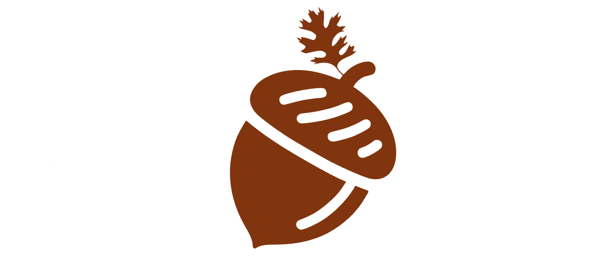

    

        
        
    

> [!WARNING]  
> This documentation is a work in progress. Some sections may be incomplete or subject to change.

> [!TIP]  
> ACORN stands for "Accessible Content Optimization for Research Needs

## Purpose
