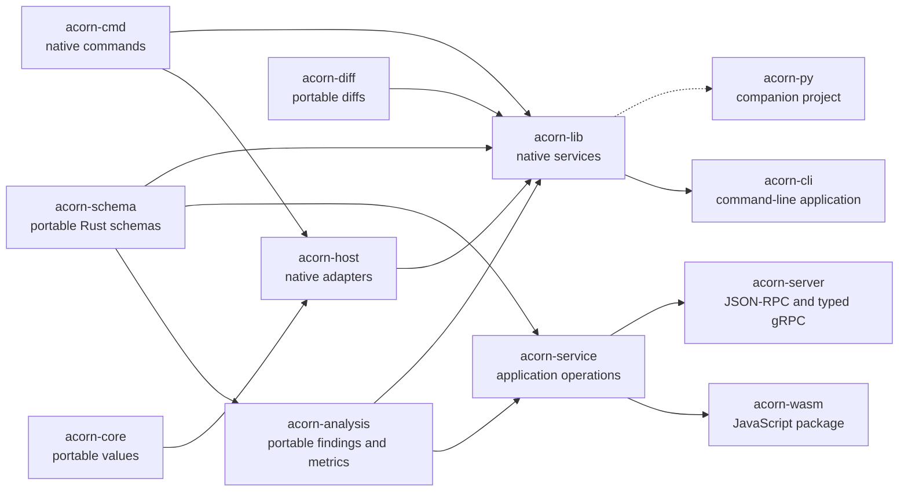

# Packages

ACORN publishes separate packages for its portable schemas, host services, CLI, and WebAssembly bindings. The Python bindings are maintained in a companion project.

Use [`acorn-diff`](acorn-diff.md) for in-memory diffs, [`acorn-schema`](acorn-schema.md) for data models and validation, [`acorn-analysis`](acorn-analysis.md) for portable findings and readability, and [`acorn-service`](acorn-service.md) for supplied-content application operations. Small native tools can use [`acorn-cmd`](acorn-cmd.md) and [`acorn-host`](acorn-host.md). Use [`acorn-lib`](acorn-lib.md) for native discovery, persistence, providers, documents, and artifact workflows.

Use an [ACORN MCP Bundle](mcpb.md) to install the target-specific CLI and its static, read-only MCP tool declaration as one validated archive.
