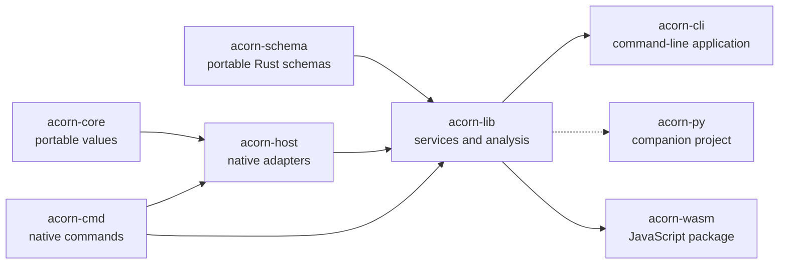

# Packages

ACORN publishes separate packages for its portable schemas, host services, CLI, and WebAssembly bindings. The Python bindings are maintained in a companion project.

Use [`acorn-schema`](acorn-schema.md) when an application only needs the data model, validation, or persistent identifiers. Small native tools can use [`acorn-cmd`](acorn-cmd.md) and [`acorn-host`](acorn-host.md) without enabling `acorn-lib`'s analysis, database, document, or export graph. Use [`acorn-lib`](acorn-lib.md) for ACORN's higher-level analysis, persistence, model APIs, and artifact workflows.

Use an [ACORN MCP Bundle](mcpb.md) to install the target-specific CLI and its static, read-only MCP tool declaration as one validated archive.
