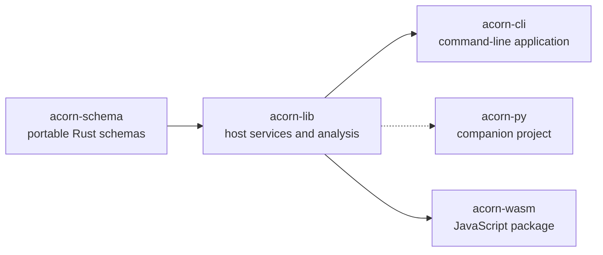

# Packages

ACORN publishes separate packages for its portable schemas, host services, CLI, and WebAssembly bindings. The Python bindings are maintained in a companion project.

Use [`acorn-schema`](acorn-schema.md) when an application only needs the data model, validation, or persistent identifiers. Use [`acorn-lib`](acorn-lib.md) for filesystem and network I/O, analysis, persistence, model APIs, or artifact generation.
